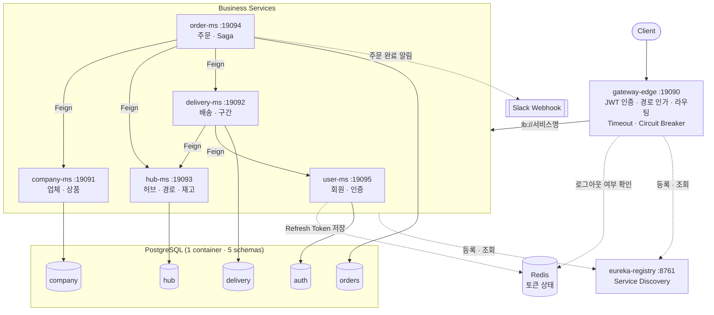
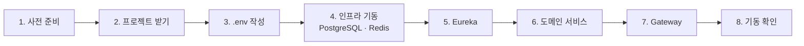
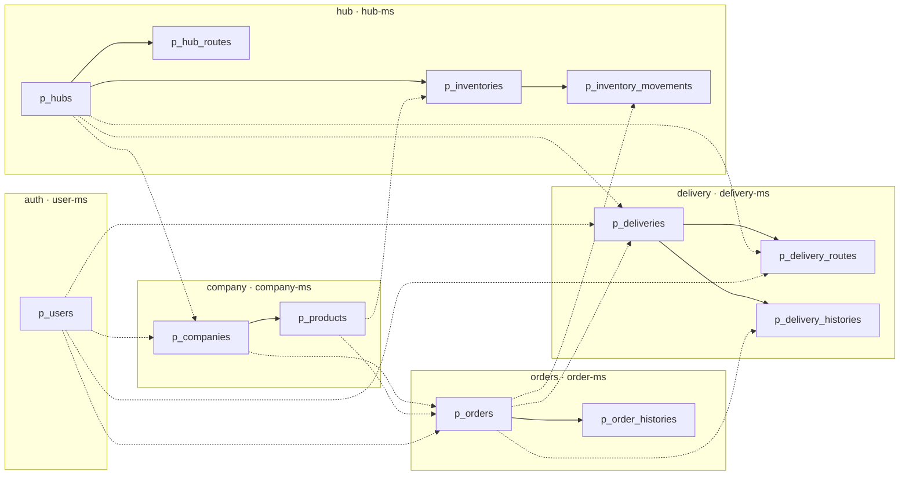
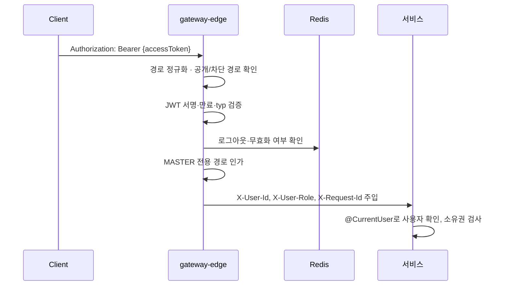
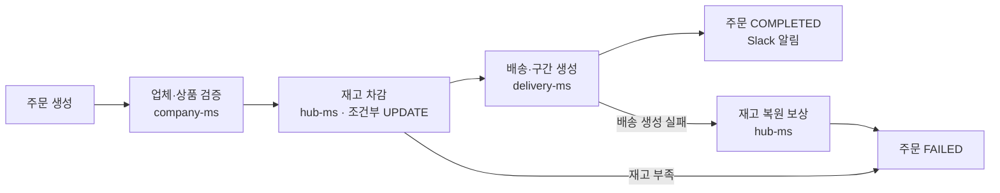

# Sparta Logistics

> 전국 17개 허브 센터를 거점으로 업체 간 주문을 받아, 허브를 거쳐 배송하는 **B2B 물류 관리·배송 시스템**입니다.
> Spring Cloud 기반 MSA로 서비스를 나누고, Gateway 인증·인가, Eureka 서비스 발견, OpenFeign 서비스 간 통신, 서비스별 스키마 분리를 적용했습니다.

## 목차

1. [프로젝트 목적](#1-프로젝트-목적)
2. [팀원 역할분담](#2-팀원-역할분담)
3. [기술 스택](#3-기술-스택)
4. [서비스 구성](#4-서비스-구성)
5. [실행 방법](#5-실행-방법)
6. [ERD](#6-erd)
7. [API](#7-api)
8. [핵심 설계](#8-핵심-설계)
9. [구현 현황](#9-구현-현황)
10. [문서 안내](#10-문서-안내)

---

## 1. 프로젝트 목적

| 항목 | 내용 |
|---|---|
| 주제 | 업체(공급·수령) 간 주문 → 허브 재고 차감 → 허브 간 이동(P2P) → 업체 배송까지 관리하는 물류 플랫폼 |
| 목표 | ① Spring Cloud 기반 MSA로 서비스 경계와 데이터 소유권을 나눈다 ② OpenFeign으로 서비스 간 API를 연동하고, 실패 시 보상(롤백)으로 데이터 정합성을 지킨다 ③ Gateway 한 곳에서 인증·인가를 처리한다 |
| 기간 | 2026-10-13 ~ 2026-10-21 |

**주요 도메인**

- **사용자**: 역할은 `MASTER`(관리자)·`USER`(일반) 2단계. 배송담당자는 역할이 아니라 `isDeliveryManager` 속성으로 부여합니다.
- **허브**: 전국 17개 허브와 허브 간 P2P 이동 경로, 허브별 상품 재고와 변동 이력.
- **업체·상품**: 업체는 관리 허브에 속하고, 상품은 업체에 속합니다.
- **주문**: 공급 업체 → 수령 업체 주문. 재고 차감·배송 생성을 조정(Saga)하고 실패하면 보상합니다.
- **배송**: 주문 1건당 배송 1건, 허브 간 구간(`HUB_TO_HUB`)과 최종 배송 구간(`HUB_TO_COMPANY`)으로 나눠 기록합니다.

## 2. 팀원 역할분담

| 이름 | 담당 | 주요 작업 |
|---|---|---|
| 대진 | User/Auth Service, Gateway, 공통(인증·장애 대응·알림) | 회원·인증 API, JWT 발급·재발급·로그아웃(Redis 토큰 상태), Gateway 라우팅·JWT 인증·경로 인가·타임아웃·Circuit Breaker, common 인증 헤더(`@CurrentUser`)·Feign 장애 대응·Slack 알림 |
| 이찬 | Hub/Inventory Service | 허브 17개·P2P 경로 시드, 허브·경로 조회, 재고 등록·차감·복원(조건부 UPDATE, 멱등성) |
| 권우 | Company/Product Service, 공통 인프라 | 업체·상품 API, 프로젝트 골격, Eureka, Docker Compose, common(`BaseEntity`·공통 응답·예외) |
| 다울 | Order Service | 주문 생성 Saga, 실패 보상·주문 취소, 주문 완료 Slack 알림 연동 |
| 영은 | Delivery Service | 배송·구간 자동 생성, 배송 상태 전이, 배송담당자 확인 |

## 3. 기술 스택

| 분류 | 기술 |
|---|---|
| Language | Java 21 |
| Framework | Spring Boot 3.5.16, Spring Data JPA, Validation, spring-security-crypto(BCrypt) |
| MSA | Spring Cloud 2025.0.3 — Gateway(WebFlux), Netflix Eureka, OpenFeign, LoadBalancer, Resilience4j |
| Auth | JWT (jjwt 0.12.6), Redis(Refresh Token·로그아웃·토큰 무효화 상태) |
| Database | PostgreSQL 18 (컨테이너 1개, 서비스별 스키마 5개), Redis 7.4 |
| Build / Infra | Gradle 멀티 모듈, Docker, Docker Compose |
| Test | JUnit 5, Mockito, H2, WireMock, Testcontainers, Postman |
| Notification | Slack Incoming Webhook |
| Collaboration | Git, GitHub |

## 4. 서비스 구성

### 4.1 아키텍처



### 4.2 모듈

| 모듈 | 포트 | 역할 | 스키마 |
|---|---|---|---|
| `eureka-registry` | 8761 | 서비스 등록·발견 | - |
| `gateway-edge` | 19090 | 외부 요청 단일 진입점. JWT 검증, MASTER 경로 인가, `X-User-*` 헤더 주입, 라우트별 타임아웃·Circuit Breaker | - |
| `user-ms` | 19095 | 회원가입·로그인·토큰, 내 정보, MASTER 사용자 관리, 사용자 검증 내부 API | `auth` |
| `hub-ms` | 19093 | 허브 17개, 허브 간 경로, 재고·재고 변동 이력 | `hub` |
| `company-ms` | 19091 | 업체, 상품 | `company` |
| `order-ms` | 19094 | 주문 생성·취소, Saga 조정, Slack 알림 호출 | `orders` |
| `delivery-ms` | 19092 | 배송, 배송 구간(경로) | `delivery` |
| `common` | - | `BaseEntity`·감사(Audit), 공통 오류 응답, `@CurrentUser`·Feign 사용자 헤더 전달, Feign 장애 대응(`RemoteCallTemplate`), `SlackNotifier` | - |

각 서비스는 **4계층(presentation → application → domain ← infrastructure)** 구조이며, 다른 서비스의 데이터는 DB 외래키 없이 **UUID 참조 + Feign API**로만 확인합니다.

### 4.3 Gateway 라우팅

| 경로 | 서비스 |
|---|---|
| `/api/v1/auth/**`, `/api/v1/users/**` | `user-ms` |
| `/api/v1/companies/**`, `/api/v1/products/**` | `company-ms` |
| `/api/v1/hubs/**`, `/api/v1/hub-routes/**`, `/api/v1/inventories/**` | `hub-ms` |
| `/api/v1/orders/**` | `order-ms` |
| `/api/v1/deliveries/**`, `/api/v1/delivery-routes/**` | `delivery-ms` |

- 공개 경로(토큰 불필요): `POST /api/v1/auth/signup`, `login`, `reissue`, `GET /api/v1/auth/check-username`. 그 밖의 `/api/v1/**`는 로그인이 필요합니다.
- `/internal/**`는 Gateway에서 404로 차단합니다. 내부 API는 서비스끼리 Feign으로만 호출합니다.
- MASTER 전용 경로와 헤더 규약은 [Gateway·인증 가이드](<docs/guide/01 Gateway·인증 가이드.md>)를 참고합니다.

## 5. 실행 방법

> 현재 Docker Compose에는 **PostgreSQL·Redis만** 정의되어 있습니다. 애플리케이션(Eureka·Gateway·서비스)은 Gradle `bootRun`이나 IntelliJ로 로컬에서 띄웁니다. 애플리케이션 컨테이너화는 진행 중입니다.



### 5.1 사전 준비

| 항목 | 버전 | 확인 |
|---|---|---|
| Docker Desktop | Compose v2 포함 | `docker info`가 오류 없이 출력 |
| JDK | 21 | `java -version` (없으면 Gradle toolchain이 내려받음) |
| Git | - | `git --version` |
| openssl | - | `.env` 비밀값 생성용 |
| Python 3 (선택) | - | 개발용 토큰 스크립트 `scripts/dev-token.py`를 쓸 때만 |

### 5.2 프로젝트 받기

```bash
git clone https://github.com/01Commit10/sparta-logistics.git
cd sparta-logistics
git switch dev

# 실행 권한이 빠진 채 저장된 파일 두 개에 권한 부여 (안 하면 DB 초기화·gradlew 실행 실패)
chmod +x gradlew docker/postgres/init/01-init-service-accounts.sh
```

### 5.3 환경 변수 (`.env`)

```bash
cp .env.example .env
```

루트 `.env`를 아래처럼 채웁니다. **Git에 올리지 않습니다.**

```properties
# ── PostgreSQL ──
DB_NAME=sparta_logistics
DB_PORT=5432
DDL=update
SHOW_SQL=false
DB_USER=sparta_admin              # Postgres 관리자 (컨테이너 초기화용, 서비스는 사용 안 함)
DB_PASSWORD=<임의 값>

# 서비스별 DB 계정 (각 서비스는 자기 스키마만 접근 가능)
AUTH_DB_USER=auth_svc
AUTH_DB_PASSWORD=<임의 값>
HUB_DB_USER=hub_svc
HUB_DB_PASSWORD=<임의 값>
COMPANY_DB_USER=company_svc
COMPANY_DB_PASSWORD=<임의 값>
ORDER_DB_USER=order_svc
ORDER_DB_PASSWORD=<임의 값>
DELIVERY_DB_USER=delivery_svc
DELIVERY_DB_PASSWORD=<임의 값>

# ── Redis ──
REDIS_HOST=localhost
REDIS_PORT=6379
REDIS_PASSWORD=<openssl rand -hex 24>

# ── JWT (Gateway·user-ms가 같은 값을 읽음) ──
JWT_SECRET_KEY=<openssl rand -base64 32>

# ── 초기 MASTER (user-ms 첫 기동 시 1회 생성) — .env.example에 없으니 직접 추가 ──
MASTER_USERNAME=master01          # 4~10자 소문자·숫자
MASTER_PASSWORD=<비밀번호>         # 8~15자, 대·소문자·숫자·특수문자 모두 포함
MASTER_NAME=관리자
MASTER_SLACK_ID=<Slack 멤버 ID>

# ── Slack 알림 (선택, 비워 두면 알림을 보내지 않음) ──
SLACK_WEBHOOK_URL=
```

- 모든 애플리케이션이 실행 위치의 `.env`와 상위 폴더의 `../.env`를 **파일로** 읽습니다(`spring.config.import`). 루트에서 `./gradlew`로 실행하든, IntelliJ에서 모듈 폴더 기준으로 실행하든 루트 `.env` 하나면 됩니다.
- **`.env`를 환경 변수로 넣지 마세요**(IntelliJ EnvFile, `set -a; . ./.env`, Compose `env_file`). 환경 변수 `DB_PASSWORD`가 서비스의 `db.password`를 덮어써서 서비스가 관리자 비밀번호로 접속하다 실패합니다.
- `DB_*` 값을 바꿨다면 `./pgdata`를 지우고 DB를 다시 만들어야 합니다. 초기화 스크립트는 처음 한 번만 실행됩니다.

### 5.4 인프라 기동 (PostgreSQL · Redis)

```bash
docker compose up -d
docker compose ps        # postgres, redis 둘 다 (healthy) 확인
```

- 처음 기동할 때 `docker/postgres/init/01-init-service-accounts.sh`가 스키마 5개(`auth`, `hub`, `company`, `orders`, `delivery`)와 서비스 계정을 만듭니다. 각 계정은 자기 스키마만 쓸 수 있습니다.
- 데이터는 `./pgdata`, `./redisdata`에 남아 재기동해도 유지됩니다.
- 테이블은 각 서비스가 기동할 때 JPA(`DDL=update`)로 만듭니다.

### 5.5 애플리케이션 기동

**순서: Eureka → 도메인 서비스 → Gateway.** 터미널을 나눠 각각 실행합니다.

```bash
# 터미널 1
./gradlew :eureka-registry:bootRun

# 터미널 2~ (필요한 서비스만 띄워도 됨, 서로 순서 무관)
./gradlew :user-ms:bootRun
./gradlew :hub-ms:bootRun
./gradlew :company-ms:bootRun
./gradlew :order-ms:bootRun
./gradlew :delivery-ms:bootRun

# 마지막 터미널
./gradlew :gateway-edge:bootRun
```

| 순서 | 모듈 | 포트 | 실행 클래스 (IntelliJ) | 기동 시 하는 일 |
|---|---|---|---|---|
| 1 | `eureka-registry` | 8761 | `EurekaRegistryApplication` | 서비스 등록소 |
| 2 | `user-ms` | 19095 | `UserMsApplication` | `.env`의 `MASTER_*`로 초기 MASTER 1명 생성 (이미 있으면 건너뜀) |
| 2 | `hub-ms` | 19093 | `HubMsApplication` | 허브 17개 시드 입력 (이미 있으면 건너뜀) |
| 2 | `company-ms` | 19091 | `CompanyMsApplication` | - |
| 2 | `order-ms` | 19094 | `OrderMsApplication` | - |
| 2 | `delivery-ms` | 19092 | `DeliveryMsApplication` | - |
| 3 | `gateway-edge` | **19090** | `GatewayEdgeApplication` | 외부 요청 진입점 |

- `./gradlew: permission denied`가 나오면 5.2의 `chmod`를 했는지 확인하거나 `sh ./gradlew ...`로 실행합니다.
- **Redis는 필수입니다.** Gateway는 보호 경로마다 Redis로 로그아웃 여부를 확인하므로 Redis가 없으면 503 `AUTH_UNAVAILABLE`을 반환합니다.
- Gateway를 거쳐 서비스를 호출하려면 그 서비스가 Eureka에 등록돼 있어야 합니다. 띄우지 않은 서비스로 가는 요청은 503 `SERVICE_UNAVAILABLE`입니다.

### 5.6 기동 확인

| 확인 | 주소 | 기대 결과 |
|---|---|---|
| Eureka 대시보드 | http://localhost:8761 | 띄운 서비스가 모두 `UP` |
| Gateway 헬스 | http://localhost:19090/actuator/health | `UP` |
| user-ms 헬스 | http://localhost:19095/actuator/health | `UP` (DB·Redis 포함) |
| 초기 MASTER | user-ms 로그 | `[InitialMaster] 초기 MASTER를 생성했습니다. username=…` |

```bash
# 1) 로그인 → Access Token 꺼내기 (공개 경로)
TOKEN=$(curl -s localhost:19090/api/v1/auth/login -H 'Content-Type: application/json' \
  -d '{"username":"<MASTER_USERNAME>","password":"<MASTER_PASSWORD>"}' \
  | python3 -c 'import sys,json;print(json.load(sys.stdin)["accessToken"])')

# 2) 토큰으로 Gateway 경유 호출
curl -s localhost:19090/api/v1/users/me -H "Authorization: Bearer $TOKEN"   # 내 정보
curl -s localhost:19090/api/v1/hubs     -H "Authorization: Bearer $TOKEN"   # 허브 목록 (hub-ms)
```

- 서비스를 띄운 직후 몇 초 동안은 Gateway가 아직 Eureka에서 서비스를 못 받아 503이 날 수 있습니다. 5~30초 기다린 뒤 다시 시도합니다.
- Postman으로 확인하는 방법은 [Postman Gateway 테스트 가이드](<docs/Common/Postman Gateway 테스트 가이드.md>)를 참고합니다.

### 5.7 종료 · 초기화

```bash
# bootRun 터미널은 Ctrl+C
docker compose stop                 # 컨테이너만 멈춤 (데이터 유지)
docker compose down                 # 컨테이너 삭제 (pgdata·redisdata는 유지)
docker compose down && rm -rf pgdata redisdata   # DB·Redis를 처음 상태로 (.env의 DB 값을 바꿨을 때)
```

### 5.8 자주 만나는 문제

| 증상 | 원인 | 해결 |
|---|---|---|
| Postgres 컨테이너가 바로 종료, 로그에 `Permission denied` | init 스크립트 실행 권한 없음 | 5.2의 `chmod` 후 `rm -rf pgdata && docker compose up -d` |
| 서비스 기동 실패 `password authentication failed` | `.env`의 DB 값과 `pgdata`에 만들어진 계정이 다름, 또는 `.env`를 환경 변수로 주입함 | `docker compose down && rm -rf pgdata` 후 다시 기동 / `.env`는 파일로만 사용 |
| Gateway 보호 경로가 전부 503 `AUTH_UNAVAILABLE` | Redis 미기동 또는 `REDIS_PASSWORD` 불일치 | `docker compose up -d redis`, `.env` 확인 후 Gateway 재기동 |
| Gateway 경유만 503 `SERVICE_UNAVAILABLE`, 서비스 직접 호출은 200 | Gateway가 아직 Eureka에서 서비스를 못 받아옴 | 5~30초 대기, Eureka 대시보드에서 등록 확인 |
| 방금 받은 토큰인데 401 `TOKEN_INVALID` | Gateway와 user-ms가 다른 `JWT_SECRET_KEY`를 읽음 | 같은 루트 `.env` 사용, 값을 바꿨다면 둘 다 재기동 |
| 30분 뒤 401 `TOKEN_EXPIRED` | Access Token 만료(30분) | `POST /api/v1/auth/reissue` 또는 다시 로그인 |
| 로그인이 안 되고 로그에 `MASTER_* 환경 변수가 비어 있어` | `.env`에 `MASTER_*` 없음 | 5.3의 `MASTER_*` 추가 후 user-ms 재기동 |

더 자세한 내용은 [로컬 실행·라우팅 확인 가이드](<docs/Common/로컬 실행·라우팅 확인 가이드.md>)에 있습니다.

### 5.9 테스트

```bash
./gradlew :gateway-edge:test
./gradlew :user-ms:test                       # H2 사용, Docker 불필요
./gradlew :common:test
./gradlew :user-ms:test -PincludeContainer    # Docker가 필요한 테스트 포함 (Testcontainers)
```

테스트는 **모듈별로** 실행하는 것을 권장합니다.

## 6. ERD

- DBMS: PostgreSQL 단일 컨테이너, 서비스별 스키마 5개(`auth`, `hub`, `company`, `orders`, `delivery`), 서비스마다 자기 스키마만 접근 가능한 DB 계정 사용
- 모든 테이블 PK는 `UUID`, Audit 컬럼 6개(`created/updated/deleted_at·by`), Soft Delete
- 실선은 같은 스키마 안의 FK, 점선은 다른 서비스의 UUID 논리 참조(DB FK 없음, API로 검증)



컬럼까지 포함한 전체 ERD는 [ERD](<docs/design/05 ERD.md>), 컬럼별 상세는 [테이블 명세서](<docs/design/06 테이블 명세서.md>)를 참고합니다.


## 7. API

전체 명세는 [API 명세서](<docs/design/04 API 명세서.md>)에 있습니다. 외부 API는 `/api/v1/**`, 서비스 간 내부 API는 `/internal/v1/**`입니다.

| 도메인 | 주요 API |
|---|---|
| Auth | 회원가입, ID 중복 확인, 로그인, 토큰 재발급, 로그아웃 |
| User | 내 정보 조회·수정, 비밀번호 변경, 탈퇴 / (MASTER) 사용자 생성·목록·상세·수정·역할 변경·배송담당자 지정·비활성화·재활성화·비밀번호 초기화 |
| Hub · Hub Route · Inventory | 허브·경로 조회·관리, 재고 등록·조회, 재고 변동 이력 |
| Company · Product | 업체·상품 등록·조회·수정·삭제 |
| Order | 주문 생성·조회·취소·삭제 |
| Delivery · Delivery Route | 배송·구간 조회, 배송 상태 변경 |
| Internal (Feign) | 사용자 검증, 허브·업체·상품 검증, 재고 차감·복원, 허브 경로 조회, 배송 생성·취소 |

**오류 응답 형식** (Gateway·서비스 공통)

```json
{ "code": "INVALID_INPUT", "message": "...", "errors": [ { "field": "username", "reason": "..." } ] }
```

HTTP 상태 코드는 응답 상태로 전달하고, `errors`는 입력값 검증 실패 때만 채웁니다.

## 8. 핵심 설계

### 8.1 인증·인가



- **401은 Gateway, 403(소유권)은 서비스**가 판단합니다. 역할 단위(MASTER 전용) 인가는 Gateway에서 처리합니다.
- 클라이언트가 보낸 `X-User-*` 헤더는 Gateway가 지우고 다시 넣어, 헤더 위조를 막습니다.
- Access Token 30분, Refresh Token은 Redis에 저장하고 재발급 시 교체(Rotation)합니다. 로그아웃·비밀번호 변경·탈퇴 시 이전 토큰은 `TOKEN_REVOKED`가 됩니다.
- MASTER가 비밀번호를 초기화한 사용자는 비밀번호를 바꿀 때까지 일부 API만 호출할 수 있습니다.

### 8.2 주문 흐름과 실패 보상(롤백)



- 주문 서비스가 오케스트레이터로 각 서비스를 Feign으로 호출합니다.
- **롤백 시나리오**: 배송 생성이 실패하면 차감했던 재고를 복원하고 주문을 `FAILED`로 남깁니다.
- 재고 변경은 `Idempotency-Key`로 같은 요청이 다시 와도 한 번만 반영합니다.

### 8.3 장애 대응

- **Gateway**: 라우트별 타임아웃과 서비스별 Circuit Breaker. 하위 서비스 장애 시 503 `SERVICE_UNAVAILABLE`로 빠르게 응답합니다.
- **Feign (common)**: 공통 타임아웃·Circuit Breaker, 실패를 예외 3종(호출 실패·상대 거절·결과 모름)으로 나눠 Saga에서 처리 방식을 고를 수 있게 했습니다.
- **Slack 알림**: 알림 실패가 주문 처리에 영향을 주지 않으며, Webhook URL이 없으면 알림을 보내지 않습니다(NoOp).

## 9. 구현 현황

> 기준: 2026-10-16

| 영역 | 상태 | 내용 |
|---|---|---|
| Gateway | ✅ | 라우팅, JWT 인증, MASTER 경로 인가, 토큰 상태 확인, 요청 ID·접근 로그, 타임아웃·Circuit Breaker, 경로 정규화 |
| common | ✅ | `BaseEntity`·감사, 공통 예외, `@CurrentUser`, Feign 헤더 전달·장애 대응, `SlackNotifier` |
| user-ms | 🚧 | 가입·로그인·재발급·로그아웃·내 정보·비밀번호 변경·탈퇴·내부 조회 완료 / MASTER 관리자 API 진행 중 |
| hub-ms | 🚧 | 허브 엔티티·조회, 17개 허브 시드 |
| company-ms, order-ms, delivery-ms | 🚧 | 구현 중 |
| Docker Compose | 🚧 | PostgreSQL·Redis 구성 완료 / 애플리케이션 컨테이너화 예정 |

## 10. 문서 안내

| 분류 | 문서 |
|---|---|
| 설계 | [프로젝트 소개](<docs/design/00 프로젝트 소개.md>) · [인프라 설계](<docs/design/02 인프라 설계.md>) · [도메인 모델](<docs/design/03 도메인 모델.md>) · [API 명세서](<docs/design/04 API 명세서.md>) · [ERD](<docs/design/05 ERD.md>) · [테이블 명세서](<docs/design/06 테이블 명세서.md>) · [서비스 정책](<docs/design/07 서비스 정책.md>) · [요구사항 정리](<docs/design/요구사항정리.md>) |
| 공통 설계 | [게이트웨이 인증·인가](<docs/Common/SYS-01 게이트웨이 인증 인가 설계.md>) · [장애 대응](<docs/Common/SYS-13 장애 대응 설계.md>) |
| 개발 가이드 | [가이드 목차](<docs/guide/00 개발 가이드 목차.md>) · [Gateway·인증](<docs/guide/01 Gateway·인증 가이드.md>) · [장애 대응(Feign)](<docs/guide/02 장애 대응(Feign) 가이드.md>) · [User·Auth API](<docs/guide/03 User·Auth API 가이드.md>) · [Slack 알림](<docs/guide/04 Slack 알림 가이드.md>) |
| 실행·테스트 | [로컬 실행·라우팅 확인](<docs/Common/로컬 실행·라우팅 확인 가이드.md>) · [Postman Gateway 테스트](<docs/Common/Postman Gateway 테스트 가이드.md>) |
| 협업 | [PR 템플릿](<docs/conventions/PULL_REQUEST_TEMPLATE.md>) |
