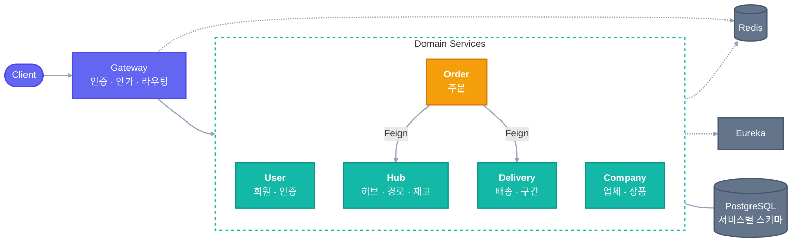
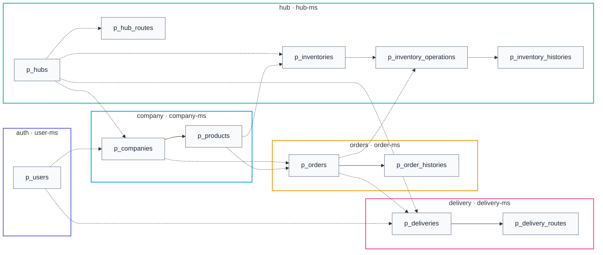
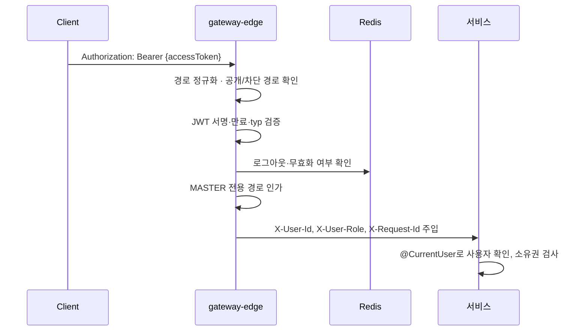
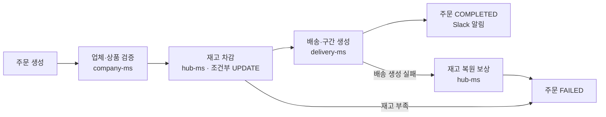

# Sparta Logistics

> 전국 17개 허브 센터를 거점으로 업체 간 주문을 받아, 허브를 거쳐 배송하는 **B2B 물류 관리·배송 시스템**입니다.
> MSA로 서비스를 나누고, Gateway 인증·인가, Eureka 서비스 발견, OpenFeign 서비스 간 통신, 서비스별 스키마 분리를 적용했습니다.

## 목차

1. [프로젝트 목적](#1-프로젝트-목적)
2. [팀원 역할분담](#2-팀원-역할분담)
3. [기술 스택](#3-기술-스택)
4. [서비스 구성](#4-서비스-구성)
5. [실행 방법](#5-실행-방법)
6. [ERD](#6-erd)
7. [API](#7-api)
8. [핵심 설계](#8-핵심-설계)
9. [구현 현황](#9-구현-현황)
10. [문서 안내](#10-문서-안내)

---

## 1. 프로젝트 목적

| 항&#8288;목 | 내용 |
|---|---|
| 주&#8288;제 | 업체 간 B2B 주문부터 허브 재고 차감, 허브 간 이동, 최종 업체 배송까지 한 흐름으로 관리하는 물류 플랫폼 |
| 목&#8288;표 | ① Spring Cloud 기반 MSA로 서비스 경계와 데이터 소유권을 나눈다<br>② OpenFeign으로 서비스 간 API를 연동하고, 실패 시 보상(롤백)으로 데이터 정합성을 지킨다<br>③ 각 서비스를 4계층(표현 → 응용 → 도메인 ← 인프라)으로 나누고, 도메인이 외부 기술에 의존하지 않게 한다<br>④ 서비스별 단위·통합 테스트와 E2E 스크립트로 기능과 실패 시나리오를 검증한다<br>⑤ 하위 서비스가 느리거나 실패해도 타임아웃과 보상으로 장애가 번지지 않게 한다<br>⭐ ⑥ **대규모 트래픽에 대비한 구조를 설계하고, 부하 테스트로 병목을 측정·개선한다** |
| 기&#8288;간 | 2026-10-13 ~ 2026-10-21 |

**주요 도메인**

| 도&#8288;메&#8288;인 | 서비스 | 역할 |
|---|---|---|
| 사&#8288;용&#8288;자 | `user-ms` | 회원가입·로그인, 토큰 발급, 사용자 관리 |
| 허&#8288;브 | `hub-ms` | 허브·허브 간 경로 관리, 재고 차감·복원 |
| 업&#8288;체·&#8288;상&#8288;품 | `company-ms` | 업체·상품 관리 |
| 주&#8288;문 | `order-ms` | 주문 생성·취소, 실패 시 재고 복원 |
| 배&#8288;송 | `delivery-ms` | 배송·구간 생성, 배송 상태·담당자 관리 |
| 공&#8288;통 | `gateway-edge`<br>`eureka-registry`<br>`common` | 외부 요청 단일 진입점, JWT 인증·관리자 경로 인가, 라우팅<br>서비스 등록·발견<br>공통 엔티티·감사, 공통 예외·응답, 로그인 사용자 전달, 서비스 간 호출 오류 처리, Slack 알림 |

## 2. 팀원 역할분담

<table>
  <tr>
    <td align="center" width="160"><a href="https://github.com/dd-jiny"><br><b>대진</b></a><br>사용자 · 공통</td>
    <td align="center" width="160"><a href="https://github.com/ijustsea"><br><b>이찬</b></a><br>허브</td>
    <td align="center" width="160"><a href="https://github.com/KWON-WOO"><br><b>권우</b></a><br>업체 · 상품</td>
    <td align="center" width="160"><a href="https://github.com/shindawull"><br><b>다울</b></a><br>주문</td>
    <td align="center" width="160"><a href="https://github.com/alreadysolved"><br><b>영은</b></a><br>배송</td>
  </tr>
</table>

| 이름 | 담당 | 주요 작업 |
|---|---|---|
| 대진 | 사용자, 공통(게이트웨이), 성능 개선 설계 | • 회원·인증 API, 관리자 사용자 관리 API<br>• Gateway 인증·인가·라우팅<br>• 공통 인증 헤더·Slack 알림<br>• 부하 테스트로 병목 분석, 서비스별 성능 개선 방향 설계 |
| 이찬 | 허브 | • 허브·허브 간 경로 API<br>• 재고 등록·차감·복원 API<br>• 재고 조회·차감 Redis 적용<br>• 허브 조회 Caffeine 캐시 적용<br>• 재고 차감 동시성 제어 |
| 권우 | 업체·상품, 공통(유레카) | • 프로젝트 초기 구성·인프라 설정<br>• 공통 엔티티·예외 처리<br>• 업체·상품 API<br>• 상품 조회 레이어드 캐시(설정으로 선택) |
| 다울 | 주문 | • 주문 생성·조회·취소·삭제 API<br>• 주문 실패 시 재고 복원(보상)<br>• 주문 트랜잭션 분리로 커넥션 풀 고갈 완화 |
| 영은 | 배송 | • 배송·배송 구간 생성<br>• 배송 상태·담당자 관리 API<br>• 배송 생성 외부 호출을 트랜잭션 밖으로 분리해 주문 생성 병목 해소 |

## 3. 기술 스택

| 분류 | 기술 |
|---|---|
| Language | Java 21 |
| Framework | Spring Boot 3.5.16, Spring Data JPA, Validation, Spring Security Crypto(BCrypt) |
| MSA | Spring Cloud 2025.0.3 (Gateway, Eureka, OpenFeign, LoadBalancer) |
| Resilience | Resilience4j Circuit Breaker·Retry 도입 후 제거, 타임아웃·오류 분류로 대체 |
| Auth | JWT(jjwt 0.12.6), Redis 토큰 상태 관리 |
| Database | PostgreSQL 18(서비스별 스키마 5개) |
| Cache | Redis 7.4, Caffeine (상품 조회 캐시는 설정으로 선택: `none`·`redis`·`layered`) |
| Build / Infra | Gradle 멀티 모듈, Docker Compose |
| Test | JUnit 5, Mockito, H2, Testcontainers, WireMock, ArchUnit, k6, Postman |
| Monitoring | Spring Boot Actuator, Prometheus |
| Notification | Slack Incoming Webhook |
| Collaboration | Git, GitHub |

## 4. 서비스 구성

### 4.1 아키텍처



- 외부 요청은 모두 Gateway를 거쳐 서비스로 갑니다.
- 서비스끼리는 Feign으로 호출합니다. 그림에는 주문 흐름(Order → Hub 재고 차감, Order → Delivery 배송 생성)만 그렸고, 전체 호출 관계는 아래 4.2 표에 있습니다.

### 4.2 모듈

**인프라 · 공통**

| 모듈 | 포트 | 역할 |
|---|---|---|
| `eureka-registry` | 8761 | 서비스 등록·발견 |
| `gateway-edge` | 19090 | 외부 요청 진입점 (관리 포트 19190) |
| `common` | - | 도메인 서비스·Gateway가 쓰는 공통 라이브러리 |

**도메인 서비스**

| 모듈 | 포트 | 스키마 | Feign 호출 (용도) |
|---|---|---|---|
| `company-ms` | 19091 | `company` | hub-ms (허브 확인, 상품 재고 삭제)<br>user-ms (업체 관리자 확인) |
| `delivery-ms` | 19092 | `delivery` | company-ms (업체·도착 허브 조회)<br>hub-ms (허브 간 경로 조회)<br>user-ms (배송담당자 배정, 수령인 조회) |
| `hub-ms` | 19093 | `hub` | company-ms (상품·업체 확인) |
| `order-ms` | 19094 | `orders` | hub-ms (재고 조회·차감·복원)<br>delivery-ms (배송 생성·취소) |
| `user-ms` | 19095 | `auth` | - |

- 각 서비스는 **4계층(presentation → application → domain ← infrastructure)** 구조입니다.
- 다른 서비스의 데이터는 DB 외래키 없이 **UUID 참조와 Feign 내부 API**로만 확인합니다.

### 4.3 Gateway 라우팅

| 경로 | 서비스 |
|---|---|
| `/api/v1/auth/**`, `/api/v1/users/**` | `user-ms` |
| `/api/v1/companies/**`, `/api/v1/products/**` | `company-ms` |
| `/api/v1/hubs/**`, `/api/v1/hub-routes/**`, `/api/v1/inventories/**` | `hub-ms` |
| `/api/v1/orders/**` | `order-ms` |
| `/api/v1/deliveries/**`, `/api/v1/delivery-routes/**` | `delivery-ms` |

- **공개 경로**: `POST /api/v1/auth/signup`·`login`·`reissue`, `GET /api/v1/auth/check-username`. 그 밖의 `/api/v1/**`는 로그인이 필요합니다.
- **내부 API 차단**: `/internal/**`는 Gateway에서 404로 막고, 서비스끼리 Feign으로만 호출합니다.
- **경로 전달**: 경로를 자르지 않고(StripPrefix 없음) 그대로 서비스에 넘깁니다.
- MASTER 전용 경로와 헤더 규약은 [Gateway·인증 가이드](<docs/guide/01 Gateway·인증 가이드.md>)를 참고합니다.

운영 확인용 Actuator(`/actuator/health`, `/actuator/gateway/routes`)는 외부에 열지 않는 **관리 포트 19190**에만 둡니다.

## 5. 실행 방법

> Docker Compose로 **PostgreSQL·Redis**를 띄우고, 애플리케이션은 Gradle `bootRun`(또는 IntelliJ)으로 로컬에서 실행합니다.

**순서**: 사전 준비 → `.env` 작성 → 인프라 기동 → Eureka → 도메인 서비스 → Gateway → 기동 확인

### 5.1 사전 준비

| 항목 | 버전 | 확인 |
|---|---|---|
| Docker Desktop | Compose v2 포함 | `docker info` |
| JDK | 21 | `java -version` |
| Git | - | `git --version` |
| openssl | - | `.env` 비밀값 생성용 |

```bash
git clone https://github.com/01Commit10/sparta-logistics.git
cd sparta-logistics
git switch dev

# 실행 권한이 빠진 채 저장된 파일 (안 하면 DB 초기화·gradlew 실행 실패)
chmod +x gradlew docker/postgres/init/01-init-service-accounts.sh
```

### 5.2 환경 변수 (`.env`)

```bash
cp .env.example .env
```

루트 `.env`를 아래처럼 채웁니다. **Git에 올리지 않습니다.**

```properties
# PostgreSQL
DB_NAME=sparta_logistics
DB_PORT=5432
DDL=update
SHOW_SQL=false
DB_USER=sparta_admin              # 컨테이너 관리자 계정 (서비스는 사용 안 함)
DB_PASSWORD=<임의 값>

# 서비스별 DB 계정 (각자 자기 스키마만 접근)
AUTH_DB_USER=auth_svc
AUTH_DB_PASSWORD=<임의 값>
HUB_DB_USER=hub_svc
HUB_DB_PASSWORD=<임의 값>
COMPANY_DB_USER=company_svc
COMPANY_DB_PASSWORD=<임의 값>
ORDER_DB_USER=order_svc
ORDER_DB_PASSWORD=<임의 값>
DELIVERY_DB_USER=delivery_svc
DELIVERY_DB_PASSWORD=<임의 값>

# Redis
REDIS_HOST=localhost
REDIS_PORT=6379
REDIS_PASSWORD=<openssl rand -hex 24>

# JWT (Gateway·user-ms 공용)
JWT_SECRET_KEY=<openssl rand -base64 32>

# 초기 MASTER (.env.example에 없으니 직접 추가)
MASTER_USERNAME=master01          # 4~10자 소문자·숫자
MASTER_PASSWORD=<비밀번호>         # 8~15자, 대·소문자·숫자·특수문자 포함
MASTER_NAME=관리자
MASTER_SLACK_ID=<Slack 멤버 ID>

# Slack 알림 (선택, 비우면 보내지 않음)
SLACK_WEBHOOK_URL=
```

- 모든 애플리케이션이 `.env`와 `../.env`를 **파일로** 읽습니다. 루트 `.env` 하나면 됩니다.
- `.env`를 **환경 변수로 주입하지 마세요**(IntelliJ EnvFile, `set -a; . ./.env` 등). `DB_PASSWORD`가 서비스 DB 비밀번호를 덮어써 접속에 실패합니다.
- `DB_*` 값을 바꿨다면 `./pgdata`를 지우고 다시 기동합니다. DB 초기화 스크립트는 처음 한 번만 실행됩니다.

### 5.3 인프라 기동

```bash
docker compose up -d
docker compose ps        # postgres, redis 모두 (healthy)
```

- 처음 기동할 때 스키마 5개(`auth`, `hub`, `company`, `orders`, `delivery`)와 서비스별 DB 계정이 만들어집니다.
- 테이블은 각 서비스가 기동할 때 JPA(`DDL=update`)로 만듭니다.
- 데이터는 `./pgdata`, `./redisdata`에 남습니다.

### 5.4 애플리케이션 기동

**Eureka → 도메인 서비스 → Gateway** 순서로, 터미널을 나눠 실행합니다.

```bash
./gradlew :eureka-registry:bootRun     # 1

./gradlew :user-ms:bootRun             # 2 (도메인 서비스끼리는 순서 무관)
./gradlew :hub-ms:bootRun
./gradlew :company-ms:bootRun
./gradlew :order-ms:bootRun
./gradlew :delivery-ms:bootRun

./gradlew :gateway-edge:bootRun        # 3
```

| 모듈 | 포트 | 실행 클래스 (IntelliJ) | 기동 시 초기 데이터 |
|---|---|---|---|
| `eureka-registry` | 8761 | `EurekaRegistryApplication` | - |
| `user-ms` | 19095 | `UserMsApplication` | 초기 MASTER 1명(`.env`), 시연용 사용자 38명(배송담당자 34명 포함, 비밀번호 `Seed1234!`) |
| `hub-ms` | 19093 | `HubMsApplication` | 허브 17개, 허브 간 경로 272개 |
| `company-ms` | 19091 | `CompanyMsApplication` | - |
| `order-ms` | 19094 | `OrderMsApplication` | - |
| `delivery-ms` | 19092 | `DeliveryMsApplication` | - |
| `gateway-edge` | 19090 | `GatewayEdgeApplication` | - |

- 초기 데이터는 이미 있으면 건너뜁니다. 시연용 사용자를 넣지 않으려면 `.env`에 `USER_SEED_MODE=never`를 둡니다.
- **Redis는 필수입니다.** Gateway가 요청마다 Redis로 로그아웃 여부를 확인하므로, Redis가 없으면 503 `AUTH_UNAVAILABLE`입니다.

### 5.5 기동 확인

| 확인 | 주소 | 기대 결과 |
|---|---|---|
| Eureka | http://localhost:8761 | 띄운 서비스가 모두 `UP` |
| Gateway | http://localhost:19090/livez | `UP` |
| Gateway 상세 | http://localhost:19190/actuator/health | `UP` (Redis·Eureka 포함) |

```bash
# 1) 로그인 → Access Token
TOKEN=$(curl -s localhost:19090/api/v1/auth/login -H 'Content-Type: application/json' \
  -d '{"username":"<MASTER_USERNAME>","password":"<MASTER_PASSWORD>"}' \
  | python3 -c 'import sys,json;print(json.load(sys.stdin)["accessToken"])')

# 2) Gateway 경유 호출
curl -s localhost:19090/api/v1/users/me -H "Authorization: Bearer $TOKEN"
curl -s localhost:19090/api/v1/hubs     -H "Authorization: Bearer $TOKEN"
```

서비스를 띄운 직후 5~30초는 Gateway가 Eureka에서 서비스를 아직 못 받아 503이 날 수 있습니다. Postman 컬렉션은 `docs/postman/`에 있고, 사용법은 [Postman Gateway 테스트 가이드](<docs/Common/Postman Gateway 테스트 가이드.md>)를 참고합니다.

### 5.6 종료 · 초기화

```bash
# bootRun 터미널은 Ctrl+C
docker compose stop                              # 컨테이너만 멈춤 (데이터 유지)
docker compose down && rm -rf pgdata redisdata   # DB·Redis를 처음 상태로
```

### 5.7 자주 만나는 문제

| 증상 | 원인 | 해결 |
|---|---|---|
| Postgres 컨테이너가 바로 종료 (`Permission denied`) | init 스크립트 실행 권한 없음 | 5.1의 `chmod` 후 `rm -rf pgdata && docker compose up -d` |
| `password authentication failed` | `.env`와 `pgdata`의 계정 불일치, 또는 `.env`를 환경 변수로 주입 | `docker compose down && rm -rf pgdata` 후 재기동 |
| 보호 경로가 모두 503 `AUTH_UNAVAILABLE` | Redis 미기동 또는 `REDIS_PASSWORD` 불일치 | Redis 기동, `.env` 확인 후 Gateway 재기동 |
| Gateway 경유만 503 `SERVICE_UNAVAILABLE` | Gateway가 아직 Eureka에서 서비스를 못 받음 | 5~30초 대기, Eureka 대시보드 확인 |
| 방금 받은 토큰이 401 `TOKEN_INVALID` | Gateway와 user-ms의 `JWT_SECRET_KEY`가 다름 | 같은 `.env` 사용, 둘 다 재기동 |

자세한 내용은 [로컬 실행·라우팅 확인 가이드](<docs/Common/로컬 실행·라우팅 확인 가이드.md>)에 있습니다.

### 5.8 테스트

```bash
./gradlew :user-ms:test                       # 모듈별 실행 권장
./gradlew :user-ms:test -PincludeContainer    # Docker가 필요한 테스트 포함 (Testcontainers)
```

테스트는 `test` 프로필로 동작하므로 Gradle로 실행합니다. IntelliJ 기본 실행기로 돌리면 프로필이 빠져 실패할 수 있습니다.

## 6. ERD

| 항목 | 내용 |
|---|---|
| DBMS | PostgreSQL 단일 컨테이너, 서비스별 스키마 5개(`auth`, `hub`, `company`, `orders`, `delivery`) |
| 테이블 | 12개 |
| 기본키 | 모든 테이블 `UUID` |
| 공통 컬럼 | Audit 6개(`created/updated/deleted_at·by`), Soft Delete |
| 서비스 간 참조 | DB 외래키 없이 UUID만 저장하고, Feign API로 존재를 확인 |

실선은 같은 스키마 안의 외래키(FK), 점선은 UUID 논리 참조(DB FK 없음)입니다.



| 스키마 | 테이블 | 설명 |
|---|---|---|
| `auth` | `p_users` | 사용자, 역할(MASTER·USER), 배송담당자 여부, 소속(HUB·COMPANY·HQ) |
| `hub` | `p_hubs`, `p_hub_routes` | 허브 17개, 허브 간 P2P 경로(출발·도착 쌍마다 1건) |
| | `p_inventories` | 허브별 상품 재고 (허브·상품 쌍마다 1건) |
| | `p_inventory_operations`, `p_inventory_histories` | 재고 차감·복원 작업(멱등 키), 재고 변경 이력 |
| `company` | `p_companies`, `p_products` | 업체(관리 허브 소속), 업체별 상품 |
| `orders` | `p_orders`, `p_order_histories` | 주문, 주문 처리 이력(멱등 키) |
| `delivery` | `p_deliveries`, `p_delivery_routes` | 배송(주문 1건당 1건), 배송 구간(`HUB_TO_HUB`·`HUB_TO_COMPANY`) |

컬럼까지 포함한 전체 ERD는 [ERD 문서](<docs/design/05 ERD.md>), 컬럼별 상세는 [테이블 명세서](<docs/design/06 테이블 명세서.md>)를 참고합니다.

## 7. API

- 외부 API는 `/api/v1/**`이고 모두 Gateway(`:19090`)를 거칩니다. 서비스 간 내부 API(`/internal/v1/**`)는 외부에서 호출할 수 없습니다.
- 전체 명세(요청·응답·오류 코드, 내부 API 포함)는 [API 명세서](<docs/design/04 API 명세서.md>)에 있습니다.
- 바로 호출해 보려면 Postman 컬렉션 `docs/postman/sparta-logistics-gateway.postman_collection.json`을 가져옵니다. 사용법은 [Postman Gateway 테스트 가이드](<docs/Common/Postman Gateway 테스트 가이드.md>)에 있습니다.

**권한 표기**: 공개(토큰 불필요) · 로그인(USER 이상) · MASTER(관리자) · 업체 관리자 / 배송담당자 / 본인 / 관계자(주문·배송에 연결된 사용자)는 서비스가 데이터를 보고 판단합니다.

<details>
<summary><b>Auth · User</b> (user-ms)</summary>

| Method | Path | 권한 | 설명 |
|---|---|---|---|
| POST | `/api/v1/auth/signup` | 공개 | 회원가입 |
| GET | `/api/v1/auth/check-username` | 공개 | ID 중복 확인 |
| POST | `/api/v1/auth/login` | 공개 | 로그인, 토큰 발급 |
| POST | `/api/v1/auth/reissue` | 공개 | 토큰 재발급 |
| POST | `/api/v1/auth/logout` | 로그인 | 로그아웃 |
| GET · PATCH · DELETE | `/api/v1/users/me` | 로그인 | 내 정보 조회·수정, 탈퇴 |
| PATCH | `/api/v1/users/me/password` | 로그인 | 비밀번호 변경 |
| POST · GET | `/api/v1/users` | MASTER | 사용자 생성, 목록·검색 |
| GET · PATCH · DELETE | `/api/v1/users/{userId}` | MASTER | 사용자 상세·수정·비활성화 |
| PATCH | `/api/v1/users/{userId}/role` | MASTER | 역할 변경 |
| PATCH | `/api/v1/users/{userId}/delivery-manager` | MASTER | 배송담당자 지정 |
| PATCH | `/api/v1/users/{userId}/organization` | MASTER | 소속 연결 |
| POST | `/api/v1/users/{userId}/password-reset` | MASTER | 비밀번호 초기화 |
| POST | `/api/v1/users/{userId}/restore` | MASTER | 재활성화 |

</details>

<details>
<summary><b>Hub · Hub Route · Inventory</b> (hub-ms)</summary>

| Method | Path | 권한 | 설명 |
|---|---|---|---|
| GET | `/api/v1/hubs`, `/api/v1/hubs/{hubId}` | 로그인 | 허브 목록·상세 |
| GET | `/api/v1/hub-routes`, `/api/v1/hub-routes/{routeId}` | 로그인 | 허브 간 경로 목록·상세 |
| GET | `/api/v1/hub-routes/fromtosearch` | 로그인 | 출발·도착 허브로 경로 검색 |
| GET | `/api/v1/inventories` | 로그인 | 재고 조회 (허브·상품 조건) |
| POST | `/api/v1/inventories` | MASTER·업체 관리자 | 재고 등록 |

</details>

<details>
<summary><b>Company · Product</b> (company-ms)</summary>

| Method | Path | 권한 | 설명 |
|---|---|---|---|
| POST | `/api/v1/companies` | MASTER | 업체 등록 |
| GET | `/api/v1/companies`, `/api/v1/companies/{companyId}` | 로그인 | 업체 목록·상세 |
| PATCH | `/api/v1/companies/{companyId}` | MASTER·업체 관리자 | 업체 수정 |
| DELETE | `/api/v1/companies/{companyId}` | MASTER | 업체 삭제 |
| POST | `/api/v1/companies/{companyId}/products` | MASTER·업체 관리자 | 상품 등록 |
| GET | `/api/v1/companies/{companyId}/products` | 로그인 | 업체별 상품 목록 |
| GET | `/api/v1/products`, `/api/v1/products/{productId}` | 로그인 | 상품 검색·상세 |
| PATCH · DELETE | `/api/v1/products/{productId}` | MASTER·업체 관리자 | 상품 수정·삭제 |

</details>

<details>
<summary><b>Order</b> (order-ms)</summary>

| Method | Path | 권한 | 설명 |
|---|---|---|---|
| POST | `/api/v1/orders` | 로그인 | 주문 생성 (재고 차감 → 배송 생성) |
| GET | `/api/v1/orders`, `/api/v1/orders/{orderId}` | 본인·MASTER | 주문 목록·상세 |
| POST | `/api/v1/orders/{orderId}/cancel` | 본인·MASTER | 주문 취소 (배송 취소 → 재고 복원) |
| DELETE | `/api/v1/orders/{orderId}` | MASTER | 주문 삭제 |

</details>

<details>
<summary><b>Delivery · Delivery Route</b> (delivery-ms)</summary>

| Method | Path | 권한 | 설명 |
|---|---|---|---|
| GET | `/api/v1/deliveries`, `/api/v1/deliveries/{deliveryId}` | 관계자·MASTER | 배송 목록·상세 |
| GET | `/api/v1/deliveries/by-order/{orderId}` | 관계자·MASTER | 주문으로 배송 조회 |
| GET | `/api/v1/deliveries/{deliveryId}/routes` | 관계자·MASTER | 배송 구간 조회 |
| PATCH | `/api/v1/deliveries/{deliveryId}/status` | MASTER·배송담당자 | 배송 상태 변경 |
| PATCH | `/api/v1/deliveries/{deliveryId}/manager` | MASTER | 배송담당자 변경 |
| PATCH | `/api/v1/delivery-routes/{routeId}/metrics` | MASTER·구간 담당자 | 구간 실측 거리·시간 입력 |

</details>

**오류 응답 형식** (Gateway·서비스 공통)

```json
{ "code": "INVALID_INPUT", "message": "...", "errors": [ { "field": "username", "reason": "..." } ] }
```

HTTP 상태 코드는 응답 상태로 전달하고, `errors`는 입력값 검증 실패 때만 채웁니다.

## 8. 핵심 설계

### 8.1 인증·인가



**Gateway 요청 처리 순서**

| 단계 | 내용 | 실패 응답 |
|---|---|---|
| 경로 정규화 | `;`·`%2f`·`..` 등 해석이 갈리는 경로 거부, `/internal/**` 차단 | 400 `INVALID_INPUT`, 404 `RESOURCE_NOT_FOUND` |
| 요청 ID | `X-Request-Id`가 없거나 형식이 틀리면 새로 발급 | - |
| 인증 | JWT 서명·만료 검증, Redis로 로그아웃 여부 확인 | 401 `TOKEN_*`, 503 `AUTH_UNAVAILABLE` |
| 인가 | MASTER 전용 경로, 비밀번호 변경이 필요한 계정 제한 | 403 `ACCESS_DENIED`, 403 `PASSWORD_CHANGE_REQUIRED` |
| 헤더 | 외부에서 온 `X-User-*`를 지우고 토큰 값으로 다시 넣음 | - |
| 라우팅 | Eureka + 로드밸런서로 서비스 전달 | 503 `SERVICE_UNAVAILABLE`, 504 `SERVICE_TIMEOUT` |

- **401은 Gateway, 403(소유권)은 서비스**가 판단합니다. 역할 단위(MASTER 전용) 인가는 Gateway에서 처리합니다.
- 클라이언트가 보낸 `X-User-*` 헤더는 Gateway가 지우고 다시 넣어, 헤더 위조를 막습니다.
- Access Token 30분, Refresh Token은 Redis에 저장하고 재발급 시 교체(Rotation)합니다. 로그아웃·비밀번호 변경·탈퇴 시 이전 토큰은 `TOKEN_REVOKED`가 됩니다.
- MASTER가 비밀번호를 초기화한 사용자는 비밀번호를 바꿀 때까지 일부 API만 호출할 수 있습니다.

### 8.2 주문 흐름과 실패 보상(롤백)



- 주문 서비스가 오케스트레이터로 각 서비스를 Feign으로 호출합니다.
- **롤백 시나리오**: 배송 생성이 실패하면 차감했던 재고를 복원하고 주문을 `FAILED`로 남깁니다.
- 재고 변경은 `Idempotency-Key`로 같은 요청이 다시 와도 한 번만 반영합니다.

### 8.3 장애 대응

- **Gateway**: 연결 2초, 응답 5초(주문 15초) 타임아웃. 하위 서비스가 응답하지 않으면 504 `SERVICE_TIMEOUT`, 연결할 수 없으면 503 `SERVICE_UNAVAILABLE`로 응답합니다.
- **Feign (common)**: 공통 타임아웃, 실패를 예외 3종(호출 실패·상대 거절·결과 모름)으로 나눠 Saga에서 처리 방식을 고를 수 있게 했습니다.
- **Slack 알림**: 알림 실패가 주문 처리에 영향을 주지 않으며, Webhook URL이 없으면 알림을 보내지 않습니다(NoOp).

## 9. 구현 현황

> 기준: 2026-10-17 (Gateway·common·user-ms), 그 밖은 2026-10-16

| 영역 | 상태 | 내용 |
|---|---|---|
| Gateway | ✅ | 라우팅, JWT 인증, MASTER 경로 인가, 토큰 상태 확인, 요청 ID·접근 로그, 타임아웃·Circuit Breaker, 경로 정규화, 운영 확인(관리 포트), 계약 테스트 |
| common | ✅ | `BaseEntity`·감사, 공통 예외, `@CurrentUser`, Feign 헤더 전달·장애 대응, `SlackNotifier` |
| user-ms | ✅ | 가입·로그인·재발급·로그아웃·내 정보·비밀번호 변경·탈퇴·내부 조회, MASTER 관리자 API(생성·목록·상세·수정·역할·배송담당자·소속 연결·비밀번호 초기화·비활성화·재활성화) |
| hub-ms | 🚧 | 허브 엔티티·조회, 17개 허브 시드 |
| company-ms, order-ms, delivery-ms | 🚧 | 구현 중 |
| Docker Compose | 🚧 | PostgreSQL·Redis 구성 완료 / 애플리케이션 컨테이너화 예정 |

## 10. 문서 안내

| 분류 | 문서 |
|---|---|
| 설계 | [프로젝트 소개](<docs/design/00 프로젝트 소개.md>) · [인프라 설계](<docs/design/02 인프라 설계.md>) · [도메인 모델](<docs/design/03 도메인 모델.md>) · [API 명세서](<docs/design/04 API 명세서.md>) · [ERD](<docs/design/05 ERD.md>) · [테이블 명세서](<docs/design/06 테이블 명세서.md>) · [서비스 정책](<docs/design/07 서비스 정책.md>) · [요구사항 정리](<docs/design/요구사항정리.md>) |
| 공통 설계 | [게이트웨이 인증·인가](<docs/Common/SYS-01 게이트웨이 인증 인가 설계.md>) · [장애 대응](<docs/Common/SYS-13 장애 대응 설계.md>) |
| 개발 가이드 | [가이드 목차](<docs/guide/00 개발 가이드 목차.md>) · [Gateway·인증](<docs/guide/01 Gateway·인증 가이드.md>) · [장애 대응(Feign)](<docs/guide/02 장애 대응(Feign) 가이드.md>) · [User·Auth API](<docs/guide/03 User·Auth API 가이드.md>) · [Slack 알림](<docs/guide/04 Slack 알림 가이드.md>) |
| 실행·테스트 | [로컬 실행·라우팅 확인](<docs/Common/로컬 실행·라우팅 확인 가이드.md>) · [Postman Gateway 테스트](<docs/Common/Postman Gateway 테스트 가이드.md>) · [시연 대본](<docs/Common/시연 대본.md>) |
| 협업 | [PR 템플릿](<docs/conventions/PULL_REQUEST_TEMPLATE.md>) |
