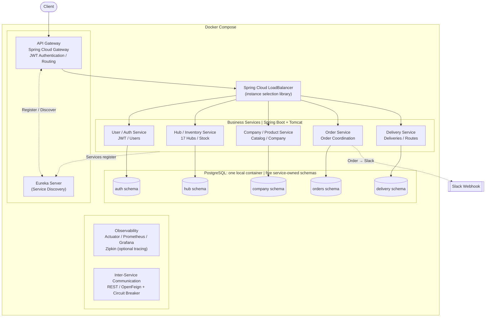

# 2. 인프라 설계

> 원본 다이어그램: [draw.io](https://app.diagrams.net/#G1HQ54nr-jfeQbi-tw-24CF0s69gwRfZXc)

## MSA 아키텍처

## 구성 요소

| 구성 요소 | 기술 | 역할 |
|---|---|---|
| API Gateway | Spring Cloud Gateway | 외부 요청의 단일 진입점. JWT 인증 후 각 서비스로 라우팅 |
| Service Discovery | Eureka Server | Gateway와 각 서비스의 위치 등록·조회 |
| Load Balancer | Spring Cloud LoadBalancer | 서비스 인스턴스 선택 (클라이언트 사이드 라이브러리) |
| User / Auth Service | Spring Boot | 회원가입, 로그인(JWT 발급), 사용자 관리 |
| Hub / Inventory Service | Spring Boot | 17개 허브, 허브 간 경로, 재고 |
| Company / Product Service | Spring Boot | 업체, 상품 카탈로그 |
| Order Service | Spring Boot | 주문 생성·취소, Saga 조정, Slack 알림 호출 |
| Delivery Service | Spring Boot | 배송, 배송 구간(경로) |
| Database | PostgreSQL (컨테이너 1개) | 서비스별 스키마 5개로 데이터 소유권 분리 |
| 서비스 간 통신 | REST / OpenFeign + Circuit Breaker | 동기 호출, 장애 전파 차단 |
| Observability | Actuator / Prometheus / Grafana, Zipkin(선택) | 메트릭 수집·대시보드, 분산 추적 |
| 외부 연동 | Slack Incoming Webhook | 주문 생성 시 알림 발송 |

## 원본 이미지

