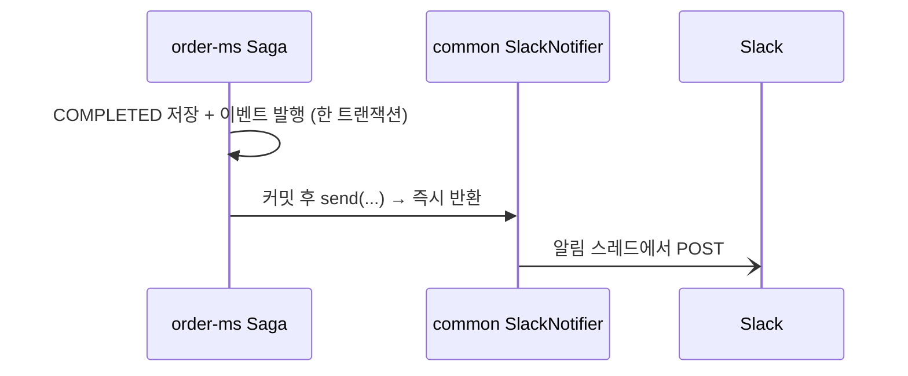
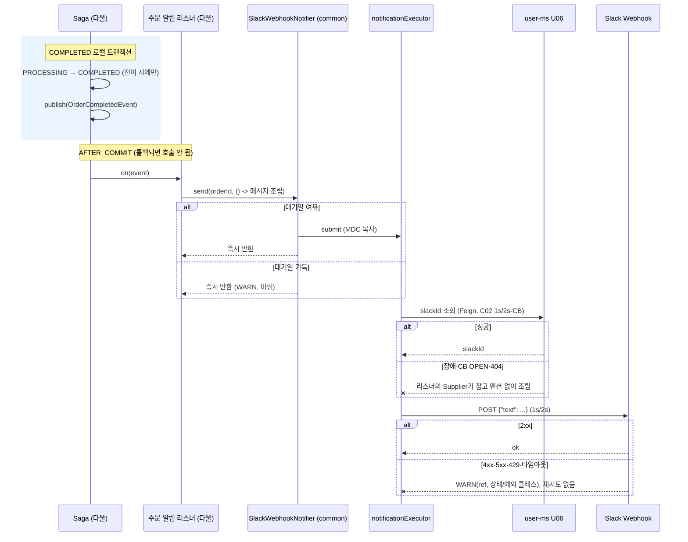
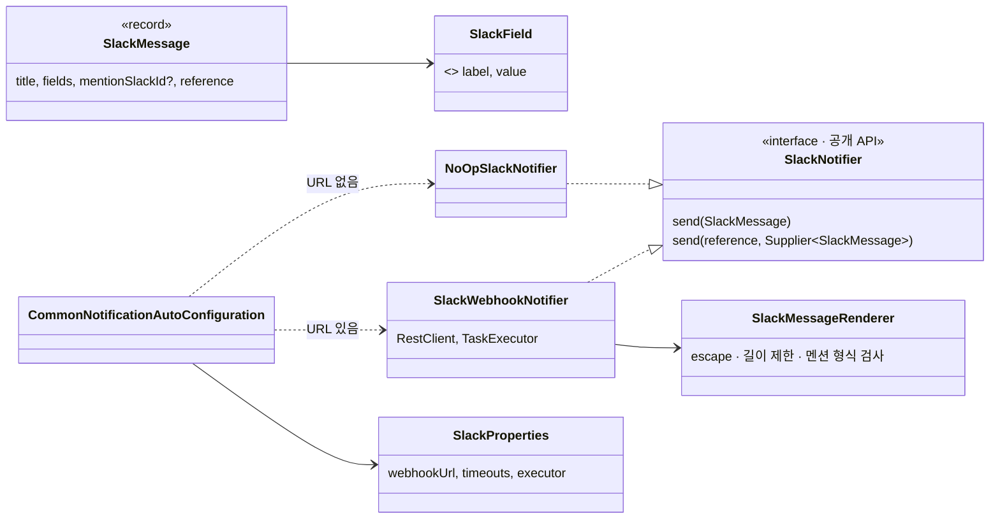
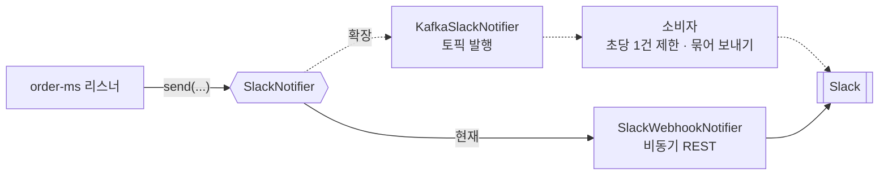

# NTF. 주문 알림 설계 (Slack)

> 작성일: 2026-10-16 · 담당: 대진 (common 발송 라이브러리) · 다울 (order-ms 주문 알림 연결)
> 관련: [[요구사항정리]] NTF-01·NTF-02, A11·A17 · [[07 서비스 정책]] 5장 주문·7장 Saga·8장 알림 · [[SYS-13 장애 대응 설계]] 2장 ③ · [[SA 설계보완리포트]] D-8

## 변경 이력

| 버전 | 날짜 | 변경 내용 | 관련 요구사항 |
|---|---|---|---|
| v1.0 | 2026-10-16 | 최초 작성. 발송 시점(COMPLETED 후)·수신 대상(주문자 멘션)·데이터 출처(Saga 스냅샷)·비동기 발송·common 라이브러리 위치 결정 | NTF-01, NTF-02 |
| v1.1 | 2026-10-16 | Kafka 검토: 비동기 REST 유지, Kafka·묶어 보내기는 확장안(10장). 근거는 Slack Webhook 속도 제한 | NTF-01, 도전 기능 |
| v1.2 | 2026-10-16 | common 구현 완료에 맞춰 3장 갱신: 생성 규칙, 로그에 requestId, 형식이 틀린 URL은 기동 실패, executor 비노출, 줄바꿈 치환·로그 값 정리 | NTF-01, NTF-02 |
| v1.3 | 2026-10-16 | 리뷰 반영: `null` 메시지도 호출한 쪽에 예외 없이 WARN "메시지 없음", 설정 객체 `toString()`에서 Webhook URL을 가림 | NTF-02, N3 |

---

## 1. 요구사항 (근거)

| ID | 기능 | 정의 | 출처 |
|---|---|---|---|
| NTF-01 | 주문 알림 발송 | 주문 생성 시 Slack Incoming Webhook 호출 | 발제 352행 |
| NTF-02 | 알림 실패 처리 | Slack 호출 실패 시 주문 처리에 미칠 영향을 결정 | 설계 결정 |

- 발제 조건: 슬랙 메시지를 저장하는 **별도 엔티티·CRUD·마이크로서비스 없이**, 주문 생성 시 Webhook을 호출하는 **함수만** 구현한다.
- Webhook은 **정해진 채널 하나**에만 글을 쓴다. 개인 DM은 불가능하다 (A11).
- Slack ID는 활성 사용자 사이에서 중복될 수 없다. 이유는 알림 오발송 방지다 (A17).

**이 요구사항이 푸는 문제:** 처리가 확정된 주문을 담당자가 놓치지 않게 외부 채널로 알린다. 단, 외부 채널이 느리거나 죽어도 **주문 확정 상태는 흔들리면 안 된다.**

---

## 2. 쉬운 설명

> 각 서비스 책상 위에 **같은 규격의 "알림 보내기 버튼"**(common)을 놓아 둡니다.
> 버튼을 누르면 알림은 **우편함**(전용 대기열)에 들어가고, 누른 사람은 바로 하던 일로 돌아갑니다.
> 우편 배달(Slack 호출·타임아웃·실패 기록)은 버튼 안쪽에서 대진이 책임지고, **무슨 내용을 언제 누구에게** 보낼지는 각 서비스가 정합니다.
> 주문 쪽은 "재고와 배송까지 확보된 주문"이 확정되면 버튼을 누르고, 주문한 사람을 태그합니다. 배달이 실패해도 주문은 이미 끝난 일이라 영향이 없습니다.

---

## 3. 상세 설명

### 3.1 책임 나눔

| 책임 | 위치 | 담당 |
|---|---|---|
| **어떻게 보내나**: Webhook 호출, 타임아웃, 비동기 대기열, 실패는 WARN만, URL 비밀 처리, 문자열 이스케이프·길이 제한, URL이 없을 때 NoOp | common `com.common.notification` | 대진 |
| **언제·누구에게·무엇을**: COMPLETED 후 발송, 주문자 slackId 조회, 메시지 항목 조립, 개인정보 제외 | order-ms | 다울 (7장 사용 계약) |

### 3.2 common 공개 API

```java
package com.common.notification;

/** 호출 즉시 반환하고 예외를 던지지 않는다. 발송은 알림 전용 스레드에서 한다. */
public interface SlackNotifier {
    void send(SlackMessage message);
    /** 메시지 조립(원격 조회 포함)까지 알림 스레드에서 한다. supplier 예외도 WARN으로 끝난다. */
    void send(String reference, Supplier<SlackMessage> message);
}

public record SlackMessage(
        String title,                 // 예: "주문 완료". 필수
        List<SlackField> fields,      // 라벨·값 쌍, 최대 10개
        String mentionSlackId,        // null 허용. Slack 멤버 ID 형식일 때만 <@...>로 렌더링
        String reference              // 로그 추적용 (예: orderId). Slack으로는 보내지 않음
) {
    public static Builder builder(String title) { ... }   // .field(label, value).mention(id).reference(ref).build()
}

public record SlackField(String label, String value) {}   // value가 null이면 "-"
```

**생성 규칙:** title 공백, label 공백, fields 10개 초과, fields 안의 null 항목은 **만드는 순간** `IllegalArgumentException`을 던진다. 개발 중 실수를 바로 드러내기 위해서다. `send()`는 어떤 경우에도 예외를 던지지 않는다.

**사용 예 (order-ms 리스너):**

```java
@TransactionalEventListener(phase = TransactionPhase.AFTER_COMMIT)
public void on(OrderCompletedEvent event) {
    slackNotifier.send(event.orderId().toString(), () -> SlackMessage.builder("주문 완료")
            .field("주문 ID", event.orderId().toString())
            .field("상품", event.productName() + " × " + event.quantity())
            .field("공급 → 요청", event.supplierCompanyName() + " → " + event.requesterCompanyName())
            .field("경로", event.departureHubName() + " → " + event.arrivalHubName())
            .field("요청사항", event.hasRequestNote() ? "있음" : "없음")
            .mention(findSlackIdOrNull(event.orderedBy()))   // U06 조회. Remote*Exception·404면 null
            .build());
}
```

### 3.3 내부 구성

| 구성 | 역할 |
|---|---|
| `SlackProperties` | `common.notification.slack.*`: `webhook-url`(← `SLACK_WEBHOOK_URL`), `connect-timeout` 1s(← `SLACK_CONNECT_TIMEOUT`), `read-timeout` 2s(← `SLACK_READ_TIMEOUT`), `pool-size` 2, `queue-capacity` 100, `shutdown-wait` 3s |
| `SlackMessageRenderer` (package-private) | `SlackMessage` → mrkdwn 본문. 줄바꿈 → 공백, 길이 제한(제목 100·라벨 50·값 200, 글자 단위, 이스케이프 전), `& < >` 이스케이프, 멘션은 멤버 ID 형식(`[UW][A-Z0-9]{8,}`)일 때만 |
| `SlackWebhookNotifier` | 내부 executor에 제출 → RestClient POST `{"text": ...}`. 모든 실패를 잡아 WARN. 형식이 틀린 URL은 생성 시 예외(기동 실패, 메시지에 URL 값 없음) |
| `NoOpSlackNotifier` | URL이 비어 있으면 등록. 아무것도 안 하고 supplier도 호출하지 않음 |
| `CommonNotificationAutoConfiguration` | Servlet 웹 앱에서만 활성(Gateway 제외). URL이 없으면 NoOp + INFO 1회. 서비스가 `SlackNotifier` 빈을 등록하면 물러남 |
| 내부 executor (`slack-notifier-*`) | **빈으로 노출하지 않음**: `Executor` 빈이 생기면 Boot 기본 `applicationTaskExecutor`가 사라짐. 스레드 2개·대기열 100, 넘치거나 종료 후 제출이면 버리고 WARN. 호출 스레드 MDC 복사·복원. 종료 시 최대 3초 대기 |

### 3.4 메시지 렌더링 예

```text
*[주문 완료]* <@U07ABCDEF>
• 주문 ID: 3fa85f64-…
• 상품: 생수 500ml × 10
• 공급 → 요청: A상사 → B마트
• 경로: 서울 허브 → 부산 허브
• 요청사항: 있음
```

### 3.5 실패 처리 (NTF-02)

| 상황 | 결과 | 로그 |
|---|---|---|
| Slack 2xx | 성공 | DEBUG `Slack 알림 발송 ref= requestId=` |
| Slack 4xx·5xx·429 | 버림, 재시도 없음 | WARN `Slack 알림 실패 ref= requestId= status=500` |
| 연결 실패·타임아웃(1s/2s) | 버림 | WARN `Slack 알림 실패 ref= requestId= cause=SocketTimeoutException` (원인 예외 **클래스명만**) |
| 대기열 가득·종료 후 제출 | 버림 | WARN `Slack 알림 버림(대기열 가득 또는 종료됨) ref= requestId=` |
| `Supplier` 예외 (예: slackId 조회 실패를 도메인이 처리하지 않음) | 버림 | WARN `Slack 알림 메시지 조립 실패 ref= requestId= cause=` |
| `null` 메시지·`null` supplier·supplier가 `null` 반환 | 버림 | WARN `Slack 알림 메시지 없음 ref= requestId=` |
| URL 미설정 | NoOp | 기동 시 INFO `Slack 알림 비활성 (…webhook-url 미설정)` 1회 |
| URL 형식 오류 | **기동 실패** | 설정 키 이름만, URL 값 없음 |

- 어떤 경우에도 **호출한 스레드에 예외가 돌아가지 않는다.** 그래서 주문 Saga 결과에 영향이 없다.
- 로그에는 **Webhook URL, 메시지 본문, Slack 응답 본문, 예외 메시지, 스택 트레이스를 남기지 않는다.** 구현 중 테스트로 확인한 노출 경로: RestClient I/O 예외 메시지(URL 전체), HTTP 오류 예외 메시지(Slack 응답 본문), `URI` 파싱 예외 메시지(URL 전체), supplier 예외 메시지(호출한 쪽 데이터).
- `requestId`는 `send()`를 호출한 요청의 `X-Request-Id`. 요청 밖이면 `-`. `ref`·`requestId`는 줄바꿈 → 공백, 64자 제한(로그 위조 방지).

---

## 4. 설계 결정

| # | 결정점 | 선택 | 포기한 것 / 이유 |
|---|---|---|---|
| Q1 | 발송 시점 | **Saga가 COMPLETED를 저장한 트랜잭션의 커밋 후** | PROCESSING 직후 발송은 실패할 주문에도 알림이 가고 배송 정보가 없음. 성공·실패 모두 알리는 안은 NTF-01 범위를 넘음. README에 "생성 = Saga 성공 시점"이라는 해석을 명시 |
| Q2 | 수신 대상 | **채널 글에 주문자 멘션.** slackId 조회 실패·404면 멘션 없이 발송 | 채널 공지만 하면 `slack_id`·A17의 쓰임이 없음. 공급업체 사용자 멘션은 user-ms 신규 API가 필요해서 일정 위험. 주문 응답이 202라서 주문자에게 "처리 완료" 통지가 됨 |
| Q3-1 | 메시지 데이터 | **Saga 중 이미 받은 검증 응답(상품명·업체명·허브명)을 이벤트 스냅샷으로** | 주문 테이블 값만 쓰면 UUID뿐이라 못 읽음. 발송할 때 추가 조회하면 원격 호출이 최대 4개 |
| Q3-2 | 요청사항 | **원문 제외, "있음/없음"만** | 자유 텍스트라 연락처·주소가 섞일 가능성이 가장 큼. 마스킹 정규식으로는 다 거르지 못함 |
| Q4 | 발송 방식 | **전용 executor로 비동기 발송.** 넘치면 버림 | 같은 스레드에서 동기로 보내면 최악 6초(user-ms 3초 + Slack 3초) 동안 Saga 스레드를 점유. Outbox는 발제("엔티티 없이")·N5와 충돌 |
| Q4-2 | Slack 타임아웃 | **connect 1s / read 2s** (환경변수로 조정) | Feign 공통값과 같아서 설명이 일관됨 |
| Q6 | URL 미설정 | **NoOp + INFO 1회** | 기동 실패로 하면 팀원 모두 더미 URL이 필요함 |
| Q7 | 형식 | **`text` + mrkdwn** | Block Kit은 JSON과 테스트가 복잡함 |
| Q8 | 코드 위치 | **common 발송 라이브러리**. 도메인은 언제·누구·무엇만 담당 | 알림 마이크로서비스는 발제("별도 서비스 없이") 위반에 일정 부담이 큼. order-ms 전용으로 두면 재사용이 어려움. 대신 개인정보를 타입으로 보장하던 부분은 도메인 책임으로 넘어감(6장 R2) |
| - | `@Async` 대신 executor 직접 제출 | common이 `TaskExecutor`에 제출 | `@Async`를 쓰면 각 서비스가 `@EnableAsync`를 켜야 하고, 프록시 호출 규칙(자기 호출 불가)을 사용자가 알아야 함 |
| - | slackId 조회 위치 | **호출하는 도메인** | common이 user-ms API에 묶이지 않게 하기 위해서 |

기존 결정(N1~N8, `docs/plan/common/NTF Slack 알림.md`) 중 **N6(order-ms 안에 코드)은 Q8로 대체**한다. 나머지는 유지한다.

---

## 5. 다이어그램

### 5.1 시퀀스: 한눈에

트랜잭션 경계와 스레드 경계를 확인하는 그림입니다. 알림이 주문 트랜잭션 밖이자 다른 스레드에서 일어나는지 봅니다.



읽는 법: Saga 쪽 화살표는 `send` 하나뿐이고 즉시 돌아옵니다. Slack과의 통신은 전부 오른쪽(알림 스레드)에서만 일어납니다.

### 5.2 시퀀스: 상세



읽는 법:
- `--x`로 표시한 실패 화살표는 모두 알림 스레드 안에서 끝나고, Saga로 돌아가는 화살표가 없습니다. 이것이 NTF-02 결정입니다.
- slackId 조회도 `Supplier` 안에 있어서 알림 스레드에서 실행됩니다. user-ms가 느려도 Saga 스레드는 기다리지 않습니다.

### 5.3 클래스: common

common 안의 의존 방향과 도메인이 볼 수 있는 경계를 확인합니다.



읽는 법:
- 도메인이 아는 것은 `SlackNotifier`, `SlackMessage`, `SlackField` 세 개뿐입니다. Slack 문법(mrkdwn, `<@id>`, 이스케이프)은 `SlackMessageRenderer` 안에 갇혀 있어서, 도메인 값으로 `<!channel>` 같은 전체 멘션을 끼워 넣을 수 없습니다.
- 테스트나 다른 채널이 필요하면 `SlackNotifier` 빈을 직접 등록해 대체합니다(`@ConditionalOnMissingBean`).

### 5.4 ERD

없습니다. 발제 조건대로 알림을 저장하지 않습니다.

---

## 6. 잠재 리스크

| # | 리스크 | 대응 |
|---|---|---|
| R1 | Saga가 트랜잭션 **밖에서** 이벤트를 발행하면 AFTER_COMMIT 리스너가 아무 말 없이 실행되지 않음 | 7장 계약에 "COMPLETED 저장과 같은 트랜잭션에서 발행"을 명시. `fallbackExecution=false` 유지. 다울님 통합 테스트로 고정 |
| R2 | common은 범용 형식이라 **개인정보를 타입으로 막지 못함** | 7장에 넣지 않는 항목을 명시. 다울님 테스트로 메시지에 연락처·주소·요청사항 원문이 없는지 확인(N8). common은 이스케이프·길이 제한만 보조 |
| R3 | Webhook URL이 로그·예외 메시지로 유출 | 예외 메시지를 출력하지 않음. "로그에 URL 없음" 테스트로 고정. URL은 `.env`에만 둠(N3) |
| R4 | 알림 영구 유실(대기열 초과, 서버 종료, Slack 장애) | N5에 따라 허용. WARN에 `ref`(orderId)를 남겨 수동으로 확인. 개선은 도전 기능(Outbox·메시징)으로 |
| R5 | 중복 알림(COMPLETED가 두 번 저장되는 경우) | PROCESSING → COMPLETED **전이 시에만** 발행하도록 계약 |
| R6 | **`slack_id` 형식 검증이 없음**(VARCHAR 80 자유 입력). 표시 이름을 넣으면 멘션이 동작하지 않음 | 렌더러는 멤버 ID 형식(`^[UW][A-Z0-9]{8,}$`)일 때만 멘션을 만들고, 아니면 멘션을 생략. 가입 시 형식 검증 추가는 user-ms 후속 검토(9장) |
| R7 | Slack 속도 제한(Webhook당 초당 약 1건) | 작은 풀이 자연히 속도를 늦춤. 429는 WARN 처리 |

---

## 7. 주문 알림 사용 계약 (order-ms · 다울)

| 항목 | 계약 |
|---|---|
| 발행 시점 | `PROCESSING → COMPLETED` **전이가 일어날 때만**, 그 상태를 저장하는 **같은 트랜잭션 안에서** `OrderCompletedEvent` 발행 |
| 수신 | `@TransactionalEventListener(phase = AFTER_COMMIT)` 리스너에서 `slackNotifier.send(orderId, () -> ...)` 호출. 리스너 자체는 `@Async`가 필요 없음 |
| 이벤트 필드(제안) | `orderId`, `deliveryId`, `orderedBy`, `productName`, `quantity`, `supplierCompanyName`, `requesterCompanyName`, `departureHubName`(nullable), `arrivalHubName`(nullable), `hasRequestNote` |
| 멘션 | `Supplier` 안에서 U06 `GET /internal/v1/users/{orderedBy}` → `slackId`. 예외(`Remote*Exception`)나 404면 `mentionSlackId = null` |
| **넣는 것** | 주문 ID, 상품명·수량, 공급·요청 업체명, 출발·도착 허브명(있을 때), 요청사항 있음/없음 |
| **넣지 않는 것** | 요청사항 원문, 수령인·연락처, 배송 상세 주소, 내부 사용자 UUID(멘션 외), 금액(필요 시 합의), 토큰·비밀번호 |
| 테스트 | ① 롤백된 주문은 알림 없음 ② COMPLETED 재저장 시 알림 1회 ③ 메시지에 "넣지 않는 것"이 없음 ④ user-ms 장애 시 멘션 없이 발송 (`SlackNotifier`를 테스트 대역으로 교체) |

---

## 8. 하지 않는 것

- FAILED·CANCELLED 알림, 배송 상태 알림 (필요해지면 같은 `SlackNotifier`로 추가)
- 재시도·Outbox·메시징 시스템 전환 (도전 기능 → 10장 확장안)
- 알림 전용 API·엔티티·마이크로서비스 (발제 조건)
- 채널 여러 개(이번 범위는 Webhook URL 1개)

## 9. 열린 항목

| # | 항목 | 확인할 사람 |
|---|---|---|
| O1 | 7장 계약과 이벤트 필드 합의, 특히 허브명이 company 검증 응답에 있는지 | 대진·다울 (이찬) |
| O2 | 메시지에 금액(`total_amount`)을 넣을지 | 다울 |
| O3 | `slack_id` 형식 검증(멤버 ID) 추가 여부 (R6) | 대진 (user-ms) |

---

## 10. 확장안: 대용량 트래픽과 Kafka (도전 기능, 이번 구현 범위 밖)

### 10.1 병목은 전송 방식이 아니라 Slack이다

Incoming Webhook은 **Webhook 하나당 초당 약 1건**만 받는다. 주문이 초당 10건씩 계속 들어오면:

| 방식 | 결과 |
|---|---|
| 비동기 REST (현재, 대기열 100) | 대기열이 몇 초 만에 차고 초당 9건이 버려짐 |
| Kafka | 유실은 없지만 시간당 약 3만 건이 밀림. 몇 시간 뒤 도착하는 "주문 완료" 알림은 의미 없음 |

→ **주문 1건 = 메시지 1건 구조는 전송 방식과 상관없이 대용량에서 확장되지 않는다.** 대용량에 대한 답은 **묶어 보내기**(예: "최근 1분 주문 42건" 요약)나 채널 분리이고, Kafka는 그것을 유실 없이 하기 위한 수단이다.

### 10.2 비교

| | 비동기 REST (채택) | Kafka (확장안) |
|---|---|---|
| 유실 | 대기열 초과·종료·Slack 장애 시 유실 (N5로 허용) | 브로커에 남아 재시도 가능. 커밋 후 발행 실패(이중 쓰기)까지 막으려면 Outbox가 추가로 필요 |
| 결합도 | order-ms가 직접 발송 | order-ms는 이벤트만 발행, 소비자를 자유롭게 추가 |
| 속도 제한 대응 | 버리는 방식으로만 대응 | 소비자에서 초당 1건 제한 + 묶어 보내기 |
| 비용 | 추가 인프라 없음 | Kafka 컨테이너, 토픽·직렬화·소비자 그룹. 소비자 실행 위치가 사실상 알림 전용 프로세스(발제 "별도 서비스 없이"와 충돌) |
| 과제 범위 | 필수 NTF-01·02 충족 | 발제 436행: 메시징 전환은 필수 범위 밖. 도전 기능에서 "슬랙 메시지 발송"을 전환 예시로 듦 |

### 10.3 교체 지점



읽는 법: 도메인 코드는 `send(...)`에서 멈춘다. 확장할 때는 `SlackNotifier` 구현체만 바꾸고(`@ConditionalOnMissingBean` 또는 프로퍼티로 선택) 소비자를 추가하면 된다. 다울님 코드는 바뀌지 않는다.
