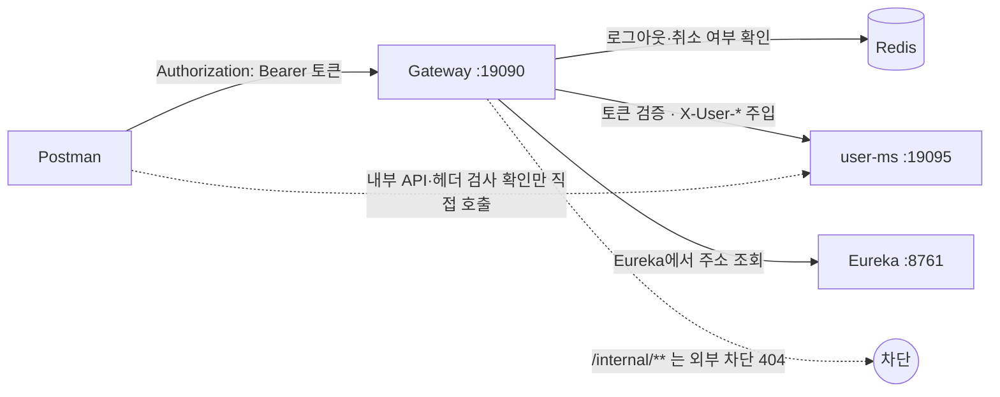

# Postman Gateway 테스트 가이드

> 작성일: 2026-10-15 · 수정: 2026-10-17 (dev 46ad946 기준: 57~90번 MASTER 관리자 API 추가. 이전: 29~50번 로그아웃·재발급·내 정보·비밀번호 변경·탈퇴, 51~56번 요청 ID·경로 우회 차단) · 작성: 대진
> 목적: Postman으로 **클라이언트 → Gateway(19090) → 각 서비스** 흐름을 직접 확인하고, 각자 만든 API도 같은 방식으로 컬렉션에 추가합니다.
> 컬렉션: `docs/postman/sparta-logistics-gateway.postman_collection.json` (**요청 90개**)
> 기동 방법·문제 해결은 [[로컬 실행·라우팅 확인 가이드]], 인증 흐름 설명은 [[03 User·Auth API 가이드]] 3장을 보세요.

---

## 1. 한눈에 보기



- **모든 요청은 Gateway(`{{gateway}}`)로 보냅니다.** 서비스 포트(`{{userDirect}}`)로 직접 보내는 것은 1번(기동 확인), 18·19번(내부 API), 20~22·31번(서비스의 사용자 헤더 검사)뿐입니다.
- Gateway는 토큰을 검증하고 Redis에서 로그아웃·취소 여부를 확인한 뒤 `X-User-Id`, `X-User-Role`, `X-Token-Jti`, `X-Token-Exp` 헤더를 붙여 서비스로 넘깁니다. 클라이언트가 직접 넣은 `X-User-*`·`X-Token-*` 헤더는 지웁니다.
- 공개 경로(토큰 없이 통과): `POST /api/v1/auth/signup`, `GET /api/v1/auth/check-username`, `POST /api/v1/auth/login`, `POST /api/v1/auth/reissue`
- MASTER 전용 경로(USER 토큰이면 Gateway가 403): 사용자 관리 API(`/api/v1/users`, `/api/v1/users/*` …, 본인 `/api/v1/users/me`는 제외), 허브 수정, 허브 경로 생성·수정·삭제, 업체 생성·삭제 등. 전체 목록은 [[01 Gateway·인증 가이드]] 4장(원본: `gateway-edge/src/main/resources/application.yaml`의 `gateway.policy.master`).

## 2. 준비 (처음 한 번)

### 2.1 `.env` 값

프로젝트 루트 `.env`에 아래 값이 있어야 합니다. `.env.example`을 복사해 채웁니다. **`.env`는 Git에 올리지 않습니다.**

| 키 | 용도 | 만드는 법 |
|---|---|---|
| `DB_*`, `AUTH_DB_*` 등 | PostgreSQL | `.env.example` 참고 |
| `JWT_SECRET_KEY` | 토큰 서명. **Gateway·user-ms·토큰 스크립트가 같은 값을 써야 합니다** | `openssl rand -base64 32` |
| `REDIS_PASSWORD` | Redis 접속 (Compose가 이 값으로 Redis를 띄움). **Gateway·user-ms 모두 필요** | `openssl rand -hex 24` |
| `MASTER_*` | 초기 MASTER 계정 (user-ms 기동 시 1명 생성). `.env.example`에 없으니 직접 추가 | ID 4~10자 소문자·숫자, 비밀번호 8~15자 대·소문자·숫자·특수문자 모두 포함 |

### 2.2 컬렉션 가져오기

1. Postman → **Import** → `docs/postman/sparta-logistics-gateway.postman_collection.json`
2. 컬렉션 → **Variables** 탭에서 기본값을 확인합니다.

| 변수 | 기본값 | 설명 |
|---|---|---|
| `gateway` | `http://localhost:19090` | Gateway |
| `userDirect` | `http://localhost:19095` | user-ms 직접 (1·18~22·31번) |
| `eureka` | `http://localhost:8761` | Eureka |
| `masterToken` / `userToken` / `expiredToken` | 비어 있음 | **2.3에서 직접 채웁니다** (2·3·6·10~12번) |
| `signupUsername` / `signupSlackId` / `signupUserId` | 비어 있음 | 14번이 자동으로 채웁니다 |
| `loginAccessToken` / `loginRefreshToken` | 비어 있음 | 23·32·39·45번(로그인)이 자동으로 채웁니다 |
| `reissuedAccessToken` / `reissuedRefreshToken` | 비어 있음 | 33번(재발급)이 자동으로 채웁니다 |
| `masterUsername` / `masterPassword` | 비어 있음 | **직접 채웁니다** (57번). `.env`의 `MASTER_USERNAME`·`MASTER_PASSWORD`를 **Current value에만** 넣습니다. Initial value에 넣으면 컬렉션을 내보낼 때 함께 나가니 넣지 마세요 |
| `masterLoginToken` / `masterUserId` | 비어 있음 | 57·58번이 자동으로 채웁니다 (실제 MASTER 토큰, `masterToken`과 별개) |
| `adminUsername` / `adminSlackId` / `adminUserId` / `adminAccessToken` / `tempPassword` | 비어 있음 | 59·62·66·79번이 자동으로 채웁니다 |

> 자동으로 채우는 변수는 손대지 않습니다. 14번부터 순서대로 실행하면 이어서 쓰입니다.

### 2.3 토큰 만들기

**로그인 API로 받기 (실제 사용자 토큰)**: MASTER는 `.env`의 `MASTER_USERNAME`·`MASTER_PASSWORD`로 로그인합니다.

```http
POST {{gateway}}/api/v1/auth/login
Content-Type: application/json

{ "username": "<MASTER_USERNAME>", "password": "<MASTER_PASSWORD>" }
```

응답의 `accessToken`을 `masterToken`에 붙여 넣습니다. **30분 뒤 만료**되므로, 401 `TOKEN_EXPIRED`가 나오면 다시 로그인하거나 `POST /api/v1/auth/reissue`로 재발급합니다.

**개발용 스크립트로 만들기**: 만료 토큰(10번)이나 DB에 없는 사용자처럼 로그인으로 만들 수 없는 토큰은 스크립트로 만듭니다. `.env`의 `JWT_SECRET_KEY`로 서명하고, 기본 30분 동안 유효합니다.

```bash
python3 scripts/dev-token.py --role MASTER   # → masterToken
python3 scripts/dev-token.py                 # → userToken (USER)
python3 scripts/dev-token.py --expired       # → expiredToken (이미 만료됨)
```

출력값(`eyJ…`)을 Variables의 같은 이름 칸(Current value)에 붙여 넣고 **Save**합니다. 다른 옵션(`--user-id`, `--pcr`, `--ttl`, `--typ`)은 `python3 scripts/dev-token.py --help`.

> 스크립트 토큰의 사용자는 DB에 없을 수 있습니다. Gateway 통과 확인용이고, `/users/me`처럼 DB를 보는 API는 로그인 토큰을 쓰세요.

## 3. 실행 순서

```bash
# 1) 인프라 (Redis 필수: Gateway가 매 요청 토큰 상태를 확인)
docker compose up -d postgres redis

# 2) 터미널을 나눠서 순서대로
sh ./gradlew :eureka-registry:bootRun
sh ./gradlew :user-ms:bootRun        # 다른 서비스를 확인할 때는 그 서비스도 띄웁니다
sh ./gradlew :gateway-edge:bootRun
```

기동 확인:

| 확인 | 기대 결과 |
|---|---|
| http://localhost:8761 | `GATEWAY-EDGE`, `USER-MS`가 `UP` |
| `GET http://localhost:19095/actuator/health` | `{"status":"UP"}` |
| `GET http://localhost:19090/livez` | `{"status":"UP"}` (상세는 관리 포트 `http://localhost:19190/actuator/health`, Redis가 꺼져 있으면 `DOWN`) |
| 컬렉션 2번 | 200. **Gateway 기동 직후 몇 초는 503일 수 있습니다**(Eureka 목록을 아직 못 받음). 잠시 후 다시 보냅니다 |

## 4. 요청 목록과 기대 결과

각 요청의 **Tests** 탭에 기대 결과가 들어 있습니다. 보내면 아래쪽 **Test Results**에 PASS/FAIL이 나옵니다.

### 4.1 라우팅·공통 오류 (1~7)

| # | 요청 | 토큰 | 기대 결과 | 확인하는 것 |
|---|---|---|---|---|
| 1 | `GET {{userDirect}}/api/v1/auth/routing-check` | - | 200, `service: "user-ms"` | 서비스 자체 기동 |
| 2 | `GET {{gateway}}/api/v1/auth/routing-check?from=postman` | MASTER | 200, `path`·`query` 그대로 | **Gateway → 서비스 라우팅** |
| 4 | `GET {{gateway}}/api/v1/unknown` | - | 404 `RESOURCE_NOT_FOUND` | 공통 오류 형식 |
| 5 | `GET {{gateway}}/internal/v1/users/{id}` | - | 404 `RESOURCE_NOT_FOUND` | 내부 API 외부 차단 |
| 6 | `GET {{gateway}}/api/v1/hubs` | MASTER | 503 `SERVICE_UNAVAILABLE` | 서비스가 꺼져 있을 때. **hub-ms를 띄웠다면 200 등이 정상** |
| 7 | `GET {{eureka}}/eureka/apps` | - | 200, `GATEWAY-EDGE`·`USER-MS` 포함 | 서비스 등록 |

### 4.2 Gateway 인증·인가 (3, 8~12)

| # | 요청 | 토큰 | 기대 결과 | 확인하는 것 |
|---|---|---|---|---|
| 8 | routing-check | 없음 | 401 `TOKEN_MISSING` | 보호 경로는 토큰 필요 |
| 9 | routing-check | `Bearer abc` | 401 `TOKEN_INVALID` | 서명·형식 검증 |
| 10 | routing-check | expired | 401 `TOKEN_EXPIRED` | 만료 검증 |
| 11 | routing-check | USER | 200, 응답 `headers`에 `X-User-Id`·`X-User-Role: USER`·`X-Token-Jti`·`X-Token-Exp` | 사용자 헤더 주입 |
| 3 | routing-check + 위조 헤더 `X-User-Role: MASTER`, `X-Token-Jti: forged`, `X-Request-Id: postman-1` | USER | 200, `X-User-Role`은 **USER**(토큰 값), `X-Request-Id`는 그대로 | 위조 헤더 제거 |
| 12 | `GET {{gateway}}/api/v1/users` | USER | 403 `ACCESS_DENIED` | MASTER 전용 경로 |

### 4.3 회원가입 (13~17, 공개 경로)

**14 → 15 → 16 순서로 보냅니다.** 14번이 만든 username을 이후 요청이 씁니다.

| # | 요청 | 기대 결과 | 확인하는 것 |
|---|---|---|---|
| 13 | `GET /api/v1/auth/check-username?username=user01` | 200 `{"available": true/false}` | 토큰 없이 통과 |
| 14 | `POST /api/v1/auth/signup` | 201, `role: "USER"`, 비밀번호 없음 | 가입. 보낼 때마다 username·slackId를 새로 만듭니다 |
| 15 | 14번과 같은 username으로 가입 | 409 `DUPLICATE_USERNAME` | 중복 가입 |
| 16 | 14번 username으로 ID 확인 | 200 `{"available": false}` | 가입 후 사용 불가 |
| 17 | 약한 비밀번호(`abcd1234`)로 가입 | 400 `INVALID_PASSWORD` | 비밀번호 정책 |

### 4.4 내부 API (18~19, user-ms 직접 호출)

내부 API는 Gateway가 막으므로(5번) **서비스 포트로 직접** 확인합니다. 실제로는 다른 서비스가 Feign으로 호출합니다.

| # | 요청 | 기대 결과 |
|---|---|---|
| 18 | `GET {{userDirect}}/internal/v1/users/{{signupUserId}}` | 200, 필드 6개 `id, name, role, isDeliveryManager, slackId, active` |
| 19 | 없는 UUID | 404 `USER_NOT_FOUND` |

### 4.5 서비스의 사용자 헤더 검사 (20~22, user-ms 직접 호출)

모든 서비스(MVC)는 공통 모듈이 요청 입구에서 `X-User-Id`·`X-User-Role`을 검사합니다. Gateway가 넣은 헤더는 항상 올바르므로, **Gateway를 거치지 않은 요청**으로 확인합니다.

| # | 요청 헤더 | 기대 결과 | 확인 내용 |
|---|---|---|---|
| 20 | `X-User-Id: <UUID>`, `X-User-Role: USER` | 200, 헤더 그대로 전달 | 로컬에서 Gateway 없이 개발할 때 손으로 넣는 방법 |
| 21 | `X-User-Id`만 | 401 `UNAUTHENTICATED` | 두 헤더 중 하나만 있으면 401 |
| 22 | `X-User-Role: ADMIN` | 401 `UNAUTHENTICATED` | 형식이 틀리면 401. 역할은 `MASTER`·`USER`만, 대소문자도 정확히 |

- 두 헤더가 **모두 없으면** 통과합니다(공개 API, 요청 밖에서 시작된 내부 호출). 1번이 그 예입니다.

### 4.6 로그인 (23~28, 공개 경로)

| # | 요청 | 기대 결과 | 확인 내용 |
|---|---|---|---|
| 23 | 14번 사용자로 로그인 | 200, 필드 3개 `accessToken, refreshToken, passwordChangeRequired` | 토큰을 `loginAccessToken`·`loginRefreshToken`에 저장 |
| 24 | 23번 Access로 `routing-check` | 200, `X-User-Id` = 14번 사용자 | **user-ms가 발급한 토큰을 Gateway가 받아 줌** (키·claim 계약 교차 확인) |
| 25 | 23번 **Refresh**로 `routing-check` | 401 `TOKEN_INVALID` | Refresh는 `typ=refresh`라 Access로 못 씀 |
| 26 | 틀린 비밀번호 | 401 `INVALID_CREDENTIALS` | 27번과 같은 응답 (어느 쪽이 틀렸는지 알려 주지 않음) |
| 27 | 없는 ID (`NoSuchUser`) | 401 `INVALID_CREDENTIALS` | 가입 규칙에 맞지 않는 ID도 400이 아니라 401 |
| 28 | 빈 비밀번호 | 400 `INVALID_INPUT` | 빈 값만 400 |

### 4.7 로그아웃 (29~31)

| # | 요청 | 기대 결과 | 확인 내용 |
|---|---|---|---|
| 29 | `POST /api/v1/auth/logout` (23번 Access) | 204 | Refresh 삭제 + 이 Access를 blacklist |
| 30 | 같은 Access로 `routing-check` | 401 `TOKEN_REVOKED` | **Gateway가 Redis blacklist를 확인** (GW-07) |
| 31 | user-ms에 직접 `logout`, `X-User-*`만 있고 `X-Token-*` 없음 | 401 `UNAUTHENTICATED` | 로그아웃은 Gateway가 넣는 `X-Token-Jti`·`X-Token-Exp`가 필요 |

### 4.8 토큰 재발급 (32~38)

| # | 요청 | 기대 결과 | 확인 내용 |
|---|---|---|---|
| 32 | 다시 로그인 | 200 | 새 토큰 저장 (재발급 준비) |
| 33 | `POST /api/v1/auth/reissue {refreshToken}` | 200, 필드 2개 `accessToken, refreshToken`, **Refresh도 새 값** | Rotation. `reissued*` 변수에 저장 |
| 34 | 재발급한 Access로 `routing-check` | 200 | 새 Access가 Gateway 통과 |
| 35 | **이전** Refresh로 다시 재발급 | 401 `REFRESH_TOKEN_INVALID` | 한 번 쓴 Refresh는 끝 |
| 36 | 33번에서 받은 **새** Refresh로 재발급 | 401 `REFRESH_TOKEN_INVALID` | 35번의 재사용 탐지로 저장된 Refresh가 지워짐 → 다시 로그인 필요 |
| 37 | Access Token을 넣어 재발급 | 401 `REFRESH_TOKEN_INVALID` | `typ` 검사 |
| 38 | `refreshToken` 빈 값 | 400 `INVALID_INPUT` | 입력 검증 |

### 4.9 내 정보·비밀번호 변경 (39~46)

| # | 요청 | 기대 결과 | 확인 내용 |
|---|---|---|---|
| 39 | 다시 로그인 | 200 | 내 계정 준비 |
| 40 | `GET /api/v1/users/me` | 200, 본인 username, 비밀번호 해시 없음 | 내 정보 조회 (USR-06) |
| 41 | `PATCH /api/v1/users/me {slackId, name}` | 200, `slackId`만 바뀌고 `name`은 그대로 | 본인은 Slack ID만 수정 (USR-07) |
| 42 | `PATCH /api/v1/users/me/password` 현재 비밀번호 틀림 | 401 `INVALID_CREDENTIALS` | 현재 비밀번호 확인 |
| 43 | 비밀번호 변경 (`Abcd123!` → `Newpw123!`) | 204 | USR-08 |
| 44 | **변경 전** 토큰으로 `/users/me` | 401 `TOKEN_REVOKED` | 비밀번호 변경 = **모든 토큰 무효** (Redis `revoked-at`) |
| 45 | 새 비밀번호로 로그인 | 200 | |
| 46 | 45번 토큰으로 `/users/me` | 200 | 변경 직후(같은 초) 재로그인한 토큰은 통과 |

### 4.10 회원탈퇴 (47~50)

| # | 요청 | 기대 결과 | 확인 내용 |
|---|---|---|---|
| 47 | `DELETE /api/v1/users/me` 본문 없음 | 400 `INVALID_INPUT` | 탈퇴는 비밀번호 확인 필요 |
| 48 | `DELETE /api/v1/users/me {password}` | 204 | Soft Delete + 모든 토큰 무효 (USR-09) |
| 49 | 탈퇴 전 토큰으로 `/users/me` | 401 `TOKEN_REVOKED` | |
| 50 | 탈퇴한 계정으로 로그인 | 401 `INVALID_CREDENTIALS` | 삭제된 사용자는 "없는 사용자" |

### 4.11 요청 ID (51~52, GW-08)

| # | 요청 | 기대 결과 | 확인 내용 |
|---|---|---|---|
| 51 | `X-Request-Id`를 직접 넣고 `routing-check` | 200 | 보낸 값이 서비스와 응답 헤더에 그대로 (1~64자 `[A-Za-z0-9-]`만 유지) |
| 52 | 형식이 틀린 `X-Request-Id`(`bad id <script>`)로 없는 경로 `/api/v1/unknown` | 404 `RESOURCE_NOT_FOUND` | 틀린 값은 버리고 새 UUID로 교체. 라우트가 없어도 응답에 붙음 |

- Gateway 로그에 `GET /api/v1/unknown 404 3 <requestId> -` 같은 접근 로그 한 줄이 남습니다(쿼리스트링·토큰은 남기지 않음).

### 4.12 경로 우회 차단 (53~56, 경로 정규화)

| # | 요청 | 기대 결과 | 확인 내용 |
|---|---|---|---|
| 53 | `GET /api/v1/%75sers` (USER 토큰) | 403 `ACCESS_DENIED` | 인코딩된 글자도 디코딩해서 MASTER 규칙 적용 |
| 54 | `GET /api/v1/users;x` | 400 `INVALID_INPUT` | `;` 경로는 거부 |
| 55 | `HEAD /api/v1/users` (USER 토큰) | 403 | HEAD도 GET 규칙에 걸림 (HEAD라 본문 없음) |
| 56 | `/api/v1/users/%2e%2e/.../internal/v1/users/x` | 400 `INVALID_INPUT` | 인코딩된 `..`으로 내부 API 접근 차단 |

**Redis에서 직접 확인하기**

```bash
docker exec -it sparta-logistics-redis redis-cli   # 컨테이너의 REDISCLI_AUTH로 자동 인증
> GET auth:refresh:<사용자ID>        # 로그인·재발급 후: Refresh jti, TTL ≈ 604800(7일)
> KEYS auth:blacklist:*               # 로그아웃 후: Access jti, TTL = 남은 유효시간
> GET auth:revoked-at:<사용자ID>      # 비밀번호 변경·탈퇴 후: 시각(epoch 초)
```

- Redis가 꺼져 있으면 로그인·재발급·로그아웃·비밀번호 변경·탈퇴는 503 `AUTH_UNAVAILABLE`(user-ms, 2초 안), 그 밖의 보호 경로도 503 `AUTH_UNAVAILABLE`(Gateway)입니다.

### 4.13 MASTER 관리자 API (57~90, U12~U20)

57번에서 실제 MASTER로 로그인하고, 59번에서 만든 허브 배송담당자 계정 하나로 생성부터 재활성화까지 이어서 확인합니다. **57번부터 순서대로** 실행하세요.

| # | 요청 | 기대 결과 | 확인 내용 |
|---|---|---|---|
| 57 | MASTER 로그인 (`masterUsername`·`masterPassword`) | 200 | `masterLoginToken` 저장 |
| 58 | MASTER `/users/me` | 200 | `masterUserId` 저장 (80·82번) |
| 59 | `POST /api/v1/users` 허브 배송담당자 (USER) | 201 | `Location`, `isDeliveryManager` true, **`passwordChangeRequired` true**, `createdBy` = MASTER |
| 60 | 생성: `HQ` + `USER` | 400 `INVALID_ORGANIZATION` | 본사는 MASTER만 |
| 61 | 생성: `role` 없음 | 400 `INVALID_INPUT` | 역할·배송담당 여부 필수 |
| 62 | 생성한 계정 로그인 | 200 | `passwordChangeRequired` true |
| 63 | 62번 토큰으로 `PATCH /users/me` | 403 `PASSWORD_CHANGE_REQUIRED` | 비밀번호를 바꾸기 전에는 `GET /users/me`·`PATCH /users/me/password`·로그아웃만 |
| 64 | 62번 토큰으로 `GET /users/me` | 200 | 허용 목록 |
| 65 | 비밀번호 변경 | 204 | 변경 필요 상태 풀림, 기존 토큰 무효 |
| 66 | 새 비밀번호로 로그인 | 200 | `passwordChangeRequired` false |
| 67 | `GET /api/v1/users?username=…` | 200 | 페이지 형식 7개 필드, 1건, 목록엔 `slackId` 없음 |
| 68 | `GET /api/v1/users?size=500` | 200, `size` 10 | 1~100 밖이면 10 (400 아님) |
| 69 | `GET /api/v1/users?sort=slackId,asc` | 400 `INVALID_SORT_PROPERTY` | 정렬은 `createdAt`·`username`·`name`만 |
| 70 | `GET /api/v1/users/{id}` | 200 | 상세 (활성 여부, 작업자) |
| 71 | `PATCH /api/v1/users/{id}` `{name}` | 200 | 보낸 필드만, `updatedBy` = MASTER |
| 72 | `PATCH /api/v1/users/{id}` `{}` | 400 `INVALID_INPUT` | 바꿀 필드가 없으면 400 |
| 73 | 배송담당자를 `COMPANY`로 | 409 `DELIVERY_MANAGER_REQUIRES_HUB` | 배송담당자는 허브 소속만 |
| 74 | `PATCH …/organization` `{HUB, organizationId}` | 200 | 존재 확인 없음, 같은 유형이면 소속명 유지 |
| 75 | `PATCH …/delivery-manager` `false` | 200 | 토큰은 그대로 |
| 76 | `PATCH …/role` `MASTER` | 200 | |
| 77 | 66번 토큰으로 `/users/me` | 401 `TOKEN_REVOKED` | 역할이 바뀌면 대상 토큰 무효 |
| 78 | `PATCH …/role` `USER` | 200 | 되돌리기 |
| 79 | `POST …/password-reset` | 200 `{userId, username, temporaryPassword}` | `Cache-Control: no-store`, `tempPassword` 저장 |
| 80 | 본인(`masterUserId`) 초기화 | 409 `CANNOT_RESET_OWN_PASSWORD` | 본인은 비밀번호 변경 사용 |
| 81 | 임시 비밀번호로 로그인 | 200 | `passwordChangeRequired` true |
| 82 | 본인 비활성화 | 409 `CANNOT_DEACTIVATE_SELF` | 본인은 탈퇴 사용 |
| 83 | `DELETE /api/v1/users/{id}` | 204 | 논리 삭제 + 대상 토큰 무효 |
| 84 | 다시 비활성화 | 409 `USER_ALREADY_DELETED` | |
| 85 | 비활성화한 계정 로그인 | 401 `INVALID_CREDENTIALS` | 없는 계정과 같은 응답 |
| 86 | 목록 `includeDeleted=true` | 200, 1건, `active` false | 삭제된 사용자는 이 조건일 때만 |
| 87 | `POST …/restore` | 200 | `active` true, `deletedAt`·`deletedBy` null |
| 88 | 다시 재활성화 | 409 `USER_NOT_DELETED` | |
| 89 | 임시 비밀번호로 로그인 | 200 | 비밀번호·변경 필요 상태 그대로 |
| 90 | 없는 사용자 상세 | 404 `USER_NOT_FOUND` | |

- 테스트 계정은 Runner를 돌릴 때마다 새로 만들어지고(`dm` + 숫자 6자리), 마지막에 활성 상태로 남습니다.
- 마지막 MASTER의 강등·비활성화(409 `LAST_MASTER`)는 MASTER가 하나뿐이면 확인할 수 없어서 넣지 않았습니다.

## 5. 한 번에 돌리기 (Collection Runner)

1. 컬렉션 오른쪽 `…` → **Run collection**
2. 순서는 그대로 두고 **Run** → 90개 결과가 한 화면에 나옵니다.
3. 6번은 hub-ms를 띄우지 않았을 때만 PASS입니다. 다른 서비스를 함께 띄웠다면 6번 FAIL은 정상입니다.
4. 2·3·10~12번은 `masterToken`·`userToken`·`expiredToken`이 있어야 PASS입니다(2.3). 30분이 지났다면 다시 만듭니다.
5. 매번 새 사용자로 가입하므로(14·59번) **여러 번 돌려도 됩니다.** 탈퇴한 테스트 사용자는 DB에 Soft Delete 상태로 남습니다.
6. 57~90번은 `masterUsername`·`masterPassword`가 있어야 PASS입니다. 비어 있으면 57번부터 줄줄이 실패합니다.

> 10/15: `dev` + Redis 기동 상태에서 19개 전체 PASS, 로그에 토큰 원문 0건.
> 10/16: C01(20~22), U05 로그인(23~28) 추가 후 28개 전체 PASS.
> 10/16: GW-07·U08 로그아웃(29~31), U07 재발급(32~38), U09~U11 내 정보·비밀번호·탈퇴(39~50) 추가 후 50개 전체 PASS. Redis 중지 시 503 확인.
> 10/16: GW-08 요청 ID(51·52), 경로 정규화(53~56) 추가 후 **56개 전체 PASS**.
> 10/17: U12~U20 관리자 API(57~90) 추가. 같은 요청·기대값을 스크립트로 Gateway(dev 46ad946)에 보내 **34개 전체 PASS**.

## 6. 자주 보는 실패

| 증상 | 원인 | 해결 |
|---|---|---|
| 2번 등 Gateway 경유만 503 `SERVICE_UNAVAILABLE` | Gateway가 아직 Eureka 목록을 못 받음 | 5~30초 뒤 다시 보냄 |
| 보호 경로가 전부 503 `AUTH_UNAVAILABLE` | Redis가 꺼져 있거나 `REDIS_PASSWORD`가 다름 | `docker compose up -d redis`, `.env` 확인 후 Gateway·user-ms 재기동 |
| 갑자기 모든 보호 경로가 401 `TOKEN_EXPIRED` | 토큰 30분 지남 | 2.3을 다시 실행 (Runner는 로그인 토큰을 매번 새로 받으므로 `masterToken` 등만 해당) |
| 401 `TOKEN_INVALID`인데 토큰은 방금 만듦 | 스크립트·Gateway·user-ms가 다른 `JWT_SECRET_KEY`를 읽음 | 같은 프로젝트 루트에서 실행. 값을 바꿨다면 **Gateway·user-ms 모두** 재기동 |
| 내가 만든 토큰이 401 `TOKEN_REVOKED` | 그 사용자가 로그아웃·비밀번호 변경·탈퇴함 (또는 Runner 44·49번이 무효화) | 다시 로그인 |
| 33번이 401 `REFRESH_TOKEN_INVALID` | 32번을 건너뛰었거나, 같은 Refresh를 이미 한 번 씀 | 32번부터 다시 |
| 23번이 401 `INVALID_CREDENTIALS` | 14번을 건너뜀 (`signupUsername`이 비어 있음), 또는 이전 실행에서 탈퇴한 사용자 | 14번부터 다시 |
| 57번이 401 `INVALID_CREDENTIALS`·400, 그 뒤가 전부 실패 | `masterUsername`·`masterPassword`가 비었거나 `.env`와 다름 | Variables의 Current value 확인 |
| 62번이 401 `INVALID_CREDENTIALS` | 59번을 건너뜀 (`adminUsername`이 이전 값) | 59번부터 다시 |
| 15번이 201 / 18번이 404 | 14번을 건너뛰었거나 14번이 실패함 | 14번부터 다시 |
| 내 서비스 API가 403 `ACCESS_DENIED` | MASTER 전용 경로(1장)에 USER 토큰을 씀 | `masterToken` 사용 |
| 내 서비스 API가 403 `PASSWORD_CHANGE_REQUIRED` | `pcr=true` 토큰(`--pcr` 스크립트 토큰 등) | 일반 토큰 사용. `pcr` 토큰은 `/users/me`, 비밀번호 변경, 로그아웃만 통과 |
| 내 서비스 API가 401 `UNAUTHENTICATED` (서비스 직접 호출) | `X-User-Id`·`X-User-Role` 중 하나만 넣었거나 값 형식이 틀림 (4.5) | 둘 다 넣거나 둘 다 빼기. 역할은 `MASTER`/`USER` |
| 내 서비스에 `X-User-*`가 안 옴 | 서비스 직접 호출(포트로 바로 보냄) | `{{gateway}}`로 보냄 |
| `docker compose up`에서 `REDIS_PASSWORD를 .env에 설정해주세요` | `.env`에 `REDIS_PASSWORD` 없음 | 2.1 참고 |

## 7. 내 서비스 요청 추가하기 (팀원용)

각자 만든 API를 이 컬렉션에 추가하면 Gateway 경유 확인을 같은 방식으로 할 수 있습니다.

1. 요청 URL은 `{{gateway}}/api/v1/...`로 씁니다. 서비스 포트는 쓰지 않습니다.
2. 보호 경로는 **Headers**에 `Authorization: Bearer {{masterToken}}` 또는 `{{userToken}}`을 넣습니다. DB에 있는 사용자가 필요하면(본인 확인 등) 로그인 요청을 앞에 두고 `{{loginAccessToken}}`을 씁니다.
3. 서비스는 `X-User-Id`·`X-User-Role` 헤더로 사용자를 압니다. 이 헤더를 Postman에서 직접 넣지 않습니다(Gateway가 지움).
4. **Tests** 탭에 기대 결과를 적습니다. 예:
   ```javascript
   pm.test("200", () => pm.response.to.have.status(200));
   pm.test("필드 확인", () => pm.expect(pm.response.json().id).to.be.a("string"));
   // 다음 요청에서 쓸 값 저장
   pm.collectionVariables.set("hubId", pm.response.json().id);
   ```
5. 오류 응답은 공통 형식이라 `pm.response.json().code`로 확인합니다(코드 목록: [[01 Gateway·인증 가이드]] 8장).
6. 이름은 `번호. 무엇 → 기대 상태` 형식으로 붙이고 **57번부터** 이어서 씁니다(예: `57. 허브 생성 → 201`). 서비스별 폴더로 묶어도 됩니다.
7. 수정한 컬렉션은 **Export(Collection v2.1)** 해서 같은 파일에 덮어쓰고 PR에 포함합니다. **토큰 값은 지우고 내보냅니다**(Variables의 Current value는 내보내지지 않지만, Initial value에 넣었다면 지워 주세요).
