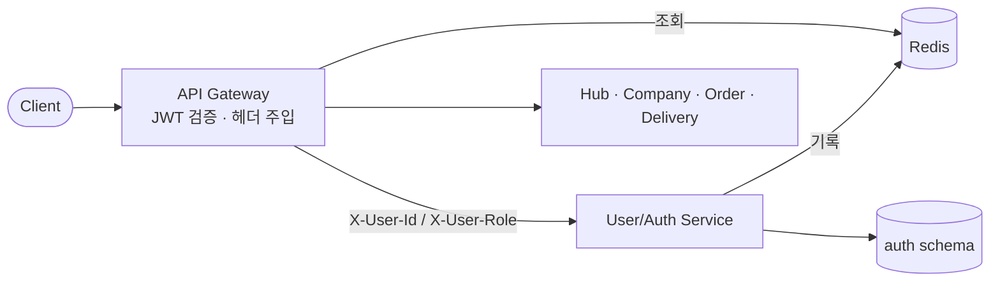
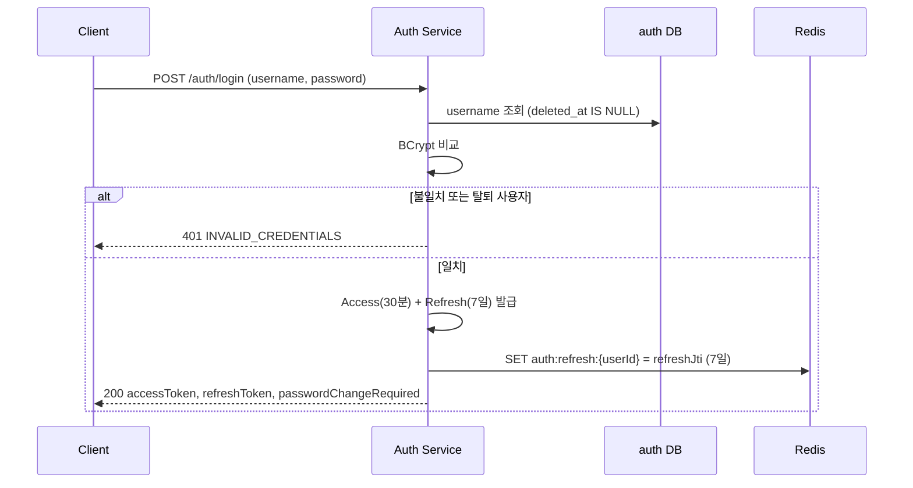
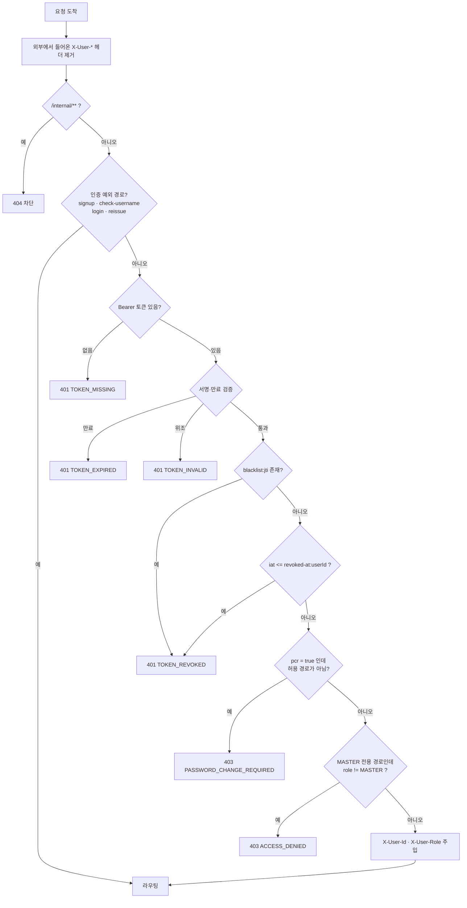
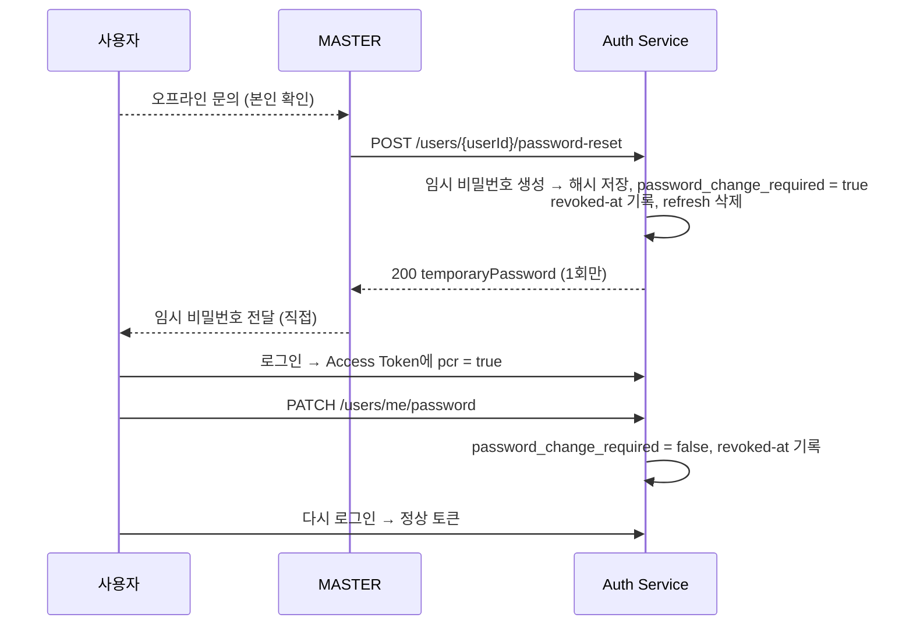

# SYS-01. 게이트웨이 인증·인가 설계

> 작성일: 2026-10-14 · 담당: 대진
> 관련: [[요구사항 정리]] USR-01~05·08·09·14·17·19~21, SYS-01 · [[07 서비스 정책]] 1.1, 2장 · [[04 API 명세서]] Auth·User

## 1. 범위와 역할 분담

| 구성 요소 | 책임 |
|---|---|
| **User/Auth Service** | 회원가입, 로그인(토큰 발급), 재발급, 로그아웃, 비밀번호 변경, 회원탈퇴. Redis에 토큰 상태 **기록** |
| **API Gateway** | 모든 외부 요청의 JWT 검증, Redis에서 토큰 상태 **조회**, MASTER 전용 경로 차단, 사용자 헤더 주입 |
| **각 서비스** | Gateway가 넣은 `X-User-Id`·`X-User-Role` 헤더를 신뢰하고 **소유권(본인 데이터)** 검사 |
| **Redis** | Refresh Token, 로그아웃 블랙리스트, 사용자별 토큰 무효화 시각 저장 |

> 발제는 Redis를 "필수 아님, 여유 있는 팀만"으로 둡니다(제외 대상 아님). 로그아웃과 토큰 무효화(USR-04·08·09·14·17·21)를 위해 인프라에 포함합니다.

---

## 2. 토큰

| 항목 | Access Token | Refresh Token |
|---|---|---|
| 형식 | JWT (HS256) | JWT (HS256) |
| 유효 시간 | **30분** | **7일** |
| claim | `sub`(userId), `role`, `pcr`(비밀번호 변경 필요), `jti`, `iat`, `exp` | `sub`(userId), `jti`, `iat`, `exp` |
| 전달 | `Authorization: Bearer {token}` | 재발급 요청 본문 |
| 서버 저장 | 저장하지 않음 (로그아웃 시 블랙리스트만) | Redis에 `jti` 저장 |

- **서명 키:** 환경 변수 `JWT_SECRET_KEY`(256비트 이상)을 Auth Service와 Gateway가 공유합니다. 코드·Git에 넣지 않습니다.
- **claim에 넣지 않는 것:** `is_delivery_manager`, 소속 정보. 자주 바뀌고 배송 서비스만 쓰므로, 필요한 서비스가 `GET /internal/v1/users/{userId}`로 조회합니다.
- **세션 정책:** 사용자당 Refresh Token **1개**. 새로 로그인하면 이전 기기의 Refresh Token은 무효가 됩니다.
- **Refresh Token Rotation:** 재발급할 때마다 Refresh Token도 새로 발급하고 이전 것은 무효로 합니다.

---

## 3. Redis 키 설계

| 키 | 값 | TTL | 기록 시점 | 삭제·확인 시점 |
|---|---|---|---|---|
| `auth:refresh:{userId}` | Refresh Token의 `jti` | 7일 | 로그인, 재발급 (덮어쓰기) | 로그아웃·비밀번호 변경·탈퇴·권한 변경·비활성화·비밀번호 초기화 시 삭제. 재발급 시 `jti` 일치 확인 |
| `auth:blacklist:{jti}` | `logout` | Access Token 남은 유효 시간 | 로그아웃 | Gateway가 매 요청 확인 |
| `auth:revoked-at:{userId}` | 무효화 시각 (epoch 초) | 30분 (Access Token 유효 시간) | 비밀번호 변경·탈퇴·권한 변경·비활성화·비밀번호 초기화 | Gateway가 매 요청 `iat <= 값`이면 거부 |

- **블랙리스트 vs 무효화 시각:** 로그아웃은 **그 토큰 하나**만 막으면 되므로 `jti` 블랙리스트를 씁니다. 비밀번호 변경·탈퇴·권한 변경은 **그 사용자의 모든 토큰**을 막아야 하므로 시각 기준으로 막습니다.
- TTL을 Access Token 유효 시간에 맞추면, 키가 사라질 때쯤 해당 토큰도 이미 만료되어 Redis에 데이터가 쌓이지 않습니다.
- **권한 변경도 무효화 대상**입니다. `role`이 claim에 들어 있어서, 바꾸지 않으면 강등된 사용자가 30분간 MASTER 토큰을 쓸 수 있습니다.

---

## 4. 흐름

### 4.1 로그인

- 없는 ID, 틀린 비밀번호, 탈퇴한 계정 모두 **같은 오류**를 반환합니다. 계정 존재 여부를 알려주지 않기 위해서입니다.

### 4.2 Gateway 요청 검증 (필터 순서)

- **헤더 제거가 첫 단계**입니다. 외부 사용자가 `X-User-Role: MASTER`를 직접 넣어 보내도 서비스에 전달되지 않습니다.
- Redis 확인 2건(`blacklist`, `revoked-at`)은 한 번의 왕복으로 처리합니다(MGET 또는 파이프라인).

### 4.3 재발급

1. Client가 `POST /auth/reissue`에 Refresh Token을 보냅니다.
2. Auth Service가 서명·만료를 검증하고, `sub`로 `auth:refresh:{userId}`를 조회해 `jti`가 일치하는지 확인합니다.
3. 일치하면 새 Access·Refresh Token을 발급하고 Redis 값을 새 `jti`로 덮어씁니다.
4. 일치하지 않으면 `401 REFRESH_TOKEN_INVALID`를 반환합니다. 이미 교체된 토큰을 재사용했다는 뜻이므로, 탈취 가능성이 있다고 보고 `auth:refresh:{userId}`를 삭제합니다.

### 4.4 비밀번호 초기화 (MASTER)

온라인 비밀번호 찾기는 없습니다. 사용자가 관리자에게 **오프라인으로 문의**하면 MASTER가 본인 여부를 확인한 뒤 초기화합니다.

- **`pcr = true` 토큰의 허용 경로:** `PATCH /users/me/password`, `POST /auth/logout`, `GET /users/me`. 나머지는 Gateway가 `403 PASSWORD_CHANGE_REQUIRED`로 거부합니다.
- 비밀번호 변경 후 `revoked-at`을 기록하므로 `pcr = true` 토큰은 더 이상 쓸 수 없고, 재로그인하면 `pcr = false` 토큰을 받습니다.

### 4.5 로그아웃·비밀번호 변경·회원탈퇴

| 기능 | DB | Redis | 결과 |
|---|---|---|---|
| 로그아웃 | - | `blacklist:{jti}` 기록, `refresh:{userId}` 삭제 | 현재 토큰만 즉시 무효 |
| 비밀번호 변경 | `password_hash` 갱신 | `revoked-at:{userId}` 기록, `refresh:{userId}` 삭제 | 모든 토큰 무효, **다시 로그인 필요** |
| 회원탈퇴 | `deleted_at`, `deleted_by` 기록 | `revoked-at:{userId}` 기록, `refresh:{userId}` 삭제 | 모든 토큰 무효, 로그인 차단 |
| 권한 변경·비활성화 (MASTER) | `role` 또는 `deleted_at` 갱신 | 대상 사용자의 `revoked-at` 기록, `refresh` 삭제 | 대상 사용자 재로그인 필요 |
| 비밀번호 초기화 (MASTER) | `password_hash`, `password_change_required = true` | 대상 사용자의 `revoked-at` 기록, `refresh` 삭제 | 임시 비밀번호로 재로그인 후 변경 강제 |

- 탈퇴·역할 강등·비활성화는 **활성 MASTER가 1명이면 거부**합니다(`409 LAST_MASTER`).

- **DB 반영 후 Redis에 기록합니다.** Redis 기록이 실패하면 예외로 DB 트랜잭션도 롤백합니다. 반대로 DB가 실패했는데 토큰만 무효화되는 것은 사용자가 재로그인하면 되므로 허용합니다.
- 비교는 `iat <= revoked-at`(둘 다 초 단위)입니다. `iat`이 초 단위라 **무효화 직후 같은 초에 재로그인한 토큰도 막힙니다.** 실사용에서는 문제가 없지만, 통합 테스트에서 비밀번호 변경 직후 바로 재로그인한다면 1초 기다린 뒤 로그인합니다.

---

## 5. 인가 (역할·소유권)

| 위치 | 검사 내용 |
|---|---|
| **Gateway** | 인증 + **MASTER 전용 경로**의 역할 검사 |
| **각 서비스** | 본인 데이터 여부([[07 서비스 정책]] 1.2), "MASTER 또는 업체관리자"처럼 데이터를 봐야 아는 권한 |

**Gateway MASTER 전용 경로** ([[04 API 명세서]] 기준)

| Method | 경로 |
|---|---|
| POST, GET | `/api/v1/users` |
| GET, PATCH | `/api/v1/users/{userId}` |
| PATCH | `/api/v1/users/{userId}/role`, `/delivery-manager`, `/organization` |
| POST | `/api/v1/users/{userId}/restore`, `/api/v1/users/{userId}/password-reset` |
| DELETE | `/api/v1/users/{userId}` |
| POST, DELETE | `/api/v1/companies`, `/api/v1/companies/{companyId}` |
| PATCH | `/api/v1/hubs/{hubId}` |
| POST, PATCH, DELETE | `/api/v1/hub-routes/**` |

> ⚠️ `/users/{userId}` 패턴이 `/users/me`, `/users/me/password`와 겹칩니다. `me`를 먼저 예외 처리해야 일반 사용자가 본인 정보를 조회·수정할 수 있습니다.
> 서비스에서도 같은 검사를 한 번 더 둡니다(방어적 검증). Gateway 설정 실수로 뚫려도 서비스가 막습니다.

### 5.1 Gateway와 서비스의 역할 구분

| 위치 | 인증 | 인가 |
|---|---|---|
| Gateway | ✅ 토큰 서명·만료·무효화 검증 | ✅ 경로 단위 역할 (MASTER 전용 경로) |
| 각 서비스 | ❌ 하지 않음. `X-User-Id`·`X-User-Role` 헤더만 읽음 | ✅ 본인 데이터 확인 + MASTER 기능의 역할 재확인 |

- 서비스에는 JWT 라이브러리와 Spring Security 필터 체인이 필요 없습니다. user-ms도 비밀번호 해시용 `spring-security-crypto`만 사용합니다.
- 데이터를 봐야 아는 권한(업체 관리자, 배송 담당자, 주문자 본인)은 Gateway가 판단할 수 없으므로 반드시 서비스에서 검사합니다.

### 5.2 서비스가 헤더를 신뢰하기 위한 전제

서비스가 `X-User-*` 헤더를 믿어도 되는 것은 **모든 외부 요청이 Gateway를 거칠 때뿐**입니다. 서비스 포트가 외부에 열려 있으면 `X-User-Role: MASTER`를 직접 넣어 권한을 위조할 수 있습니다.

| 규칙 | 내용 |
|---|---|
| 외부 공개 포트 | Docker Compose에서 **Gateway 포트만** 외부에 공개. 서비스 포트(`ports:`)는 매핑하지 않음 |
| 서비스 간 통신 | Docker 내부 네트워크 + Eureka로만 호출 |
| 로컬 개발 | 서비스 포트로 직접 호출하며 헤더를 수동으로 넣는 테스트는 허용 (개발 환경 한정) |
| 내부 API | Gateway 라우팅에 `/internal/**`이 없으므로 외부에서 도달 불가. 호출 서비스 검증 방식은 [[07 서비스 정책]] 9장 16번 |
| Feign 호출 시 사용자 정보 | 사용자 요청에서 시작된 내부 호출은 `X-User-Id`·`X-User-Role`·`X-Request-Id`를 그대로 전달 (감사 기록, 받는 서비스의 역할 확인, 요청 추적). `Authorization`·`X-Token-*`는 전달하지 않음. 요청 밖(스케줄러) 호출엔 붙이지 않음 |
| Feign 사용 범위 | **Feign은 우리 서비스끼리만** 사용. 외부 API(Slack Webhook 등)는 `RestClient`로 호출. 사용자 헤더가 외부로 나가지 않게, `url`로 외부 주소를 지정한 `@FeignClient`가 있으면 **기동 실패** |
| 헤더 형식 검사 | 서비스는 `X-User-Id`(UUID)·`X-User-Role`(MASTER·USER)이 **둘 다 있고 형식이 맞을 때만** 사용자로 인정. 하나만 있거나 형식이 틀리면 모든 API에서 401 `UNAUTHENTICATED` (Gateway를 거치지 않은 요청으로 봄) |

---

## 6. 오류 응답

공통 에러 포맷을 Gateway와 서비스가 똑같이 사용합니다.

| HTTP | 코드 | 상황 | 반환 위치 |
|---|---|---|---|
| 401 | `TOKEN_MISSING` | Authorization 헤더 없음 | Gateway |
| 401 | `TOKEN_EXPIRED` | Access Token 만료 → 클라이언트가 재발급 시도 | Gateway |
| 401 | `TOKEN_INVALID` | 서명 위조, 형식 오류 | Gateway |
| 401 | `TOKEN_REVOKED` | 로그아웃·비밀번호 변경·탈퇴·권한 변경된 토큰 | Gateway |
| 401 | `INVALID_CREDENTIALS` | 로그인 실패, 비밀번호 재확인 실패 | Auth |
| 401 | `REFRESH_TOKEN_INVALID` | 재발급 실패 | Auth |
| 403 | `ACCESS_DENIED` | 역할·소유권 불일치 | Gateway, 서비스 |
| 403 | `PASSWORD_CHANGE_REQUIRED` | 초기화된 비밀번호를 아직 변경하지 않음 | Gateway |
| 409 | `DUPLICATE_USERNAME` | 이미 사용 중인 ID (탈퇴한 ID 포함) | Auth |
| 409 | `DUPLICATE_SLACK_ID` | 활성 사용자가 이미 사용 중인 Slack ID | Auth |
| 409 | `LAST_MASTER` | 마지막 MASTER의 탈퇴·강등·비활성화 | Auth |
| 404 | `RESOURCE_NOT_FOUND` | 외부에서 `/internal/**` 호출, 라우트가 없는 경로 | Gateway |
| 503 | `AUTH_UNAVAILABLE` | Redis 연결 실패 | Gateway, Auth |

- **Redis 장애 시 요청을 거부합니다(fail-closed).** 통과시키면 로그아웃한 토큰이 다시 쓰일 수 있기 때문입니다.
- **외부에서 내부 API(`/internal/**`, `/api/v1/internal/**`)를 부르면 403이 아니라 404입니다.** 내부 API가 있다는 사실 자체를 외부에 알리지 않기 위해서입니다.

  | 응답 | 외부에서 보면 | 판단 |
  |---|---|---|
  | 401 | "토큰을 넣으면 들어갈 수 있다" | 틀린 안내. 토큰이 있어도 외부에서는 접근할 수 없음 |
  | 403 | "여기에 무언가 있고, 권한만 없다" | 주소를 바꿔 가며 403이 나오는 곳을 찾으면 내부 API 목록이 드러남 |
  | **404** | "없는 주소" | 진짜 없는 경로(`/api/v1/unknown`)와 응답이 같아 구분할 수 없음 → **채택** |

  서비스끼리의 호출(Feign → Eureka → 서비스 직접)은 Gateway를 거치지 않으므로 영향이 없습니다. 이 404는 보호의 한 겹일 뿐이며, 서비스 포트 비공개(GW-01)와 내부 호출자 인증(정책 #16)이 함께 필요합니다.

---

## 7. 결정 사항과 남은 결정

| # | 항목 | 결정 | 상태 |
|---|---|---|---|
| 1 | 토큰 무효화 방식 | Redis (Refresh 저장 + jti 블랙리스트 + 사용자별 무효화 시각) | ✅ 결정 |
| 2 | 토큰 유효 시간 | Access 30분, Refresh 7일 | ✅ 결정 |
| 3 | 사용자당 세션 수 | 1개 (새 로그인 시 이전 Refresh 무효) | ✅ 결정 |
| 4 | Redis 장애 | fail-closed (503) | ✅ 결정 |
| 5 | 탈퇴 제한 | 마지막 MASTER만 탈퇴 불가 | ✅ 결정 |
| 6 | 로그인 실패 횟수 제한 | 범위 밖 (필요하면 Redis 카운터로 추가 가능) | 제외 |
| 7 | 초기 MASTER | 기동 시 MASTER가 없으면 `.env`(`MASTER_USERNAME`, `MASTER_PASSWORD`, `MASTER_NAME`, `MASTER_SLACK_ID`)로 1회 생성. 소속은 `HQ` | ✅ 결정 |
