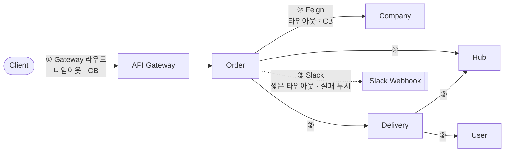
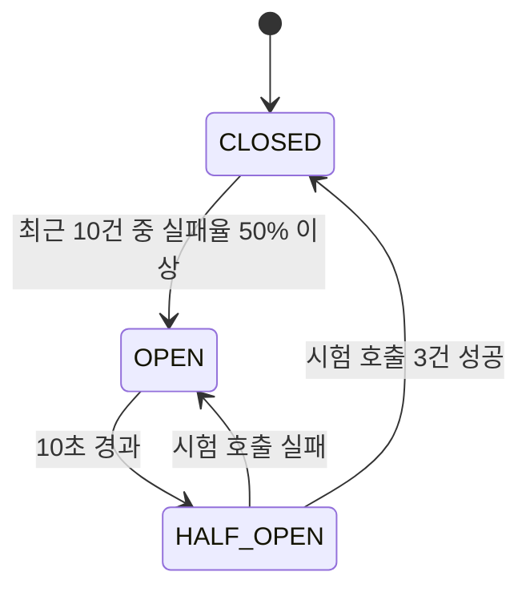

# SYS-13. 장애 대응 설계

> 작성일: 2026-10-14 · 담당: 대진 (공통 설정) · 각 서비스 담당 (실패 처리)
> 관련: [[요구사항 정리]] SYS-13 · [[07 서비스 정책]] 7장 Saga · [[SYS-01 게이트웨이 인증 인가 설계]] 6장 (Redis 장애) · [[SA 설계보완리포트]] D-4, T-4

## 1. 목적과 범위

다른 서비스가 느리거나 죽었을 때 **호출한 쪽까지 같이 멈추지 않게** 하고, 실패를 **같은 방식으로 분류**해서 각 서비스가 일관되게 처리하도록 합니다.

| 영역 | 내용 | 담당 |
|---|---|---|
| Feign 공통 설정 | 타임아웃, Circuit Breaker, 오류 분류(`ErrorDecoder`), 재시도 기본값 | 대진 |
| Gateway 라우트 보호 | 라우트별 타임아웃, Circuit Breaker, 장애 응답(503·504) | 대진 |
| 호출 실패 시 업무 처리 | 주문 FAILED 처리, 보상 트랜잭션, 재시도 여부 | 각 서비스 담당 (주로 다울·이찬·영은) |
| 장애 시연 | 서비스 중단 → Circuit Breaker 열림 → 복구 | 대진·다울 |

**범위 밖:** DB 장애, Redis 장애(→ [[SYS-01 게이트웨이 인증 인가 설계]]의 fail-closed 정책), 서비스 이중화.

---

## 2. 적용 위치



| 위치 | 기술 | 의존성 |
|---|---|---|
| ① Gateway 라우트 | Spring Cloud Gateway CircuitBreaker 필터 + Resilience4j (Reactor) | `spring-cloud-starter-circuitbreaker-reactor-resilience4j` |
| ② 서비스 간 Feign | Spring Cloud OpenFeign + Spring Cloud CircuitBreaker (Resilience4j) | `spring-cloud-starter-openfeign`, `spring-cloud-starter-circuitbreaker-resilience4j` |
| ③ Slack Webhook | HTTP 클라이언트 타임아웃만 (Circuit Breaker 선택) | - |

> 발제는 Circuit Breaker를 직접 요구하지 않습니다. 요구사항 정리에서 **권장**(SYS-13)으로 분류했습니다.

---

## 3. 타임아웃

### 3.1 원칙

**바깥 타임아웃은 안쪽 호출들의 타임아웃 합보다 길어야 합니다.** 그렇지 않으면 안쪽 작업은 계속 진행되는데 바깥에서 먼저 실패를 반환해, 클라이언트는 실패로 알지만 실제로는 주문이 완료되는 상황이 생깁니다.

### 3.2 값 (초안)

| 구간 | 연결 | 응답 | 근거 |
|---|---|---|---|
| Feign 기본값 | 1초 | **2초** | 내부 호출은 단건 조회·변경이라 짧게 |
| Delivery → Hub 경로 조회 | 1초 | 2초 | 기본값 |
| Order → Delivery 배송 생성 | 1초 | **5초** | 내부에서 Hub 경로 조회(2초)를 다시 호출하므로 더 길게 |
| Slack Webhook | 1초 | 2초 | 실패해도 주문에 영향 없음 |
| Gateway 기본값 | 2초 | **5초** | 일반 API |
| Gateway `/api/v1/orders/**` | 2초 | **15초** | 주문 생성 = 업체 검증 2 + 재고 차감 2 + 배송 생성 5 + 보상(재고 복원) 2 + 여유 |

- 주문 생성을 비동기(`202`)로 바꾸면 Gateway 주문 라우트도 5초로 줄일 수 있습니다. → [[07 서비스 정책]] 9장 11번
- Gateway가 먼저 타임아웃(504)되어도 주문 처리는 서버에서 계속될 수 있습니다. 클라이언트는 **같은 `Idempotency-Key`로 다시 요청**하거나 주문 조회로 결과를 확인합니다.

---

## 4. Circuit Breaker

### 4.1 기준값 (초안, 시연하기 쉬운 값)

| 항목 | 값 | 의미 |
|---|---|---|
| 집계 방식 | 최근 호출 **10건** (COUNT_BASED) | |
| 최소 호출 수 | 5건 | 5건 이상 쌓여야 실패율 계산 |
| 실패율 기준 | **50%** | 넘으면 OPEN |
| OPEN 유지 | **10초** | 그동안 호출하지 않고 바로 실패 |
| HALF_OPEN 시험 호출 | 3건 | 성공하면 CLOSED, 실패하면 다시 OPEN |
| 느린 호출 | 집계하지 않음 | 타임아웃이 이미 끊어주므로 |



### 4.2 단위

- **대상 서비스 단위**로 하나씩 둡니다(`hub-ms`, `delivery-ms` 등). 메서드마다 두면 같은 서비스가 죽어도 메서드별로 따로 실패가 쌓여 늦게 열립니다.
- Feign은 기본이 메서드 단위이므로 `spring.cloud.openfeign.circuitbreaker.group.enabled: true`로 클라이언트 단위로 묶습니다.

### 4.3 실패로 세는 것 / 세지 않는 것

| 응답 | Circuit Breaker | 이유 |
|---|---|---|
| 연결 실패, 타임아웃 | ✅ 실패 | 대상 서비스 장애 |
| 5xx | ✅ 실패 | 대상 서비스 장애 |
| **4xx** (재고 부족 409, 검증 실패 400, 없음 404) | ❌ 세지 않음 | **정상적인 업무 응답**. 재고 부족 주문이 몰렸다고 Hub 호출이 차단되면 안 됨 |

---

## 5. 오류 분류 (Feign `ErrorDecoder`)

서비스 간 호출 실패를 네 가지로 나눠 공통 예외로 바꿉니다. 각 서비스는 이 예외 종류만 보고 처리합니다.

| 분류 | 발생 조건 | 공통 예외 (예시) | 결과가 확실한가 | 클라이언트 응답 |
|---|---|---|---|---|
| **업무 거절** | 4xx | `RemoteBusinessException` (원래 오류 코드 유지) | ✅ 확실히 실패 | 원래 코드 그대로 전달 (예: 409 `INSUFFICIENT_STOCK`) |
| **서비스 오류** | 5xx | `RemoteServiceException` | ⚠️ 대체로 실패 | 503 `SERVICE_UNAVAILABLE` |
| **응답 없음** | 타임아웃, 연결 실패 | `RemoteTimeoutException` | ❌ **결과 모름** | 504 `SERVICE_TIMEOUT` |
| **차단됨** | Circuit Breaker OPEN | `CallNotPermittedException` → `RemoteServiceException` | ✅ 호출 안 함 | 503 `SERVICE_UNAVAILABLE` |

> **"응답 없음"은 실패가 아니라 "결과를 모름"입니다.** 재고 차감이 타임아웃되어도 Hub에서는 실제로 차감됐을 수 있습니다. 이 경우를 실패로 단정하고 그냥 끝내면 재고가 사라집니다.

---

## 6. 재시도

| 호출 종류 | 재시도 | 조건 |
|---|---|---|
| 기본값 (모든 Feign) | **하지 않음** | 실수로 같은 작업이 두 번 실행되는 것을 막기 위해 |
| 조회 (GET 내부 검증) | 1회 허용 | 부작용 없음 |
| 변경 (POST) + `Idempotency-Key` | 1회 허용, **같은 키** 사용 | 재고 차감·복원, 배송 생성·취소 |
| 변경 (POST) + 키 없음 | ❌ 금지 | |
| Gateway 라우트 | ❌ 하지 않음 | 재시도는 업무를 아는 서비스가 판단 |

- 재시도는 Feign `Retryer`가 아니라 **각 서비스가 명시적으로** 합니다. 어떤 호출이 안전한지는 업무를 아는 사람만 판단할 수 있기 때문입니다.
- 재시도 대상 API는 **같은 키로 다시 와도 결과가 같아야** 합니다(멱등). → 이찬(재고), 영은(배송) 확인 필요

---

## 7. Fallback 원칙

- **가짜 성공을 돌려주지 않습니다.** 예: Company가 죽었다고 "검증 통과"로 처리하지 않습니다.
- Fallback은 **실패를 공통 예외로 바꾸는 역할만** 합니다. 그다음 무엇을 할지는 호출한 서비스가 정합니다.
- 예외: Slack 알림은 실패해도 로그만 남기고 주문은 그대로 진행합니다.

---

## 8. 호출별 실패 처리

각 담당자가 확정할 내용입니다. 아래는 제안입니다.

### 8.1 주문 생성 (Order Saga)

| 단계 | 업무 거절 (4xx) | 서비스 오류·차단 (5xx·OPEN) | 응답 없음 (타임아웃) |
|---|---|---|---|
| ① 업체·상품 검증 → Company | 주문 FAILED | 주문 FAILED (되돌릴 것 없음) | 주문 FAILED |
| ② 재고 차감 → Hub | 재고 부족 → FAILED | FAILED | **같은 키로 1회 재시도** → 그래도 모르면 **재고 복원 호출** 후 FAILED |
| ③ 배송 생성 → Delivery | 재고 복원 → FAILED | 재고 복원 → FAILED | **같은 키로 1회 재시도** (이미 만들어졌으면 기존 배송 반환) → 그래도 모르면 **배송 취소 + 재고 복원** 후 FAILED |
| ④ 보상: 재고 복원 → Hub | - | 같은 키로 재시도 (최대 3회) | 같은 키로 재시도 (최대 3회) |
| ⑤ Slack 알림 | 로그만 | 로그만 | 로그만 |

**필요한 전제 (다른 서비스와 합의)**

| # | 전제 | 담당 |
|---|---|---|
| P1 | 재고 복원은 **차감 기록이 없으면 아무것도 하지 않고 성공**을 반환 (타임아웃으로 차감 여부를 모를 때 안전하게 복원 호출 가능) | 이찬 |
| P2 | 재고 차감·복원은 같은 `Idempotency-Key`로 다시 오면 **처음 결과를 그대로** 반환 | 이찬 |
| P3 | 배송 생성은 같은 키(또는 같은 `orderId`)로 다시 오면 **기존 배송을 반환** | 영은 |
| P4 | 배송 취소는 배송이 없으면 아무것도 하지 않고 성공 | 영은 |

### 8.2 기타 호출

| 호출 | 실패 시 처리 | 담당 |
|---|---|---|
| Company → Hub 허브 검증 (업체 등록) | 업체 등록 거부, 503 | 권우 |
| Delivery → Hub 경로 조회 (배송 생성 중) | 배송 생성 실패 → Order가 8.1 ③으로 처리 | 영은 |
| Delivery → User 담당자 검증 | 담당자 배정 거부, 503 | 영은 |

### 8.3 미결정

| # | 항목 | 내용 | 담당 |
|---|---|---|---|
| F1 | 보상 자체가 끝까지 실패할 때 | 재고 복원을 3회 재시도해도 실패하면 주문 상태를 무엇으로 둘지 (`PROCESSING` 유지 + 로그 / 별도 상태 추가) | 다울 |
| F2 | 멈춘 주문 복구 | `PROCESSING`으로 남은 주문을 누가 언제 정리할지 (스케줄러 등). [[SA 설계보완리포트]] D-4 | 다울 |
| F3 | 주문 생성 동기·비동기 | 타임아웃 값과 직결. [[07 서비스 정책]] 9장 11번 | 다울 |

---

## 9. Gateway 라우트 보호

| 항목 | 내용 |
|---|---|
| 타임아웃 | 전역 연결 2초·응답 5초, 주문 라우트만 응답 15초 (3.2) |
| Circuit Breaker | 라우트(대상 서비스)마다 1개. 기준값은 4.1과 동일 |
| Fallback | `forward:/fallback` → 공통 에러 형식으로 503 `SERVICE_UNAVAILABLE` |
| 타임아웃 응답 | 504 `SERVICE_TIMEOUT` (공통 에러 형식) |
| 재시도 | 하지 않음 |

- Gateway의 Circuit Breaker는 **인증 필터 다음**에 동작합니다. 토큰이 없는 요청은 서비스 장애와 상관없이 401입니다.
- user-ms가 죽으면 로그인·재발급만 실패하고, 이미 로그인한 사용자의 다른 요청은 계속 동작합니다(Gateway는 JWT와 Redis만 확인).

---

## 10. 설정 위치와 담당

### 10.0 두 층, 한 곳의 기본값

```
Client ──①──▶ Gateway ──①──▶ Order ──②──▶ Hub
                                    └──②──▶ Delivery ──②──▶ Hub
```

| 층 | 보호 구간 | 설정 위치 | 담당 |
|---|---|---|---|
| ① Gateway | 클라이언트 → 서비스 | `gateway-edge/src/main/resources/application.yaml` | 대진 |
| ② Feign **공통 기본값** | 모든 서비스 → 서비스 | `common/src/main/resources/application-common.yaml` (각 서비스가 `profiles.include: common`으로 읽음) | 대진 |
| ② Feign **서비스별 예외** | 특정 호출만 | 호출하는 서비스의 `application.yaml` | 각 서비스 담당 |
| 실패 시 업무 처리 | - | 호출하는 서비스의 코드 (8장) | 각 서비스 담당 |

- 두 층은 서로 겹치지 않습니다. Gateway 설정은 Order → Hub 구간에, Feign 설정은 클라이언트 → Gateway 구간에 영향을 주지 않습니다.
- **값은 기본적으로 공통 파일 한 곳에만 둡니다.** 서비스별로 따로 정하면 "바깥 타임아웃 > 안쪽 합" 원칙(3.1)을 확인하기 어렵고, Circuit Breaker 동작이 서비스마다 달라져 시연·디버깅이 어렵습니다.
- 서비스별 예외를 추가할 때는 대진에게 공유해 3.2 표와 Gateway 라우트 타임아웃을 함께 맞춥니다.

**현재 예상되는 서비스별 예외**

| 서비스 | 설정 | 이유 | 담당 |
|---|---|---|---|
| order-ms | `delivery-ms` read-timeout 5초 | 배송 생성 안에서 Hub 경로 조회를 다시 호출 | 다울 |

```yaml
# order-ms/src/main/resources/application.yaml
spring:
  cloud:
    openfeign:
      client:
        config:
          delivery-ms:
            read-timeout: 5000
```

## 11. 설정 예시

### 11.1 서비스 공통 (Feign) — `application-common.yaml`

```yaml
spring:
  cloud:
    openfeign:
      circuitbreaker:
        enabled: true
        group:
          enabled: true          # 클라이언트(대상 서비스) 단위로 묶기
      client:
        config:
          default:
            connect-timeout: 1000
            read-timeout: 2000

resilience4j:
  circuitbreaker:
    configs:
      default:
        sliding-window-type: COUNT_BASED
        sliding-window-size: 10
        minimum-number-of-calls: 5
        failure-rate-threshold: 50
        wait-duration-in-open-state: 10s
        permitted-number-of-calls-in-half-open-state: 3
        ignore-exceptions:
          - com.common.exception.RemoteBusinessException   # 4xx는 실패로 세지 않음
  timelimiter:
    configs:
      default:
        timeout-duration: 6s     # Feign read-timeout보다 길게 (Feign 타임아웃이 먼저 동작하도록)

management:
  endpoints:
    web:
      exposure:
        include: health, info, circuitbreakers, circuitbreakerevents
```

### 11.2 Gateway — `gateway-edge/application.yaml`

```yaml
spring:
  cloud:
    gateway:
      server:
        webflux:
          httpclient:
            connect-timeout: 2000
            response-timeout: 5s
          routes:
            - id: order-ms
              uri: lb://order-ms
              predicates:
                - Path=/api/v1/orders/**
              metadata:
                response-timeout: 15000
              filters:
                - name: CircuitBreaker
                  args:
                    name: order-ms
                    fallbackUri: forward:/fallback
```

> 패키지명(`com.common.exception`)과 클래스명은 공통 모듈 구조가 정해지면 맞춥니다. Spring Cloud 2025.0.x 기준 속성명이며, 적용 시 실제 동작을 확인합니다.

---

## 12. 확인·시연

| # | 시나리오 | 기대 결과 |
|---|---|---|
| 1 | Delivery 컨테이너 중지 후 주문 1건 | 배송 생성 실패 → 재고 복원 → 주문 FAILED (발제 필수 롤백 시나리오) |
| 2 | 같은 상태에서 주문 5건 이상 | Circuit Breaker OPEN → 이후 주문은 Delivery를 호출하지 않고 바로 실패 (`/actuator/circuitbreakers`로 상태 확인) |
| 3 | Delivery 재시작 후 10초 대기 | HALF_OPEN → 시험 호출 성공 → CLOSED, 주문 정상 처리 |
| 4 | 재고 부족 주문 10건 | 409로 실패하지만 Circuit Breaker는 **열리지 않음** |
| 5 | Hub에 응답 지연 주입 (테스트용 sleep) | 2초 후 타임아웃 → 재시도 → 복원 → FAILED, 재고 수량 원래대로 |
| 6 | user-ms 중지 | 로그인은 503, 기존 토큰으로 다른 서비스 요청은 정상 |

---

## 13. 결정 사항과 남은 결정

| # | 항목 | 결정 | 상태 |
|---|---|---|---|
| 1 | 담당 | 공통 설정·Gateway: 대진 / 실패 처리: 각 서비스 | ✅ 결정 |
| 2 | 재시도 기본값 | 하지 않음. 멱등성 키가 있는 호출만 서비스가 명시적으로 1회 | 제안 |
| 3 | 4xx 처리 | Circuit Breaker 실패로 세지 않음 | 제안 |
| 4 | 타임아웃·CB 값 | 3.2, 4.1 초안 | 제안 (구현 후 조정) |
| 5 | 전제 P1~P4 | 재고 복원·배송 생성·배송 취소의 멱등 동작 | ⚠️ 이찬·영은 확인 |
| 6 | F1~F3 | 보상 실패, 멈춘 주문, 동기·비동기 | ⚠️ 다울 결정 |
