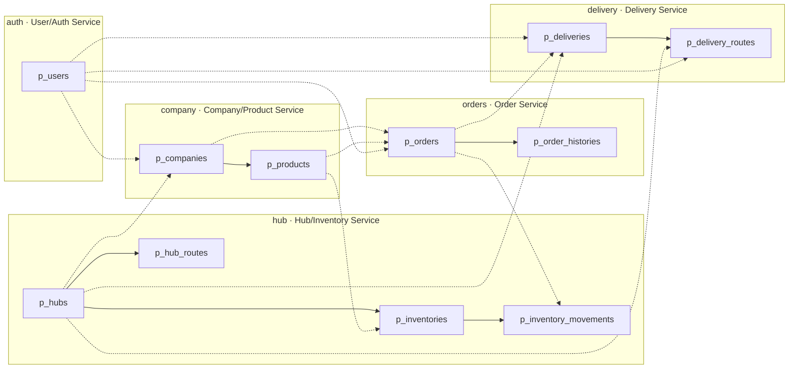
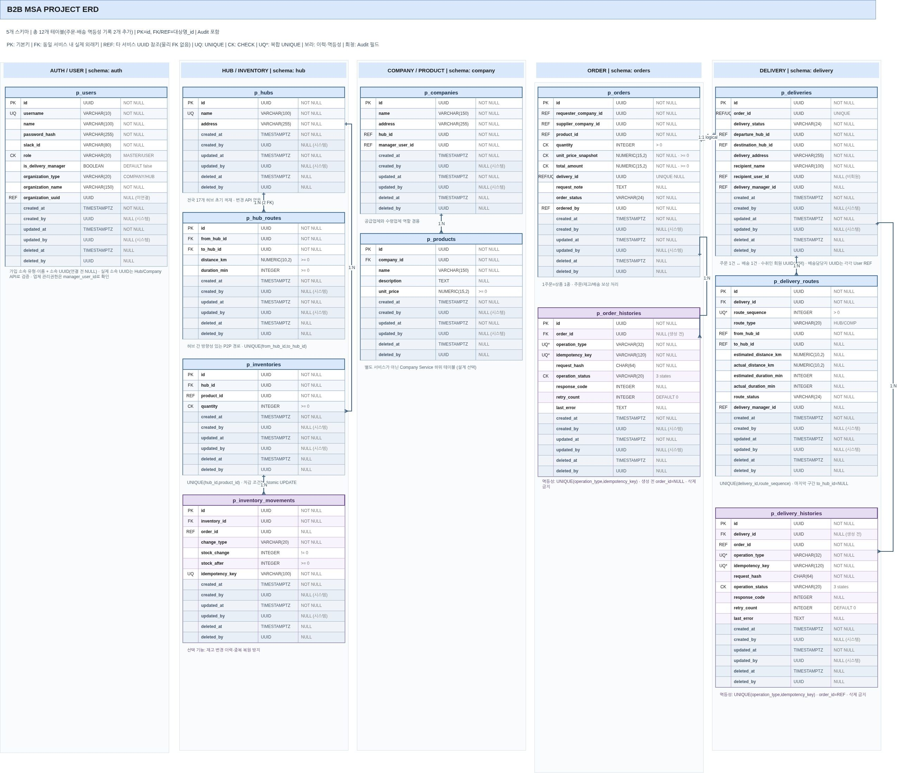

# 5. ERD

> 원본 다이어그램: [draw.io](https://app.diagrams.net/#G1eWI_xOKKnUKvRS9euyz6X1hfhthzdHWy#%7B%22pageId%22%3A%22erd%22%7D)
> 컬럼별 상세(논리명·기본값·설명)는 [[06 테이블 명세서]]를 참고합니다.

## 개요

| 항목 | 내용                                                           |
|---|--------------------------------------------------------------|
| DBMS | PostgreSQL (단일 컨테이너, 서비스별 스키마 분리)                            |
| 스키마 | `auth`, `hub`, `company`, `orders`, `delivery` (5개)          |
| 테이블 | 11개                                                          |
| 기본키 | 모든 테이블 `id UUID`                                             |
| 공통 컬럼 | Audit 6개 (`created_at/by`, `updated_at/by`, `deleted_at/by`) |
| 삭제 방식 | Soft Delete (`deleted_at IS NULL`만 조회)                       |

### 표기 규칙

| 표기 | 의미 | Mermaid 표현 |
|---|---|---|
| PK | 기본키 | `PK` |
| FK | **같은 서비스(스키마) 안의** 실제 외래키 | `FK` + 실선 `--` |
| REF | **다른 서비스의** UUID 논리 참조 (DB 외래키 없음, API로 검증) | `"REF"` 주석 + 점선 `..` |
| UQ / UQ* | 단일 UNIQUE / 복합 UNIQUE | `UK` |
| CK | CHECK 제약조건 | 주석에 조건 표기 |

---

## 1. 서비스 경계 다이어그램

어떤 테이블이 어느 서비스(스키마)에 속하고, 경계를 넘는 참조가 어디에 있는지 보여줍니다.
실선은 FK, 점선은 REF입니다.

---

## 2. 전체 ERD

Audit 공통 컬럼 6개는 모든 테이블에 동일하게 있으므로 다이어그램에서는 생략했습니다.

```mermaid
erDiagram
    %% ───────── auth ─────────
    p_users {
        UUID id PK
        VARCHAR username UK "(10) 로그인 ID"
        VARCHAR name "(100)"
        VARCHAR password_hash "(255) BCrypt"
        VARCHAR slack_id "(80)"
        VARCHAR role "(20) CK MASTER/USER"
        BOOLEAN is_delivery_manager "DEFAULT false"
        VARCHAR organization_type "(20) CK COMPANY/HUB/HQ"
        VARCHAR organization_name "(150)"
        UUID organization_id "REF 업체 또는 허브, NULL=미연결"
        BOOLEAN password_change_required "DEFAULT false"
    }

    %% ───────── hub ─────────
    p_hubs {
        UUID id PK
        VARCHAR name UK "(100)"
        VARCHAR address "(255)"
    }
    p_hub_routes {
        UUID id PK
        UUID departure_hub_id FK,UK "UQ*(departure,arrival)"
        UUID arrival_hub_id FK,UK "UQ*(departure,arrival)"
        NUMERIC distance_km "(10,2) CK >= 0"
        INTEGER duration_min "CK >= 0"
    }
    p_inventories {
        UUID id PK
        UUID hub_id FK,UK "UQ*(hub,product)"
        UUID product_id UK "REF p_products, UQ*(hub,product)"
        INTEGER quantity "CK >= 0"
    }
    p_inventory_movements {
        UUID id PK
        UUID inventory_id FK
        UUID order_id "REF p_orders, NULL"
        VARCHAR change_type "(20) INCREASE/DECREASE/RESTORE"
        INTEGER stock_change "CK != 0"
        INTEGER stock_after "CK >= 0"
        VARCHAR idempotency_key UK "(100)"
    }

    %% ───────── company ─────────
    p_companies {
        UUID id PK
        VARCHAR name "(150)"
        VARCHAR address "(255)"
        UUID hub_id "REF p_hubs"
        UUID manager_user_id "REF p_users"
    }
    p_products {
        UUID id PK
        UUID company_id FK
        VARCHAR name "(150)"
        TEXT description "NULL"
        NUMERIC unit_price "(15,2) CK >= 0"
    }

    %% ───────── orders ─────────
    p_orders {
        UUID id PK
        UUID requester_company_id "REF p_companies (수령)"
        UUID supplier_company_id "REF p_companies (공급)"
        UUID product_id "REF p_products"
        INTEGER quantity "CK > 0"
        NUMERIC unit_price_snapshot "(15,2) CK >= 0"
        NUMERIC total_amount "(15,2) CK >= 0"
        UUID delivery_id UK "REF p_deliveries, NULL"
        TEXT request_note "NULL"
        VARCHAR order_status "(24) PROCESSING/COMPLETED/FAILED/CANCELLED"
        UUID ordered_by "REF p_users"
    }
    p_order_histories {
        UUID id PK
        UUID order_id FK "NULL (생성 전)"
        VARCHAR operation_type UK "(32) UQ*(type,key)"
        VARCHAR idempotency_key UK "(120) UQ*(type,key)"
        CHAR request_hash "(64)"
        VARCHAR operation_status "(20) PROCESSING/SUCCEEDED/FAILED"
        INTEGER response_code "NULL"
        INTEGER retry_count "DEFAULT 0"
        TEXT last_error "NULL"
    }

    %% ───────── delivery ─────────
    p_deliveries {
        UUID id PK
        UUID order_id UK "REF p_orders"
        VARCHAR delivery_status "(24)"
        UUID departure_hub_id "REF p_hubs"
        UUID arrival_hub_id "REF p_hubs"
        VARCHAR delivery_address "(255)"
        VARCHAR recipient_name "(100)"
        UUID recipient_user_id "REF p_users, NULL=비회원"
        UUID delivery_manager_id "REF p_users, NULL"
    }
    p_delivery_routes {
        UUID id PK
        UUID delivery_id FK,UK "UQ*(delivery,sequence)"
        INTEGER route_sequence UK "CK > 0"
        VARCHAR route_type "(20) HUB_TO_HUB/HUB_TO_COMPANY"
        UUID departure_hub_id "REF p_hubs"
        UUID arrival_hub_id "REF p_hubs, 마지막 구간 NULL"
        NUMERIC estimated_distance_km "(10,2) NULL"
        NUMERIC actual_distance_km "(10,2) NULL"
        INTEGER estimated_duration_min "NULL"
        INTEGER actual_duration_min "NULL"
        VARCHAR route_status "(24)"
        UUID delivery_manager_id "REF p_users, NULL"
    }

    %% ───────── FK (실선, 같은 스키마) ─────────
    p_hubs ||--o{ p_hub_routes : "출발 departure_hub_id"
    p_hubs ||--o{ p_hub_routes : "도착 arrival_hub_id"
    p_hubs ||--o{ p_inventories : "보관"
    p_inventories ||--o{ p_inventory_movements : "변경 기록"
    p_companies ||--o{ p_products : "소유"
    p_orders |o--o{ p_order_histories : "요청 처리 기록"
    p_deliveries ||--o{ p_delivery_routes : "이동 구간"

    %% ───────── REF (점선, 서비스 간) ─────────
    p_products ||..o{ p_inventories : "product_id"
    p_orders |o..o{ p_inventory_movements : "order_id"
    p_hubs ||..o{ p_companies : "관리 허브"
    p_users ||..o{ p_companies : "업체 관리자"
    p_companies ||..o{ p_orders : "요청 업체"
    p_companies ||..o{ p_orders : "공급 업체"
    p_products ||..o{ p_orders : "주문 상품"
    p_users ||..o{ p_orders : "주문자"
    p_orders ||..o| p_deliveries : "1:1 배송"
    p_hubs ||..o{ p_deliveries : "출발 허브"
    p_hubs ||..o{ p_deliveries : "도착 허브"
    p_users |o..o{ p_deliveries : "수취인"
    p_users |o..o{ p_deliveries : "배송담당자"
    p_hubs ||..o{ p_delivery_routes : "구간 허브"
    p_users |o..o{ p_delivery_routes : "구간 담당자"
```

> `p_users.organization_id`는 `organization_type`에 따라 `p_companies.id` 또는 `p_hubs.id`를 가리키는 **조건부 REF**라서 다이어그램에는 관계선으로 그리지 않았습니다.

---

## 3. 스키마별 설명

### auth — User/Auth Service

| 테이블 | 역할 | 핵심 제약 |
|---|---|---|
| `p_users` | 계정, 권한(MASTER/USER), 배송담당 여부, 소속 조직 | `username` UNIQUE · `slack_id` 부분 UNIQUE · `role`·`organization_type` CHECK |

- 배송담당자는 별도 엔티티 없이 `is_delivery_manager` 플래그로 구분합니다.
- 가입 시 소속 유형·이름만 받고, 조직 확인 후 `organization_id`를 연결합니다(그전까지 NULL).

### hub — Hub/Inventory Service

| 테이블 | 역할 | 핵심 제약 |
|---|---|---|
| `p_hubs` | 전국 17개 허브 (초기 적재, 변경 API 없음) | `name` UNIQUE |
| `p_hub_routes` | 방향 있는 P2P 허브 간 경로 | UNIQUE(`departure_hub_id`, `arrival_hub_id`) · 출발≠도착 |
| `p_inventories` | 허브별 상품 현재 재고 | UNIQUE(`hub_id`, `product_id`) · `quantity >= 0` |
| `p_inventory_movements` | 재고 변경 이력 + 멱등성 | `idempotency_key` UNIQUE · `stock_after >= 0` |

- 재고 차감은 조건부 UPDATE(Atomic UPDATE) 또는 잠금으로 음수를 막습니다.
- 재고 수량 변경과 movement 기록을 하나의 로컬 트랜잭션으로 처리합니다.

### company — Company/Product Service

| 테이블 | 역할 | 핵심 제약 |
|---|---|---|
| `p_companies` | 업체 (공급·수령 겸용) | `hub_id`, `manager_user_id` REF |
| `p_products` | 업체가 공급하는 상품 (Company Service 하위 리소스) | `unit_price >= 0` |

### orders — Order Service

| 테이블 | 역할 | 핵심 제약 |
|---|---|---|
| `p_orders` | 주문 + Saga 진행 상태 | `quantity > 0` · `delivery_id` UNIQUE · 상태 4종 CHECK |
| `p_order_histories` | 주문 생성·취소 요청의 멱등성 기록 | UNIQUE(`operation_type`, `idempotency_key`) |

- 1주문 = 1상품. 주문 당시 단가(`unit_price_snapshot`)와 총액(`total_amount = 단가 × 수량`)을 저장합니다.
- `p_order_histories.order_id`는 주문이 만들어지기 전에는 NULL이고, `SUCCEEDED`가 되면 NOT NULL이어야 합니다.

### delivery — Delivery Service

| 테이블 | 역할 | 핵심 제약 |
|---|---|---|
| `p_deliveries` | 주문 1건당 배송 1건 | `order_id` UNIQUE |
| `p_delivery_routes` | 배송을 이루는 이동 구간 | UNIQUE(`delivery_id`, `route_sequence`) · 유형별 `arrival_hub_id` NULL 규칙 |

- 구간 예시: `서울 허브 → 대전 허브`(HUB_TO_HUB) → `대전 → 부산`(HUB_TO_HUB) → `부산 허브 → 수령업체`(HUB_TO_COMPANY, `arrival_hub_id` NULL)

---

## 4. 관계 목록

| 출발 테이블 | 참조 컬럼 | 대상 테이블 | 종류 | 카디널리티 |
|---|---|---|---|---|
| p_hub_routes | departure_hub_id | p_hubs | FK | N:1 |
| p_hub_routes | arrival_hub_id | p_hubs | FK | N:1 |
| p_inventories | hub_id | p_hubs | FK | N:1 |
| p_inventories | product_id | p_products | REF | N:1 |
| p_inventory_movements | inventory_id | p_inventories | FK | N:1 |
| p_inventory_movements | order_id | p_orders | REF | N:0..1 |
| p_companies | hub_id | p_hubs | REF | N:1 |
| p_companies | manager_user_id | p_users | REF | N:1 |
| p_products | company_id | p_companies | FK | N:1 |
| p_orders | requester_company_id | p_companies | REF | N:1 |
| p_orders | supplier_company_id | p_companies | REF | N:1 |
| p_orders | product_id | p_products | REF | N:1 |
| p_orders | delivery_id | p_deliveries | REF | 1:0..1 |
| p_orders | ordered_by | p_users | REF | N:1 |
| p_order_histories | order_id | p_orders | FK | N:0..1 |
| p_deliveries | order_id | p_orders | REF | 1:1 |
| p_deliveries | departure_hub_id | p_hubs | REF | N:1 |
| p_deliveries | arrival_hub_id | p_hubs | REF | N:1 |
| p_deliveries | recipient_user_id | p_users | REF | N:0..1 |
| p_deliveries | delivery_manager_id | p_users | REF | N:0..1 |
| p_delivery_routes | delivery_id | p_deliveries | FK | N:1 |
| p_delivery_routes | departure_hub_id | p_hubs | REF | N:1 |
| p_delivery_routes | arrival_hub_id | p_hubs | REF | N:0..1 |
| p_delivery_routes | delivery_manager_id | p_users | REF | N:0..1 |
| p_users | organization_id | p_companies / p_hubs | REF (조건부) | N:0..1 |

---

## 5. 원본 ERD 이미지

