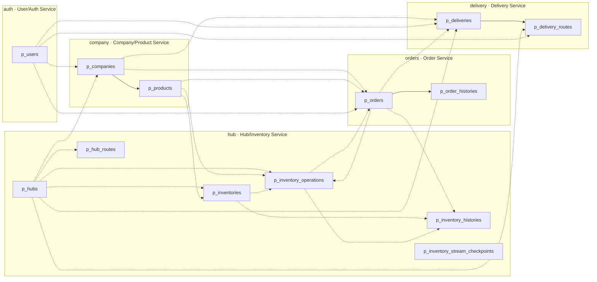
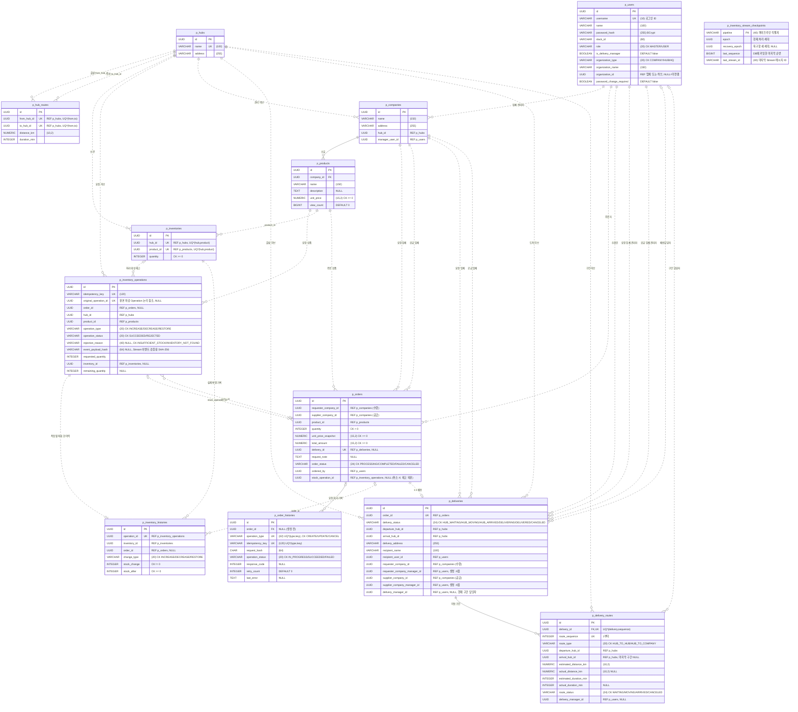
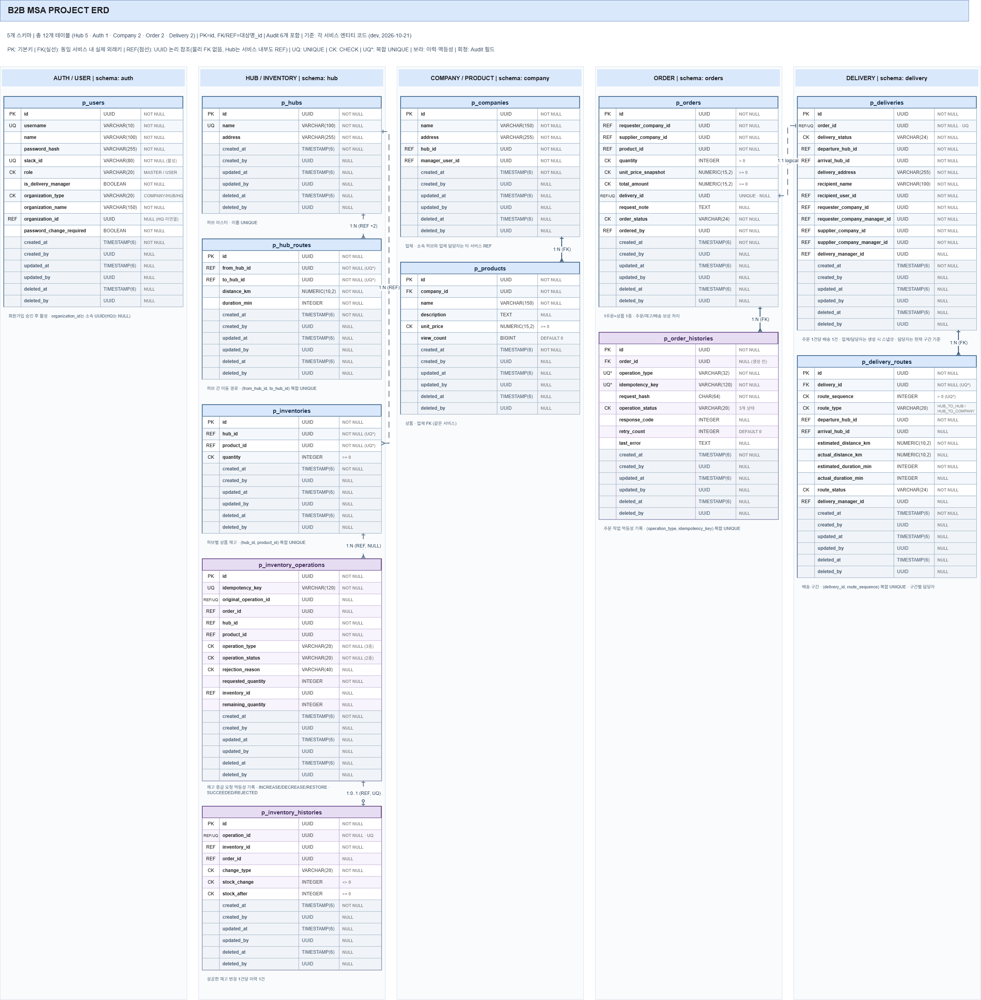

# 5. ERD

> 원본 다이어그램: [draw.io](https://app.diagrams.net/#G1eWI_xOKKnUKvRS9euyz6X1hfhthzdHWy#%7B%22pageId%22%3A%22erd%22%7D)
> 컬럼별 상세(논리명·기본값·설명)는 [[06 테이블 명세서]]를 참고합니다.

## 개요

| 항목 | 내용                                                           |
|---|--------------------------------------------------------------|
| DBMS | PostgreSQL (단일 컨테이너, 서비스별 스키마 분리)                            |
| 스키마 | `auth`, `hub`, `company`, `orders`, `delivery` (5개)          |
| 테이블 | 13개 (Hub 6개)                                               |
| 기본키 | 업무 테이블 `id UUID`, Hub 체크포인트는 `pipeline VARCHAR(40)` |
| 공통 컬럼 | 업무 테이블 Audit 6개 (`created_at/by`, `updated_at/by`, `deleted_at/by`), 체크포인트는 제외 |
| 삭제 방식 | 업무 데이터 Soft Delete (조회 시 삭제 제외는 각 Repository에서 처리), 체크포인트는 제외 |

> **반영 기준:** 각 서비스의 JPA 엔티티 코드(`dev`, 2026-10-21)에 Hub의 Redis Streams 작업본을 반영했습니다. 전체 13개 테이블·177개 컬럼(Audit 포함)이며, Hub는 6개 테이블·67개 컬럼입니다. enum 컬럼의 허용값 CHECK는 Hibernate가 자동으로 생성합니다. 아래 [원본 ERD 이미지](#5-원본-erd-이미지)는 Redis 확장 전 기준이며, 최신 Hub 스키마는 이 문서의 Mermaid와 테이블 명세서를 참고합니다.

### 표기 규칙

| 표기 | 의미 | Mermaid 표현 |
|---|---|---|
| PK | 기본키 | `PK` |
| FK | **같은 서비스(스키마) 안의** 실제 외래키 | `FK` + 실선 `--` |
| REF | UUID 논리 참조 (같은 서비스도 가능, DB 외래키 없음) | `"REF"` 주석 + 점선 `..` |
| UQ / UQ* | 단일 UNIQUE / 복합 UNIQUE | `UK` |
| CK | CHECK 제약조건 | 주석에 조건 표기 |

---

## 1. 서비스 경계 다이어그램

어떤 테이블이 어느 서비스(스키마)에 속하고, 경계를 넘는 참조가 어디에 있는지 보여줍니다.
실선은 FK, 점선은 REF입니다.

---

## 2. 전체 ERD

업무 테이블의 Audit 공통 컬럼 6개는 다이어그램에서 생략했습니다. Hub의 기술용 `p_inventory_stream_checkpoints`는 Audit 컬럼 없이 아래 5개 컬럼만 사용합니다.

> `p_users.organization_id`는 `organization_type`에 따라 `p_companies.id` 또는 `p_hubs.id`를 가리키는 **조건부 REF**라서 다이어그램에는 관계선으로 그리지 않았습니다.

---

## 3. 스키마별 설명

### auth — User/Auth Service

| 테이블 | 역할 | 핵심 제약 |
|---|---|---|
| `p_users` | 계정, 권한(MASTER/USER), 배송담당 여부, 소속 조직 | `username` UNIQUE · `slack_id` 부분 UNIQUE · `role`·`organization_type` CHECK |

- 배송담당자는 별도 엔티티 없이 `is_delivery_manager` 플래그로 구분합니다.
- 가입 시 소속 유형·이름만 받고, 조직 확인 후 `organization_id`를 연결합니다(그전까지 NULL).

### hub — Hub/Inventory Service

| 테이블 | 역할 | 핵심 제약 |
|---|---|---|
| `p_hubs` | 전국 17개 허브 (초기 적재, 변경 API 없음) | `name` UNIQUE |
| `p_hub_routes` | 방향 있는 P2P 허브 간 경로 | UNIQUE(`from_hub_id`, `to_hub_id`) |
| `p_inventories` | 허브별 상품 현재 재고 | UNIQUE(`hub_id`, `product_id`) · `quantity >= 0` |
| `p_inventory_operations` | 재고 변경 요청·처리 결과·거절 사유·복원 원본 기록 | `idempotency_key` UNIQUE(120자) · `original_operation_id` UNIQUE(NULL 허용) · 유형/상태/사유 값 CHECK |
| `p_inventory_histories` | 실제 반영된 수량 변경을 작업·주문과 연결 | `operation_id` UNIQUE · `stock_change <> 0` · `stock_after >= 0` |
| `p_inventory_stream_checkpoints` | Redis Consumer의 DB 반영 위치·복구 세대 기록 | `pipeline` PK · 재고/Operation/History와 같은 트랜잭션으로 갱신 |

- 기본 PostgreSQL 모드의 정상 차감 흐름은 **조건부 UPDATE → 변경 후 재고 조회 → SUCCEEDED Operation 저장 → History 저장 → 커밋 → 응답**입니다. 세 업무 테이블의 변경은 같은 트랜잭션이며 이력 저장 실패 시 모두 롤백됩니다.
- Redis 모드(`inventory.stock.mode=redis-streams`)는 **Lua 재고·결과·Stream 기록 → 응답 → Consumer의 DB 반영**입니다. Consumer는 추가 수집 대기 없이 읽은 최대 500건을 처리하며, 재고·Operation·History·체크포인트를 함께 커밋한 뒤 ACK·Stream 정리를 합니다. `event_payload_hash`로 재전달 이벤트의 내용 변경도 확인합니다.
- 차감 업무 거절은 REJECTED Operation만 남기고 History를 만들지 않습니다. 수량 부족은 409 `INSUFFICIENT_STOCK`, 대상 없음·논리 삭제는 404 `INVENTORY_NOT_FOUND`입니다. PostgreSQL 모드는 거절 기록 커밋 후 응답하고, Redis 모드는 결과·이벤트 기록 후 응답하여 DB 저장은 Consumer가 수행합니다.
- Inventory는 현재 값, Operation은 요청·결과·거절 사유, History는 실제 증감 내역을 담당합니다. 정상 차감은 Operation 1건·History 1건, 업무 거절은 Operation 1건·History 0건을 남깁니다.
- 성공의 거절 사유는 NULL입니다. 수량 부족은 재고 ID·수량을 기록하고, 대상 없음은 두 값을 NULL로 기록합니다. 이 조합은 엔티티 팩토리에서 검증하며 DB의 컬럼 간 CHECK로 구현한 것은 아닙니다.
- **구현 범위:** 재고 등록·조건 조회, 차감 성공·거절 저장, 같은 키의 결과 재응답·내용 충돌, 원본 차감 기준 복원과 중복 복원 방지. 증가·작업 결과 조회 API는 후속 구현입니다. 같은 주문을 다른 키로 차감하는 업무 중복 방지는 아직 없습니다.
- 복원은 성공한 DECREASE의 재고 ID·수량을 사용하고, 복원 Operation에 원본 ID를 기록합니다. PostgreSQL에는 재고 증가·RESTORE Operation·History가 함께 커밋됩니다. Redis 모드는 아직 DB에 저장되지 않은 원본도 Redis 기록으로 복원할 수 있습니다. 복원 거절은 현재 별도 REJECTED Operation으로 저장하지 않습니다.
- 기본 PostgreSQL 모드는 중복 충돌 시 롤백 후 새 트랜잭션에서 기존 결과를 확인합니다. Redis 모드는 Lua에서 같은 키·내용과 원본 복원 여부를 함께 검사합니다. 두 모드 모두 같은 키의 기존 결과를 재사용하고, 다른 내용은 충돌로 거절합니다.
- Hub 내부 참조도 현재는 UUID 논리 참조이며 물리적 FK가 없습니다. 허브·상품 조합, 멱등성 키, 원본 차감 ID의 UNIQUE는 논리 삭제된 행도 포함합니다. 원본 차감 ID의 NULL은 여러 행에 허용됩니다.
- **명칭 차이:** 최근 통합 설계의 `departure_hub_id/arrival_hub_id`와 달리 현재 Hub 코드·초기 데이터는 `from_hub_id/to_hub_id`입니다. 이 문서는 구현명을 사용하며, 명칭 통일 시 코드·SQL·API 계약의 영향 범위를 함께 검토해야 합니다.
- 경로의 출발≠도착·거리/시간 비음수 CHECK는 현재 엔티티와 생성 DDL에 없으므로 구현된 DB 제약으로 표시하지 않았습니다.
- Order·Delivery의 현재 호출 경로·필드와 소비자 Feign 예시는 [Hub-MS Feign 연동 사용법](<../guide/사용법/Hub-MS Feign 연동 사용법.md>)을 참고합니다.

### company — Company/Product Service

| 테이블 | 역할 | 핵심 제약 |
|---|---|---|
| `p_companies` | 업체 (공급·수령 겸용) | `hub_id`, `manager_user_id` REF |
| `p_products` | 업체가 공급하는 상품 (Company Service 하위 리소스) | `unit_price >= 0` |

### orders — Order Service

| 테이블 | 역할 | 핵심 제약 |
|---|---|---|
| `p_orders` | 주문 + Saga 진행 상태 | `quantity > 0` · `delivery_id` UNIQUE · 상태 4종 CHECK |
| `p_order_histories` | 주문 생성·수정·취소 요청의 멱등성 기록 | UNIQUE(`operation_type`, `idempotency_key`) · 유형/상태 CHECK |

- 1주문 = 1상품. 주문 당시 단가(`unit_price_snapshot`)와 총액(`total_amount = 단가 × 수량`)을 저장합니다.
- 주문이 완료되면 `delivery_id`와 Hub의 재고 차감 작업 ID(`stock_operation_id`)를 저장합니다. COMPLETED이고 `stock_operation_id`가 있어야 취소(재고 복원)할 수 있습니다.
- `p_order_histories.order_id`는 주문이 만들어지기 전에는 NULL이고, `SUCCEEDED`가 되면 값이 있어야 합니다. 이 규칙은 애플리케이션에서 지키며 DB CHECK는 없습니다.

### delivery — Delivery Service

| 테이블 | 역할 | 핵심 제약 |
|---|---|---|
| `p_deliveries` | 주문 1건당 배송 1건 | `order_id` UNIQUE · 상태 CHECK |
| `p_delivery_routes` | 배송을 이루는 이동 구간 | UNIQUE(`delivery_id`, `route_sequence`) · 유형/상태 CHECK |

- 구간 예시: `서울 허브 → 대전 허브`(HUB_TO_HUB) → `대전 → 부산`(HUB_TO_HUB) → `부산 허브 → 수령업체`(HUB_TO_COMPANY, `arrival_hub_id` NULL)
- 같은 주문으로 배송을 다시 생성하면 `order_id` UNIQUE 위반을 409 `DELIVERY_ALREADY_EXISTS`로 반환합니다.
- 요청·공급 업체와 각 업체 관리자 ID는 배송 생성 시점의 값을 저장하며, 이후 업체 관리자가 바뀌어도 갱신하지 않습니다.
- 담당자는 구간마다 지정합니다(`p_delivery_routes.delivery_manager_id`). `p_deliveries.delivery_manager_id`는 현재 진행 구간의 담당자이며 HUB_ARRIVED로 바뀔 때 다음 구간 담당자로 바뀝니다.
- 구간 유형별 `arrival_hub_id` NULL 규칙과 `route_sequence > 0`은 애플리케이션 규칙이며 DB CHECK는 없습니다. 실측 거리·시간의 0 이상 검증은 요청 DTO에서 합니다.

---

## 4. 관계 목록

| 출발 테이블 | 참조 컬럼 | 대상 테이블 | 종류 | 카디널리티 |
|---|---|---|---|---|
| p_hub_routes | from_hub_id | p_hubs | REF | N:1 |
| p_hub_routes | to_hub_id | p_hubs | REF | N:1 |
| p_inventories | hub_id | p_hubs | REF | N:1 |
| p_inventories | product_id | p_products | REF | N:1 |
| p_inventory_operations | hub_id | p_hubs | REF | N:1 |
| p_inventory_operations | product_id | p_products | REF | N:1 |
| p_inventory_operations | inventory_id | p_inventories | REF | N:0..1 |
| p_inventory_operations | order_id | p_orders | REF | N:0..1 |
| p_inventory_histories | operation_id | p_inventory_operations | REF, UQ | 0..1:1 |
| p_inventory_histories | inventory_id | p_inventories | REF | N:1 |
| p_inventory_histories | order_id | p_orders | REF | N:0..1 |
| p_companies | hub_id | p_hubs | REF | N:1 |
| p_companies | manager_user_id | p_users | REF | N:1 |
| p_products | company_id | p_companies | FK | N:1 |
| p_orders | requester_company_id | p_companies | REF | N:1 |
| p_orders | supplier_company_id | p_companies | REF | N:1 |
| p_orders | product_id | p_products | REF | N:1 |
| p_orders | delivery_id | p_deliveries | REF | 1:0..1 |
| p_orders | ordered_by | p_users | REF | N:1 |
| p_orders | stock_operation_id | p_inventory_operations | REF | N:0..1 |
| p_order_histories | order_id | p_orders | FK | N:0..1 |
| p_deliveries | order_id | p_orders | REF | 1:1 |
| p_deliveries | departure_hub_id | p_hubs | REF | N:1 |
| p_deliveries | arrival_hub_id | p_hubs | REF | N:1 |
| p_deliveries | recipient_user_id | p_users | REF | N:1 |
| p_deliveries | requester_company_id | p_companies | REF | N:1 |
| p_deliveries | requester_company_manager_id | p_users | REF | N:1 |
| p_deliveries | supplier_company_id | p_companies | REF | N:1 |
| p_deliveries | supplier_company_manager_id | p_users | REF | N:1 |
| p_deliveries | delivery_manager_id | p_users | REF | N:0..1 |
| p_delivery_routes | delivery_id | p_deliveries | FK | N:1 |
| p_delivery_routes | departure_hub_id | p_hubs | REF | N:1 |
| p_delivery_routes | arrival_hub_id | p_hubs | REF | N:0..1 |
| p_delivery_routes | delivery_manager_id | p_users | REF | N:0..1 |
| p_users | organization_id | p_companies / p_hubs | REF (조건부) | N:0..1 |

---

## 5. 원본 ERD 이미지

