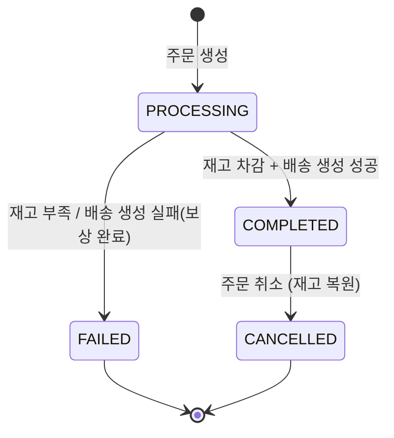
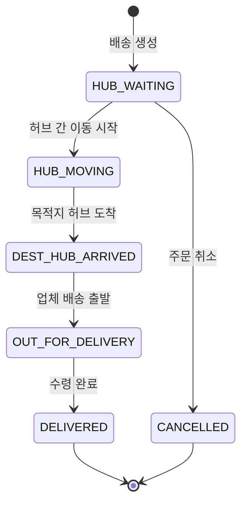
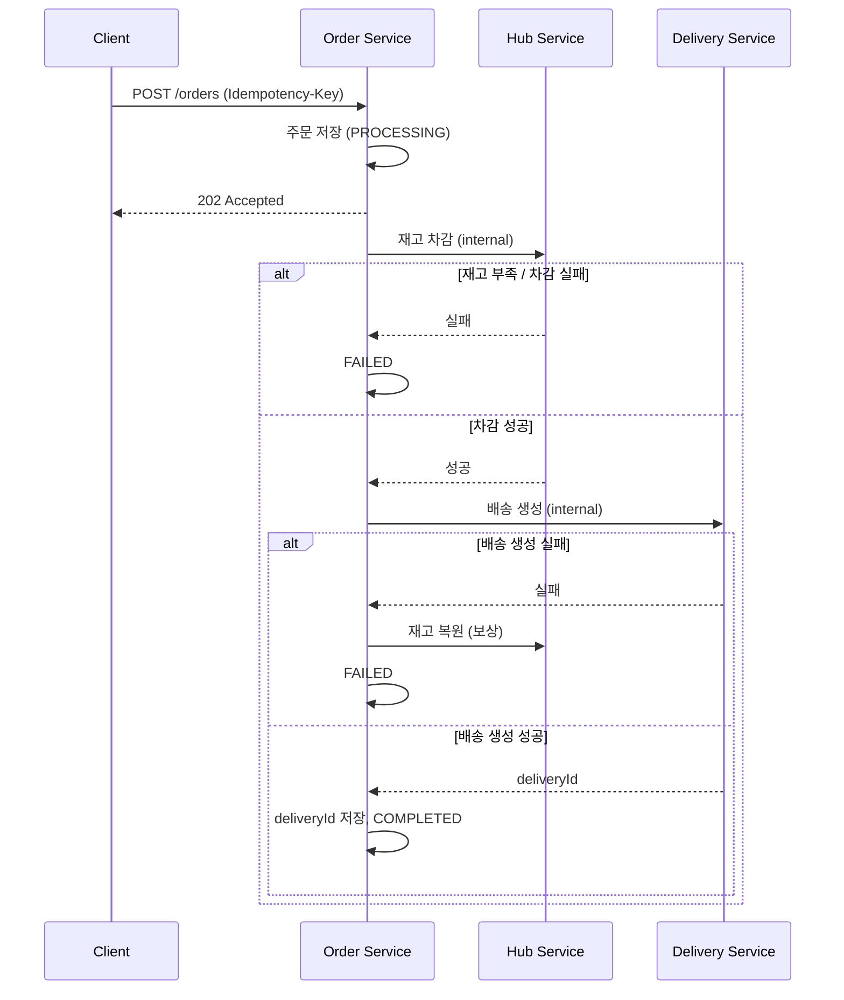

# 7. 서비스 정책

> 발제문·[[요구사항 정리]]·설계 문서(도메인 모델, API, 테이블 명세)에 흩어진 정책을 한곳에 모은 문서입니다.
> 각 정책의 **출처** 표기: `발제` = 숙련 프로젝트 발제, `요구` = 요구사항 정리, `설계` = SA 설계 문서
> ⚠️ 표시는 문서 간 충돌이 있거나 팀 결정이 필요한 항목입니다. → [[#9. 미결정·충돌 사항]]

---

## 1. 공통 정책

### 1.1 인증

| 정책 | 내용 | 출처 |
|---|---|---|
| 인증 방식 | 별도 인증 서버(Keycloak) 없이 User/Auth Service가 자체 JWT 발급 | 발제 |
| 인증 위치 | API Gateway에서 JWT와 역할을 검증한 후 각 서비스로 라우팅 | 발제·요구(USR-05) |
| 인증 예외 경로 | 회원가입·ID 중복 확인·로그인·토큰 재발급은 비로그인 상태로 호출 가능 | 요구·설계 |
| 토큰 | Access 30분, Refresh 7일. 토큰 상태는 Redis에 저장 → [[SYS-01 게이트웨이 인증 인가 설계]] | 설계 |
| 사용자 정보 전달 | Gateway가 검증한 사용자 ID·역할을 서비스가 신뢰할 수 있는 방식으로 전달(헤더 등). 서비스는 외부에서 직접 넣은 값을 신뢰하지 않음 | 요구(SYS-07) |
| 내부 API 보호 | `/internal/v1/**`은 Gateway에서 외부로 노출하지 않으며 서비스 간 인증·네트워크 제한 적용 | 설계 |

### 1.2 권한 체계

전역 역할은 **2단계**입니다. 배송담당자는 역할이 아니라 사용자 속성입니다. `발제`·`요구`

| 구분 | 값 | 설명 |
|---|---|---|
| 역할 | `MASTER` | 관리자. 모든 기능 수행 가능 |
| 역할 | `USER` | 로그인한 일반 사용자. 자신이 연관된(소유한) 데이터만 수정 가능 |
| 속성 | `is_delivery_manager = true` | 배송담당자. 허브 간 이동과 허브→업체 배송을 모두 담당하는 단일 유형 |
| 속성 | `organization_type` + `organization_id` | 소속 업체(COMPANY), 허브(HUB), 본사(HQ). HQ는 MASTER만 지정하며 연결할 UUID가 없음. **소속만으로 권한이 생기지 않음** |

**"본인 데이터" 판별 기준** `설계`

| 대상 | 본인 판별 |
|---|---|
| 업체 | `p_companies.manager_user_id == 로그인 사용자 ID` |
| 상품 | 상품의 `company_id` 업체의 관리자 == 로그인 사용자 |
| 주문 | `p_orders.ordered_by == 로그인 사용자 ID` |
| 배송 | `p_deliveries.delivery_manager_id == 로그인 사용자 ID` |
| 배송 구간 | `p_delivery_routes.delivery_manager_id == 로그인 사용자 ID` |

### 1.3 데이터 삭제 (Soft Delete)

| 정책 | 내용 | 출처 |
|---|---|---|
| 삭제 방식 | DELETE 요청 시 물리 삭제하지 않고 `deleted_at`, `deleted_by` 기록 | 발제 |
| 조회 제외 | 모든 조회·검색은 `deleted_at IS NULL` 데이터만 대상 | 발제 |
| 롤백 | 트랜잭션 처리 시 논리 삭제의 예외 상황도 고려해 롤백 | 발제 |
| 이력 테이블 | `p_order_histories`는 **삭제 금지** (멱등성 보장용) | 설계(ERD) |

### 1.4 감사(Audit)

- 모든 테이블에 `created_at/by`, `updated_at/by`, `deleted_at/by` 6개 컬럼을 둡니다. `설계`
- 생성·수정 정보는 JPA Auditing(common `BaseEntity` + `AuditorAware`)으로 자동 기록합니다. `요구`
- 삭제 정보는 Auditing 대상이 아니므로 `softDelete()` 같은 명시적 처리에서 기록합니다. `요구`
- 시스템 자동 처리(HTTP 요청 밖: 기동 시 초기화, 시드, 스케줄러)의 작업자는 **시스템 UUID `00000000-0000-0000-0000-000000000000`**입니다. `설계` (2026-10-16 변경: 기존 NULL은 시스템 수정 시 `updated_by`에 이전 사용자가 남는 문제가 있음)
- 요청 안이지만 로그인 사용자가 없는 경우(회원가입 등 공개 API)는 작업자를 자동 기록하지 않고, 필요하면 직접 지정합니다(회원가입 `created_by` = 본인). `설계`
- 작업자 헤더(`X-User-Id`·`X-User-Role`)는 둘 다 있고 형식이 맞아야 사용자로 인정합니다. 하나만 있거나 형식이 틀리면 모든 API에서 401 `UNAUTHENTICATED`입니다. `설계`

### 1.5 조회·검색

| 정책 | 내용 | 출처 |
|---|---|---|
| 검색 | 모든 검색 API는 검색 조건과 정렬 기능 제공 | 발제 |
| 기본 정렬 | 생성일 역순(최신순) | 발제 |
| 페이지네이션 | `page`(0부터), `size` 파라미터. `size`는 1~100, 그 밖은 기본값 10으로 바꿈(400 아님) | 설계 |
| 정렬 필드 | API마다 허용한 필드만(`createdAt`은 항상 허용). 그 밖은 400 `INVALID_SORT_PROPERTY`. 같은 값끼리 순서가 고정되도록 `id`를 보조 정렬로 붙임 → [[SYS-08 페이지네이션 정렬 설계]] | 설계 |
| 입력 검증 | 서버에서 Bean Validation으로 검증 | 요구(SYS-10)·설계 |

### 1.6 식별자·데이터 소유권

- 모든 주요 엔티티의 PK는 `UUID`입니다. `요구(SYS-09)`
- 각 서비스는 자기 스키마의 데이터만 생성·수정·삭제합니다. 다른 서비스의 데이터는 API로 요청합니다. `설계`
- 같은 서비스 안에서는 실제 FK, 서비스 간에는 UUID 논리 참조(REF)를 사용하고 참조 대상은 API로 검증합니다. `설계`
- 다른 서비스의 스키마에 직접 접근하지 못하도록 DB 계정 권한도 분리하는 것을 권장합니다. `요구`

---

## 2. 사용자 정책 (User/Auth Service)

### 2.1 회원가입

| 정책 | 내용 | 출처 |
|---|---|---|
| 승인 | 별도 승인 절차 없이 가입 즉시 활성화 | 발제 |
| 필수 입력 | 이름, 비밀번호, Slack ID, 소속 업체명 또는 허브명 | 발제 |
| username | 4~10자, 영문 소문자(a-z)·숫자(0-9) | 발제 |
| password | 8~15자, 영문 대소문자·숫자·특수문자 | 발제 |
| 비밀번호 저장 | BCrypt 등 안전한 해시 | 요구 |
| 기본 역할 | `USER`, `is_delivery_manager = false` | 설계 |
| 소속 연결 | 가입 시 조직 유형·이름만 저장. 관리자가 조직을 확인한 뒤 `organization_id` 연결(그전까지 NULL) | 설계 |
| 소속 허브 기준 | 배송담당자의 소속 허브는 **출발지 기준**. 소속 허브가 관리하는 지역 배송과, 그 허브에서 출발하는 다른 허브행 배송을 담당 | 발제 |

### 2.2 사용자 관리 권한

| 기능 | MASTER | 본인 | 그 외 USER | 출처 |
|---|---|---|---|---|
| 회원가입·로그인 | - | 비로그인 가능 | - | 발제 |
| 사용자 생성 | ✅ 역할 지정 가능 | 회원가입 (USER 고정) | - | 발제 |
| 다른 사용자 수정·비활성화 | ✅ | - | ❌ | 발제 |
| 본인 정보 수정(Slack ID만)·비밀번호 변경·탈퇴 | - | ✅ 확장 | - | 설계 |
| 사용자 조회·검색 | ✅ 전체 | ✅ 본인만 | ❌ | 발제 |
| 역할 변경, 배송담당자 지정, 소속 연결 | ✅ | ❌ | ❌ | 설계 |

- 사용자 삭제는 비활성화(Soft Delete)로 처리합니다. `발제`
- 첫 MASTER는 Auth 서비스 기동 시 MASTER가 하나도 없으면 `.env`의 계정 정보로 1회 생성합니다. 이후에는 DB에 저장된 계정을 계속 사용합니다. `설계`

### 2.3 계정 관리 (로그아웃·비밀번호 변경·회원탈퇴)

발제에 없는 기능으로 팀에서 추가했습니다(USR-04 로그아웃, USR-08 비밀번호 변경, USR-09 회원탈퇴). 발제 364행의 "수정·삭제는 관리자만"은 다른 사람의 계정에 대한 규칙으로 보고, 본인 계정 관리는 확장 기능으로 둡니다. `설계`

| 정책 | 내용 | 출처 |
|---|---|---|
| 로그아웃 | 현재 Access Token을 Redis 블랙리스트에 등록하고 Refresh Token 삭제 | 설계 |
| 비밀번호 변경 | 현재 비밀번호 확인 필수. 새 비밀번호는 가입 규칙과 동일하며 현재 비밀번호와 달라야 함 | 설계 |
| 비밀번호 변경 후 | 해당 사용자의 모든 토큰 무효화(Redis `revoked-at`), 재로그인 필요 | 설계 |
| 회원탈퇴 | 비밀번호 재확인 후 Soft Delete(`deleted_by` = 본인). 탈퇴 후 로그인 차단, 기존 토큰 무효화 | 설계 |
| 탈퇴 후 username | 재사용 불가 (일반 UNIQUE 유지) | 설계 |
| 탈퇴 사용자의 데이터 | 주문·배송·업체의 사용자 UUID 참조는 그대로 유지 | 설계 |
| 탈퇴 제한 | 마지막 MASTER만 탈퇴 불가. 업체 관리자·배송 담당자가 탈퇴하면 MASTER가 다시 지정 | 설계 |
| 마지막 MASTER 보호 | 활성 MASTER가 1명이면 탈퇴·역할 강등·비활성화 거부 (409) | 설계 |
| 비밀번호 찾기 | 온라인 기능 없음. 사용자가 관리자에게 오프라인으로 문의 | 설계 |
| 비밀번호 초기화 | MASTER가 본인 확인 후 실행. 응답은 대상 `userId`·`username`·임시 비밀번호(1회만 노출, 저장 안 함, `Cache-Control: no-store`). 대상 사용자 토큰 무효화. **MASTER 본인은 409** `CANNOT_RESET_OWN_PASSWORD`(현재 비밀번호를 확인하는 비밀번호 변경을 씀) | 설계 |
| MASTER의 사용자 생성 | MASTER가 비밀번호를 정해 만들고, 역할·배송담당 여부는 필수. 본사(HQ) 소속은 MASTER만 | 설계 |
| 비밀번호 변경 강제 | **MASTER가 만든 계정과 초기화된 사용자**는 비밀번호 변경 전까지 비밀번호 변경·로그아웃·내 정보 조회만 가능 (403 `PASSWORD_CHANGE_REQUIRED`). 비밀번호를 아는 사람이 본인만 남도록 | 설계 |
| 역할 변경 | 실제로 바뀌면 대상 토큰 무효화(역할이 토큰에 있음). 본인 강등 가능(마지막 MASTER 제외) | 설계 |
| 배송담당자 | 허브 소속만 지정 가능. 담당자를 허브 밖으로 옮기려면 먼저 해제 (409 `DELIVERY_MANAGER_REQUIRES_HUB`) | 설계 |
| 소속 연결 | 업체·허브 UUID 연결. 존재 여부는 확인하지 않음(MASTER가 확인한 UUID). 소속 유형을 바꾸면 소속명 필수 | 설계 |
| 비활성화 | MASTER가 다른 사용자를 Soft Delete(`deleted_by` = MASTER), 대상 토큰 무효화. 역할·배송담당 여부는 유지. **본인은 409** `CANNOT_DEACTIVATE_SELF`(비밀번호를 확인하는 탈퇴를 씀) | 설계 |
| 재활성화 | MASTER가 비활성화된 사용자의 `deleted_at`·`deleted_by`를 초기화. 본인 탈퇴 계정도 대상. 비밀번호·역할·배송담당 여부는 그대로. 그사이 같은 Slack ID를 다른 활성 사용자가 쓰면 409 | 설계 |
| 삭제된 사용자 조회 | 기본 제외. MASTER 목록 조회에서만 `includeDeleted=true`로 포함 | 설계 |
| 사용자 검색 | username·이름·역할·배송담당 여부·소속 유형 / 정렬: 생성일(기본 역순)·username·이름 | 설계 |
| 가입 시 작성자 | `created_by` = 가입한 본인 ID | 설계 |
| Slack ID | 활성 사용자 간 중복 불가 | 설계 |
| ID 중복 확인 | 가입 전 확인 API 제공. 탈퇴한 ID도 사용 불가로 응답 | 설계 |
| 계정 존재 노출 | 로그인 실패는 계정 존재 여부를 숨기지만, ID 중복 확인으로는 존재 여부를 알 수 있음. 회원가입 편의를 위해 감수 | 설계 |
| 회원탈퇴 요청 | `DELETE /users/me` 요청 본문으로 비밀번호를 받음. 본문을 무시하는 클라이언트 문제가 생기면 `POST /users/me/withdrawal`로 변경 | 설계 |
| 사용자 검증 내부 API | 응답: id, name, role, isDeliveryManager, slackId, active. 삭제된 사용자는 404 (배송담당자로 배정 불가) | 설계 |

---

## 3. 허브·재고 정책 (Hub/Inventory Service)

### 3.1 허브와 허브 간 경로

| 정책 | 내용 | 출처 |
|---|---|---|
| 허브 | 17개 센터 고정. 초기 데이터 적재 후 **조회 API만 제공** | 발제·요구 |
| 허브 간 경로 | 모든 허브 간 직접 이동 가능한 **P2P 모델**. 초기 적재 후 조회만 제공 ⚠️ | 발제·요구 |
| 경로 방향 | A→B와 B→A는 별도 경로. 같은 출발·도착 조합 중복 불가, 출발≠도착 | 설계 |
| 권한 | 조회·검색은 로그인한 모든 사용자 | 발제 |

### 3.2 재고

| 정책 | 내용 | 출처 |
|---|---|---|
| 재고 단위 | 허브 + 상품 조합당 재고 레코드 1개 | 설계 |
| 음수 금지 | 재고 수량은 0 이상. 동시 주문에서도 음수가 되지 않도록 조건부 UPDATE 또는 잠금 적용 | 요구·설계 |
| 차감 | 주문 생성 과정에서 수량 확인 후 차감. 부족하면 주문 실패 | 발제 |
| 복원 | 주문 취소 또는 Saga 실패 시 차감 수량 복원 | 발제·요구 |
| 추가 | 입고 프로세스는 범위 밖. 테스트용 초기 적재 또는 재고 추가 API로 대체 | 발제·요구 |
| 변경 기록 | 모든 변경을 `p_inventory_movements`에 기록(INCREASE / DECREASE / RESTORE). 재고 변경과 기록은 같은 로컬 트랜잭션 | 설계 |
| 멱등성 | 같은 `idempotency_key`의 재고 변경은 한 번만 반영 | 설계 |
| 권한 | 재고 조회·등록·추가는 설계상 "관리자·허브담당" ⚠️ | 설계 |
| 차감·복원 호출 | 외부 API로 노출하지 않고 Order Service가 호출하는 내부 API로만 제공 | 설계 |

---

## 4. 업체·상품 정책 (Company/Product Service)

| 정책 | 내용 | 출처 |
|---|---|---|
| 업체 유형 | 모든 업체는 구분 없이 생산업체이자 수령업체가 될 수 있음 | 발제 |
| 소속 허브 | 모든 업체는 관리 허브 1개에 소속. 등록·수정 시 허브 존재 여부를 Hub Service로 검증 | 발제 |
| 업체 관리자 | `manager_user_id`로 지정. 등록·변경 시 User Service 내부 API로 존재 확인(삭제된 사용자 불가) | 발제·설계 |
| 관리 허브·관리자 변경 | 업체 수정 중 `hub_id`·`manager_user_id` 변경은 MASTER만. 업체 관리자가 스스로 권한을 넘기거나 허브를 옮기지 못하게 함 | 설계 |
| 업체 삭제와 상품 | 업체를 삭제해도 소속 상품은 따로 삭제하지 않음. 삭제된 업체의 상품은 상품 조회·검색·내부 API에서 함께 제외(404) | 설계 |
| 상품 위치 | 별도 서비스 없이 Company Service의 하위 리소스. 이름·정보·가격은 업체가, 허브별 재고는 Hub Service가 소유 | 발제 |
| 상품 가격 | 0 이상 | 설계 |
| 상품 조회수 | 사용자 상세 조회(`GET /api/v1/products/{id}`)마다 +1. 내부 API 조회는 세지 않음. 같은 사용자의 반복 조회·MASTER·업체 관리자 조회도 현재는 모두 셈 | 설계(확장) |
| 인기 상품 | 상품 목록·업체별 상품 목록을 `sort=viewCount,desc`로 조회 | 설계(확장) |

**권한**

| 기능 | MASTER | 업체 관리자 본인 | 그 외 USER | 출처 |
|---|---|---|---|---|
| 업체 생성 | ✅ | ⚠️ | ❌ | 발제/설계 충돌 |
| 업체 수정 | ✅ | ✅ | ❌ | 발제 |
| 업체 삭제 | ✅ | ⚠️ | ❌ | 설계 |
| 업체 조회·검색 | ✅ | ✅ | ✅ | 발제 |
| 상품 생성·수정·삭제 | ✅ | ✅ | ❌ | 설계 (요구: 팀 구체화 필요) |
| 상품 조회·검색 | ✅ | ✅ | ✅ | 설계 |

---

## 5. 주문 정책 (Order Service)

### 5.1 주문 생성

| 정책 | 내용 | 출처 |
|---|---|---|
| 주문 단위 | 1주문 = 1상품 | 설계 |
| 필수 정보 | 요청업체 ID, 공급업체 ID, 상품 ID, 수량, 요청사항 | 발제 |
| 검증 | 업체·상품 존재, **상품이 공급업체 소유인지**, 재고 수량 확인 | 요구·설계 |
| 수량 | 0보다 커야 함 | 설계 |
| 금액 | 주문 시점 단가를 `unit_price_snapshot`에 저장, `total_amount = 단가 × 수량`. 이후 상품 가격이 바뀌어도 주문 금액 유지 | 설계 |
| 연계 | 주문이 생성되면 재고 차감 + 배송·배송 구간이 함께 생성되어야 함 | 발제 |
| 응답 | 비동기 처리 결과를 기다리지 않고 `202 Accepted` 반환, 상태는 조회로 확인 | 설계 |
| 멱등성 | `Idempotency-Key` 헤더 필수. 같은 키 + 같은 요청 → 기존 결과 반환, 같은 키 + 다른 요청 → 충돌 오류 | 설계 |

### 5.2 주문 상태

| 상태 | 의미 |
|---|---|
| `PROCESSING` | 주문 생성됨, Saga 진행 중 |
| `COMPLETED` | 재고 확보·배송 생성까지 완료 (**실제 배송 완료가 아님**) |
| `FAILED` | 처리 실패, 보상 완료 |
| `CANCELLED` | 취소 확정, 재고 복원 완료 |

### 5.3 주문 취소·삭제

| 정책 | 내용 | 출처 |
|---|---|---|
| 취소 | 취소 시 차감 재고를 복원 | 발제 |
| 취소 가능 조건 | 어떤 배송 상태까지 취소를 허용할지 ⚠️ 미정 | 설계 |
| 취소 시 배송 처리 | 연결된 배송을 함께 취소·삭제할지 ⚠️ 미정 | - |
| 삭제 | Soft Delete. 연관 배송·배송 구간도 `deleted_at/by`로 관리 | 발제 |

### 5.4 주문 권한

| 기능 | MASTER | 주문자 본인 | 그 외 USER | 출처 |
|---|---|---|---|---|
| 주문 생성 | ✅ | ✅ | ✅ | 발제 |
| 주문 조회·검색 | ✅ 전체 | ✅ 본인 주문만 | ❌ | 발제 |
| 주문 취소 | ✅ | ✅ | ❌ | 설계 |

---

## 6. 배송 정책 (Delivery Service)

### 6.1 배송 생성과 구간

| 정책 | 내용 | 출처 |
|---|---|---|
| 생성 시점 | 주문 생성 과정에서 Order Service가 내부 API로 요청 | 발제·설계 |
| 1:1 | 주문 1건에 배송 최대 1건 (`order_id` UNIQUE) | 설계 |
| 구간 구성 | 허브 간 이동(`HUB_TO_HUB`) 구간들 + 마지막 허브→업체(`HUB_TO_COMPANY`) 구간 1개. `route_sequence`로 순서 관리 | 설계 |
| 마지막 구간 | `HUB_TO_COMPANY` 구간은 `arrival_hub_id = NULL` | 설계 |
| 수취인 | 이름은 식별자로 쓰지 않음. 회원이면 `recipient_user_id`, 비회원이면 NULL | 설계 |
| 멱등성 | 같은 `orderId`로 재요청하면 배송을 새로 만들지 않음 (`order_id` UNIQUE로 중복 방지) | 설계 |

### 6.2 배송담당자

| 정책 | 내용 | 출처 |
|---|---|---|
| 구성 | 별도 서비스·엔티티 없이 `is_delivery_manager` 사용자 | 발제·요구 |
| 담당 범위 | 허브 간 이동 + 허브→업체 배송 모두 | 발제 |
| 제약 | 시간적·공간적 제약 없음 | 발제 |
| 배정 | 순차 배정·거리 기반 자동 배차는 필수 범위 아님. 관리자가 수동 배정 ⚠️ | 발제·설계 |

### 6.3 배송 상태 ⚠️ 미정

DB에 허용값 CHECK가 없고 상태 전이 규칙도 정해지지 않았습니다. `설계` 아래는 **제안안**입니다.

- 허용되지 않는 상태 변경은 거부합니다(역방향 전이 금지 등). `요구(DLV-06)`
- 구간 상태(`route_status`)와 배송 전체 상태의 연동 규칙도 함께 정해야 합니다.

### 6.4 배송 권한

| 기능 | MASTER | 담당 배송담당자 | 그 외 USER | 출처 |
|---|---|---|---|---|
| 배송·구간 조회·검색 | ✅ 전체 | ✅ 본인 배송만 | ⚠️ | 발제 |
| 배송·구간 상태 변경, 실측 정보 수정 | ✅ | ✅ | ❌ | 발제 |
| 배송담당자 배정 | ✅ | ❌ | ❌ | 설계 |

---

## 7. 분산 트랜잭션 정책 (Saga)

| 정책 | 내용 | 출처 |
|---|---|---|
| 방식 | Order Service가 조정하는 Orchestration Saga. 각 서비스는 자기 로컬 트랜잭션만 처리 | 요구·설계 |
| 필수 범위 | 실패 시 롤백 처리 시나리오 1개 이상 | 발제 |
| 통신 | OpenFeign 동기 호출 + Circuit Breaker·Timeout → [[SYS-13 장애 대응 설계]] | 요구(SYS-13, 권장) |
| 재시도 | 기본은 재시도하지 않음. 멱등성 키가 있는 호출만 서비스가 같은 키로 1회 재시도. 타임아웃은 "결과 모름"으로 처리 → [[SYS-13 장애 대응 설계]] 6·8장 | 설계 |

---

## 8. 알림 정책 (Slack)

| 정책 | 내용 | 출처 |
|---|---|---|
| 구조 | 별도 서비스·엔티티·CRUD 없이 Order Service가 Slack Incoming Webhook 호출. 발송 기능은 common 라이브러리(`SlackNotifier`), 언제·누구·무엇은 Order Service → [[NTF 주문 알림 설계]] | 발제·설계 |
| 발송 시점 | Saga가 `PROCESSING → COMPLETED`를 저장한 트랜잭션의 **커밋 후**. 롤백·FAILED 주문은 알림 없음 | 설계(NTF-01) |
| 수신 대상 | 고정 채널 1개 + 주문자 Slack ID 멘션. Slack ID 조회 실패 시 멘션 없이 발송 | 설계 |
| 메시지 | 주문 ID, 상품명·수량, 공급·요청 업체명, 출발·도착 허브명, 요청사항 있음/없음. **요청사항 원문·연락처·주소 제외** | 설계 |
| 실패 처리 | 비동기 발송(전용 대기열), 실패는 WARN 로그만, 재시도 없음. **주문 처리에 영향 없음** | 설계(NTF-02) |

---

## 9. 미결정·충돌 사항

| # | 항목 | 내용 | 결정 필요 |
|---|---|---|---|
| 1 | 허브·경로 변경 API | 발제·요구는 **조회만**, 설계 API 명세에는 허브 수정·경로 등록/수정/삭제 존재 | API 제거 또는 MASTER 전용 유지 결정 |
| 2 | ~~사용자 정보 수정~~ | ✅ 결정: 본인은 Slack ID만 수정(확장 기능) → [[요구사항 정리]] A2·A10 | - |
| 3 | 업체 생성 권한 | 발제는 "업체 사용자 본인 또는 관리자", 설계는 MASTER만 | 업체 관리자가 직접 등록할 수 있는지 |
| 4 | 업체 삭제 권한 | 발제에 명시 없음, 설계는 MASTER만 | 확정 |
| 5 | "허브담당" 권한 | 설계 재고 API의 "관리자·허브담당"이 역할 체계(MASTER/USER)에 없음 | HUB 소속 사용자로 판별할지, MASTER 전용으로 할지 |
| 6 | 배송 조회 권한 | 발제는 "모든 로그인 사용자 조회 가능(담당자는 본인 배송만)", 설계는 "관리자·관계자" | 주문자·업체 관리자도 조회 가능한지 |
| 7 | 배송 상태값 | 상태 종류와 전이 규칙 미정 (6.3 제안안 참고) | 확정 |
| 8 | 주문 취소 조건 | 어느 배송 단계까지 취소 가능한지, 취소 시 배송 처리 | 확정 |
| 9 | 배송담당자 배정 | 수동 배정만 할지, 생성 시 자동 배정할지 | 확정 |
| 10 | ~~Slack 발송 시점·실패 정책~~ | ✅ 결정: COMPLETED 커밋 후 비동기 발송, 실패는 로그만(주문 롤백 없음) → 8장, [[NTF 주문 알림 설계]] | - |
| 11 | 주문 생성 응답 | 설계는 `202 Accepted`(비동기), 하지만 Feign 동기 호출 구조 | 동기 처리 후 `201`로 할지, 비동기로 할지 |
| 12 | ~~로그아웃·토큰 무효화 방식~~ | ✅ 결정: Redis 사용 (발제상 선택 기술) → [[SYS-01 게이트웨이 인증 인가 설계]] | - |
| 13 | ~~회원탈퇴 제한~~ | ✅ 결정: 마지막 MASTER만 막고, 나머지는 MASTER가 재지정 | - |
| 14 | ~~본인 탈퇴 허용~~ | ✅ 결정: 확장 기능으로 유지, README에 사유 기재 (USR-09) | - |
| 15 | 배송담당자 지정 해제 | 진행 중 배송이 있는 담당자의 `is_delivery_manager`를 해제하면 배송이 담당자 없이 남음 | 해제를 막을지, 허용하고 재배정할지 (대진·영은) |
| 16 | 내부 API 호출자 확인 | `/internal/**`는 Gateway에서 막을 뿐 호출 서비스를 검증하지 않음 (SA 보완 리포트 I-3) | Docker 내부 네트워크 제한만 할지, 서비스 토큰을 둘지 (팀 공통) |
