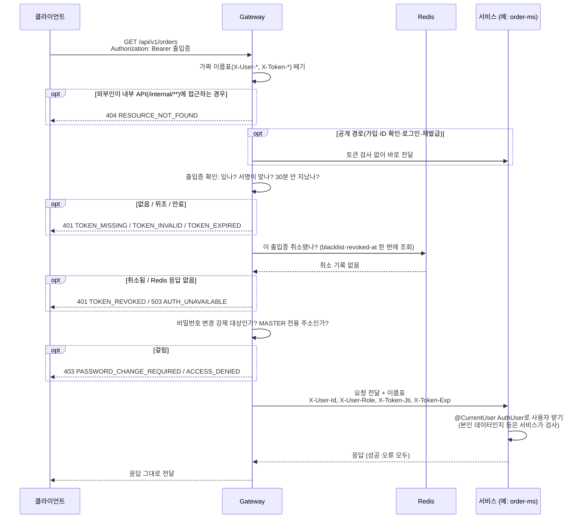
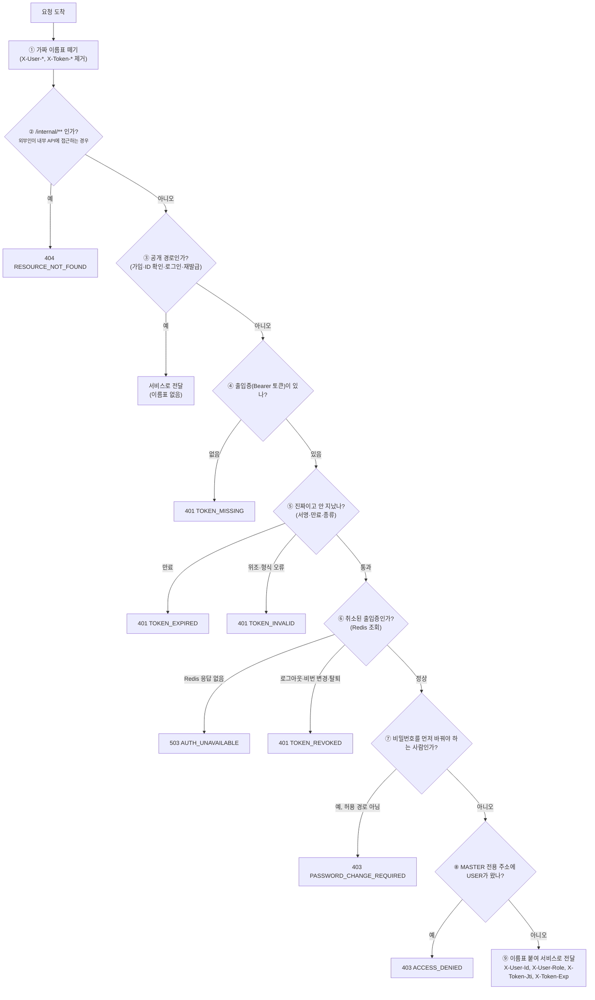

# 01. Gateway·인증 개발 가이드

> 작성: 대진 · 기준: `dev` d6af869 (GW-08~10, 경로 정규화 머지) · 최종 수정: 2026-10-16
> 대상: hub-ms(이찬), order-ms(다울), delivery-ms(영은), company-ms·common 인프라(권우)
> 이 문서는 **코드 기준**입니다. 설계 문서와 다르면 이 문서(=코드)가 맞습니다. 근거 파일은 각 절에 적었습니다.

## 0. 요약

1. **Gateway(19090)가 토큰 검증·로그아웃 확인·MASTER 경로 차단을 끝내고**, 통과한 요청에만 `X-User-Id`·`X-User-Role`을 넣어 줍니다. 서비스는 JWT를 다루지 않습니다.
   - **쉽게 말해:** Gateway는 건물 입구의 보안 요원입니다. 출입증(JWT)을 확인하고, 통과한 사람에게만 "이름표"(`X-User-Id`·`X-User-Role` 헤더)를 붙여 안으로 들여보냅니다. 각 서비스는 출입증을 다시 검사하지 않고 이름표만 읽으면 됩니다.
2. Controller에서는 **`@CurrentUser AuthUser user`** 하나로 현재 사용자를 받고, application에는 `user.id()`만 넘깁니다.
   - **쉽게 말해:** 이름표(헤더)를 읽어 `AuthUser` 객체로 바꿔 주는 것이 `@CurrentUser`입니다. Controller 파라미터에 붙이기만 하면 됩니다. application 계층은 HTTP 헤더를 몰라도 되도록 사용자 ID(UUID)만 받습니다.
3. **"본인 데이터인지", "업체 관리자·허브 담당자인지"는 서비스가 검사**합니다. Gateway는 MASTER 전용 경로만 막습니다.
   - **쉽게 말해:** Gateway는 "이 URL은 MASTER만" 같은 **주소 단위** 규칙만 압니다. "이 주문이 이 사람 것인가"는 DB를 봐야 알 수 있으므로 각 서비스가 직접 확인해야 합니다.
4. 서비스를 직접 호출할 때 `X-User-Id`·`X-User-Role`은 **둘 다 넣거나 둘 다 빼야** 합니다. 하나만 있거나 형식이 틀리면 모든 API가 401입니다.
   - **쉽게 말해:** 헤더가 아예 없으면 "로그인하지 않은 요청"으로 봅니다(공개 API는 정상 동작). 하나만 있거나 UUID 형식이 틀리면 위조나 버그로 보고 거절합니다. Postman이나 테스트에서 서비스를 직접 부를 때 자주 걸리니 주의하세요.
5. 새 외부 경로를 만들거나 MASTER 전용 여부가 바뀌면 **대진에게 알려 주세요**(Gateway 설정 수정).
   - **쉽게 말해:** Gateway는 미리 등록된 경로 규칙(`application.yaml`)대로만 움직입니다. 새 API를 만들었는데 규칙에 없으면 권한 검사가 빠지거나 의도와 다르게 막힐 수 있습니다.

## 1. 상태표

| 기능 | 상태 | 비고 |
|---|---|---|
| 라우팅 (Eureka `lb://`) | ✅ 사용 가능 | 3장 |
| 외부 `X-User-*`·`X-Token-*` 제거 | ✅ | 5장 |
| `/internal/**` 외부 차단 (404) | ✅ | 3장 |
| JWT 검증 (서명·만료·`typ=access`) | ✅ | |
| 토큰 상태 확인 (로그아웃·비밀번호 변경·탈퇴 → 401) | ✅ | Redis 필요 |
| 비밀번호 변경 강제 (`pcr`) | ✅ | 4.3 |
| MASTER 전용 경로 차단 | ✅ | 4.2 |
| 공통 오류 형식 (Gateway·서비스 동일) | ✅ | 8장 |
| `@CurrentUser`, 입구 헤더 검사, 감사 작업자, Feign 헤더 전달 | ✅ (common) | 6·7장 |
| 로그인·재발급·로그아웃·내 정보·비밀번호 변경·탈퇴 (user-ms) | ✅ | 9장 |
| GW-08 `X-Request-Id` 자동 생성·응답 헤더·접근 로그 | ✅ (PR #24) | 형식이 맞는 외부 값(1~64자 `[A-Za-z0-9-]`)은 그대로, 아니면 새 UUID |
| GW-09 Gateway 타임아웃 (연결 2초, 응답 5초, 주문 15초) | ✅ (PR #24) | 응답 초과 504, 연결 실패 503 |
| GW-10 서비스별 Circuit Breaker | ✅ (PR #24) | 연결 실패·타임아웃만 실패로 셈, OPEN이면 503. 별도 fallbackUri 없음 |
| 경로 정규화 (인코딩·`..` 우회 차단) | ✅ (PR #26) | `;`·`%2f`·`..` 등 해석이 갈리는 경로는 400 `INVALID_INPUT` |
| GW-11 운영 확인 (관리 포트·헬스 그룹) | ✅ (PR #31) | 서비스 포트엔 `/livez`·`/readyz`만, 상세·라우트·회로 상태는 관리 포트 **19190** (10/17: company-ms 19091과 겹쳐 변경) |
| GW-12 계약 테스트 | ✅ (PR #31) | 토큰 claim·오류 형식을 Gateway·user-ms가 각각 문자열로 확인 |
| GW-01 Gateway 컨테이너·서비스 포트 비공개 | ⏳ 예정 (10/20) | 지금은 IDE·`bootRun` 실행 |

## 2. 요청 흐름

### 2.1 한 줄로 보면

Gateway는 **검문소가 여러 개 있는 건물 입구**입니다. 요청은 위에서부터 차례로 검문소를 지나고, **한 곳에서라도 걸리면 그 자리에서 오류로 돌려보냅니다.** 서비스까지 가지 않습니다. 모두 통과하면 "이름표"(`X-User-*` 헤더)를 붙여 서비스로 보냅니다.

**누가 누구와 주고받나 (시퀀스)**: 보호 경로 요청이 정상적으로 통과하는 경우를 시간 순서로 그렸습니다. 막히는 경우는 `opt` 상자로 표시했고, 상자 안의 응답이 나가면 그 요청은 거기서 끝납니다.



**어디서 막히나 (순서도)**: 같은 흐름을 갈림길 기준으로 그렸습니다. 번호는 2.2 표와 같습니다.



### 2.2 검문소별 설명

| # | 검문소 | 무엇을 보나 | 걸리면 | 왜 하나 |
|---|---|---|---|---|
| ① | 가짜 이름표 떼기 | 클라이언트가 직접 넣은 `X-User-*`, `X-Token-*` | (오류 없이 지움) | 누군가 `X-User-Role: MASTER`를 직접 넣어 관리자인 척하는 것을 막습니다. 이름표는 Gateway만 붙일 수 있습니다 |
| ② | 내부 주소 차단<br><sub>외부인이 내부 API에 접근하는 경우</sub> | 경로가 `/internal/**`인가 | 404 | 내부 API는 서비스끼리만 씁니다. 외부에는 "없는 주소"처럼 보이게 합니다 |
| ③ | 공개 경로 | 가입·ID 확인·로그인·재발급인가 | (토큰 검사 생략) | 로그인 전에도 써야 하는 API입니다 |
| ④ | 출입증 확인 | `Authorization: Bearer …`가 있나 | 401 `TOKEN_MISSING` | |
| ⑤ | 진짜·유효기간 | 서명이 맞나, 30분 안 지났나, Access 토큰인가 | 401 `TOKEN_EXPIRED` / `TOKEN_INVALID` | 위조·만료 토큰 차단. Refresh 토큰을 Access 대신 쓰는 것도 여기서 막힙니다 |
| ⑥ | 취소 목록 확인 | Redis에서 "로그아웃한 출입증인가", "비밀번호 변경·탈퇴 전에 받은 출입증인가" | 401 `TOKEN_REVOKED`, Redis 장애면 503 | JWT는 스스로는 취소를 모릅니다. 그래서 Redis에 적어 둔 취소 기록을 확인합니다([[03 User·Auth API 가이드]] 3장) |
| ⑦ | 비밀번호 변경 강제 | 토큰의 `pcr=true`인데 허용 경로(내 정보 조회, 비밀번호 변경, 로그아웃)가 아닌가 | 403 `PASSWORD_CHANGE_REQUIRED` | 관리자가 비밀번호를 초기화한 사람은 새 비밀번호부터 정해야 합니다 |
| ⑧ | 관리자 전용 주소 | MASTER 전용 경로(4.2)에 USER가 왔나 | 403 `ACCESS_DENIED` | 주소만 보고 판단할 수 있는 권한은 Gateway가 한 번에 막습니다 |
| ⑨ | 전달 | | | 토큰에서 꺼낸 사용자 ID·역할을 헤더로 붙여 서비스로 보냅니다 |

### 2.3 예시로 따라가 보기

| 상황 | 지나가는 길 | 결과 |
|---|---|---|
| 로그인 | ① → ② → ③ 공개 경로 | user-ms로 전달 (토큰 검사 없음) |
| USER가 `GET /api/v1/orders` | ① → … → ⑧ 통과 → ⑨ | order-ms가 `X-User-Id`를 받아 처리 |
| USER가 `GET /api/v1/users` (사용자 목록) | ① → … → ⑧ MASTER 전용 | 403 `ACCESS_DENIED`, user-ms까지 가지 않음 |
| 로그아웃한 토큰으로 요청 | ① → … → ⑥ 취소 목록에 있음 | 401 `TOKEN_REVOKED` |
| 30분 지난 토큰 | ① → … → ⑤ 만료 | 401 `TOKEN_EXPIRED` → 재발급 후 다시 요청 |
| 외부에서 `/internal/v1/users/{id}` | ① → ② | 404 |

### 2.4 서비스 개발자가 기억할 것

- **⑨까지 온 요청만 서비스에 도착합니다.** 그래서 서비스는 토큰을 다시 검사하지 않고 `X-User-Id`·`X-User-Role`만 읽으면 됩니다(6장 `@CurrentUser`).
- Gateway가 막는 건 **주소 단위 권한(⑧)**까지입니다. "이 주문이 이 사람 것인가"처럼 데이터를 봐야 하는 권한은 서비스가 검사합니다.
- 서비스가 보낸 오류 응답(400, 404 등)은 Gateway가 손대지 않고 그대로 클라이언트에 돌려줍니다.

> **구현 참고:** 필터 순서는 `gateway-edge/.../presentation/filter/FilterOrder.java`, 인증 판단 순서(④~⑧)는 `application/auth/AuthenticationService.java`입니다. Redis는 ⑤를 통과한 보호 경로 요청만 **요청당 1번**(MGET) 조회하므로, 공개 경로는 Redis가 꺼져도 Gateway를 통과합니다(로그인 자체는 user-ms가 Redis를 써서 503). 경로는 퍼센트 인코딩을 디코딩한 값으로 비교하고(`domain/policy/RequestPath.java`), 원문에 `;`·`\`·`%2e`·`%2f`·`%5c`·`%00`·`%25`가 있거나 `.`·`..` 세그먼트가 있으면 400 `INVALID_INPUT`으로 거부합니다. 비교 시 쿼리스트링 제거·소문자 변환을 합니다(`domain/policy/PathRule.java`). HEAD 요청은 GET 규칙에도 걸립니다. ⑦이 ⑧보다 먼저이므로 비밀번호가 초기화된 MASTER도 비밀번호부터 바꿔야 합니다.

## 3. 라우팅

`gateway-edge/src/main/resources/application.yaml` → `spring.cloud.gateway.server.webflux.routes`

| 경로 | 서비스 (Eureka 이름) | 로컬 포트 |
|---|---|---|
| `/api/v1/auth/**`, `/api/v1/users/**` | `user-ms` | 19095 |
| `/api/v1/companies/**`, `/api/v1/products/**` | `company-ms` | 19091 |
| `/api/v1/hubs/**`, `/api/v1/hub-routes/**`, `/api/v1/inventories/**` | `hub-ms` | 19093 |
| `/api/v1/orders/**` | `order-ms` | 19094 |
| `/api/v1/deliveries/**`, `/api/v1/delivery-routes/**` | `delivery-ms` | 19092 |

- 경로는 **그대로** 전달됩니다(StripPrefix 없음). 서비스 Controller도 `/api/v1/...` 전체 경로로 매핑합니다.
- **차단 경로** (`gateway.policy.blocked`, 메서드 무관 404 `RESOURCE_NOT_FOUND`): `/internal/**`, `/api/v1/internal/**`. 내부 API는 서비스끼리 Feign으로만 부릅니다.
- 위 표에 없는 경로는 라우트가 없어 404 `RESOURCE_NOT_FOUND`입니다.
- Eureka 조회 주기 5초·LoadBalancer 캐시 5초로 줄여 두었습니다. 서비스 기동 직후 몇 초간 503 `SERVICE_UNAVAILABLE`이 날 수 있습니다.
- **라우트 추가·변경은 대진에게 요청**해 주세요. 경로 접두사와 서비스 이름만 알려 주면 됩니다.

## 4. 경로 정책 (application.yaml `gateway.policy`)

규칙 형식은 `"메서드[,메서드] 경로"`, `*` = 세그먼트 하나, `**` = 마지막에서 0개 이상, 메서드 `*` = 전체입니다.

### 4.1 공개 경로 (`public`, 토큰 없이 통과)

| Method | 경로 |
|---|---|
| POST | `/api/v1/auth/signup` |
| POST | `/api/v1/auth/login` |
| POST | `/api/v1/auth/reissue` |
| GET | `/api/v1/auth/check-username` |

- 공개 경로는 **토큰을 보내도 검증하지 않고 `X-User-*`도 넣지 않습니다.** 공개 API에서 `@CurrentUser`를 필수로 쓰면 항상 401입니다.
- 그 밖의 `/api/v1/**`는 **모두 로그인 필요**(보호 경로)입니다. 지금은 위 4개 외에 공개 경로가 없습니다.

### 4.2 MASTER 전용 경로 (`master`, USER면 403 `ACCESS_DENIED`)

| Method | 경로 |
|---|---|
| POST, GET | `/api/v1/users` |
| GET, PATCH, DELETE | `/api/v1/users/*` |
| PATCH | `/api/v1/users/*/role`, `/api/v1/users/*/delivery-manager`, `/api/v1/users/*/organization` |
| POST | `/api/v1/users/*/restore`, `/api/v1/users/*/password-reset` |
| PATCH | `/api/v1/hubs/*` |
| POST | `/api/v1/hub-routes` |
| PATCH, DELETE | `/api/v1/hub-routes/*` |
| POST | `/api/v1/companies` |
| DELETE | `/api/v1/companies/*` |

- 예외(`master-exclude`, MASTER 규칙보다 먼저 적용): `* /api/v1/users/me`, `* /api/v1/users/me/**` — 본인 계정 API는 USER도 호출합니다.
- **표에 없는 것은 Gateway가 로그인만 확인**합니다. 예: `POST /api/v1/hubs`, `PATCH /api/v1/companies/*`, 재고·주문·배송 API 전부. 이런 API의 역할·소유권 검사는 서비스 몫입니다(6.3).
- 내 API가 MASTER 전용인데 표에 없거나, 표에 있는데 아니라면 알려 주세요. `application.yaml`과 테스트 정책표 `gateway-edge/src/test/resources/policy/master-cases.csv`를 함께 고칩니다.

### 4.3 비밀번호 변경 강제 시 허용 경로 (`password-change-allowed`)

관리자가 비밀번호를 초기화한 사용자의 토큰(`pcr=true`)은 아래만 호출할 수 있고, 나머지는 403 `PASSWORD_CHANGE_REQUIRED`입니다.

| Method | 경로 |
|---|---|
| GET | `/api/v1/users/me` |
| PATCH | `/api/v1/users/me/password` |
| POST | `/api/v1/auth/logout` |

## 5. 헤더 규약

상수는 `com.common.auth.AuthContract`에 있습니다. **문자열을 직접 쓰지 말고 상수를 써 주세요.**

| 헤더 | 상수 | 값 | 넣는 곳 | 서비스에서 |
|---|---|---|---|---|
| `X-User-Id` | `HEADER_USER_ID` | 사용자 UUID (토큰 `sub`) | Gateway | 작업자, 본인 확인 |
| `X-User-Role` | `HEADER_USER_ROLE` | `MASTER` / `USER` | Gateway | 역할 확인 |
| `X-Token-Jti` | `HEADER_TOKEN_JTI` | 토큰 ID | Gateway | user-ms 로그아웃 전용 (다른 서비스는 무시) |
| `X-Token-Exp` | `HEADER_TOKEN_EXP` | 만료 epoch 초 | Gateway | user-ms 로그아웃 전용 (다른 서비스는 무시) |
| `X-Request-Id` | `HEADER_REQUEST_ID` | 추적 ID | Gateway (형식 맞는 외부 값은 유지, 응답 헤더에도 같은 값) | 로그 추적. Feign으로 자동 전달 |
| `Authorization` | - | `Bearer …` | 클라이언트 | Gateway가 그대로 전달하지만 **서비스는 쓰지 않음** |

- Gateway는 이름이 **`x-user-`·`x-token-`으로 시작하는 모든 헤더**(대소문자 무관)를 외부 요청에서 지운 뒤, 토큰을 검증한 경우에만 위 4개를 다시 넣습니다(`domain/policy/TrustedHeaders.java`). 그래서 Gateway를 거친 요청의 `X-User-*`는 믿어도 됩니다.
- 배송담당자 여부, 소속 업체·허브는 헤더에 **없습니다.** 필요하면 user-ms 내부 API `GET /internal/v1/users/{userId}`로 조회합니다.

## 6. 서비스 코드에서 현재 사용자 받기

자동 설정(`CommonAuthWebAutoConfiguration`)이 서블릿 서비스에 리졸버·입구 인터셉터·`CurrentUserProvider` 빈을 등록합니다. 추가 설정은 없습니다.

### 6.1 API

| 쓰는 곳 | 코드 | 헤더 없음 | 헤더 형식 틀림 |
|---|---|---|---|
| Controller (필수) | `@CurrentUser AuthUser user` | 401 `UNAUTHENTICATED` | 401 |
| Controller (선택) | `@CurrentUser(required = false) AuthUser user` | `null` | 401 |
| Controller 밖 | `CurrentUserProvider.current()` → `Optional<AuthUser>` | `Optional.empty()` | (입구에서 이미 401) |
| 요청 안인지 | `CurrentUserProvider.inRequest()` | 스케줄러 등 요청 밖이면 `false` | |

`AuthUser`(`com.common.auth`, `record AuthUser(UUID id, AuthRole role)`) 메서드:

| 메서드 | 동작 |
|---|---|
| `id()`, `role()` | UUID, `AuthRole.MASTER`/`USER` |
| `isMaster()` | MASTER면 true |
| `requireMaster()` | MASTER가 아니면 `BusinessException(ACCESS_DENIED)` → 403 |
| `requireSelfOrMaster(UUID ownerId)` | MASTER도 본인도 아니면 403 `ACCESS_DENIED` |

### 6.2 예시

```java
import com.common.auth.AuthUser;
import com.common.auth.web.CurrentUser;

@RestController
@RequestMapping("/api/v1/hubs")
public class HubController {

    @PatchMapping("/{hubId}")                       // Gateway가 MASTER 전용으로 1차 차단
    public HubResponse update(@CurrentUser AuthUser user, @PathVariable UUID hubId,
                              @Valid @RequestBody UpdateHubRequest request) {
        user.requireMaster();                       // 2차 방어 (권장)
        return HubResponse.from(hubFacade.update(request.toCommand(hubId, user.id())));
    }

    @GetMapping
    public List<HubResponse> list(@CurrentUser AuthUser user) {   // 로그인만 필요
        return hubFacade.list().stream().map(HubResponse::from).toList();
    }
}
```

- `AuthUser`는 **presentation에서만** 받고, application에는 `user.id()`(필요하면 역할)를 Command 값으로 넘깁니다.
- 헤더 검사는 **형식만** 봅니다(UUID인지, 역할이 정확히 `MASTER`/`USER`인지). 사용자가 실제로 있는지는 확인하지 않습니다.
- 기존 `@RequestHeader(AuthContract.HEADER_USER_ID) UUID userId`도 동작합니다(누락 시 `GlobalExceptionHandler`가 401). 새 코드는 `@CurrentUser`를 써 주세요.

### 6.3 권한 검사는 어디서

| 권한 | 위치 |
|---|---|
| 로그인 여부, 토큰 유효성 | Gateway |
| MASTER 전용 경로 (4.2) | Gateway 1차 + 서비스 `requireMaster()` 2차 (권장) |
| 본인 데이터 (주문자 본인 등) | 서비스 (`requireSelfOrMaster(ownerId)` 또는 도메인 규칙) |
| 업체 관리자, 허브 담당자, 배송 담당자 | 서비스 (데이터·user-ms 내부 API로 판단) |

### 6.4 감사 컬럼 (`BaseEntity`)

`com.common.entity.BaseEntity`를 상속하면 `createdBy`·`updatedBy`가 자동으로 채워집니다(`UserIdAuditorAware`).

| 상황 | 기록되는 작업자 |
|---|---|
| 요청 안 + 사용자 헤더 있음 | `X-User-Id` |
| 요청 안 + 헤더 없음 (공개 경로) | 기록하지 않음 → `recordCreatedBy(actorId)`로 직접 지정한 값 유지 |
| 요청 밖 (스케줄러, 기동 시 초기화, 시드) | `AuthContract.SYSTEM_USER_ID` = `00000000-0000-0000-0000-000000000000` |

- 삭제는 Auditing 대상이 아닙니다. `softDelete(actorId)`로 명시적으로 기록합니다.
- `@Async` 등 다른 스레드에서 도는 작업은 요청 밖으로 보아 시스템 UUID로 기록됩니다.

## 7. 서비스 간 호출 시 헤더 전달 (Feign)

`spring-cloud-starter-openfeign`을 추가한 서비스에는 `UserHeaderRelayInterceptor`가 모든 Feign 클라이언트에 자동 적용됩니다(`CommonAuthFeignAutoConfiguration`).

| 상황 | 동작 |
|---|---|
| 사용자 요청 처리 중 Feign 호출 | 현재 요청의 `X-User-Id`·`X-User-Role`·`X-Request-Id`를 붙임 |
| Feign 메서드에서 `X-User-Id` 또는 `X-User-Role`을 직접 지정 | 사용자 헤더 **둘 다** 건드리지 않음 (한 쌍으로 취급) |
| Feign 메서드에서 `X-Request-Id`를 직접 지정 | 덮어쓰지 않음 |
| 요청 밖(스케줄러 등) | 사용자 헤더를 붙이지 않음. 받는 서비스에서는 "요청 안 + 헤더 없음"이라 `created_by`를 기록하지 않음 (시스템 UUID 아님) |
| `Authorization`, `X-Token-*` | **보내지 않음** (토큰은 Gateway에서 끝남) |

- 그래서 **내부 API(`/internal/**`) Controller에는 필수 `@CurrentUser`를 쓰지 마세요.** 스케줄러에서 시작된 호출에는 사용자 헤더가 없습니다. 필요하면 `@CurrentUser(required = false)`.
- `@FeignClient(name = "hub-ms")`처럼 **Eureka 이름으로만** 부릅니다. `url`로 외부 주소를 지정하면 서비스가 기동하지 않습니다(`FeignClientUrlGuard`, 테스트만 `common.feign.allow-direct-url=true`). 외부 API는 `RestClient`를 씁니다.
- 실패 처리(`RemoteCallTemplate`의 `run`/`execute`/`executeWithRetryOnce`, 예외 3종)는 [02 장애 대응(Feign) 가이드](./02%20장애%20대응(Feign)%20가이드.md)를 봐 주세요.

## 8. 오류 응답

Gateway와 서비스가 같은 형식(`com.common.exception.ErrorResponse`)을 씁니다. `errors`는 비어 있으면 생략됩니다.

```json
{ "code": "TOKEN_EXPIRED", "message": "인증 토큰이 만료되었습니다." }
{ "code": "INVALID_INPUT", "message": "잘못된 요청입니다.", "errors": [ { "field": "quantity", "reason": "1 이상이어야 합니다" } ] }
```

| code | HTTP | 반환 | 언제 |
|---|---|---|---|
| `TOKEN_MISSING` | 401 | Gateway | 보호 경로에 `Authorization: Bearer …` 없음·빈 값 |
| `TOKEN_INVALID` | 401 | Gateway | 서명 불일치, 형식 오류, Refresh Token 사용(`typ`), 필수 claim 누락 |
| `TOKEN_EXPIRED` | 401 | Gateway | Access Token 만료 (30분) → `POST /api/v1/auth/reissue` |
| `TOKEN_REVOKED` | 401 | Gateway | 로그아웃한 토큰, 비밀번호 변경·탈퇴 등으로 무효화된 토큰 → 재로그인 |
| `UNAUTHENTICATED` | 401 | 서비스 | 필수 `@CurrentUser`인데 헤더 없음, `X-User-*` 하나만 있음·형식 틀림·중복, 필수 `X-User-*`/`X-Token-*` `@RequestHeader` 누락 |
| `INVALID_CREDENTIALS` | 401 | user-ms | 로그인·비밀번호 재확인 실패 |
| `REFRESH_TOKEN_INVALID` | 401 | user-ms | 재발급 실패 |
| `ACCESS_DENIED` | 403 | Gateway, 서비스 | MASTER 전용 경로에 USER, `requireMaster()`·`requireSelfOrMaster()` 실패 |
| `PASSWORD_CHANGE_REQUIRED` | 403 | Gateway | `pcr=true` 토큰으로 4.3 이외 경로 호출 |
| `INVALID_INPUT` | 400 | Gateway, 서비스 | (Gateway) 경로에 `;`·`%2f`·`..` 등 해석이 갈리는 값. (서비스) 입력 검증 실패 |
| `RESOURCE_NOT_FOUND` | 404 | Gateway, 서비스 | 차단 경로(`/internal/**`), 라우트 없음 |
| `AUTH_UNAVAILABLE` | 503 | Gateway, user-ms | Redis 오류·응답 없음 (fail-closed) |
| `SERVICE_UNAVAILABLE` | 503 | Gateway | 대상 서비스 인스턴스 없음, 연결 실패(2초), 서비스별 CB OPEN |
| `SERVICE_TIMEOUT` | 504 | Gateway | 응답 타임아웃 (전역 5초, `/api/v1/orders/**` 15초) |

- 코드 정의: `AuthErrorCode`(TOKEN_*, `REFRESH_TOKEN_INVALID`, `PASSWORD_CHANGE_REQUIRED`, `AUTH_UNAVAILABLE`), `CommonErrorCode`(나머지), `UserErrorCode`(`INVALID_CREDENTIALS`).
- 서비스가 보낸 오류 응답(예: 409)은 Gateway가 **바꾸지 않고 그대로** 전달합니다.

## 9. 로컬 개발·테스트

### 9.1 Gateway를 거쳐 호출 (실제 토큰)

필요: Redis, Eureka, user-ms, gateway-edge, 내 서비스 (실행 순서는 [로컬 실행 가이드](../Common/로컬%20실행·라우팅%20확인%20가이드.md) 2장).

```bash
# MASTER: .env의 MASTER_USERNAME / MASTER_PASSWORD (user-ms 첫 기동 때 생성)
# USER: POST /api/v1/auth/signup 으로 가입 후 로그인
curl -s localhost:19090/api/v1/auth/login -H 'Content-Type: application/json' \
  -d '{"username":"<username>","password":"<password>"}'
# → { "accessToken": "…", "refreshToken": "…", "passwordChangeRequired": false }

curl -i localhost:19090/api/v1/hubs -H "Authorization: Bearer <accessToken>"

# 만료되면 재발급 (Refresh도 새로 바뀌므로 두 토큰 모두 교체)
curl -s localhost:19090/api/v1/auth/reissue -H 'Content-Type: application/json' \
  -d '{"refreshToken":"<refreshToken>"}'
```

### 9.2 개발용 토큰 (`scripts/dev-token.py`)

로그인 없이 `.env`의 `JWT_SECRET_KEY`로 토큰을 만듭니다. Gateway와 **같은 `.env`**여야 서명이 맞습니다.

```bash
TOKEN=$(python3 scripts/dev-token.py --role MASTER)    # USER는 --role 생략
python3 scripts/dev-token.py --pcr                     # 비밀번호 변경 강제 토큰
python3 scripts/dev-token.py --expired                 # TOKEN_EXPIRED 확인용
python3 scripts/dev-token.py --typ refresh             # TOKEN_INVALID 확인용
python3 scripts/dev-token.py --user-id <UUID> --ttl 60
```

- 기본 사용자 ID는 DB에 없는 고정 UUID입니다(MASTER `…00a`, USER `…00b`). 사용자 존재를 확인하는 API(user-ms 내부 API 등)를 거치면 404가 날 수 있습니다.
- Redis가 꺼져 있으면 dev-token으로도 보호 경로는 503 `AUTH_UNAVAILABLE`입니다.

### 9.3 서비스 포트로 직접 호출 (Gateway 없이)

```http
GET http://localhost:19093/api/v1/hubs
X-User-Id: 00000000-0000-0000-0000-000000000001
X-User-Role: MASTER
```

| 넣은 헤더 | 결과 |
|---|---|
| 둘 다 없음 | 입구 통과. 필수 `@CurrentUser`면 401 |
| 둘 다 있고 형식 맞음 | 통과 |
| 하나만 있음 / UUID 아님(`1-1-1-1-1` 포함) / 역할이 `master`·`ADMIN` 등 / 같은 헤더 두 번 | **모든 API에서 401 `UNAUTHENTICATED`** (`CurrentUserHeaderInterceptor`) |

- 앞뒤 공백은 지우고 봅니다. 역할은 **대문자 정확히** `MASTER`/`USER`입니다.

### 9.4 Postman

- 컬렉션: [`docs/postman/sparta-logistics-gateway.postman_collection.json`](../postman/sparta-logistics-gateway.postman_collection.json) (요청 56개: 라우팅·인증·회원가입·로그인·로그아웃·재발급·내 계정·요청 ID·경로 우회 차단)
- 사용법·내 API 추가 방법: [Postman Gateway 테스트 가이드](../Common/Postman%20Gateway%20테스트%20가이드.md) 7장

### 9.5 테스트 코드

```java
// @WebMvcTest에도 리졸버·입구 검사가 자동 등록됩니다 (AutoConfigureWebMvc.imports)
mockMvc.perform(patch("/api/v1/hubs/{id}", hubId)
                .header(AuthContract.HEADER_USER_ID, "00000000-0000-0000-0000-000000000001")
                .header(AuthContract.HEADER_USER_ROLE, AuthRole.USER.name())
                .contentType(MediaType.APPLICATION_JSON).content(body))
        .andExpect(status().isForbidden())
        .andExpect(jsonPath("$.code").value("ACCESS_DENIED"));
```

- 권장 케이스: 헤더 없음 → 401, USER로 MASTER 기능 → 403, 다른 사용자 데이터 → 403, 정상 → 2xx.
- Service·Facade 단위 테스트는 `AuthUser`가 아니라 Command의 `actorId`로 테스트합니다.
- `@DataJpaTest`에서도 Auditing이 동작합니다. 요청이 없으므로 작업자는 시스템 UUID입니다.

## 10. Do / Don't

| ✅ Do | ❌ Don't |
|---|---|
| `@CurrentUser AuthUser`로 사용자 받기 | JWT 파싱, `Authorization` 헤더 읽기, Spring Security 필터 추가 |
| 헤더 이름은 `AuthContract` 상수 | `"X-User-Id"` 문자열 하드코딩 |
| application에는 `user.id()`만 전달 | Service·Domain에 `AuthUser`·`HttpServletRequest` 전달 |
| 소유권·업체 관리자·담당자 권한은 서비스에서 검사 | "Gateway가 막겠지"라고 가정하고 서비스 검사 생략 |
| MASTER 전용 기능에 `requireMaster()` 2차 방어 | Gateway `application.yaml`을 직접 수정 (대진에게 요청) |
| 내부 API는 `/internal/v1/...` + Feign(Eureka 이름) | 내부 API에 필수 `@CurrentUser` |
| 직접 호출 테스트 시 `X-User-Id`·`X-User-Role` 둘 다 | `X-User-Id`만 넣기 |
| 외부 API는 `RestClient` | `@FeignClient(url = "https://…")` |
| 클라이언트·Postman은 Bearer 토큰만 | Postman에서 `X-User-*` 직접 넣기 (Gateway가 지움) |

## 11. FAQ / 트러블슈팅

| 증상 | 원인 | 해결 |
|---|---|---|
| 401 `TOKEN_MISSING` | 보호 경로인데 Bearer 없음 | 로그인 또는 dev-token |
| 401 `TOKEN_INVALID` (방금 만든 토큰) | Gateway와 다른 `.env`의 `JWT_SECRET_KEY`, Refresh Token을 Access로 사용 | 같은 루트 `.env`, 바꿨다면 user-ms·Gateway 둘 다 재기동 |
| 401 `TOKEN_REVOKED` | 로그아웃·비밀번호 변경·탈퇴 이후 토큰 | 다시 로그인 |
| 401 `UNAUTHENTICATED` (서비스 직접 호출) | `X-User-*` 하나만 넣었거나 형식 틀림 | 9.3 |
| 401 `UNAUTHENTICATED` (Gateway 경유) | 공개 경로 API에 필수 `@CurrentUser` | `required = false` 또는 공개 경로가 아니어야 함 |
| 403 `ACCESS_DENIED` (Gateway) | 4.2 MASTER 경로에 USER 토큰 | MASTER 토큰. 경로 정책이 틀렸으면 대진에게 |
| 403 `PASSWORD_CHANGE_REQUIRED` | `pcr=true` 토큰 | `PATCH /api/v1/users/me/password` 후 재로그인 |
| 503 `AUTH_UNAVAILABLE` | Redis 꺼짐·비밀번호 불일치·500ms 안에 응답 없음 | `docker compose up -d redis`, `.env`의 `REDIS_*` 확인 |
| 503 `SERVICE_UNAVAILABLE` | 대상 서비스 미기동, 아직 Eureka 미등록 | Eureka(8761)에서 `UP` 확인, 몇 초 뒤 재시도 |
| 404 `RESOURCE_NOT_FOUND` (Gateway) | `/internal/**` 호출, 라우트 없는 경로 | 내부 API는 서비스끼리 Feign으로 부르고, 로컬 확인은 서비스 포트로 직접. 새 경로는 라우트 추가 요청 |
| 내부 API인데 왜 403이 아니라 404? | 의도한 동작. 403이면 "여기 뭔가 있다"는 사실이 드러나 주소를 바꿔 가며 내부 API 목록을 찾아낼 수 있음. 404면 없는 주소와 구분되지 않음 | 서비스끼리의 Feign 호출은 Gateway를 거치지 않아 영향 없음. 근거는 [[SYS-01 게이트웨이 인증 인가 설계]] 6장 |
| 서비스에 `X-User-*`가 안 옴 | 공개 경로이거나 서비스 포트로 직접 호출 | Gateway(19090)로, 보호 경로로 |
| Feign으로 받은 요청의 `created_by`가 비어 있음 | 스케줄러 등 요청 밖에서 보낸 호출 (헤더 없음) | 정상. 필요하면 Feign 메서드에 헤더 직접 지정 |
| 504 `SERVICE_TIMEOUT` | 서비스가 5초(주문 15초) 안에 응답 안 함 | 느린 쿼리·Feign 호출 확인. 늘려야 하면 대진에게 (`GW_RESPONSE_TIMEOUT`, `GW_ORDER_RESPONSE_TIMEOUT_MS`) |
| 서비스는 떠 있는데 계속 503 | 연결 실패·타임아웃이 쌓여 그 서비스의 Gateway CB가 OPEN | 10초(`GW_CB_OPEN_WAIT`) 뒤 자동 회복. 원인 서비스부터 확인 |
| 400 `INVALID_INPUT` (Gateway) | 경로에 `;`·`%2f`·`..` 등 | 정상 경로로 호출 |
| Gateway `19190/actuator/health`가 `DOWN` | Redis 상태가 헬스에 포함됨 | 기능 영향은 위 503뿐. 컨테이너 헬스체크는 Redis와 무관한 `/livez`를 씀 |
| `19090/actuator/**`가 404 | 정상. actuator는 관리 포트 19190에만 있음 | `localhost:19190/actuator/...` |

## 12. 참고 문서

| 문서 | 내용 |
|---|---|
| [02 장애 대응(Feign) 가이드](./02%20장애%20대응(Feign)%20가이드.md) · [03 User·Auth API 가이드](./03%20User·Auth%20API%20가이드.md) · [04 Slack 알림 가이드](./04%20Slack%20알림%20가이드.md) | 함께 보는 가이드 |
| [SYS-01 게이트웨이 인증 인가 설계](../Common/SYS-01%20게이트웨이%20인증%20인가%20설계.md) | 토큰·Redis 키·흐름 설계 배경 |
| [SYS-13 장애 대응 설계](../Common/SYS-13%20장애%20대응%20설계.md) | 타임아웃·Circuit Breaker·보상 |
| [로컬 실행·라우팅 확인 가이드](../Common/로컬%20실행·라우팅%20확인%20가이드.md) | `.env`, 실행 순서, 알려진 문제 |
| [Postman Gateway 테스트 가이드](../Common/Postman%20Gateway%20테스트%20가이드.md) | 컬렉션 사용법, 내 요청 추가 |
| [04 API 명세서](../design/04%20API%20명세서.md) · [07 서비스 정책](../design/07%20서비스%20정책.md) | API·권한 정책 원본 |
| 코드 | `gateway-edge/src/main/resources/application.yaml`, `gateway-edge/.../application/auth/AuthenticationService.java`, `common/src/main/java/com/common/auth/` |

> GW-xx·C01 구현 플랜(`docs/plan/`)은 Git에 올리지 않는 대진 개인 문서입니다. 필요한 내용은 이 문서에 옮겼습니다.
