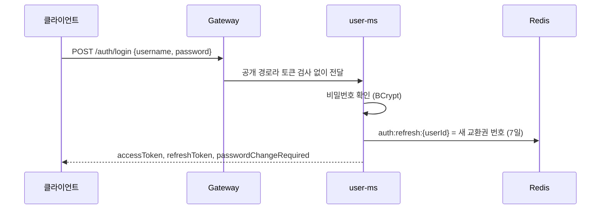
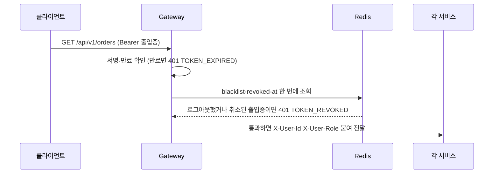
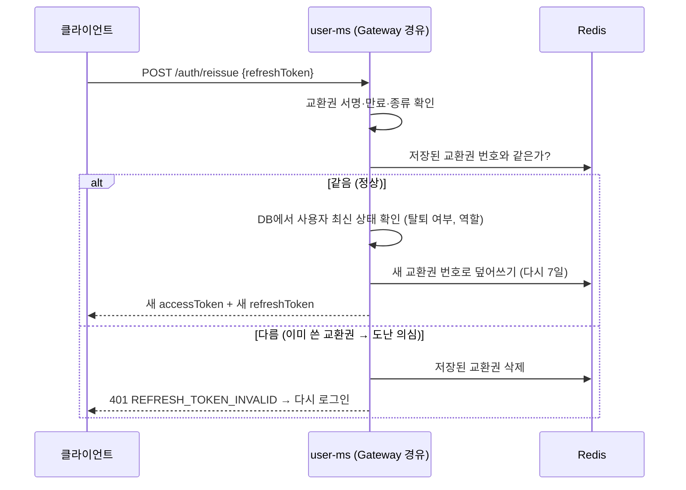
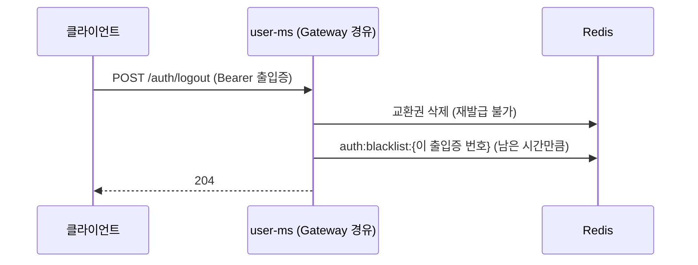
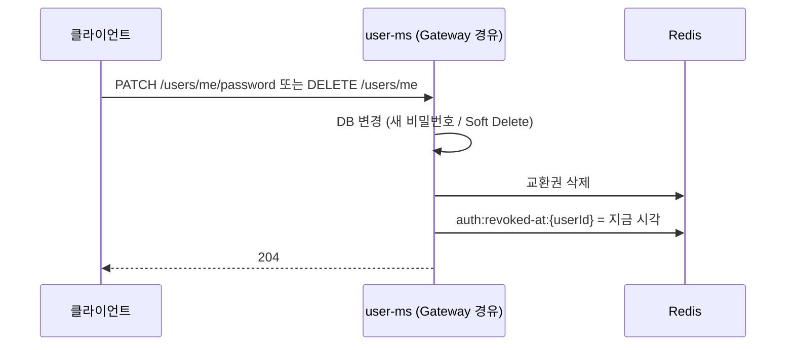

# 03. User·Auth API 가이드

> 작성자: 대진 · 기준: `dev` d6af869 (U00~U11 머지) · 최종 수정: 2026-10-16
> 대상: 팀원(허브 이찬, 주문 다울, 배송 영은, 업체 권우)과 API를 호출하는 분
> 원칙: **코드가 기준**입니다. 아직 구현되지 않은 것은 (예정)으로 표시했습니다.

## 0. 요약

- **지금 쓸 수 있는 API**: 회원가입, ID 중복 확인, 로그인, 토큰 재발급, 로그아웃, 내 정보 조회·수정(Slack ID만), 비밀번호 변경, 회원탈퇴, 내부 사용자 조회(`GET /internal/v1/users/{userId}`).
   - **쉽게 말해:** 사용자 **본인**이 하는 기능은 모두 동작합니다.
- **아직 없는 API (예정)**: MASTER 관리자 기능 전부(U12~U20: 사용자 생성·목록·상세·수정·역할 변경·배송담당자 지정·비활성화·비밀번호 초기화·재활성화·소속 연결).
   - **쉽게 말해:** **관리자 화면** 기능은 아직 없습니다. 경로와 권한 규칙만 Gateway에 미리 등록되어 있습니다.
- **역할은 `MASTER`, `USER` 두 개뿐**입니다. 배송담당자는 역할이 아니라 `isDeliveryManager` 속성입니다.
   - **쉽게 말해:** 권한은 "관리자 / 일반" 두 단계뿐입니다. 배송담당자는 "USER이면서 배송 담당 표시가 켜진 사람"입니다. 업체 관리자인지도 역할이 아니라 업체 데이터(`p_companies.manager_user_id`)를 보고 각 서비스가 판단합니다.
- **토큰**: Access 30분, Refresh 7일. 재발급하면 Refresh도 바뀝니다(rotation). 이미 교체된 이전 Refresh를 다시 쓰면 저장된 Refresh가 지워져 다시 로그인해야 합니다(이미 받은 Access는 만료까지 유효).
   - **쉽게 말해:** Access 토큰은 30분짜리 **출입증**, Refresh 토큰은 출입증을 다시 받는 7일짜리 **교환권**입니다. 교환할 때마다 교환권도 새것으로 바뀝니다. 이미 쓴 교환권이 다시 들어오면 도난으로 보고 저장된 교환권을 지웁니다. 그래서 다시 로그인해야 합니다.
- **다른 서비스에서 사용자 확인**: Feign으로 `user-ms`의 `/internal/v1/users/{userId}`를 부릅니다. 없거나 탈퇴했으면 404 `USER_NOT_FOUND`입니다.
   - **쉽게 말해:** 주문·배송을 만들 때 "이 사용자가 실제로 있고 활성 상태인가", "배송담당자인가"를 확인하는 용도입니다. 외부에서는 Gateway가 `/internal/**`를 막기 때문에 서비스끼리만 부를 수 있습니다.
- **로컬 계정**: MASTER는 `.env`의 `MASTER_*`로 user-ms 첫 기동 때 자동 생성, USER는 회원가입으로 만듭니다.
   - **쉽게 말해:** `.env`에 관리자 아이디·비밀번호를 적어 두면 user-ms를 처음 켤 때 MASTER 계정이 하나 생깁니다. 일반 사용자는 회원가입 API로 직접 만들면 됩니다.

## 1. 구현 상태

| 플랜 | 요구사항 | Method · Path | 권한 | 상태 |
|---|---|---|---|---|
| U03 | USR-19 | (기동 시) 초기 MASTER 생성 | - | ✅ |
| U04 | USR-01 | `POST /api/v1/auth/signup` | 공개 | ✅ |
| U04 | USR-20 | `GET /api/v1/auth/check-username` | 공개 | ✅ |
| U05 | USR-02 | `POST /api/v1/auth/login` | 공개 | ✅ |
| U06 | USR-18 | `GET /internal/v1/users/{userId}` | 내부(Feign) | ✅ |
| U07 | USR-03 | `POST /api/v1/auth/reissue` | 공개 | ✅ |
| U08 | USR-04 | `POST /api/v1/auth/logout` | 로그인 | ✅ |
| U09 | USR-06·07 | `GET`·`PATCH /api/v1/users/me` | 로그인 | ✅ |
| U10 | USR-08 | `PATCH /api/v1/users/me/password` | 로그인 | ✅ |
| U11 | USR-09 | `DELETE /api/v1/users/me` | 로그인 | ✅ |
| U12 | USR-10 | `POST /api/v1/users` 사용자 생성 | MASTER | (예정) |
| U13 | USR-11·12 | `GET /api/v1/users`, `GET /api/v1/users/{userId}` | MASTER | (예정) |
| U14 | USR-13 | `PATCH /api/v1/users/{userId}` 정보 수정 | MASTER | (예정) |
| U15 | USR-14 | `PATCH /api/v1/users/{userId}/role` 역할 변경 | MASTER | (예정) |
| U16 | USR-15 | `PATCH /api/v1/users/{userId}/delivery-manager` | MASTER | (예정) |
| U17 | USR-17 | `DELETE /api/v1/users/{userId}` 비활성화 | MASTER | (예정) |
| U18 | USR-21 | `POST /api/v1/users/{userId}/password-reset` | MASTER | (예정) |
| U19 | USR-22 | `POST /api/v1/users/{userId}/restore` 재활성화 | MASTER | (예정) |
| U20 | USR-16 | `PATCH /api/v1/users/{userId}/organization` 소속 연결 | MASTER | (예정) |

- (예정) 경로는 Gateway 정책(`gateway-edge/src/main/resources/application.yaml` `gateway.policy.master`)에 이미 MASTER 전용으로 등록되어 있습니다. USER 토큰으로 부르면 지금도 403 `ACCESS_DENIED`, MASTER 토큰이면 user-ms에 컨트롤러가 없어 404입니다.
- 개발 확인용 `GET /api/v1/auth/routing-check`도 있습니다(로그인 필요, 받은 `X-User-*` 헤더를 그대로 보여 줌). `ROUTING_CHECK_ENABLED=false`면 꺼집니다. 업무 API가 아니니 클라이언트에서 쓰지 마세요.

## 2. 역할·사용자 모델

### 2.1 역할 (`UserRole`)

| 값 | 할 수 있는 일 |
|---|---|
| `MASTER` | 관리자. Gateway의 MASTER 전용 경로 + 모든 기능. 본사(`HQ`) 소속은 MASTER만 가능 |
| `USER` | 로그인 사용자. 본인 계정 관리, 본인 데이터(업체 관리자·주문자·배송담당자 등)만 수정. 판단은 각 서비스가 데이터로 합니다 |

- 회원가입은 항상 `USER`입니다. 역할 변경은 U15(예정)입니다.
- 서비스에서는 `@CurrentUser AuthUser user`로 받고 `user.isMaster()`, `user.requireMaster()`, `user.requireSelfOrMaster(ownerId)`를 씁니다(common `AuthUser`, `AuthRole`).

### 2.2 사용자 필드 (`auth.p_users`, `User` 엔티티)

| JSON 필드 | 컬럼 | 설명 |
|---|---|---|
| `id` | `id` (UUID) | 애플리케이션이 `UUID.randomUUID()`로 생성 |
| `username` | `username` VARCHAR(10) | 로그인 ID. 탈퇴 사용자 포함 UNIQUE (재사용 불가) |
| `name` | `name` VARCHAR(100) | 이름 |
| `slackId` | `slack_id` VARCHAR(80) | 활성 사용자 사이에서만 UNIQUE (부분 인덱스 `uk_p_users_slack_id_active`) |
| `role` | `role` | `MASTER` / `USER` |
| `isDeliveryManager` | `is_delivery_manager` | 배송담당자 여부. 가입 시 `false`, 지정은 U16(예정) |
| `organizationType` | `organization_type` | `COMPANY` / `HUB` / `HQ`(본사, MASTER 전용) |
| `organizationName` | `organization_name` VARCHAR(150) | 가입 때 입력한 소속명 (자유 입력) |
| `organizationId` | `organization_id` (UUID, NULL 가능) | 실제 업체·허브 ID. **지금은 항상 `null`** (연결은 U20 예정). HQ는 항상 NULL (CHECK 제약) |
| `passwordChangeRequired` | `password_change_required` | MASTER가 비밀번호를 초기화하면 `true`(U18 예정), 본인이 변경하면 `false` |
| - | `created_at/by`, `updated_at/by`, `deleted_at/by` | 감사 컬럼. 회원가입의 `created_by`는 본인, 초기 MASTER는 시스템 UUID(`00000000-0000-0000-0000-000000000000`) |

- **소속만으로는 권한이 생기지 않습니다.** 업체 관리자 여부는 `p_companies.manager_user_id`, 배송담당 여부는 `isDeliveryManager`로 판단합니다(07 서비스 정책 1.2).
- **Soft Delete**: 탈퇴·비활성화는 `deleted_at`을 기록할 뿐 행은 남습니다. 다른 서비스의 사용자 UUID 참조는 그대로 둡니다. 삭제된 사용자는 로그인·내부 조회에서 "없는 사용자"로 취급됩니다.

## 3. 인증 흐름

### 3.1 먼저 알아 둘 것: 토큰 2개, Redis 기록 3개

**토큰 2개**

| 토큰 | 비유 | 유효시간 | 언제 쓰나 |
|---|---|---|---|
| Access Token | 건물 **출입증** | 30분 | 모든 API 요청의 `Authorization: Bearer ...` |
| Refresh Token | 출입증을 새로 받는 **교환권** | 7일 | `POST /auth/reissue`에서만 |

- 토큰마다 일련번호(`jti`)가 있습니다.
- JWT는 **한 번 발급하면 만료 전까지 스스로 유효**합니다. 그래서 "로그아웃했다", "비밀번호를 바꿨다"는 사실을 Gateway가 알 수 있도록 Redis에 기록을 남깁니다.

**Redis 기록 3개**

| 키 | 값 | 뜻 | 누가 쓰고, 누가 읽나 |
|---|---|---|---|
| `auth:refresh:{userId}` | 교환권 일련번호 | "이 사람의 **지금 유효한 교환권**은 이것 하나" (사용자당 1개, 7일) | 로그인·재발급 때 user-ms가 덮어쓰고, 재발급 때 비교 |
| `auth:blacklist:{jti}` | `logout` | "이 **출입증 한 장**은 로그아웃됨" (출입증 남은 시간만큼 보관) | 로그아웃 때 user-ms가 쓰고, 매 요청 Gateway가 확인 |
| `auth:revoked-at:{userId}` | 시각(초) | "이 시각 **이전에 발급된 이 사람의 출입증은 전부** 무효" | 비밀번호 변경·탈퇴 때 user-ms가 쓰고, 매 요청 Gateway가 확인 |

### 3.2 장면별 흐름

**① 로그인**



다시 로그인하면 교환권 번호가 덮어써지므로 **이전 교환권은 자동으로 무효**가 됩니다.

**② 일반 API 호출 (매 요청)**



서비스는 이 과정을 신경 쓰지 않고 헤더만 읽습니다([[01 Gateway·인증 가이드]]).

**③ 30분이 지나 출입증이 만료됐을 때: 재발급**



- 교환권은 **한 번 쓰면 끝**이고, 재발급 응답의 새 교환권을 저장해 다음에 써야 합니다(rotation).
- 꾸준히 쓰면 교환권이 계속 새로 7일짜리로 바뀌므로, 실제로는 "**7일 동안 활동이 없으면** 다시 로그인"입니다.

**④ 로그아웃**



이후 같은 출입증으로 요청하면 Gateway가 ②에서 401 `TOKEN_REVOKED`로 막습니다.

**⑤ 비밀번호 변경·회원탈퇴: 모든 기기에서 로그아웃**



- 로그아웃은 **출입증 한 장**을 막고, 이건 **그 사람의 출입증 전부**를 막습니다. 다른 기기에 남은 출입증도 포함입니다.
- 비밀번호 변경 후에는 새 비밀번호로 다시 로그인합니다. 새로 받은 출입증은 `revoked-at`보다 나중에 발급됐으므로 통과합니다.

### 3.3 정리

| 단계 | 동작 |
|---|---|
| 회원가입 | 승인 없이 즉시 활성. 역할 `USER`, 소속은 `COMPANY`·`HUB`만 |
| 로그인 | Access(30분)·Refresh(7일) 발급. **사용자당 Refresh 1개**: 다시 로그인하면 이전 Refresh는 무효 |
| 재발급 | 새 Access·Refresh를 **둘 다** 받습니다. 역할·`pcr`은 DB 최신값으로 다시 담깁니다 |
| 재사용 탐지 | 이미 교체된 Refresh가 오면 저장된 Refresh를 지웁니다 → 정상 사용자도 다시 로그인해야 함. 이미 발급된 Access는 만료까지 남음 |
| 로그아웃 | 이 Access를 blacklist, Refresh 삭제. 여러 번 호출해도 같은 결과 |
| 비밀번호 변경 | 성공하면 **이 요청의 토큰을 포함해 모든 토큰 무효** → 새 비밀번호로 다시 로그인 |
| 회원탈퇴 | Soft Delete + 모든 토큰 무효. 같은 username으로 재가입 불가 |

- 토큰 claim: `sub`(사용자 UUID), `role`, `pcr`(비밀번호 변경 필요), `typ`(`access`/`refresh`), `jti`, `iat`, `exp`. HS256, 키는 `.env`의 `JWT_SECRET_KEY`(gateway와 공유). 상세는 [[01 Gateway·인증 가이드]]·[[SYS-01 게이트웨이 인증 인가 설계]].
- `pcr=true` 토큰은 `GET /api/v1/users/me`, `PATCH /api/v1/users/me/password`, `POST /api/v1/auth/logout`만 통과하고 나머지는 403 `PASSWORD_CHANGE_REQUIRED`입니다. 지금은 `pcr`을 `true`로 만드는 API(U18)가 없습니다.
- Redis 장애 시 로그인·재발급·로그아웃·비밀번호 변경·탈퇴는 503 `AUTH_UNAVAILABLE`입니다(user-ms Redis timeout 2s).

## 4. API 레퍼런스 (구현된 것만)

공통 사항:

- 외부 호출은 모두 **Gateway `http://localhost:19090`** 를 거칩니다. 로그인 필요 API는 `Authorization: Bearer {accessToken}` 헤더가 필요합니다.
- 로그인 필요 API의 Gateway 오류: 401 `TOKEN_MISSING`·`TOKEN_EXPIRED`·`TOKEN_INVALID`·`TOKEN_REVOKED`, 403 `PASSWORD_CHANGE_REQUIRED`, 503 `AUTH_UNAVAILABLE`. 아래 표에서는 생략합니다.
- Bean Validation 실패(`@NotBlank`, `@Size`)·JSON 파싱 실패는 400 `INVALID_INPUT`입니다.
- 오류 응답 형식:

```json
{ "code": "INVALID_INPUT", "message": "잘못된 요청입니다.", "errors": [ { "field": "slackId", "reason": "공백일 수 없습니다" } ] }
```

### 4.1 회원가입 `POST /api/v1/auth/signup` (공개)

```json
{ "username": "user01", "password": "Abcd1234!", "name": "홍길동",
  "slackId": "U01ABCDEF", "organizationType": "COMPANY", "organizationName": "스파르타상사" }
```

| 필드 | 검증 |
|---|---|
| `username` | `@NotBlank` + 도메인: `^[a-z0-9]{4,10}$` → 위반 시 `INVALID_USERNAME` |
| `password` | `@NotBlank` + 도메인: 8~15자, 대문자·소문자·숫자·특수문자 각 1개 이상 → `INVALID_PASSWORD` |
| `name` | `@NotBlank @Size(max=100)` |
| `slackId` | `@NotBlank @Size(max=80)`, 활성 사용자 중복 시 `DUPLICATE_SLACK_ID` |
| `organizationType` | `@NotBlank`, 정확히 `COMPANY` 또는 `HUB` (대소문자 구분). `HQ`·기타 값은 `INVALID_ORGANIZATION` |
| `organizationName` | `@NotBlank @Size(max=150)` |

응답 201:

```json
{ "id": "3f0c...uuid", "username": "user01", "name": "홍길동", "slackId": "U01ABCDEF",
  "role": "USER", "organizationType": "COMPANY", "organizationName": "스파르타상사" }
```

오류: 400 `INVALID_INPUT`·`INVALID_USERNAME`·`INVALID_PASSWORD`·`INVALID_ORGANIZATION`, 409 `DUPLICATE_USERNAME`(탈퇴한 ID 포함)·`DUPLICATE_SLACK_ID`. 검사 순서: 형식 → username 규칙 → 비밀번호 규칙 → 소속 유형 → username 중복 → Slack ID 중복.

### 4.2 ID 중복 확인 `GET /api/v1/auth/check-username?username=user01` (공개)

응답 200 `{ "available": true }` — 탈퇴한 사용자의 ID도 `false`입니다.
오류: 400 `INVALID_INPUT`(파라미터 없음), 400 `INVALID_USERNAME`(형식 위반).

### 4.3 로그인 `POST /api/v1/auth/login` (공개)

```json
{ "username": "user01", "password": "Abcd1234!" }
```

검증: 둘 다 `@NotBlank`만. 가입 규칙에 안 맞는 값도 400이 아니라 401로 응답합니다.

응답 200:

```json
{ "accessToken": "eyJ...", "refreshToken": "eyJ...", "passwordChangeRequired": false }
```

오류: 400 `INVALID_INPUT`, 401 `INVALID_CREDENTIALS`(없는 ID·틀린 비밀번호·탈퇴 계정 구분 없음), 503 `AUTH_UNAVAILABLE`.

### 4.4 토큰 재발급 `POST /api/v1/auth/reissue` (공개)

```json
{ "refreshToken": "eyJ..." }
```

응답 200 `{ "accessToken": "eyJ...", "refreshToken": "eyJ..." }` — **두 토큰 모두 교체**해서 저장하세요.
오류: 400 `INVALID_INPUT`(빈 값), 401 `REFRESH_TOKEN_INVALID`(서명·만료 오류, Access를 넣음, 로그아웃·교체된 토큰, 탈퇴 사용자 모두 같은 코드), 503 `AUTH_UNAVAILABLE`.

### 4.5 로그아웃 `POST /api/v1/auth/logout` (로그인)

본문 없음. 응답 204.
user-ms는 Gateway가 넣은 `X-User-Id`·`X-User-Role`·`X-Token-Jti`·`X-Token-Exp`를 씁니다. user-ms(19095)를 직접 부르면 헤더가 없어 401 `UNAUTHENTICATED`입니다.
오류: 503 `AUTH_UNAVAILABLE`(다시 호출하면 됩니다).

### 4.6 내 정보 조회 `GET /api/v1/users/me` (로그인, `pcr`이어도 허용)

응답 200:

```json
{ "id": "3f0c...uuid", "username": "user01", "name": "홍길동", "slackId": "U01ABCDEF",
  "role": "USER", "isDeliveryManager": false, "organizationType": "COMPANY",
  "organizationName": "스파르타상사", "organizationId": null,
  "passwordChangeRequired": false, "createdAt": "2026-10-16T10:15:30.123456" }
```

오류: 404 `USER_NOT_FOUND`(토큰은 유효하지만 사용자가 없음, 예: `scripts/dev-token.py`로 만든 가짜 사용자).

### 4.7 내 정보 수정 `PATCH /api/v1/users/me` (로그인)

```json
{ "slackId": "U09NEWID" }
```

검증: `slackId` `@NotBlank @Size(max=80)`. **본인은 Slack ID만** 바꿀 수 있고, `name` 등 다른 필드는 무시됩니다(오류 아님).
응답 200: 4.6과 같은 형식. 오류: 400 `INVALID_INPUT`, 404 `USER_NOT_FOUND`, 409 `DUPLICATE_SLACK_ID`(다른 활성 사용자가 사용 중. 본인의 현재 값은 허용).

### 4.8 비밀번호 변경 `PATCH /api/v1/users/me/password` (로그인, `pcr`이어도 허용)

```json
{ "currentPassword": "Abcd1234!", "newPassword": "Efgh5678@" }
```

검증: 둘 다 `@NotBlank`. 새 비밀번호는 가입 규칙과 같고 현재와 달라야 합니다.
응답 204 → **모든 토큰 무효**, 새 비밀번호로 다시 로그인.
오류: 400 `INVALID_INPUT`·`INVALID_PASSWORD`·`SAME_PASSWORD`, 401 `INVALID_CREDENTIALS`(현재 비밀번호 틀림), 404 `USER_NOT_FOUND`, 503 `AUTH_UNAVAILABLE`(이 경우 비밀번호도 바뀌지 않음, 롤백).

### 4.9 회원탈퇴 `DELETE /api/v1/users/me` (로그인)

```json
{ "password": "Abcd1234!" }
```

DELETE지만 **본문이 필요**합니다(`@NotBlank`, 본문 없으면 400 `INVALID_INPUT`). 응답 204 → 모든 토큰 무효, 이후 로그인은 401 `INVALID_CREDENTIALS`.
오류: 400 `INVALID_INPUT`, 401 `INVALID_CREDENTIALS`, 404 `USER_NOT_FOUND`, 409 `LAST_MASTER`(활성 MASTER가 본인 1명), 503 `AUTH_UNAVAILABLE`.

## 5. 다른 서비스에서 사용자 조회 (내부 API)

`GET /internal/v1/users/{userId}` — user-ms에 Eureka 이름 `user-ms`로 **Feign 직접 호출**합니다. Gateway는 `/internal/**`을 404로 막으므로 외부에서는 부를 수 없습니다. `X-User-*` 헤더 없이도 됩니다.

| 상황 | 응답 |
|---|---|
| 활성 사용자 | 200, 아래 6개 필드만 |
| 없음 · 탈퇴 · 비활성화 | 404 `USER_NOT_FOUND` |
| UUID 형식 아님 | 400 `INVALID_INPUT` |

```json
{ "id": "3f0c...uuid", "name": "홍길동", "role": "USER", "isDeliveryManager": true, "slackId": "U01ABCDEF", "active": true }
```

- 삭제된 사용자는 404라 `active`는 항상 `true`입니다(계약상 남겨 둔 필드).
- 배송담당자 배정 시 **200 + `isDeliveryManager == true`** 를 함께 확인하세요. 담당자가 아니어도 200입니다.
- `username`, 소속 정보는 내부 응답에 없습니다. 필요하면 대진에게 요청해 주세요(필드를 바꾸면 양쪽 DTO를 함께 바꿉니다).

### 5.1 Feign 예시 (4계층 + DIP)

의존성: `spring-cloud-starter-openfeign`, `spring-cloud-starter-circuitbreaker-resilience4j`, 애플리케이션에 `@EnableFeignClients`. 타임아웃(connect 1s·read 2s)·Circuit Breaker·오류 해석(`CommonFeignErrorDecoder`)은 common이 자동 설정합니다. `@FeignClient`에 `url`을 넣으면 기동이 실패합니다(`FeignClientUrlGuard`).

```java
// domain — Feign을 모르는 Port
public interface UserPort {
    Optional<UserSnapshot> findActiveUser(UUID userId);   // 없거나 탈퇴면 empty
}
public record UserSnapshot(UUID id, String name, boolean deliveryManager, String slackId) {}

// infrastructure/client — HTTP 계약
@FeignClient(name = "user-ms")
public interface UserClient {
    @GetMapping("/internal/v1/users/{userId}")
    InternalUserResponse getUser(@PathVariable("userId") UUID userId);
}
public record InternalUserResponse(UUID id, String name, String role,
                                   boolean isDeliveryManager, String slackId, boolean active) {}

// infrastructure/client — Adapter
@Component
@RequiredArgsConstructor
public class UserAdapter implements UserPort {
    private final UserClient userClient;
    private final RemoteCallTemplate remote;

    @Override
    public Optional<UserSnapshot> findActiveUser(UUID userId) {
        try {
            InternalUserResponse r = remote.execute("user-ms", () -> userClient.getUser(userId));
            return Optional.of(new UserSnapshot(r.id(), r.name(), r.isDeliveryManager(), r.slackId()));
        } catch (RemoteBusinessException e) {
            if (e.getErrorCode() == UserErrorCode.USER_NOT_FOUND) {
                return Optional.empty();
            }
            throw e;
        }
    }
}
```

- `RemoteServiceException`(5xx·CB OPEN·연결 실패 → 503)과 `RemoteTimeoutException`(read 타임아웃 → 504)은 잡지 않으면 공통 형식으로 응답됩니다. 처리 방법은 [[02 장애 대응(Feign) 가이드]], [[SYS-13 장애 대응 설계]]를 보세요.
- 조회는 멱등이므로 필요하면 `remote.executeWithRetryOnce(...)`를 써도 됩니다.

### 5.2 열린 사항과 의존 관계

| 항목 | 내용 | 관련 |
|---|---|---|
| 정책 #16 내부 API 호출자 확인 | 지금 `/internal/**`은 Gateway 차단만 하고 **호출 서비스를 검증하지 않습니다**. 네트워크 제한만 할지 서비스 토큰을 둘지 미결정 | 팀 공통 |
| U16 배송담당자 지정 (예정) | 지금은 API로 `isDeliveryManager=true`를 만들 수 없습니다. 시연 데이터를 위해 관리자 기능 중 먼저 구현 예정. 정책 #15(진행 중 배송이 있는 담당자 해제)는 미결정 | 영은 |
| U20 소속 연결 (예정) | `organizationId`는 지금 항상 `null`입니다. 연결 시 업체·허브 존재 확인(Feign)은 선택 사항이며 일정이 밀리면 제외 1순위 | 권우(업체), 이찬(허브) |

## 6. 로컬 테스트 계정·토큰 얻기

### 6.1 초기 MASTER

`.env`(프로젝트 루트)에 아래 4개를 넣고 user-ms를 기동하면, **활성 MASTER가 하나도 없을 때만** 1명 생성됩니다(소속 `HQ`, 이름 `본사`). 값은 각자 정하고 저장소에 올리지 마세요.

| 환경 변수 | 프로퍼티 | 규칙 |
|---|---|---|
| `MASTER_USERNAME` | `initial-master.username` | 4~10자 영문 소문자·숫자 |
| `MASTER_PASSWORD` | `initial-master.password` | 8~15자, 대·소문자·숫자·특수문자 |
| `MASTER_NAME` | `initial-master.name` | |
| `MASTER_SLACK_ID` | `initial-master.slack-id` | |

- 하나라도 비어 있으면 경고 로그(`[InitialMaster] MASTER_* 환경 변수가 비어 있어…`)만 남기고 만들지 않습니다.
- 규칙에 맞지 않는 값이면 기동이 실패합니다. 성공하면 `[InitialMaster] 초기 MASTER를 생성했습니다. username=…` 로그가 나옵니다.
- `.env.example`에는 아직 `MASTER_*` 항목이 없습니다. [[로컬 실행·라우팅 확인 가이드]]를 참고하세요.

### 6.2 USER 만들고 토큰 받기 (curl, Gateway 19090)

```bash
GW=http://localhost:19090

curl -s -X POST $GW/api/v1/auth/signup -H 'Content-Type: application/json' \
  -d '{"username":"user01","password":"Abcd1234!","name":"홍길동","slackId":"U01ABCDEF","organizationType":"HUB","organizationName":"서울허브"}'

ACCESS=$(curl -s -X POST $GW/api/v1/auth/login -H 'Content-Type: application/json' \
  -d '{"username":"user01","password":"Abcd1234!"}' | jq -r .accessToken)

curl -s $GW/api/v1/users/me -H "Authorization: Bearer $ACCESS"
```

MASTER 토큰은 같은 방법으로 `"username":"'$MASTER_USERNAME'"` 등 `.env` 값을 넣어 로그인합니다.

### 6.3 기타

- **Postman**: `docs/postman/sparta-logistics-gateway.postman_collection.json` (56개 요청, 13~50번이 회원가입~탈퇴 흐름, 18·19번이 내부 API). 사용법은 [[Postman Gateway 테스트 가이드]].
- **`scripts/dev-token.py`**: DB 없이 서명만 맞춘 토큰을 만듭니다. 사용자 ID가 가짜라 Gateway 통과 확인용으로만 쓰고, `/users/me`처럼 실제 사용자가 필요한 API에는 로그인 토큰을 쓰세요.
- 내부 API 직접 확인: `curl http://localhost:19095/internal/v1/users/{userId}`.

## 7. 오류 코드표

| code | HTTP | 메시지 | 발생 |
|---|---|---|---|
| `INVALID_USERNAME` | 400 | 아이디는 4~10자의 영문 소문자와 숫자만 사용할 수 있습니다. | 가입, ID 확인 |
| `INVALID_PASSWORD` | 400 | 비밀번호는 8~15자이며 영문 대문자·소문자·숫자·특수문자를 모두 포함해야 합니다. | 가입, 비밀번호 변경 |
| `INVALID_ORGANIZATION` | 400 | 소속 정보가 올바르지 않습니다. | 가입(HQ·잘못된 값) |
| `SAME_PASSWORD` | 400 | 현재 비밀번호와 다른 비밀번호를 입력해 주세요. | 비밀번호 변경 |
| `INVALID_CREDENTIALS` | 401 | 아이디 또는 비밀번호가 올바르지 않습니다. | 로그인, 비밀번호 재확인 |
| `USER_NOT_FOUND` | 404 | 사용자를 찾을 수 없습니다. | 내 정보, 내부 API |
| `DUPLICATE_USERNAME` | 409 | 이미 사용 중인 아이디입니다. | 가입 |
| `DUPLICATE_SLACK_ID` | 409 | 이미 사용 중인 Slack ID입니다. | 가입, 내 정보 수정 |
| `LAST_MASTER` | 409 | 마지막 관리자는 탈퇴·강등·비활성화할 수 없습니다. | 탈퇴 (U15·U17 예정) |
| `USER_ALREADY_DELETED` | 409 | 이미 삭제된 사용자입니다. | (U17 예정) |
| `USER_NOT_DELETED` | 409 | 삭제되지 않은 사용자입니다. | (U19 예정) |
| `TOKEN_MISSING` | 401 | 인증 토큰이 없습니다. | Gateway |
| `TOKEN_EXPIRED` | 401 | 인증 토큰이 만료되었습니다. | Gateway → 재발급 |
| `TOKEN_INVALID` | 401 | 유효하지 않은 인증 토큰입니다. | Gateway (Refresh를 Access로 사용 포함) |
| `TOKEN_REVOKED` | 401 | 더 이상 사용할 수 없는 인증 토큰입니다. 다시 로그인해 주세요. | Gateway (로그아웃·비밀번호 변경·탈퇴 후) |
| `REFRESH_TOKEN_INVALID` | 401 | 유효하지 않은 Refresh Token입니다. 다시 로그인해 주세요. | 재발급 |
| `PASSWORD_CHANGE_REQUIRED` | 403 | 비밀번호를 변경한 뒤 이용할 수 있습니다. | Gateway (`pcr=true`) |
| `AUTH_UNAVAILABLE` | 503 | 일시적으로 인증을 처리할 수 없습니다. | Redis 장애 |
| `INVALID_INPUT` | 400 | 잘못된 요청입니다. | Bean Validation, JSON 오류, 파라미터 누락 |
| `UNAUTHENTICATED` | 401 | 인증이 필요합니다. | 서비스 직접 호출로 `X-User-*`·`X-Token-*` 없음 |
| `ACCESS_DENIED` | 403 | 접근 권한이 없습니다. | USER가 MASTER 전용 경로 호출 |

출처: `common/src/main/java/com/common/exception/{UserErrorCode,AuthErrorCode,CommonErrorCode}.java`.

## 8. 정책 요약

| 항목 | 규칙 (코드 기준) |
|---|---|
| username | `^[a-z0-9]{4,10}$`. 탈퇴 사용자 포함 영구 UNIQUE |
| password | `^[A-Za-z0-9\p{Punct}]{8,15}$` + 대문자·소문자·숫자·특수문자 각 1개 이상. 공백·한글 불가. BCrypt 저장 |
| slackId | 필수, 80자 이하. 활성 사용자 사이 중복 불가(탈퇴자의 값은 재사용 가능) |
| 소속 | 가입은 `COMPANY`·`HUB`만. `HQ`는 MASTER 전용. `organizationId`는 MASTER가 연결(예정) |
| 가입 | 승인 없이 즉시 활성, 역할 `USER`, `isDeliveryManager=false` |
| 로그인 실패 | 없는 ID·틀린 비밀번호·탈퇴 계정 모두 같은 401 (ID 존재 여부는 ID 확인 API로 알 수 있음, 감수) |
| 세션 | 사용자당 Refresh 1개. 새 로그인·재발급 시 이전 Refresh 무효 |
| 본인 수정 | Slack ID만. 이름·소속 변경은 MASTER(U14 예정) |
| 비밀번호 변경 | 현재 비밀번호 확인, 새 규칙 충족, 현재와 달라야 함. 성공 시 전체 토큰 무효 |
| 탈퇴 | 비밀번호 재확인 후 Soft Delete(`deleted_by`=본인), 전체 토큰 무효 |
| 마지막 MASTER 보호 | 활성 MASTER가 1명이면 탈퇴 409 `LAST_MASTER` (강등·비활성화도 같은 규칙 예정). 동시 탈퇴는 잠금 조회로 막음 |
| 비밀번호 찾기 | 온라인 기능 없음. MASTER에게 오프라인 문의 → 초기화(U18 예정) |
| 초기 MASTER | 활성 MASTER가 0명일 때만 `.env`로 1회 생성 |

## 9. FAQ

**Q. Access가 만료되면?** 401 `TOKEN_EXPIRED`를 받으면 `/auth/reissue`로 새 쌍을 받고 원래 요청을 다시 보내세요. 재발급이 401이면 로그인 화면으로 보냅니다.

**Q. 탭 두 개에서 동시에 재발급했더니 둘 다 로그아웃됐어요.** 재사용 탐지 때문입니다. 한쪽이 먼저 교체하면 다른 쪽의 Refresh는 "이미 교체된 토큰"이 되어 저장값이 지워집니다. 클라이언트에서 재발급을 한 번만 하도록 직렬화해 주세요.

**Q. 비밀번호 변경 후 바로 로그인했는데 막히지 않나요?** 같은 초에 로그인해도 새 토큰의 `iat`를 다음 초로 미뤄서 통과합니다(Postman 45·46번).

**Q. 내 서비스에서 현재 사용자 이름이 필요해요.** 헤더에는 `X-User-Id`·`X-User-Role`만 옵니다. 이름·Slack ID는 내부 API로 조회하세요.

**Q. 배송담당자 계정을 테스트로 만들고 싶어요.** U16 전까지는 API가 없습니다. 로컬 DB에서 `auth.p_users.is_delivery_manager`를 직접 `true`로 바꾸는 것은 개인 로컬에서만 해 주세요.

**Q. user-ms(19095)를 직접 불렀더니 401 `UNAUTHENTICATED`예요.** 로그인 필요 API는 Gateway가 넣는 헤더를 요구합니다. 19090으로 호출하세요. 내부 API(`/internal/**`)만 직접 호출합니다.

**Q. 탈퇴한 사용자의 주문·배송은?** 데이터의 사용자 UUID 참조는 그대로 둡니다. 내부 API로 조회하면 404이므로 "새 배정 불가"로 처리하면 됩니다.

## 10. 참고 문서

- API·정책: [[04 API 명세서]] Auth·User·Internal, [[06 테이블 명세서]] p_users, [[07 서비스 정책]] 1·2·9장
- 인증: [[01 Gateway·인증 가이드]], [[SYS-01 게이트웨이 인증 인가 설계]]
- 장애 대응·알림: [[02 장애 대응(Feign) 가이드]], [[04 Slack 알림 가이드]], [[SYS-13 장애 대응 설계]]
- 실행·테스트: [[로컬 실행·라우팅 확인 가이드]], [[Postman Gateway 테스트 가이드]]
- 코드: `user-ms/src/main/java/com/user/presentation/controller/`, `common/src/main/java/com/common/exception/`
