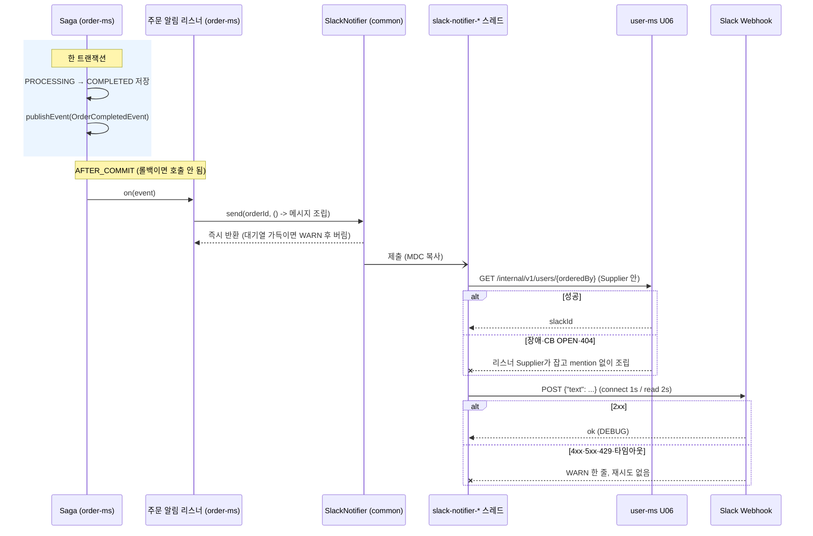

# 04. Slack 알림 가이드

> 작성자: 대진 · 기준: `dev` `bc7ffbf` (PR #25 머지) · 최종 수정 2026-10-16
> 대상: 주문 알림을 붙일 다울님(order-ms), Slack 알림을 쓰려는 모든 서비스 담당자
> 설계 근거: [NTF 주문 알림 설계](../Common/NTF%20주문%20알림%20설계.md) · [07 서비스 정책 §8](../design/07%20서비스%20정책.md)

---

## 0. 요약

> **상태: common 사용 가능 (`dev`에 머지, PR #25)**
> - `dev`를 받으면 모든 Servlet 서비스(user·hub·company·order·delivery)에서 `SlackNotifier`를 바로 주입받을 수 있습니다. **의존성·설정 추가 없음**(루트 build가 `common`·`spring-boot-starter-web`을 이미 넣어 줍니다).
> - 검증: common 테스트 241개, 실제 Slack 채널 발송(이스케이프·줄바꿈 처리 확인), user-ms 기동(URL 없으면 NoOp, 있으면 발송기 선택, 로그에 URL 0건).
> - order-ms 쪽 이벤트·리스너·slackId 조회는 **다울님 담당**이며 아직 없습니다(이 문서 5장).

한 줄 요약: **주문이 `COMPLETED`로 커밋된 뒤, order-ms 리스너가 `slackNotifier.send(...)`를 한 번 호출하면 끝입니다.** 발송·타임아웃·실패 처리는 common이 맡고, 실패해도 주문에는 아무 영향이 없습니다.

> **쉽게 말해:** 다울님은 "주문이 완료됐다"는 사실과 메시지 내용만 넘기면 됩니다. Slack 주소 관리, 시간 제한, 실패 처리, 특수문자 이스케이프는 common이 알아서 합니다. 알림은 별도 스레드에서 보내므로 Slack이 느리거나 죽어도 주문 API 응답은 기다리지 않습니다. 커밋 **후에** 보내기 때문에 롤백된 주문에 알림이 나가는 일도 없습니다.

### 0.1 빠른 시작 (모든 서비스 공통, 3단계)

```java
@Component
@RequiredArgsConstructor
public class SomethingNotifier {

    private final SlackNotifier slackNotifier;               // ① 주입 (common 자동 설정 빈)

    public void notifyDone(UUID id, String itemName) {
        SlackMessage message = SlackMessage.builder("작업 완료") // ② 메시지 만들기 (제목 필수, 필드 최대 10개)
                .field("ID", id.toString())
                .field("항목", itemName)
                .reference(id.toString())                     //    로그 추적용, Slack에는 안 보임
                .build();
        slackNotifier.send(message);                          // ③ 보내기: 즉시 반환, 예외 없음
    }
}
```

- 로컬에 `SLACK_WEBHOOK_URL`이 없으면 아무것도 보내지 않고(NoOp) 정상 동작합니다. 실제로 보려면 4.1절대로 개인 Webhook을 만드세요.
- **트랜잭션 안에서 바로 `send`하지 마세요.** 롤백돼도 알림이 나갑니다. 커밋 후에 보내려면 5장(이벤트 + `@TransactionalEventListener(AFTER_COMMIT)`) 방식을 따르세요.
- 메시지를 만들 때 원격 조회가 필요하면 `send(reference, () -> ...)`를 씁니다(3.1절).
- 넣으면 안 되는 것: 연락처, 상세 주소, 자유 입력 원문, 토큰·비밀번호(8장).

---

## 1. 무엇을 언제 보내나

| 항목 | 내용 |
|---|---|
| 트리거 | Saga가 주문을 `PROCESSING → COMPLETED`로 **전이·저장한 트랜잭션이 커밋된 뒤** (롤백·FAILED 주문은 알림 없음) |
| 채널 | Incoming Webhook에 연결된 **고정 채널 1개** (DM 불가, A11) |
| 멘션 | 주문자(`orderedBy`)의 Slack 멤버 ID. 조회 실패·404·형식 불일치면 **멘션 없이** 발송 |
| 넣는 것 | 주문 ID, 상품명·수량, 공급·요청 업체명, 출발·도착 허브명(있을 때), 요청사항 **있음/없음** |
| 넣지 않는 것 | 요청사항 원문, 수령인·연락처, 상세 주소, 내부 사용자 UUID(멘션 외), 금액(미결 O2), 토큰·비밀번호 |

렌더링 예시:

```text
*[주문 완료]* <@U07ABCDEF1>
• 주문 ID: 3fa85f64-…
• 상품: 생수 500ml × 10
• 공급 → 요청: A상사 → B마트
• 경로: 서울 허브 → 부산 허브
• 요청사항: 있음
```

**왜 "주문 생성 시"가 아니라 COMPLETED인가요?** 발제(NTF-01)는 "주문 생성 시 Webhook 호출"이지만, 우리 주문은 생성 직후 `PROCESSING`이고 재고·배송 확보(Saga)가 실패할 수 있습니다. 생성 직후에 보내면 실패할 주문에도 알림이 가고 배송 정보도 없습니다. 그래서 **"생성 = Saga가 성공해 주문이 확정된 시점"** 으로 해석했고(설계 Q1), README에도 이 해석을 적습니다. 주문 응답을 202(비동기)로 정하면 이 알림이 주문자에게 "처리 완료" 통지 역할도 합니다(202/201은 아직 미정, 7장).

---

## 2. 구조

### 2.1 책임 나눔

| 책임 | 위치 | 담당 |
|---|---|---|
| **어떻게 보내나**: Webhook 호출, 타임아웃, 전용 스레드·대기열, 실패는 WARN만, URL 비밀 처리, 이스케이프·길이 제한·멘션 형식 검사, URL 없으면 NoOp | common `com.common.notification` | 대진 |
| **언제·누구에게·무엇을**: COMPLETED 전이 시 이벤트 발행, 주문자 slackId 조회, 메시지 항목 조립, 개인정보 제외 | order-ms | 다울 |

common은 user-ms API를 모릅니다. slackId 조회는 호출하는 도메인이 합니다.

### 2.2 시퀀스



읽는 법: Saga 스레드가 하는 일은 `send` 한 번이고 바로 돌아옵니다. user-ms 조회와 Slack 호출은 모두 알림 스레드에서 일어나므로, 둘 다 느리거나 죽어도 Saga는 기다리지 않습니다.

---

## 3. common API 레퍼런스

### 3.1 공개 타입 (`com.common.notification`)

도메인이 알아야 할 것은 이 세 개뿐입니다.

```java
public interface SlackNotifier {
    void send(SlackMessage message);
    void send(String reference, Supplier<SlackMessage> message);
}

public record SlackMessage(String title, List<SlackField> fields, String mentionSlackId, String reference) {
    public static final int MAX_FIELDS = 10;
    public static Builder builder(String title);
    // Builder: field(String label, String value) / mention(String slackId) / reference(String reference) / build()
}

public record SlackField(String label, String value) { }
```

| 메서드 | 동작 |
|---|---|
| `send(SlackMessage)` | 즉시 반환, 예외 없음. 로그 추적값은 `message.reference()` |
| `send(String reference, Supplier<SlackMessage>)` | 즉시 반환, 예외 없음. **메시지 조립(Supplier 실행)까지 알림 스레드에서** 합니다. 원격 조회가 필요하면 이쪽을 씁니다. Supplier가 던진 예외도 WARN으로 끝납니다 |

| 필드 | 규칙 |
|---|---|
| `title` | 필수. null·공백이면 **생성 시** `IllegalArgumentException` |
| `fields` | null이면 빈 목록. 최대 10개, 초과·null 항목이면 생성 시 IAE. 불변 복사됨 |
| `SlackField.label` | 필수. null·공백이면 IAE |
| `SlackField.value` | null이면 `-`로 표시 |
| `mentionSlackId` | null이면 멘션 없음. 형식이 틀리면 렌더러가 조용히 생략 |
| `reference` | 로그 추적용(예: 주문 ID). **Slack으로는 보내지 않습니다** |
| `null` 처리 | `send(null)`, `send(ref, null)`, `null`을 돌려주는 Supplier는 모두 **예외 없이** 버리고 WARN `메시지 없음`을 남깁니다 |

> 생성 시 IAE는 개발 중 실수를 바로 드러내기 위한 것입니다. Supplier 안에서 IAE가 나면 알림 스레드에서 "메시지 조립 실패" WARN으로 끝나고, 호출한 쪽에는 전파되지 않습니다.

### 3.2 렌더링 규칙 (`SlackMessageRenderer`, package-private)

| 규칙 | 내용 |
|---|---|
| 형식 | `{"text": ...}` + mrkdwn. 첫 줄 `*[제목]*` (+ ` <@멘션>`), 이후 `• 라벨: 값` |
| 멘션 형식 | 정규식 `[UW][A-Z0-9]{8,}` 전체 일치일 때만 `<@ID>`. `hong`, `<!here>`, 소문자 ID 등은 생략 |
| 줄바꿈 | 값 안의 줄바꿈은 공백으로 바꿈 (가짜 줄 삽입 방지) |
| 길이 제한 | 제목 100, 라벨 50, 값 200 (code point 기준). 넘으면 잘라서 `…` |
| 이스케이프 | 자른 **다음** `&` → `&amp;`, `<` → `&lt;`, `>` → `&gt;` |

그래서 값에 `<!channel>`이나 링크를 넣어도 평문으로 보입니다. **멘션은 `mention(...)`으로만** 만들 수 있습니다.

### 3.3 구현체와 자동 설정

| 구성 | 동작 |
|---|---|
| `CommonNotificationAutoConfiguration` | **Servlet 웹 앱 + RestClient 클래스**가 있을 때만 켜짐(gateway 제외). `SlackNotifier` 빈을 서비스가 직접 등록하면 물러남(`@ConditionalOnMissingBean`) |
| `NoOpSlackNotifier` | `webhook-url`이 비어 있으면(공백 포함) 등록. 기동 시 INFO `Slack 알림 비활성 (common.notification.slack.webhook-url 미설정)` 1회. **Supplier도 호출하지 않아** user-ms 조회가 일어나지 않음 |
| `SlackWebhookNotifier` | URL이 있으면 등록. 생성 시 URL 검증: http/https 절대 URL이 아니거나 파싱 실패면 **기동 실패**(`IllegalArgumentException`, 메시지에 URL 값 없음) |
| `SlackProperties` | 설정 객체. `toString()`은 URL을 `****`(없으면 `(미설정)`)로 가립니다. 설정 객체를 로그에 찍어도 URL이 새지 않습니다 |

### 3.4 스레드·타임아웃

| 항목 | 값 |
|---|---|
| 스레드 | 내부 `ThreadPoolTaskExecutor`, 이름 `slack-notifier-*`, core = max = `pool-size`(기본 2) |
| 대기열 | `queue-capacity`(기본 100). 가득 차거나 종료 후 제출이면 **버리고 WARN** |
| 종료 | 남은 작업을 최대 `shutdown-wait`(기본 3s) 기다림 |
| 빈 노출 | executor는 **빈이 아닙니다.** `Executor` 빈이 생기면 Boot 기본 `applicationTaskExecutor`가 빠져 서비스의 `@Async` 동작이 바뀌기 때문입니다(P1) |
| HTTP | `RestClient` + `SimpleClientHttpRequestFactory`, connect 1s / read 2s. Feign이 아니므로 `X-User-*` 헤더가 Slack으로 나가지 않습니다(N1) |
| MDC | 호출 스레드 MDC를 알림 스레드에 복사하고 끝나면 복원 |
| 재시도 | 없음 (N5) |

### 3.5 로그 정책

| 상황 | 레벨 | 형식 |
|---|---|---|
| 성공 | DEBUG | `Slack 알림 발송 ref={} requestId={}` |
| HTTP 4xx·5xx·429 | WARN | `Slack 알림 실패 ref={} requestId={} status={}` |
| 연결 실패·타임아웃 등 | WARN | `Slack 알림 실패 ref={} requestId={} cause={}` (원인 예외 **클래스 단순명**만) |
| 대기열 가득·종료 후 | WARN | `Slack 알림 버림(대기열 가득 또는 종료됨) ref={} requestId={}` |
| Supplier 예외 | WARN | `Slack 알림 메시지 조립 실패 ref={} requestId={} cause={}` |
| `null` 메시지 | WARN | `Slack 알림 메시지 없음 ref={} requestId={}` |
| URL 미설정(NoOp) | INFO, 기동 시 1회 | `Slack 알림 비활성 (common.notification.slack.webhook-url 미설정)` |

- 로그에 **Webhook URL, 메시지 본문, Slack 응답 본문, 예외 메시지, 스택 트레이스를 남기지 않습니다.** (RestClient 예외 메시지에는 URL·응답 본문이, Supplier 예외 메시지에는 호출한 쪽 데이터가 들어 있을 수 있습니다.)
- `requestId`는 `send()`를 호출한 요청의 `X-Request-Id`, 요청 밖이면 `-`.
- `ref`·`requestId`는 줄바꿈 → 공백, 64자 제한(로그 위조 방지).

---

## 4. 설정

`application-common.yaml` (common이 제공, 서비스에서 따로 적을 필요 없음):

```yaml
common:
  notification:
    slack:
      webhook-url: ${SLACK_WEBHOOK_URL:}            # 비어 있으면 NoOp
      connect-timeout: ${SLACK_CONNECT_TIMEOUT:1s}
      read-timeout: ${SLACK_READ_TIMEOUT:2s}
```

| 키 (`common.notification.slack.`) | 기본값 | 환경변수 |
|---|---|---|
| `webhook-url` | `""` (NoOp) | `SLACK_WEBHOOK_URL` |
| `connect-timeout` | `1s` | `SLACK_CONNECT_TIMEOUT` |
| `read-timeout` | `2s` | `SLACK_READ_TIMEOUT` |
| `pool-size` | `2` | 없음 (키로만 변경) |
| `queue-capacity` | `100` | 없음 |
| `shutdown-wait` | `3s` | 없음 |

`.env`:

```properties
# Slack 알림 (선택). 비워 두면 알림을 보내지 않음. Webhook URL은 비밀값이라 공유·커밋 금지
SLACK_WEBHOOK_URL=
```

- **아무것도 안 해도 됩니다.** 비워 두면 NoOp이라 Slack 없이 모든 서비스가 정상 기동합니다.
- Webhook URL은 비밀값입니다. URL만 있으면 누구나 그 채널에 글을 쓸 수 있으니 **코드·Git·Slack 대화·PR·스크린샷에 넣지 마세요.**
- 값을 넣었는데 형식이 틀리면(예: `https://` 빠짐) 서비스가 **기동에 실패**합니다. 오류 메시지에는 키 이름만 나옵니다.

### 4.1 로컬 테스트용 Webhook 만들기 (약 5분)

> **팀 워크스페이스(2026 내일배움캠프)에는 설치할 수 없습니다.** 앱 개수 제한에 걸려 "has reached its app limit"가 나옵니다. **개인 워크스페이스**를 만들어 테스트하세요(무료, https://slack.com/get-started#/createnew).

1. https://api.slack.com/apps → **Create New App**
   - 빈 앱(**From scratch**)을 고르고 이름·개인 워크스페이스를 선택합니다.
   - 빈 앱 선택지가 없으면 **From a manifest**를 고르고 아래 YAML을 붙여 넣습니다. `scopes`는 넣지 마세요(bot 사용자 설정 없이 넣으면 검증 오류가 납니다). Webhook을 켜면 권한은 자동으로 추가됩니다.
     ```yaml
     display_information:
       name: sparta-logistics-notifier
     settings:
       org_deploy_enabled: false
       socket_mode_enabled: false
       token_rotation_enabled: false
     ```
2. 왼쪽 메뉴 **Incoming Webhooks** → **Activate Incoming Webhooks** On
3. **Add New Webhook to Workspace** → 채널(예: `#ntf-test`) 선택 → **Allow**
4. 생성된 URL(`https://hooks.slack.com/services/T…/B…/…`)을 복사해 **본인 `.env`의 `SLACK_WEBHOOK_URL=`에만** 넣습니다.
5. URL이 노출됐으면 같은 화면에서 그 Webhook을 삭제하고 새로 발급합니다.

> **멘션 확인 팁:** 개인 워크스페이스에서는 팀원의 Slack 멤버 ID가 그 워크스페이스에 없어서 멘션이 이름으로 보이지 않습니다. 멘션까지 보려면 개인 워크스페이스의 **본인 멤버 ID**(프로필 → ⋮ → 멤버 ID 복사)로 시험하세요.
>
> **운영(팀 채널) 발송:** 팀 워크스페이스의 앱 제한을 운영진이 풀어 줘야 합니다. 그 전까지는 각자 개인 Webhook으로 확인합니다.

---

## 5. order-ms 구현 가이드 (다울님용)

> 아래 이벤트·리스너·Feign 클라이언트 이름은 **제안(예정)** 입니다. common API(`SlackNotifier`, `SlackMessage`)만 실제 코드와 같습니다.

### 5.1 이벤트 (제안)

```java
public record OrderCompletedEvent(
        UUID orderId,
        UUID deliveryId,
        UUID orderedBy,              // 멘션 대상 조회용. 메시지에는 넣지 않음
        String productName,
        int quantity,
        String supplierCompanyName,
        String requesterCompanyName,
        String departureHubName,     // nullable (O1)
        String arrivalHubName,       // nullable (O1)
        boolean hasRequestNote       // 원문 대신 있음/없음만
) { }
```

값은 **Saga 중 이미 받은 검증 응답(상품명·업체명·허브명) 스냅샷**으로 채웁니다. 알림 때문에 추가 조회하지 않습니다(N10).

### 5.2 발행 위치

- `PROCESSING → COMPLETED` **전이가 실제로 일어날 때만** 발행합니다. 이미 COMPLETED인 주문을 다시 저장할 때는 발행하지 않습니다(중복 알림 방지).
- COMPLETED를 저장하는 **같은 `@Transactional` 메서드 안에서** `ApplicationEventPublisher.publishEvent(...)`를 호출합니다. 트랜잭션 밖에서 발행하면 AFTER_COMMIT 리스너가 **아무 말 없이 실행되지 않습니다**(설계 R1). `fallbackExecution`은 켜지 마세요.

### 5.3 리스너 예시

```java
@Component
@RequiredArgsConstructor
public class OrderCompletedSlackListener {

    private final SlackNotifier slackNotifier;      // common 자동 설정 빈
    private final UserSlackIdReader slackIdReader;  // order-ms infrastructure (예정)

    @TransactionalEventListener(phase = TransactionPhase.AFTER_COMMIT)
    public void on(OrderCompletedEvent event) {
        slackNotifier.send(event.orderId().toString(), () -> SlackMessage.builder("주문 완료")
                .field("주문 ID", event.orderId().toString())
                .field("상품", event.productName() + " × " + event.quantity())
                .field("공급 → 요청", event.supplierCompanyName() + " → " + event.requesterCompanyName())
                .field("경로", hubRoute(event))
                .field("요청사항", event.hasRequestNote() ? "있음" : "없음")
                .mention(slackIdReader.findSlackIdOrNull(event.orderedBy()))
                .reference(event.orderId().toString())
                .build());
    }

    private static String hubRoute(OrderCompletedEvent e) {
        return (e.departureHubName() == null || e.arrivalHubName() == null)
                ? null                                     // null → "-"
                : e.departureHubName() + " → " + e.arrivalHubName();
    }
}
```

- 리스너에 `@Async`는 필요 없습니다. `send`가 즉시 반환합니다.
- 메시지 조립을 **반드시 Supplier 안에** 두세요. 밖에서 조회하면 user-ms 지연이 커밋 후 요청 스레드를 붙잡습니다.

### 5.4 slackId 조회 (U06)

user-ms 내부 API `GET /internal/v1/users/{userId}`는 `InternalUserResponse(id, name, role, isDeliveryManager, slackId, active)`를 돌려줍니다. 활성 사용자가 아니면 오류 응답입니다.

```java
// order-ms infrastructure Adapter (예정)
public String findSlackIdOrNull(UUID userId) {
    try {
        return remote.execute("user-ms", () -> userClient.getUser(userId)).slackId();
    } catch (RemoteBusinessException | RemoteServiceException | RemoteTimeoutException e) {
        return null;   // 404·장애·CB OPEN·타임아웃 → 멘션 없이 발송
    }
}
```

- `remote`는 common `RemoteCallTemplate`, 예외 3종은 `com.common.remote` 패키지입니다. Feign 타임아웃·CB 설정은 공통값(connect 1s / read 2s)을 그대로 씁니다.
- 여기서 예외를 잡지 않아도 알림 스레드가 WARN으로 끝내지만, 그러면 **알림 자체가 안 나갑니다.** 멘션만 빼고 보내려면 위처럼 잡아 주세요.
- Feign·원격 예외 사용법: [02 장애 대응(Feign) 가이드](./02%20장애%20대응(Feign)%20가이드.md), U06 계약: [03 User·Auth API 가이드](./03%20User·Auth%20API%20가이드.md) 5장

### 5.5 필수 테스트 4개

`SlackNotifier`를 테스트 대역으로 교체해서 확인합니다(서비스에서 `SlackNotifier` 빈을 등록하면 자동 설정이 물러납니다).

| # | 테스트 | 확인 |
|---|---|---|
| ① | Saga 트랜잭션이 롤백된 주문 | `send` 호출 0회 |
| ② | 이미 COMPLETED인 주문을 다시 저장 | `send` 호출 **정확히 1회** (전이 때만) |
| ③ | 메시지에 넣지 않는 것 | 렌더 대상(title·fields)에 요청사항 원문·연락처·주소·사용자 UUID가 없음 |
| ④ | user-ms 장애(예외) | Supplier 결과의 `mentionSlackId == null`, 메시지는 정상 조립 |

①②는 실제 트랜잭션이 필요하므로 `@SpringBootTest`(또는 `@DataJpaTest` + 이벤트 리스너 등록)로, ③④는 Supplier를 직접 `get()`해서 단위 테스트로 확인하면 간단합니다.

---

## 6. 테스트 방법

### 6.1 단위: 가짜 SlackNotifier

```java
class RecordingSlackNotifier implements SlackNotifier {
    final List<SlackMessage> sent = new CopyOnWriteArrayList<>();

    @Override public void send(SlackMessage message) { sent.add(message); }
    @Override public void send(String reference, Supplier<SlackMessage> message) { sent.add(message.get()); }
}
```

동기로 Supplier를 실행하므로 비동기 대기 없이 바로 검증할 수 있습니다. `@TestConfiguration`에서 `@Bean SlackNotifier`로 등록하면 됩니다.

### 6.2 WireMock: Webhook 대체

common 테스트(`SlackWebhookNotifierTest`)가 `org.wiremock:wiremock-standalone:3.9.2`로 이미 다음을 고정합니다: 요청 형식(`POST`, JSON, `{"text": ...}`), 500·404·429·타임아웃·연결 거부 시 예외 없음, 로그에 URL·본문 없음, 비동기·대기열 초과, MDC·`X-Request-Id`. 서비스 쪽에서 실제 HTTP까지 보고 싶다면 그 서비스 `build.gradle`에 `testImplementation 'org.wiremock:wiremock-standalone:3.9.2'`를 추가하고(common의 테스트 의존성은 전달되지 않습니다), `common.notification.slack.webhook-url`을 WireMock 주소로 지정한 뒤, 비동기이므로 Awaitility 등으로 요청 도착을 기다립니다. Docker는 필요 없습니다.

### 6.3 로컬 실제 발송

1. 4.1절대로 개인 테스트 Webhook을 만들어 `.env`의 `SLACK_WEBHOOK_URL`에 넣습니다.
2. 서비스를 기동합니다. NoOp INFO 로그가 **안 나오면** 활성 상태입니다.
3. 주문을 COMPLETED까지 진행하고 채널을 확인합니다. 안 오면 `Slack 알림` 로그(WARN의 `status`·`cause`)를 봅니다.
4. 끝나면 `.env` 값을 지우거나 Webhook을 폐기합니다.

---

## 7. 미결 항목

| # | 항목 | 담당 |
|---|---|---|
| O1 | 허브명이 company 검증 응답에 있는지 (없으면 `departureHubName`·`arrivalHubName` null, "경로: -") | 대진·다울 (이찬) |
| O2 | 메시지에 금액(`total_amount`) 포함 여부 | 다울 |
| O3 | `slack_id` 멤버 ID 형식 검증(가입·수정 시) 추가 여부. 지금은 렌더러가 형식이 틀리면 멘션만 생략 | 대진 (user-ms) |
| - | 주문 생성 응답 `202 Accepted` vs `201 Created` (07 서비스 정책 §9 #11). 202면 이 알림이 "처리 완료" 통지 역할 | 다울 |

---

## 8. Do / Don't

| Do | Don't |
|---|---|
| COMPLETED **전이 시에만**, 같은 트랜잭션에서 이벤트 발행 | 트랜잭션 밖 발행, `fallbackExecution = true` |
| `@TransactionalEventListener(AFTER_COMMIT)`에서 `send` | Saga 메서드 안에서 직접 `send` (롤백돼도 알림 나감) |
| 원격 조회는 `send(reference, supplier)`의 Supplier 안에서 | 리스너에서 user-ms를 먼저 조회한 뒤 `send(message)` |
| 멘션은 `mention(slackId)`로만 | 값에 `<@...>`·`<!channel>`을 직접 넣기 (이스케이프되어 평문으로 보임) |
| 요청사항은 "있음/없음" | 요청사항 원문·연락처·주소·UUID를 field로 |
| `reference`에 주문 ID | `reference`에 개인정보 (로그에 남음) |
| URL은 본인 `.env`에만 | URL을 yaml·코드·PR·채팅에 붙여 넣기 |
| 테스트는 `SlackNotifier` 대역으로 | 테스트에서 실제 Slack 호출 |
| 실패는 WARN 로그로 추적 (`ref` = 주문 ID) | 알림 실패를 이유로 주문 상태 변경·재시도 |

---

## 9. FAQ

**Q. Slack이 죽거나 느리면 주문은 어떻게 되나요?**
영향 없습니다. 알림은 커밋 후 별도 스레드에서 보내고, 모든 실패는 WARN 한 줄로 끝납니다. 호출한 쪽에 예외가 돌아가지 않습니다(NTF-02).

**Q. 알림이 유실될 수 있나요?**
네. 대기열 초과, 서버 종료(3초 대기 후), Slack 장애 시 재시도 없이 버립니다. 설계상 허용한 범위(N5)이고, WARN의 `ref`로 어떤 주문인지 확인할 수 있습니다. 유실 없는 전송(Outbox·Kafka)은 도전 기능 확장안입니다(설계 10장).

-> 유실되지 않는 설계가 필요하시면 말씀해주세요.
-> 유실 되지 않을 설계 방향
1. DB 에 메시지 저장
2. 혹은 실패메시지를 따로 저장하여 상한선을 지정하여 재시도

**Q. 로컬에서 Slack 설정을 안 하면요?**
NoOp으로 동작하고 기동 시 INFO 한 줄만 남습니다. Supplier도 호출하지 않아 user-ms 조회도 일어나지 않습니다.

**Q. 멘션이 안 붙어요.**
① slackId 조회 실패(예외를 잡아 null 반환) ② `slack_id`가 멤버 ID 형식(`U`/`W` + 대문자·숫자 8자 이상)이 아님(표시 이름을 넣은 경우) 중 하나입니다. Slack 프로필 → "멤버 ID 복사" 값을 넣어야 합니다.

**Q. gateway에서도 쓸 수 있나요?**
아니요. 자동 설정은 Servlet 서비스에만 켜집니다.

**Q. 다른 서비스(배송 등)에서도 쓸 수 있나요?**
네. `SlackNotifier`를 주입받아 같은 방식으로 쓰면 됩니다. 다만 채널은 Webhook 1개뿐이고, 무엇을 넣을지(개인정보 제외)는 그 서비스 책임입니다.

**Q. `@EnableAsync`가 필요한가요?**
아니요. common이 내부 executor에 직접 제출합니다. 서비스의 `@Async` 설정에도 영향을 주지 않습니다.

**Q. 메시지를 잘못 만들면요?**
title 공백, field 11개 이상 등은 `SlackMessage` 생성 시 `IllegalArgumentException`입니다. Supplier 안이면 "메시지 조립 실패" WARN으로 끝나고 알림은 나가지 않으니, 단위 테스트에서 미리 잡아 주세요. `send(null)`처럼 메시지 자체가 없으면 예외 없이 "메시지 없음" WARN으로 끝납니다.

**Q. 팀 Slack에 앱을 만들려니 "has reached its app limit"가 떠요.**
팀 워크스페이스의 앱 개수 제한입니다. 개인 워크스페이스를 만들어 테스트하세요(4.1절).

**Q. 알림이 안 와요.**
① 기동 로그에 `Slack 알림 비활성` INFO가 있으면 `SLACK_WEBHOOK_URL`이 비어 있는 것입니다(`.env` 위치·서비스 재시작 확인). ② `Slack 알림 실패 … status=404`·`403`이면 Webhook이 삭제됐거나 URL이 틀린 것입니다. ③ `cause=…Timeout…`이면 네트워크 문제입니다. ④ 로그가 아무것도 없으면 `send`가 호출되지 않은 것입니다(트랜잭션 밖 이벤트 발행, R1).

---

## 10. 참고 문서

- [NTF 주문 알림 설계](../Common/NTF%20주문%20알림%20설계.md): 결정 Q1~Q8, 7장 order-ms 사용 계약, 10장 Kafka 확장안
- [07 서비스 정책](../design/07%20서비스%20정책.md): §8 알림 정책, §9 #10·#11
- [요구사항정리](../design/요구사항정리.md): NTF-01, NTF-02
- [SYS-13 장애 대응 설계](../Common/SYS-13%20장애%20대응%20설계.md)
- [01 Gateway·인증 가이드](./01%20Gateway·인증%20가이드.md), [02 장애 대응(Feign) 가이드](./02%20장애%20대응(Feign)%20가이드.md), [03 User·Auth API 가이드](./03%20User·Auth%20API%20가이드.md)
