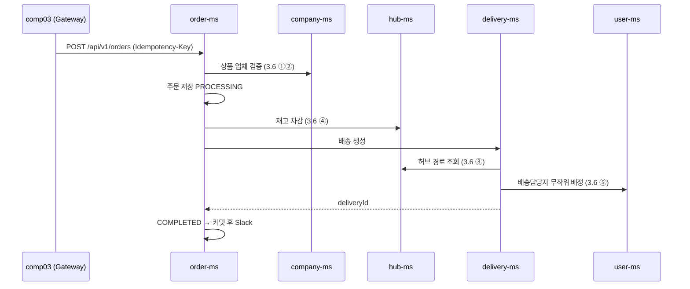

# 06. 주문 흐름 수동 테스트 가이드

> 대상: 주문 프로세스(업체·상품·재고 준비 → 주문 → 재고 차감 → 배송 생성·담당자 배정 → Slack)를 **직접 손으로** 돌려 보는 사람 · 기준: dev `bc6bb44` (2026-10-19) · 관련: [[05 통합 테스트 가이드]] 6·7장, [[시연 대본]], [[07 서비스 정책]] 5~8장

## 0. 요약

1. 서비스를 모두 띄우고, **Gateway(19090)** 로 업체 → 상품 → 재고를 만든 뒤 주문합니다. 주문이 내부에서 부르는 API는 서비스 포트로 직접 불러 하나씩 확인할 수 있습니다.
2. **지금 dev에서 되는 것은 주문 직전까지입니다.** order-ms는 도메인만 있고(`feature/order`, 작업 중), delivery-ms는 별도 브랜치(`feat/delivery-crud`, 작업 중)입니다. 그래서 3장은 지금 바로, 4장은 두 서비스가 dev에 들어온 뒤 진행합니다.
3. 각 단계의 기대 결과 가운데 ✅는 10/19 dev에서 실제로 실행해 확인한 값입니다. ⏳는 아직 구현되지 않아 설계 기준으로 적은 값입니다.
4. 진행하다 발견한 문제는 7장에 모아 두었습니다. 그대로 담당자에게 전달하면 됩니다.

| 단계 | 서비스 | 상태 |
|---|---|---|
| 로그인 (MASTER, 업체 사용자) | user-ms | ✅ 가능 |
| 업체·상품 생성, 권한 확인 | company-ms | ✅ 가능 |
| 재고 등록·조회 | hub-ms | ✅ 가능 |
| Saga가 부를 내부 API (상품·업체 검증, 경로, 재고 차감, 담당자 배정) | company·hub·user | ✅ 직접 호출 가능 |
| 주문 생성·조회·취소, Saga, Slack | order-ms | ⏳ 머지 후 |
| 배송 생성·조회 | delivery-ms | ⏳ 머지 후 (생성·조회는 브랜치에 있음, 담당자 배정 호출은 아직) |
| 재고 복원(보상) `POST /internal/v1/inventories/restore` | hub-ms | ⏳ 아직 없음 |

## 1. 준비

### 1.1 띄우기

```bash
docker compose up -d postgres redis
sh ./gradlew :eureka-registry:bootRun      # 터미널 1, 먼저
sh ./gradlew :user-ms:bootRun              # 터미널 2
sh ./gradlew :hub-ms:bootRun               # 터미널 3
sh ./gradlew :company-ms:bootRun           # 터미널 4
sh ./gradlew :order-ms:bootRun             # 터미널 5 (4장부터)
sh ./gradlew :delivery-ms:bootRun          # 터미널 6 (4장부터)
sh ./gradlew :gateway-edge:bootRun         # 터미널 7, 마지막
```

- http://localhost:8761 에서 모두 `UP`인지 봅니다.
- 포트: gateway 19090 · company 19091 · delivery 19092 · hub 19093 · order 19094 · user 19095

### 1.2 hub-ms가 기동하다 죽으면 (로컬 DB가 예전 스키마)

예전에 만든 로컬 DB에는 `hub.p_hubs`에 `created_at` 컬럼이 없을 수 있습니다. 그러면 기동할 때 아래처럼 실패합니다.

```
Error executing DDL "alter table if exists hub.p_hubs add column created_at timestamp(6) not null"
... column "created_at" of relation "p_hubs" contains null values
Failed to execute SQL script statement #1 of class path resource [db/seed/hubs.sql]
```

데이터를 지우지 않고 컬럼만 채워서 추가하면 됩니다(10/19 대진 로컬에서 이렇게 고침).

```bash
set -a && . ./.env >/dev/null 2>&1 && set +a
docker exec -e PGPASSWORD="$DB_PASSWORD" sparta-logistics-postgres psql -U "$DB_USER" -d "$DB_NAME" -c "
ALTER TABLE hub.p_hubs ADD COLUMN IF NOT EXISTS created_at timestamp(6);
UPDATE hub.p_hubs SET created_at = CURRENT_TIMESTAMP WHERE created_at IS NULL;
ALTER TABLE hub.p_hubs ALTER COLUMN created_at SET NOT NULL;"
```

다시 기동한 뒤 허브 17곳, 경로 272개가 있으면 정상입니다(6장 확인 SQL).

### 1.3 셸 준비 (토큰은 화면에 찍지 않음)

터미널 하나에서 아래를 붙여 넣고, 3·4장 명령을 같은 터미널에서 이어서 실행합니다. MASTER 아이디·비밀번호는 `.env`에서 읽고 출력하지 않습니다.

```bash
set -a && . ./.env >/dev/null 2>&1 && set +a
GW=http://localhost:19090
login() { curl -s $GW/api/v1/auth/login -H 'Content-Type: application/json' \
  -d "{\"username\":\"$1\",\"password\":\"$2\"}" | python3 -c 'import sys,json;print(json.load(sys.stdin)["accessToken"])'; }
id_of() { python3 -c 'import sys,json;print(json.load(sys.stdin)["id"])'; }

SEOUL=10000000-0000-4000-8000-000000000001     # 요청업체 쪽 허브 (도착)
BUSAN=10000000-0000-4000-8000-000000000004     # 공급업체 쪽 허브 (출발)
COMP02=b0000000-0000-4000-8000-000000000002    # 공급업체 담당자 (부산 수산물 도매업체)
COMP03=b0000000-0000-4000-8000-000000000003    # 요청업체 담당자 (서울 식품 유통)

M=$(login "$MASTER_USERNAME" "$MASTER_PASSWORD")
T2=$(login comp02 'Seed1234!')
T3=$(login comp03 'Seed1234!')
echo ${#M} ${#T2} ${#T3}     # 세 숫자 모두 0보다 크면 로그인 성공
```

### 1.4 등장인물과 데이터

| 역할 | 계정 | 비고 |
|---|---|---|
| MASTER | `.env`의 `MASTER_USERNAME` | 업체·재고 생성 |
| 공급업체 담당자 | `comp02` / `Seed1234!` | 상품 생성 |
| 요청업체 담당자 (주문자) | `comp03` / `Seed1234!` | 주문 생성 |
| 출발 허브 배송담당자 | `hub04dm1`, `hub04dm2` (부산) | 자동 배정 후보 |
| 도착 허브 배송담당자 | `hub01dm1`, `hub01dm2` (서울) | 자동 배정 후보 |

- 사용자·허브·경로는 기동할 때 시드로 들어갑니다([[05 통합 테스트 가이드]] 6.1). 업체·상품·재고는 시드가 없어 3장에서 직접 만듭니다.
- 주문 흐름: **부산 공급업체의 상품을 서울 요청업체가 주문**합니다. 재고는 부산 허브에서 빠지고, 배송은 부산 허브에서 서울 허브로 갑니다.

## 2. 흐름 한눈에 보기



배송 생성 쪽에서 경로 조회·담당자 배정을 누가 부르는지는 delivery-ms 구현에 따라 달라질 수 있습니다.

## 3. 지금 바로: 주문 직전까지

각 단계에서 응답 코드와 본문을 함께 봅니다. `-w '\n%{http_code}\n'`로 마지막 줄에 상태 코드가 나옵니다.

### 3.1 공급업체·요청업체 만들기 (MASTER)

```bash
SUP=$(curl -s $GW/api/v1/companies -H "Authorization: Bearer $M" -H 'Content-Type: application/json' \
  -d "{\"name\":\"부산 수산물 도매업체\",\"address\":\"부산 중구 자갈치해안로 52\",\"hubId\":\"$BUSAN\",\"managerUserId\":\"$COMP02\"}" | id_of)
REQ=$(curl -s $GW/api/v1/companies -H "Authorization: Bearer $M" -H 'Content-Type: application/json' \
  -d "{\"name\":\"서울 식품 유통\",\"address\":\"서울 송파구 올림픽로 300\",\"hubId\":\"$SEOUL\",\"managerUserId\":\"$COMP03\"}" | id_of)
echo SUP=$SUP REQ=$REQ
```

| 확인 | 기대 |
|---|---|
| 응답 | ✅ 201, `id`·`hubId`·`managerUserId` 포함 |
| comp03 토큰으로 같은 요청 | ✅ 403 `ACCESS_DENIED` (업체 생성은 MASTER만) |

### 3.2 업체 사용자에게 소속 연결 (MASTER)

시드 업체 사용자는 업체 ID가 비어 있습니다. 주문할 때 "내 업체인지"를 확인하려면 연결해 둡니다.

```bash
curl -s -X PATCH $GW/api/v1/users/$COMP02/organization -H "Authorization: Bearer $M" -H 'Content-Type: application/json' \
  -d "{\"organizationType\":\"COMPANY\",\"organizationId\":\"$SUP\"}" -w '\n%{http_code}\n'
curl -s -X PATCH $GW/api/v1/users/$COMP03/organization -H "Authorization: Bearer $M" -H 'Content-Type: application/json' \
  -d "{\"organizationType\":\"COMPANY\",\"organizationId\":\"$REQ\"}" -w '\n%{http_code}\n'
```

- 기대: ✅ 200, `organizationType: "COMPANY"`, `organizationId`가 각 업체 ID입니다.
- order-ms가 "소속확인"을 이 값으로 할지, 업체의 `managerUserId`로 할지는 구현을 보고 맞춥니다.

### 3.3 상품 만들기 (공급업체 담당자)

```bash
PROD=$(curl -s $GW/api/v1/companies/$SUP/products -H "Authorization: Bearer $T2" -H 'Content-Type: application/json' \
  -d '{"name":"고등어 1kg","description":"냉동","unitPrice":5000}' | id_of)
echo PROD=$PROD
```

| 확인 | 기대 |
|---|---|
| comp02 (자기 업체) | ✅ 201, `unitPrice: 5000`, `viewCount: 0` |
| comp03 (남의 업체) | ✅ 403 `ACCESS_DENIED` |

### 3.4 재고 등록 (MASTER, 출발 허브=부산에 100개)

```bash
curl -s $GW/api/v1/inventories -H "Authorization: Bearer $M" -H 'Content-Type: application/json' \
  -d "{\"hubId\":\"$BUSAN\",\"productId\":\"$PROD\",\"initialQuantity\":100}" -w '\n%{http_code}\n'
curl -s "$GW/api/v1/inventories?productId=$PROD" -H "Authorization: Bearer $M"; echo
```

- 기대: ✅ 201 `quantity: 100`, 조회하면 부산 허브 1건이 나옵니다.

### 3.5 외부에서 내부 API는 막혀 있는지

```bash
curl -s "$GW/internal/v1/products/$PROD" -H "Authorization: Bearer $M" -w '\n%{http_code}\n'
```

- 기대: ✅ 404 `RESOURCE_NOT_FOUND` (Gateway가 `/internal/**`을 내보내지 않음)

### 3.6 주문 Saga가 부를 내부 API를 하나씩 직접 호출

order-ms가 없어도 Saga의 각 단계를 손으로 확인할 수 있습니다. 내부 API는 **서비스 포트로 직접** 부릅니다(토큰 없이).

```bash
ORDER=$(python3 -c 'import uuid;print(uuid.uuid4())')     # 가짜 주문 ID

# ① 상품 검증
curl -s http://localhost:19091/internal/v1/products/$PROD; echo
# ② 공급업체 검증 (hubId = 출발 허브)
curl -s http://localhost:19091/internal/v1/companies/$SUP; echo
# ③ 허브 경로 부산→서울
curl -s "http://localhost:19093/internal/v1/hub-routes?departureHubId=$BUSAN&arrivalHubId=$SEOUL"; echo
# ④ 재고 차감 3개
curl -s http://localhost:19093/internal/v1/inventories/decrease -H 'Content-Type: application/json' \
  -H "Idempotency-Key: order-$ORDER" \
  -d "{\"orderId\":\"$ORDER\",\"hubId\":\"$BUSAN\",\"productId\":\"$PROD\",\"quantity\":3}" -w '\n%{http_code}\n'
# ⑤ 배송담당자 무작위 배정 부산→서울
curl -s "http://localhost:19095/internal/v1/users/delivery-managers/random?departureHubId=$BUSAN&arrivalHubId=$SEOUL"; echo
```

| # | 기대 (✅ 10/19 실행) |
|---|---|
| ① | 200 `{id, companyId(=SUP), name, unitPrice: 5000.00}`, 조회수는 오르지 않음 |
| ② | 200 `{id, name, address, hubId(=부산), managerUserId(=comp02)}` |
| ③ | 200 `{id, departureHubId, arrivalHubId, distanceKm: 383.78, durationMin: 241}` |
| ④ | 200 `{operationId, orderId, status: "SUCCEEDED", inventoryId, changedQuantity: -3, remainingQuantity: 97}` |
| ⑤ | 200 `{departureManagerId: "a0000000-…-000000000401" 또는 "…0402", arrivalManagerId: "…0101" 또는 "…0102"}` |

- ⑤에서 담당자가 시드 ID(`a0000000-…`)가 아니면 로컬 DB에 예전에 그 허브로 연결한 담당자가 있는 것입니다(정상). 6장 마지막 쿼리로 후보를 볼 수 있습니다.
- 3.4의 재고 조회를 다시 하면 97이어야 합니다.

### 3.7 실패 경우를 손으로 만들어 보기

| # | 만드는 법 | 기대 |
|---|---|---|
| X1 | ④를 `quantity: 1000`, 새 키로 | ✅ 400 `INVALID_INPUT` "요청한 재고 차감을 적용할 수 없습니다.", 재고 97 그대로 |
| X2 | ④를 **같은 키·같은 본문**으로 한 번 더 | ⚠️ 지금 500 (7장 K1). 재고는 97 그대로라 두 번 빠지지는 않음 |
| X3 | ①에 없는 상품 ID | ✅ 404 `PRODUCT_NOT_FOUND` "상품을 찾을 수 없습니다." |
| X4 | ③에 같은 허브(부산→부산) 또는 없는 허브 | ✅ 404 `RESOURCE_NOT_FOUND` "해당하는 Hub 경로를 찾을 수 없습니다." |
| X5 | ⑤ 출발지에 없는 허브 ID | ✅ 404 `DELIVERY_MANAGER_NOT_FOUND` "출발지 허브에 배정할 수 있는 배송담당자가 없습니다." |
| X6 | 부산 담당자 둘을 해제한 뒤 ⑤ (아래) | 404 "출발지 …" → 실제 주문이라면 배송 생성 실패 → 재고 복원 |

```bash
# X6: 부산 담당자 해제 (끝나면 true로 되돌립니다)
for u in a0000000-0000-4000-8000-000000000401 a0000000-0000-4000-8000-000000000402; do
  curl -s -o /dev/null -w '%{http_code}\n' -X PATCH $GW/api/v1/users/$u/delivery-manager \
    -H "Authorization: Bearer $M" -H 'Content-Type: application/json' -d '{"isDeliveryManager":false}'
done
```

## 4. order-ms·delivery-ms가 dev에 들어온 뒤: 주문 전체

> **10/20 dev `b202b21`에서 처음 실행했습니다(12/19).** 아래 체크리스트 대부분을 자동으로 돌리는 스크립트가 `e2e/order/run.py`에 있습니다(19개 케이스, 응답 + 각 서비스 DB 확인). 결과는 [e2e/order/README](<../../e2e/order/README.md>)와 `e2e/order/results/result.md`, 발견한 문제는 7장 E1~E6.
>
> 같은 날 `perf/order-create-tx`(PR #61·#62 포함 + E1 수정)에서 다시 돌려 **15/19**입니다. E1·E2가 해결됐고, 남은 실패는 보류 중인 E3~E5입니다.
>
> 실제 구현과 달라진 점: 주문 생성은 **동기 201 `COMPLETED`** 입니다(202 아님). 요청 본문에 `unitPrice`가 필수이고, 주문 조회·이력·취소 API는 아직 없습니다(DB로 확인).

요청 본문의 필드 이름은 order-ms 구현이 정해지면 맞춥니다. 아래는 `Order` 엔티티(`feature/order`)와 [[04 API 명세서]] 기준입니다.

### 4.1 주문 생성 (comp03)

```bash
KEY=$(python3 -c 'import uuid;print(uuid.uuid4())')
curl -s $GW/api/v1/orders -H "Authorization: Bearer $T3" -H 'Content-Type: application/json' -H "Idempotency-Key: $KEY" \
  -d "{\"requesterCompanyId\":\"$REQ\",\"supplierCompanyId\":\"$SUP\",\"productId\":\"$PROD\",\"quantity\":3,\"requestNote\":\"오전 배송 부탁드립니다\"}" \
  -w '\n%{http_code}\n'
```

지금(order-ms 없음)은 ✅ 503 `SERVICE_UNAVAILABLE`이 나옵니다.

### 4.2 성공 흐름 체크리스트 ⏳

| # | 확인 | 어떻게 | 기대 |
|---|---|---|---|
| S1 | 주문 응답 | 4.1 | 202, 주문 ID, 상태 `PROCESSING` (또는 동기 처리면 201·`COMPLETED`, [[07 서비스 정책]] 미결 #11) |
| S2 | 주문 상태 | `GET $GW/api/v1/orders/{orderId}` (comp03) | `COMPLETED`, `unitPriceSnapshot: 5000`, `totalAmount: 15000`, `deliveryId` 채워짐 |
| S3 | 재고 | 3.4 조회 | 3 감소 |
| S4 | 배송 | `GET $GW/api/v1/deliveries/by-order/{orderId}` (MASTER) | 1건, 출발 부산·도착 서울 |
| S5 | 담당자 | S4 응답 또는 6장 SQL | 출발 `…040N`, 도착 `…010N` |
| S6 | 주문 기록 | `GET $GW/api/v1/orders/{orderId}/histories` | 단계별 기록 |
| S7 | Slack | 개인 Webhook 채널 | 1건. 주문 ID·상품명·수량·업체명·허브명, 요청사항은 "있음"만 (원문 없음) |
| S8 | 같은 키로 4.1 다시 | 같은 `KEY`, 같은 본문 | 같은 주문 반환, 주문·재고·배송 그대로 |
| S9 | 같은 키, 다른 본문 | `quantity: 4` | 409 |
| S10 | 단가 변경 후 조회 | comp02가 `PATCH /api/v1/products/$PROD` `{"unitPrice":6000}` | 기존 주문 금액은 5000 기준 그대로 |

### 4.3 실패·보상 체크리스트 ⏳

| # | 만드는 법 | 기대 |
|---|---|---|
| F1 | 수량 0 | 400 `INVALID_QUANTITY` "주문 수량은 1 이상 입력해주세요." |
| F2 | 재고보다 많이 (1000) | 주문 `FAILED`, 재고 그대로, 배송 없음, Slack 없음 |
| F3 | 공급업체 소유가 아닌 상품 | 400 또는 404, 주문 안 생김 |
| F4 | 부산 담당자 해제(3.7 X6) 후 주문 | 배송 생성 실패 → **재고 복원** → 주문 `FAILED`. 재고가 주문 전 값과 같아야 함 |
| F5 | 주문 중 hub-ms 멈춤 `kill -STOP $(lsof -ti tcp:19093 -sTCP:LISTEN)` | order-ms가 타임아웃 → `FAILED`(또는 결과 모름 처리). `kill -CONT`로 풀고 재고 확인 |
| F6 | 주문 중 user-ms 멈춤 (19095) | 배송 생성 실패 → 재고 복원 → `FAILED` |
| F7 | delivery-ms 끄기 (Ctrl+C) | 재고 복원 → `FAILED` |
| F8 | Slack URL을 틀린 주소로 | 주문은 `COMPLETED`, 로그에 WARN만 |

- F4·F6·F7이 "실패 시 롤백 시나리오 1개 이상"(발제 필수)에 해당합니다. 시연에는 F4가 가장 재현하기 쉽습니다.
- 시험이 끝나면 X6에서 해제한 담당자를 `{"isDeliveryManager":true}`로 되돌립니다.

### 4.4 권한·취소 ⏳

| # | 시나리오 | 기대 |
|---|---|---|
| P1 | comp02(주문자 아님)가 comp03 주문 조회 | 403 |
| P2 | MASTER가 주문 목록 | 전체 |
| P3 | comp03이 주문 취소 `POST /api/v1/orders/{id}/cancel` (Idempotency-Key) | `CANCELLED`, 재고 복원, 배송 취소 |
| P4 | 이미 취소한 주문 다시 취소 | 409 |

## 5. 기록 남기기

시험할 때 아래 표를 복사해 채우면 그대로 발표 자료와 이슈로 씁니다.

| 날짜 | # | 결과 (코드·본문 요약) | 기대와 같음? | X-Request-Id | 메모 |
|---|---|---|---|---|---|
| | | | | | |

- 응답 헤더 `X-Request-Id`(`curl -i`)로 Gateway 로그 한 줄을 찾을 수 있습니다([[05 통합 테스트 가이드]] 6.3 A5).

## 6. DB로 확인하기

```bash
set -a && . ./.env >/dev/null 2>&1 && set +a
q() { docker exec -e PGPASSWORD="$DB_PASSWORD" sparta-logistics-postgres psql -U "$DB_USER" -d "$DB_NAME" -c "$1"; }

q "select (select count(*) from hub.p_hubs) hubs, (select count(*) from hub.p_hub_routes) routes;"     # 17, 272
q "select hub_id, product_id, quantity from hub.p_inventories where product_id='$PROD';"
q "select order_id, operation_status, requested_quantity, remaining_quantity, idempotency_key from hub.p_inventory_operations where product_id='$PROD';"
q "select username, organization_id from auth.p_users where is_delivery_manager and deleted_at is null and organization_id in ('$BUSAN','$SEOUL');"   # 배정 후보
```

- 사용자 테이블은 `auth` 스키마에 있습니다(`users`가 아님).

- 주문·배송 테이블(`orders.p_orders`, `delivery.p_deliveries`)은 서비스가 dev에 들어온 뒤 컬럼을 확인해 추가합니다.

## 7. 알려진 문제 (10/19 실행에서 발견)

| # | 내용 | 영향 | 전달 |
|---|---|---|---|
| K1 | 재고 차감을 **같은 Idempotency-Key**로 다시 보내면 500. 로그: `duplicate key value violates unique constraint "uk_inventory_operations_idempotency_key"` | 재고는 두 번 빠지지 않지만, Saga가 타임아웃 뒤 같은 키로 다시 부르면 실패로 보임. 정책은 "같은 키 + 같은 요청 → 기존 결과 반환" | 이찬 |
| K2 | 재고 부족이 전용 코드 없이 400 `INVALID_INPUT` | order-ms가 재고 부족과 잘못된 요청을 코드로 구분할 수 없음 (메시지로만 구분) | 이찬·다울 |
| K3 | 재고 복원 API(`/internal/v1/inventories/restore`)가 아직 없음 | 4.3 F4·F6·F7 보상을 시험할 수 없음 | 이찬 |
| K4 | 로컬 DB가 예전 스키마면 hub-ms 기동 실패 (1.2) | 처음 받는 팀원이 막힘 | 전체 공지 |
| K5 | delivery-ms가 아직 담당자 배정 API를 부르지 않음 | 4.2 S5 시험 불가 | 영은 ([[05 통합 테스트 가이드]] 7장) |
| K6 | 주문 생성 요청 필드·응답 코드(202/201)가 미정 | 4장 명령 수정 필요 | 다울 |

10/20 E2E 실행(`e2e/order/run.py`, dev `b202b21`)에서 새로 발견. K1·K2·K3·K5는 이 시점 dev에서 해결됨(같은 키 재요청은 기존 결과, 재고 부족은 409 `INSUFFICIENT_STOCK`, 복원 API 있음, 배송 생성 시 담당자 자동 배정).

| # | 내용 | 영향 | 전달 | 상태 |
|---|---|---|---|---|
| E1 | 같은 Idempotency-Key로 **동시에** 주문하면 4건이 500, 재고는 5번 차감·배송 5건 생성 (이력 유니크 위반이 커밋 때, 원격 호출 뒤에 터짐) | 따닥 시 재고 유실·주문 없는 배송 | 다울 | ✅ `saveAndFlush` + 409 (실험 브랜치) |
| E2 | 재고 복원 요청 형식 불일치: order `{orderId}` ↔ hub `{originalOperationId}` → 400, 복원 안 됨 | 배송 단계 실패 시 재고가 빠진 채 `FAILED` | 다울·이찬 | ✅ PR #61 |
| E3 | 배송 생성 타임아웃 뒤 delivery-ms가 재개되면 배송이 그대로 생성 | `FAILED` 주문에 배송이 남음 | 다울·영은 | 보류 |
| E4 | 주문 단가를 요청 `unitPrice`로 저장 (상품 단가 확인 안 함) | 단가 조작 가능 | 다울 | 보류 |
| E5 | 업체·상품 소유 검증 없음, 없는 상품은 409 재고 부족 | 남의 상품 주문 가능 | 다울 | 보류 |
| E6 | 담당자 후보가 없으면 delivery-ms는 담당자 없이 배송 생성 (정책 문서는 404) | 문서 정리 | 영은 | 보류 |

## 8. 끝나고 정리하기

- 3.7 X6에서 해제한 담당자를 되돌립니다.
- 시험 데이터를 지우려면 정확한 ID로만 지웁니다(업체 삭제 API는 Soft Delete라 행이 남습니다). 업체를 지우면 3.2에서 연결한 소속이 없는 업체를 가리키므로 시드 상태(NULL)로 함께 되돌립니다.

```bash
q "BEGIN;
UPDATE auth.p_users SET organization_id = NULL WHERE id IN ('$COMP02','$COMP03');
DELETE FROM hub.p_inventory_histories WHERE inventory_id IN (SELECT id FROM hub.p_inventories WHERE product_id='$PROD');
DELETE FROM hub.p_inventory_operations WHERE product_id='$PROD';
DELETE FROM hub.p_inventories WHERE product_id='$PROD';
DELETE FROM company.p_products WHERE id='$PROD';
DELETE FROM company.p_companies WHERE id IN ('$SUP','$REQ');
COMMIT;"
```

- 서비스 끄기: `lsof -ti tcp:19090 -sTCP:LISTEN | xargs kill` (포트마다)
