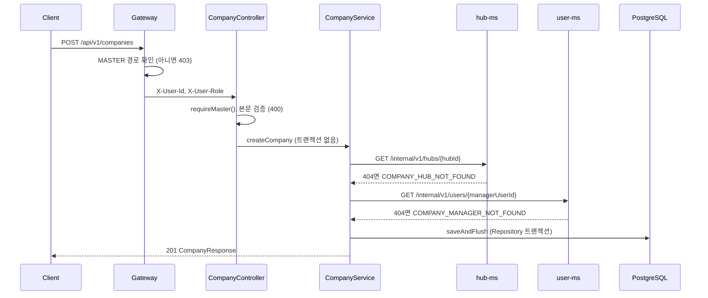
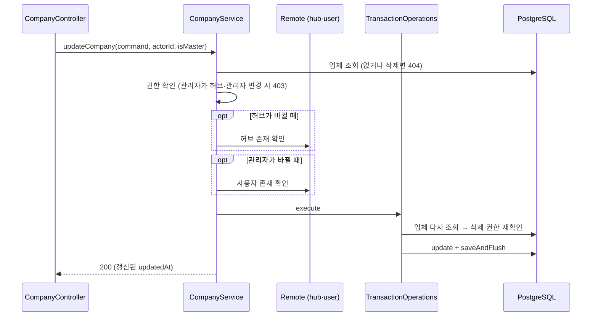
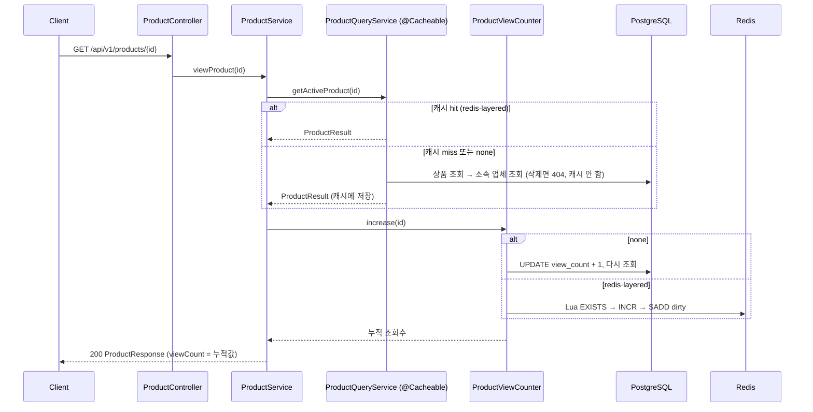
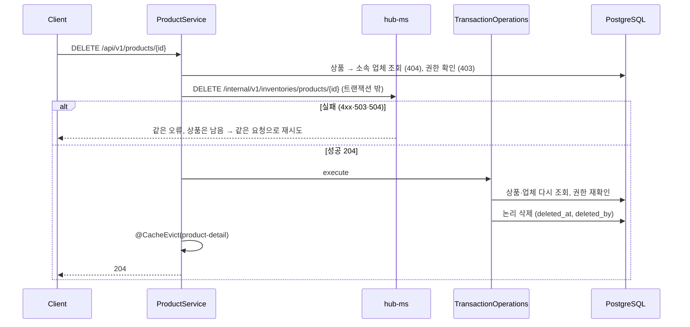

# Company 도메인 구현 설명

> 작성자: 권우 · 기준: `dev` 760e7cb · 모듈: `company-ms` (스키마 `company`, 테이블 `p_companies`·`p_products`)
> 1부는 **무엇을 왜 이렇게 만들었는지**(설계 결정·대안·트러블슈팅), 2부는 **요청이 어떻게 흐르는지**, 3부는 **코드를 어디서 찾는지**(계층·API·오류 코드·설정·테스트)입니다.
> API 사용법만 필요하면 [[Company 사용법]], 상품 조회 성능 측정 전체 결과는 [[상품 조회 최적화 레포트]]를 봅니다.

## 목차

- [1부. 설계 결정](#1부-설계-결정)
- [2부. 요청 흐름](#2부-요청-흐름)
- [3부. 코드 구조](#3부-코드-구조)

---

## 한눈에 보기

| 항목 | 업체 (`com.company.company`) | 상품 (`com.company.product`) |
|---|---|---|
| 역할 | 업체 등록·조회·검색·수정·삭제, 내부 조회 API | 상품 등록·조회·검색·수정·삭제, 업체별 목록, 조회수·인기 상품, 내부 조회 API |
| 권한 | 등록·삭제 MASTER, 수정 MASTER·업체 관리자(허브·관리자 변경은 MASTER만), 조회 로그인 | 등록·수정·삭제 MASTER·소속 업체 관리자, 조회 로그인 |
| 부르는 서비스 | hub-ms(관리 허브 확인), user-ms(업체 관리자 확인) | hub-ms(상품 삭제 시 재고 정리) |
| 부르는 쪽 | delivery-ms(배송 생성), hub-ms(재고 등록) | hub-ms(재고 등록) |

| 항목 | 내용 |
|---|---|
| 관계 | 상품은 별도 서비스 없이 업체의 하위 리소스. 같은 스키마라 `@ManyToOne` + FK로 참조 |
| 구조 | 두 도메인 모두 4계층 + DIP. 원격 호출은 domain 인터페이스, Feign 구현은 infrastructure (ArchUnit 14개 규칙) |
| 성능 | 상품 조회 캐시 3단계(`none`·`redis`·`layered`)와 조회수 Redis 누적. 100만 건 기준 인기 상품 30초 처리량 약 3,598배 (`layered`) |
| 테스트 | 테스트 클래스 46개(업체 18 · 상품 26 · 아키텍처 · 기동), 테스트 메서드 약 256개. H2 기본, Redis 컨테이너 테스트 1개 클래스 |

---

# 1부. 설계 결정

## 1.1 요구사항 해석

발제·설계 문서의 충돌이나 빈칸을 구현 규칙으로 정한 결정입니다. 정책 원문은 [[07 서비스 정책]] 4장에 있습니다.

**업체**

| 결정 | 내용 | 이유 |
|---|---|---|
| 업체 등록은 MASTER만 (정책 #3) | 발제의 "업체 사용자 본인 또는 관리자" 대신 설계([[04 API 명세서]])의 MASTER 전용을 채택. 업체 관리자는 등록 시 MASTER가 지정 | 발제·설계 충돌을 설계 기준으로 정리 |
| 업체 삭제도 MASTER만 (정책 #4) | Gateway MASTER 경로 + 컨트롤러 `requireMaster()` 이중 확인 | 발제에 명시가 없어 설계를 따름 |
| 업체 관리자 = `manager_user_id` | 역할(`USER`)이나 소속 연결(`organization_id`)이 아니라 업체 행의 관리자 ID와 로그인 사용자 ID 비교 | 소속은 MASTER가 UUID만 연결하고 존재 확인을 안 하므로(U20) 권한 근거로 쓰기 어려움 |
| 관리 허브·관리자 변경은 MASTER만 | 업체 관리자는 이름·주소만 수정 | 관리자가 스스로 권한을 넘기거나 관리 허브를 옮기지 못하게 함 |
| 업체 유형 구분 없음 | 공급업체·수령업체 컬럼 없이 모든 업체가 둘 다 될 수 있음 | 발제 그대로. 주문에서 `supplier`·`requester`로 역할을 나눔 |

**상품**

| 결정 | 내용 | 이유 |
|---|---|---|
| 업체의 하위 리소스 | 등록은 `POST /companies/{companyId}/products`, 업체별 목록은 `GET /companies/{companyId}/products` | 발제가 상품을 업체에 속한 것으로 정의. 별도 서비스를 두지 않음 |
| 관리 권한 | MASTER 또는 **소속 업체의 관리자 본인** | 다른 업체의 관리자는 403 |
| 단가 0 이상 | 요청 DTO(`@DecimalMin("0")`, 정수 13·소수 2자리) → 도메인(`validateUnitPrice`) → DB(`CHECK unit_price >= 0`) 3단계 | DTO를 거치지 않는 경로(다른 서비스 코드, 테스트 데이터)로 만들어도 지켜지게 함 |
| 인기 상품 = 조회수 정렬 | 사용자 상세 조회(`GET /api/v1/products/{id}`)마다 +1, `sort=viewCount,desc` | 같은 사용자의 반복 조회·MASTER 조회도 현재는 모두 셈 |

## 1.2 다른 서비스의 데이터를 어떻게 확인하나

`hub_id`와 `manager_user_id`는 다른 스키마(`hub`, `auth`)의 ID라 FK를 걸 수 없습니다. 그래서 **업체를 등록·수정할 때 Feign으로 존재를 확인**합니다.

| 결정 | 내용 | 이유 |
|---|---|---|
| 404만 "없음"으로 해석 | hub-ms·user-ms가 404를 주면 400 `COMPANY_HUB_NOT_FOUND` / `COMPANY_MANAGER_NOT_FOUND` | 사용자가 잘못된 ID를 보낸 것이므로 400 |
| 그 밖의 실패는 그대로 던짐 | 5xx·연결 실패·타임아웃은 common이 바꾼 503·504가 그대로 응답 | 확인하지 못했는데 저장하면 없는 허브를 가리키는 업체가 생김 |
| 원격 호출은 트랜잭션 밖 | 등록·수정·상품 삭제에 `@Transactional`을 걸지 않고, DB 쓰기만 트랜잭션 | Feign 응답을 기다리는 최대 2초 동안 DB 커넥션을 잡지 않음 |
| 바뀌는 값만 확인 | 수정에서 현재와 **같은** 허브·관리자를 보내면 원격 호출도, MASTER 전용 확인도 하지 않음 | 프론트가 전체 필드를 다시 보내도 업체 관리자의 수정이 막히지 않게 함 |
| 검색 조건은 확인 안 함 | 목록의 `hubId`는 존재 확인 없이 조건으로만 사용, 없는 허브면 빈 목록 | 조회에 원격 호출을 넣으면 hub-ms 장애가 업체 목록 장애로 번짐 |
| 허브 확인은 내부 API로 (dcc7d27) | `GET /api/v1/hubs/{id}` → `GET /internal/v1/hubs/{id}` | hub-ms가 허브 검증 내부 API를 제공한 뒤 전환. 서비스 간 호출은 내부 API로 맞춤 |

| 대안 | 채택하지 않은 이유 |
|---|---|
| 존재 확인 생략 (U20 소속 연결처럼) | 업체 관리자는 상품·재고 권한의 근거라, 없는 사용자를 관리자로 두면 아무도 관리할 수 없는 업체가 생김 |
| 서비스 전체에 `@Transactional` | 원격 호출 동안 커넥션 점유. 동시 요청이 몰리면 Hikari 풀(기본 10)이 먼저 고갈됨 |
| 원격 장애 시 확인 없이 저장 | 데이터 정합성이 장애 여부에 따라 달라짐 |

## 1.3 업체와 상품의 관계

| 결정 | 내용 | 이유 |
|---|---|---|
| `@ManyToOne Company` | 상품이 업체 엔티티를 직접 참조, `company_id`는 물리 FK | 같은 스키마·같은 서비스라 "다른 서비스 DB 접근 금지" 규칙에 해당하지 않음. 소속 업체 삭제 여부를 JOIN으로 거를 수 있음 |
| `CompanyRepository` 직접 사용 | `ProductService`가 company 도메인의 저장소 포트로 업체·관리자 확인 | 같은 모듈의 도메인 포트라 Feign 호출 없이 확인 |
| 업체를 지워도 상품은 그대로 | 업체 삭제는 `p_companies` 한 행만 논리 삭제. 상품 조회·검색·내부 API가 소속 업체의 `deleted_at`을 함께 보고 제외(404 `COMPANY_NOT_FOUND`) | 상품을 일괄 삭제하지 않아도 일관되게 404. 원격 호출이 없어 업체 삭제는 한 트랜잭션 |
| 조회 순서 | 상품 존재 → 소속 업체 존재 → 권한 | 없는 상품이면 권한 없는 사용자에게도 404 (권한보다 존재가 먼저) |

## 1.4 상품 삭제와 허브 재고

상품을 지우면 hub-ms의 허브별 재고도 정리해야 합니다. 두 작업은 서로 다른 DB라 한 트랜잭션으로 묶을 수 없습니다.

| 결정 | 내용 | 이유 |
|---|---|---|
| **재고를 먼저** 정리 | 권한 확인 → hub-ms 재고 정리(트랜잭션 밖) → 상품 논리 삭제 | hub-ms가 멱등(없어도 204)이라, 원격이 실패하면 상품이 남아 **같은 요청으로 다시 시도**할 수 있음 |
| 원격 실패는 그대로 던짐 | 4xx는 같은 상태·코드, 5xx 503, 타임아웃 504. 상품은 삭제하지 않음 | 결과를 모르는 504도 재시도가 안전 (멱등) |
| 저장 전에 다시 읽음 | 트랜잭션 안에서 상품·업체·권한 재확인 | 원격 호출 사이에 먼저 삭제됐으면 404, 최초 삭제자 유지 (트러블슈팅 ①과 같은 이유) |

| 대안 | 채택하지 않은 이유 |
|---|---|
| 상품 먼저 삭제 → 재고 정리 | 원격이 실패하면 상품은 이미 404라 다시 시도할 길이 없고 재고만 남음 |
| 메시지 큐·Outbox로 비동기 정리 | 현재 인프라에 메시지 브로커가 없음 |

상품 삭제와 재고 등록이 동시에 들어오는 경우의 정합성은 아직 검토하지 않았습니다.

## 1.5 조회수와 상품 조회 캐시

자세한 측정 조건과 단계별 수치는 [[상품 조회 최적화 레포트]]에 있습니다.

**조회수: 누락 없이, 그러나 병목 없이**

| 결정 | 내용 | 이유 |
|---|---|---|
| 엔티티가 아니라 조건부 UPDATE | `UPDATE ... SET view_count = view_count + 1` (벌크) | 엔티티에서 읽고 +1 하면 동시 조회 시 덮어써 누락됨(lost update). 벌크 UPDATE라 `updatedAt`·`updatedBy`도 바뀌지 않음 |
| `DEFAULT 0` | `@ColumnDefault("0")` | 기존 행이 있는 테이블에 `ddl-auto: update`로 NOT NULL 컬럼을 추가할 수 있게 |
| 내부 API는 세지 않음 | `getProduct`(내부)와 `viewProduct`(사용자)를 분리 | 주문 검증 같은 서비스 호출이 인기 지표에 섞이지 않게 |
| 캐시 단계에서는 Redis 누적 | Lua 스크립트(`EXISTS → INCR → SADD`)로 Redis 왕복 1번, 5초마다 바뀐 상품만 DB 반영 | DB 방식은 인기 상품 한 행에 UPDATE가 몰려 행 잠금 대기가 생김 (트러블슈팅 ⑤) |
| 반영은 커질 때만 | `UPDATE ... WHERE view_count < :누적값` | 늦게 도착한 작은 값으로 조회수가 줄지 않게 |

Redis 누적은 처음 세는 상품이면 DB 값을 시작값으로 넣고(`SETNX`라 동시에 처음 세도 한 번만), 키에 증가분이 아닌 **누적값**을 둬서 응답의 조회수가 요청마다 정확합니다. 대신 Redis가 DB 반영 전에 사라지면 마지막 반영 이후(최대 5초) 조회수를 잃습니다. 처리량을 우선한 결정입니다.

**조회 캐시**

`product.cache.mode`(환경변수 `PRODUCT_CACHE_MODE`)로 단계를 고르고, 코드는 그대로입니다. 성능 실험(P01) 단계를 바꾸려고 만든 설정이라 **기본값은 `none`**(캐시 없음)입니다.

| 모드 | CacheManager | 조회수 |
|---|---|---|
| `none` | `NoOpCacheManager` | `DbProductViewCounter` (DB 바로 +1) |
| `redis` | `RedisCacheManager` (캐시별 TTL) | `RedisProductViewCounter` + `ProductViewCountFlusher` |
| `layered` | `LayeredCacheManager` = Caffeine(L1) + Redis(L2) | 위와 같음 |

| 결정 | 내용 | 이유 |
|---|---|---|
| 캐시 대상 | 사용자 상세(`product-detail`, 5분), 목록·검색·인기 상품(`product-search`, 30초) | 반복 조회가 많고 DB 비용이 큰 곳 |
| 캐시하지 않는 것 | 내부 API, 업체별 상품 목록, 업체 API, 404 | 내부 API는 주문 시점 단가가 필요해 옛 값이 들어가면 주문 금액이 틀림 |
| 상세는 지우고, 목록은 TTL만 | 수정·삭제 시 `@CacheEvict(product-detail)`. 목록은 키가 조건+페이지 조합이라 지우지 않고 30초로 갱신 | 어떤 목록 키에 그 상품이 들어 있는지 알 수 없음 |
| 조회수는 캐시 밖 | 상세 캐시는 상품 내용만, 응답 조회수는 `ProductViewCounter` 값 | 캐시된 조회수가 TTL 동안 멈춰 보이지 않게 |
| L2를 먼저 지움 | `LayeredCache.evict`는 Redis → Caffeine 순서 | L1만 먼저 지우면 그 사이 조회가 L2의 옛 값을 L1에 다시 채움 |
| `ProductQueryService` 분리 | `@Cacheable`을 별도 빈에 둠 | 같은 빈 안의 호출은 프록시를 거치지 않아 캐시가 적용되지 않음 |

| 대안 | 채택하지 않은 이유 |
|---|---|
| 수정 시 목록 캐시 전체 삭제(`allEntries`) | 수정 한 번에 모든 검색 키가 비어 캐시 스탬피드를 스스로 일으킴 |
| 여러 서버 L1 동기화(Redis Pub/Sub) | 실험은 서버 1대. 다른 서버의 L1은 최대 10초 옛 값이 보일 수 있음 (다음 개선) |

실험에서 쓴 `(view_count DESC, id)`·`pg_trgm` 인덱스는 `perf/product-query/sql`로만 적용했습니다. 엔티티에는 `company_id` 인덱스만 있습니다.

## 1.6 트러블슈팅

①②는 기능 구현 중, ③~⑥은 성능 실험(상품 100만 건 · 동시 사용자 50명, 노트북 한 대라 절대값보다 단계 간 비율이 의미 있음)에서 나온 문제입니다.

### ① 원격 검증 중에 삭제된 업체가 수정으로 되살아날 수 있었다 (c01ee97)

- **위험**: 업체 수정은 "업체 조회 → 원격 검증 → 저장" 순서입니다. 처음 읽은 엔티티는 트랜잭션 밖이라 준영속(detached) 상태이고, 이를 그대로 `save()`하면 JPA가 `merge`합니다. 원격 검증을 기다리는 사이 MASTER가 업체를 삭제하면, merge가 `deleted_at = NULL`인 옛 상태로 덮어써 **삭제된 업체가 살아납니다**.
- **해결**: 저장은 `TransactionOperations` 안에서 **업체를 다시 읽고**, 삭제 여부와 권한을 다시 확인한 뒤 반영합니다. 원격 호출 사이에 삭제됐으면 404 `COMPANY_NOT_FOUND`입니다. 상품 삭제(1.4)도 같은 이유로 다시 읽습니다.
- **검증**: `UpdateCompanyTest`, `DeleteProductTest`. 저장 트랜잭션에 들어가기 직전 대상을 삭제하는 `TransactionOperations`를 넣어 경쟁 상황을 재현합니다.

### ② 수정 응답의 `updatedAt`이 수정 전 값이었다 (c01ee97, ead226f)

- **현상**: dirty checking으로 수정하면 flush가 커밋 시점에 일어나, 응답을 만들 때는 JPA Auditing이 `updatedAt`을 아직 바꾸지 않았습니다.
- **해결**: `CompanyRepositoryImpl`·`ProductRepositoryImpl`의 `save`를 `saveAndFlush`로 바꿔 Auditing과 DB 제약 위반(길이 초과 등)을 응답 전에 반영합니다.

### ③ 인덱스를 걸었는데 인기 상품이 2배밖에 안 빨라졌다

- **현상**: `(view_count DESC, id)` 인덱스로 목록 쿼리는 106ms → 0.25ms가 됐지만, 처리량은 초당 24 → 51건이었습니다.
- **원인**: 공통 `PageResponse`가 `totalElements`를 위해 **`count(*)`를 매번 실행**했고, 이 쿼리가 여전히 100만 행을 전체 스캔했습니다.
- **해결**: 캐시로 DB 접근 자체를 없앴습니다. count 제거(`Slice`·추정 건수)는 공통 `PageResponse` 변경이라 팀 합의가 필요해 다음 개선으로 남겼습니다.

### ④ 이름 검색은 인덱스를 걸자 오히려 느려졌다

- **현상**: `pg_trgm` GIN 인덱스를 추가했더니 p99가 3,090ms → 3,580ms로 늘었습니다.
- **원인**: 트라이그램은 3글자 단위라 **2글자 이하 검색어는 거를 수 없습니다**. 앱은 검색어를 파라미터로 보내므로, PostgreSQL이 검색어를 보지 않는 일반 계획(generic plan)을 쓰면 1~2글자에도 인덱스를 탄 뒤 95만 행 이상을 재확인해 전체 스캔보다 4~5배 느렸습니다(사과: 387ms, 고등어: 14ms).
- **교훈**: 인덱스는 쿼리 모양과 입력 분포에 맞아야 효과가 있습니다. 짧은 검색어 제한·접두어 검색은 다음 개선으로 남겼습니다.

### ⑤ 상품 상세의 병목은 읽기가 아니라 조회수 쓰기였다

- **현상**: 상세는 PK 조회인데도 p50 9.3ms, p99 46.8ms로 차이가 컸고, 동시 사용자를 200명으로 늘리면 p99가 191ms까지 늘었습니다.
- **원인**: 요청 1번에 쿼리 4번(상품·업체 조회, UPDATE, 다시 조회)이고, 인기 상품에 요청이 몰리면 **같은 행의 UPDATE가 행 잠금을 기다렸습니다**.
- **해결**: 조회수를 Redis에 누적하고 5초마다 반영(1.5). DB UPDATE가 11.4만 번 → 2.4만 번으로 줄고 요청 경로에서 빠졌습니다. 상세 30초 처리량 114,392 → 1,262,399건(약 11배), p99 46.8ms → 2.5ms.

### ⑥ 동시 사용자 200명에서 이름 검색이 무너졌다

- **현상**: `layered`인데도 검색이 초당 278건, p99 18.5초, 실패 0.02%였습니다. 로그에 `HikariPool-1 - Connection is not available ... (total=10, active=10, idle=0, waiting=111)`.
- **원인**: 검색어별 캐시(30초)가 만료되는 순간 기다리던 사용자가 동시에 DB로 갔고(**캐시 스탬피드**), 그 쿼리가 ④의 느린 경로(약 400ms)라 커넥션 10개가 금방 고갈됐습니다.
- **다음 개선**: `@Cacheable(sync = true)`(레이어드 캐시는 키별 잠금 구현 필요), 만료 전 갱신·TTL 무작위 오차, 커넥션 대기 시간 단축. 레포트 7장에서 가장 시급한 항목으로 정리했습니다.

## 1.7 그 밖의 설계 포인트

- **PATCH는 "보낸 필드만"**: `null`은 유지, 빈 본문 `{}`은 `@AssertTrue`로 400. 보낸 업체 `name`·`address`, 상품 `name`이 공백뿐이면 400입니다. `@NotBlank`는 null도 막으므로 `@Pattern("(?s).*\\S.*")`을 썼습니다(null 통과). 상품 `description`은 제약이 없어 빈 문자열로도 바꿀 수 있습니다.
- **이미 삭제된 업체·상품**: 조회·수정·삭제 모두 404. 다시 삭제해도 최초 삭제자·시각이 바뀌지 않습니다.
- **검색**: 이름 부분 일치, 대소문자 무시(`lower`), 검색어의 `%`·`_`·`\`는 글자로 찾도록 이스케이프. 150자 초과 검색어는 찾을 수 없으므로 400. 검색의 `hubId`·`companyId`는 조건일 뿐이라 없으면 빈 목록이고, 경로에 업체가 있는 업체별 상품 목록은 404입니다.
- **업체 인덱스는 실제 `ORDER BY`에 맞춤** (90e83d8): `PagePolicy`가 붙이는 보조 정렬 `id ASC`까지 포함해 정의했습니다.

  | 인덱스 | 쓰는 쿼리 |
  |---|---|
  | `(hub_id, created_at DESC, id)` | 허브별 목록 + 기본 정렬. `hub_id` 단독 조건도 커버 |
  | `(created_at DESC, id)` | 전체 목록 기본 정렬 |
  | `(name, id)` | 업체명 정렬 |

  `name` 부분 일치(`LIKE '%..%'`)는 B-tree 인덱스를 쓸 수 없어 제외했고, `deleted_at`·`manager_user_id`도 인덱스 대상에서 뺐습니다.
- **내부 API는 응답 DTO를 따로**: `InternalCompanyResponse`(`id`, `name`, `address`, `hubId`, `managerUserId`), `InternalProductResponse`(`id`, `companyId`, `name`, `unitPrice`)는 외부 응답과 섞지 않습니다. 업체의 `address`·`managerUserId`는 delivery-ms(배송 주소·관계자)와 hub-ms(업체 관리자 확인)를 위해 추가했습니다(13d6cdd). `X-User-*` 헤더를 요구하지 않아 스케줄러·Saga처럼 요청 밖에서도 호출할 수 있습니다.
- **같은 hub-ms를 부르는 Feign 클라이언트 두 개** (dcc7d27): 업체의 `HubFeignClient`와 상품의 `InventoryFeignClient`가 둘 다 `name = "hub-ms"`라 Feign 설정 빈 이름이 겹칩니다. `contextId`를 따로 줍니다.

---

# 2부. 요청 흐름

## 2.1 업체 등록



hub-ms·user-ms가 5xx·타임아웃이면 저장하지 않고 503·504가 그대로 나갑니다.

## 2.2 업체 수정



## 2.3 상품 상세 조회 (조회수 +1)



`redis`·`layered`에서는 `ProductViewCountFlusher`가 5초마다 `dirty` 집합에서 최대 1,000개씩 꺼내 `UPDATE ... WHERE view_count < :누적값`으로 반영합니다.

## 2.4 상품 삭제



## 2.5 다른 서비스가 조회할 때

```
delivery-ms ──Feign──▶ GET /internal/v1/companies/{companyId}   (도착 허브·배송 주소·업체 관리자)
hub-ms      ──Feign──▶ GET /internal/v1/products/{productId}    (재고 등록 시 상품·소유 업체 확인)
hub-ms      ──Feign──▶ GET /api/v1/companies/{companyId}        (재고 등록 시 업체 관리자 확인, 사용자 헤더 전달)
```

- 없거나 삭제된 업체는 404 `COMPANY_NOT_FOUND`, 없거나 삭제된 상품은 404 `PRODUCT_NOT_FOUND`, 소속 업체가 삭제된 상품은 404 `COMPANY_NOT_FOUND`입니다.
- 내부 상품 조회는 조회수를 올리지 않고 캐시도 쓰지 않습니다(`ProductService.getProduct`).
- hub-ms는 업체를 아직 공개 API로 부릅니다. 같은 필드를 주는 내부 API가 있으므로 전환 대상입니다.

---

# 3부. 코드 구조

## 3.1 계층

```
presentation → application → domain ← infrastructure
```

업체와 상품은 같은 모듈 안에서 패키지를 나눕니다. 상품은 업체의 `CompanyRepository` 포트와 `Company` 엔티티에만 의존합니다.

**업체 (`com.company.company.`)**

| 계층 | 패키지 | 주요 클래스 |
|---|---|---|
| presentation | `presentation.controller` | `CompanyController`, `InternalCompanyController` |
| | `presentation.dto` | `CreateCompanyRequest`, `UpdateCompanyRequest`, `CompanySearchRequest`, `CompanyResponse`, `InternalCompanyResponse` |
| application | `application.service` | `CompanyService` (등록·수정은 트랜잭션 없음, 조회는 `readOnly`, 삭제는 `@Transactional`) |
| | `application.dto` | `CreateCompanyCommand`, `UpdateCompanyCommand`, `DeleteCompanyCommand`, `CompanySearchQuery`, `CompanyResult` |
| domain | `domain.entity` | `Company` |
| | `domain.repository` | 포트 `CompanyRepository`, `CompanySearchCondition` |
| | `domain.client` | 포트 `HubClient`, `UserClient`, `UserInfo` |
| infrastructure | `infrastructure.persistence` | `CompanyRepositoryImpl`, `CompanyJpaRepository`, `CompanySpecifications` |
| | `infrastructure.client` | `HubClientImpl`·`HubFeignClient`, `UserClientImpl`·`UserFeignClient` |

**상품 (`com.company.product.`)**

| 계층 | 패키지 | 주요 클래스 |
|---|---|---|
| presentation | `presentation.controller` | `ProductController`, `InternalProductController` |
| | `presentation.dto` | `CreateProductRequest`, `UpdateProductRequest`, `ProductSearchRequest`, `ProductResponse`, `InternalProductResponse` |
| application | `application.service` | `ProductService`(쓰기·상세·내부 조회), `ProductQueryService`(캐시 대상 조회) |
| | `application.cache` | `ProductCacheNames` (`product-detail`, `product-search`) |
| | `application.dto` | `CreateProductCommand`, `UpdateProductCommand`, `DeleteProductCommand`, `ProductSearchQuery`, `ProductResult` |
| domain | `domain.entity` | `Product` |
| | `domain.repository` | 포트 `ProductRepository`, `ProductSearchCondition` |
| | `domain.client` / `domain.service` | 포트 `InventoryClient`, `ProductViewCounter` |
| infrastructure | `infrastructure.persistence` | `ProductRepositoryImpl`, `ProductJpaRepository`, `ProductSpecifications` |
| | `infrastructure.client` | `InventoryClientImpl`, `InventoryFeignClient` |
| | `infrastructure.viewcount` | `DbProductViewCounter`, `RedisProductViewCounter`, `ProductViewCountFlusher` |
| | `infrastructure.cache` | `ProductCacheConfig`, `ProductCacheProperties`, `ProductCacheMode`, `LayeredCache`, `LayeredCacheManager` |

**포트와 구현 (DIP)**

| 도메인 포트 | 구현 | 비고 |
|---|---|---|
| `CompanyRepository` / `ProductRepository` | `CompanyRepositoryImpl` / `ProductRepositoryImpl` | `save`는 `saveAndFlush` |
| `HubClient.existsHub` | `HubClientImpl` | `RemoteCallTemplate`, 404 → `false` |
| `UserClient.findActiveUser` | `UserClientImpl` | `RemoteCallTemplate`, 404 → `Optional.empty()` |
| `InventoryClient.deleteInventory` | `InventoryClientImpl` | `RemoteCallTemplate`, 실패는 그대로 |
| `ProductViewCounter` | `DbProductViewCounter` | `product.cache.mode=none` (기본) |
| | `RedisProductViewCounter` (+ `ProductViewCountFlusher`) | `redis`·`layered` |

> 업체의 Feign 인터페이스(`HubFeignClient`, `UserFeignClient`)는 package-private이라 infrastructure 밖에서 볼 수 없습니다.

## 3.2 도메인 모델

**`Company`** (`p_companies`)

| 필드 | 컬럼 | 설명 |
|---|---|---|
| `id` | `id` UUID | PK |
| `name` | `name` VARCHAR(150) | 업체명 |
| `address` | `address` VARCHAR(255) | 주소 (배송 주소로 쓰임) |
| `hubId` | `hub_id` UUID | 관리 허브 (hub 스키마 참조, FK 없음) |
| `managerUserId` | `manager_user_id` UUID | 업체 관리자 (auth 스키마 참조, FK 없음) |
| `BaseEntity` | `created_*`, `updated_*`, `deleted_*` | 감사 컬럼·논리 삭제 |

| 메서드 | 규칙 |
|---|---|
| `create` | 원격 확인은 서비스가 먼저 함 |
| `update` | `null`인 값은 유지 |
| `delete(actorId)` | `softDelete` (삭제 시각·삭제자) |
| `isManagedBy(userId)` | `managerUserId == userId` |

**`Product`** (`p_products`)

| 필드 | 컬럼 | 설명 |
|---|---|---|
| `id` | `id` UUID | PK |
| `company` | `company_id` UUID | 소속 업체 (`@ManyToOne(LAZY)`, FK, 인덱스) |
| `name` | `name` VARCHAR(150) | 상품명 |
| `description` | `description` TEXT | 설명 (NULL 가능) |
| `unitPrice` | `unit_price` NUMERIC(15,2) | 단가, `CHECK ck_products_unit_price (unit_price >= 0)` |
| `viewCount` | `view_count` BIGINT DEFAULT 0 | 조회수. 엔티티에서 바꾸지 않고 저장소 UPDATE로만 |
| `BaseEntity` | `created_*`, `updated_*`, `deleted_*` | 감사 컬럼·논리 삭제 |

| 메서드 | 규칙 |
|---|---|
| `create` | 단가 검증 (`null`·음수면 `PRODUCT_INVALID_UNIT_PRICE`) |
| `update` | `null`은 유지, 단가는 생성과 같은 검증 |
| `delete(actorId)` | `softDelete` |

## 3.3 API

| Method · Path | 권한 | 처리 | 규칙 |
|---|---|---|---|
| POST `/api/v1/companies` | MASTER | `createCompany` | 201. 허브·관리자 원격 확인 |
| GET `/api/v1/companies` | 로그인 | `searchCompanies` | `hubId` 일치, `name` 부분 일치. 정렬 `createdAt`(기본 DESC)·`name`, 보조 `id` |
| GET `/api/v1/companies/{id}` | 로그인 | `getCompany` | 없거나 삭제 404 |
| PATCH `/api/v1/companies/{id}` | MASTER·업체 관리자 | `updateCompany` | 보낸 필드만. 허브·관리자 변경은 MASTER만 |
| DELETE `/api/v1/companies/{id}` | MASTER | `deleteCompany` | 204. 상품은 그대로 |
| POST `/api/v1/companies/{companyId}/products` | MASTER·업체 관리자 | `createProduct` | 201 |
| GET `/api/v1/companies/{companyId}/products` | 로그인 | `getProductsByCompany` | 업체가 없거나 삭제면 404. 캐시 안 함 |
| GET `/api/v1/products` | 로그인 | `searchProducts` (캐시) | `companyId`, `name`. 정렬 `createdAt`·`name`·`unitPrice`·`viewCount` |
| GET `/api/v1/products/{id}` | 로그인 | `viewProduct` (캐시 + 조회수) | 조회수 +1 |
| PATCH `/api/v1/products/{id}` | MASTER·업체 관리자 | `updateProduct` | 보낸 필드만, 상세 캐시 삭제 |
| DELETE `/api/v1/products/{id}` | MASTER·업체 관리자 | `deleteProduct` | 204, hub-ms 재고 먼저 정리, 상세 캐시 삭제 |
| GET `/internal/v1/companies/{id}` | 서비스 간 | `getCompany` | 응답 필드 5개, 사용자 헤더 불필요 |
| GET `/internal/v1/products/{id}` | 서비스 간 | `getProduct` | 응답 필드 4개, 조회수·캐시 없음 |

업체 등록·삭제는 Gateway(`gateway.policy.master`)가 먼저 막고, 컨트롤러 첫 줄의 `authUser.requireMaster()`가 한 번 더 확인합니다. 업체 수정과 상품 관리 권한은 업체의 관리자를 봐야 알 수 있어 서비스가 판단합니다.

## 3.4 오류 코드

| 상태 | 코드 | 언제 |
|---|---|---|
| 400 | `INVALID_INPUT` | 필수값·길이·공백·단가 형식·빈 수정 본문 |
| 400 | `INVALID_SORT_PROPERTY` | 허용 외 정렬 |
| 400 | `COMPANY_HUB_NOT_FOUND` | 관리 허브가 hub-ms에 없음 |
| 400 | `COMPANY_MANAGER_NOT_FOUND` | 관리자가 user-ms에 없거나 삭제됨 |
| 400 | `PRODUCT_INVALID_UNIT_PRICE` | 도메인 단가 검증 (DTO를 거치지 않은 경로) |
| 403 | `ACCESS_DENIED` | MASTER·업체 관리자 아님, 관리자가 허브·관리자 변경 |
| 404 | `COMPANY_NOT_FOUND` | 업체(상품의 소속 업체, 경로의 업체 포함)가 없거나 삭제됨 |
| 404 | `PRODUCT_NOT_FOUND` | 없거나 삭제된 상품 |
| 503 / 504 | `SERVICE_UNAVAILABLE` / `SERVICE_TIMEOUT` | 업체 원격 확인 실패(저장 안 함), 상품 삭제 시 재고 정리 실패(상품 남음). 재고 정리의 4xx는 hub-ms 코드 그대로 |

코드 정의는 common의 `CompanyErrorCode`, `ProductErrorCode`, `CommonErrorCode`에 있습니다.

## 3.5 설정 (`company-ms` application.yaml)

| 키 | 기본값 | 설명 |
|---|---|---|
| `product.cache.mode` | `none` (`PRODUCT_CACHE_MODE`) | `none` · `redis` · `layered` |
| `product.cache.ttl.product-detail` | 5m | 상세 캐시 |
| `product.cache.ttl.product-search` | 30s | 목록·검색 캐시 |
| `product.cache.local.ttl` / `maximum-size` | 10s / 10000 | L1(Caffeine), `layered`에서만 |
| `product.view-count.flush-interval` | 5s | Redis 조회수 → DB 반영 주기 |

Redis 직렬화와 키 prefix는 common 설정을 그대로 씁니다. DB 계정은 `COMPANY_DB_USER`·`COMPANY_DB_PASSWORD`, 서버 포트는 19091입니다.

## 3.6 테스트

| 계층 | 방식 | 예 |
|---|---|---|
| domain | 순수 단위 테스트 | `CompanyTest`, `ProductTest` |
| application | Spring 없이 Fake로 (`test/fake` 5개: `FakeCompanyRepository`, `FakeProductRepository`, `FakeHubClient`, `FakeUserClient`, `FakeInventoryClient`) | 업체 유스케이스 5개, 상품 유스케이스 7개, `ProductQueryCachingTest` |
| infrastructure | `@DataJpaTest`(H2), Feign 클라이언트, 캐시 | `*RepositoryImplTest`·`*SearchTest`, `CompanySchemaTest`·`ProductSchemaTest`, `HubClientImplTest`·`UserClientImplTest`·`InventoryClientImplTest`, `LayeredCacheTest`, `ProductCacheConfigTest`, `ProductCacheSerializationTest` |
| presentation | `@WebMvcTest` + `@SpringBootTest` | 업체 컨트롤러 5개, 상품 컨트롤러 6개, `Internal*ControllerTest`, `Internal*IntegrationTest` |
| 컨테이너 | `@Tag("container")`, Testcontainers Redis | `RedisProductViewCounterTest` |
| 아키텍처 | ArchUnit 14개 규칙 | 계층 의존, 포트 구현 위치, 클래스 종류별 패키지, 페이지 도구 사용 계층, 다른 서비스 코드 import 금지 |

눈여겨볼 테스트:

- `UpdateCompanyTest`: 원격 검증 중 삭제(트러블슈팅 ①), 같은 값은 변경 아님, 관리자의 허브·관리자 변경 시 원격 호출 없이 403.
- `CreateCompanyTest`: hub-ms·user-ms 장애면 503을 그대로 던지고 저장하지 않음. `FakeUserClient`가 장애를 흉내 내고 호출 횟수를 셉니다.
- `DeleteProductTest`: hub-ms 재고 정리가 실패하면 상품을 지우지 않음(다시 요청 가능), 원격 호출 중 먼저 삭제됐으면 최초 삭제자 유지.
- `RedisProductViewCounterTest`: 처음 세는 상품을 50개 스레드가 20번씩 조회해도 DB 값 + 1,000으로 누락 없음.
- `ProductQueryCachingTest`: 404는 캐시하지 않음, 수정·삭제 시 상세 캐시 삭제, 상품 내용은 캐시에서 읽고 조회수는 매번 센 값.
- `LayeredCacheTest`: L1 hit이면 L2를 보지 않음, L2 hit이면 L1에 채움, evict·clear는 두 단 모두.
- `CompanyRepositorySearchTest`: 검색어의 `%`·`_`를 글자로 찾음, 삭제된 업체가 목록과 전체 건수에서 빠짐.
- `ProductSchemaTest`: 단가 소수 둘째 자리 보존, 음수 단가는 CHECK로 저장 실패, `view_count`를 빼고 INSERT하면 DEFAULT 0.

```bash
./gradlew :company-ms:test                       # H2, Docker 불필요
./gradlew :company-ms:test -PincludeContainer    # Redis 컨테이너 테스트 포함
```
