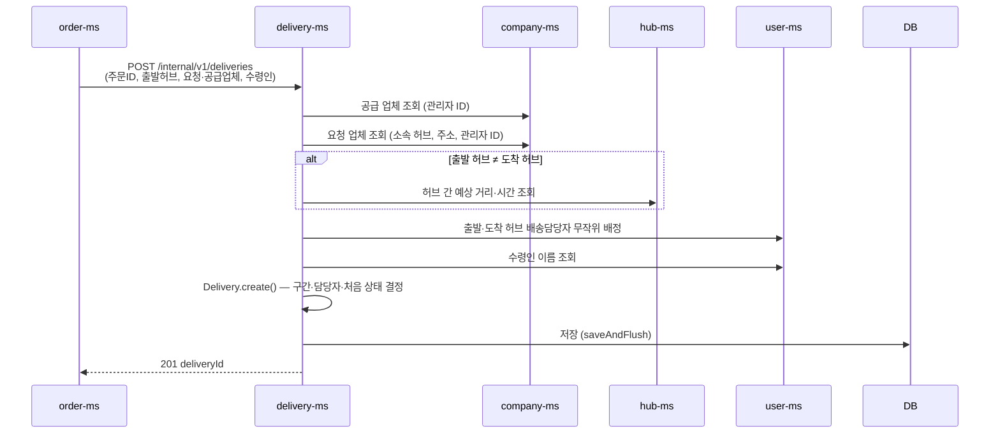
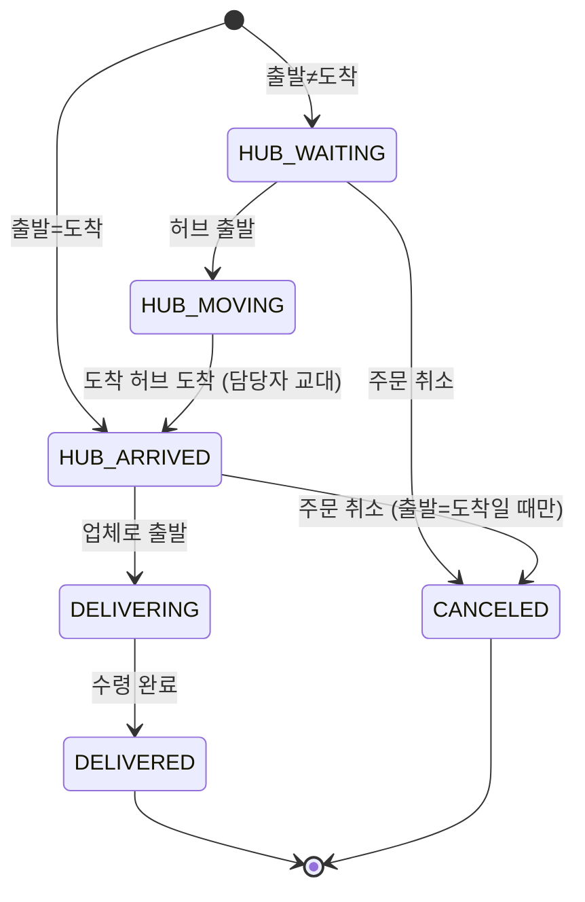

# Delivery 도메인 구현 설명

> 작성자: 영은 · 기준: `dev` 912506f · 모듈: `delivery-ms` (스키마 `delivery`)
> 배송이 **어떻게 만들어지고, 어떻게 움직이고, 누가 무엇을 할 수 있는지**를 순서대로 설명합니다. 뒤쪽에는 고민했던 점과 코드 위치를 정리했습니다.
> API 요청·응답 형식은 [[04 API 명세서]], 테이블 컬럼은 [[06 테이블 명세서]]를 봅니다.

## 목차

1. [한눈에 보기](#1-한눈에-보기)
2. [배송은 이렇게 생겼다](#2-배송은-이렇게-생겼다)
3. [배송이 만들어지는 과정](#3-배송이-만들어지는-과정)
4. [배송 상태는 한 방향으로만 움직인다](#4-배송-상태는-한-방향으로만-움직인다)
5. [누가 무엇을 할 수 있나](#5-누가-무엇을-할-수-있나)
6. [왜 이렇게 만들었나](#6-왜-이렇게-만들었나)
7. [만들면서 겪은 문제](#7-만들면서-겪은-문제)
8. [코드 위치](#8-코드-위치)
9. [아직 남은 과제](#9-아직-남은-과제)

---

## 1. 한눈에 보기

| 항목 | 내용 |
|---|---|
| 하는 일 | 주문이 완료되면 배송을 만들고, 허브 → 허브 → 업체로 이동하는 과정을 상태로 관리 |
| 테이블 | `p_deliveries`(배송) 1 : N `p_delivery_routes`(배송 구간) |
| 누가 부르나 | 배송 생성·취소는 **order-ms만** 호출(내부 API), 조회·상태 변경은 사용자가 Gateway를 거쳐 호출 |
| 내가 부르는 서비스 | company-ms(업체 정보), hub-ms(허브 간 거리·시간), user-ms(수령인 이름, 배송담당자 배정) |
| 구조 | 4계층 `presentation → application → domain ← infrastructure` |

---

## 2. 배송은 이렇게 생겼다

배송 1건은 **구간(route)** 1~2개로 이루어집니다.

```
출발 허브 ──[구간 1: HUB_TO_HUB]──▶ 도착 허브 ──[구간 2: HUB_TO_COMPANY]──▶ 요청 업체
```

- **출발 허브**: 재고가 빠진 허브 (주문 서비스가 알려줌)
- **도착 허브**: 요청 업체가 소속된 허브 (company-ms에서 조회)
- 출발 허브와 도착 허브가 **같으면** 허브 간 이동이 필요 없으므로 `HUB_TO_COMPANY` 구간 하나만 만듭니다.

| 경우 | 만들어지는 구간 | 처음 상태 |
|---|---|---|
| 출발 ≠ 도착 | ① HUB_TO_HUB ② HUB_TO_COMPANY | `HUB_WAITING` (출발 허브에서 대기) |
| 출발 = 도착 | ① HUB_TO_COMPANY | `HUB_ARRIVED` (이미 도착 허브에 있음) |

**구간마다 담당자가 따로 있습니다.** 허브 간 이동은 출발 허브 담당자가, 업체 배송은 도착 허브 담당자가 맡습니다.
`p_deliveries.delivery_manager_id`는 "**지금 진행 중인 구간의 담당자**"를 보여주는 값이라, 도착 허브에 도착하면(`HUB_ARRIVED`) 업체 배송 담당자로 바뀝니다.

`Delivery`가 구간을 관리하는 대장(애그리거트 루트)입니다. 구간 상태를 바꾸는 메서드는 package-private이라 바깥에서는 `Delivery`를 통해서만 구간을 바꿀 수 있습니다.

---

## 3. 배송이 만들어지는 과정

주문 서비스는 주문을 만들고 재고를 뺀 뒤, 마지막으로 배송 생성을 요청합니다.



요청값을 일부러 적게 받았습니다. 주문 서비스는 **주문ID, 출발 허브, 요청·공급 업체 ID, 수령인 ID** 다섯 개만 보내고, 도착 허브·배송 주소·수령인 이름·업체 관리자는 배송 서비스가 직접 조회합니다. 주문 서비스가 다른 서비스에 조회 요청을 할 필요가 없게 하기 위해서입니다.

| 정보 | 어디서 가져오나 |
|---|---|
| 도착 허브, 배송 주소 | 요청 업체(company-ms)의 소속 허브·주소 |
| 요청·공급 업체 관리자 | company-ms. **생성 시점 값으로 저장**(스냅샷)하고 나중에 바뀌어도 갱신하지 않음 |
| 허브 간 예상 거리·시간 | hub-ms 허브 경로 |
| 허브 → 업체 예상 거리·시간 | 고정값 10km · 30분 |
| 배송담당자 | user-ms가 허브별로 무작위 1명씩. 후보가 없으면 **담당자 없이** 배송을 만들고 MASTER가 나중에 배정 |
| 수령인 | 주문자 = 수령인. user-ms에서 이름 조회 |

**취소**는 주문 취소 때 order-ms가 `POST /internal/v1/deliveries/{id}/cancel`로 부릅니다. 이미 취소된 배송이나 없는 배송이면 아무 일도 하지 않고 204를 돌려주므로, 주문 서비스가 같은 요청을 다시 보내도 안전합니다.

---

## 4. 배송 상태는 한 방향으로만 움직인다



- 정해진 다음 단계로만 갈 수 있습니다(`DeliveryStatus.canChangeTo`). 건너뛰거나 되돌리면 409 `DELIVERY_INVALID_STATUS_TRANSITION`입니다. 같은 상태로 바꾸는 요청은 아무것도 하지 않고 성공합니다.
- **배송 상태가 바뀌면 구간 상태도 같이 바뀝니다.**

| 배송 상태 변경 | 구간에 일어나는 일 |
|---|---|
| → `HUB_MOVING` | 허브 간 구간 `WAITING → MOVING` |
| → `HUB_ARRIVED` | 허브 간 구간 `MOVING → ARRIVED`, 현재 담당자를 업체 배송 담당자로 교대 |
| → `DELIVERING` | 업체 배송 구간 `WAITING → MOVING` |
| → `DELIVERED` | 업체 배송 구간 `MOVING → ARRIVED` |
| → `CANCELED` | 모든 구간 `WAITING → CANCELED` |

- **취소는 이동이 시작되기 전에만** 됩니다. 이미 물건이 움직였다면 409 `DELIVERY_NOT_CANCELABLE`입니다.
- 구간 상태를 따로 바꾸는 API는 없습니다. 구간은 배송 상태를 따라가기만 해서, 둘이 어긋날 일이 없습니다.

---

## 5. 누가 무엇을 할 수 있나

먼저 **관계자**라는 말을 정했습니다. 배송과 관련 있는 사람이라는 뜻입니다.

> **관계자** = 수령인 · 요청 업체 관리자 · 공급 업체 관리자 · 구간 담당자(어느 구간이든)

| 기능 | API | 할 수 있는 사람 |
|---|---|---|
| 배송 단건 조회 | `GET /api/v1/deliveries/{id}` | MASTER, 관계자 |
| 주문으로 배송 조회 | `GET /api/v1/deliveries/by-order/{orderId}` | MASTER, 관계자 |
| 배송 목록 조회 | `GET /api/v1/deliveries` | MASTER는 전체, 그 외는 **내가 관계자인 배송만** |
| 배송 구간 조회 | `GET /api/v1/deliveries/{id}/routes` | MASTER, 관계자 |
| 배송 상태 변경 | `PATCH /api/v1/deliveries/{id}/status` | MASTER, **현재 구간** 담당자 |
| 구간 실측 거리·시간 입력 | `PATCH /api/v1/delivery-routes/{routeId}/metrics` | MASTER, **그 구간** 담당자 |
| 구간 담당자 배정 | `PATCH /api/v1/deliveries/{id}/manager` | MASTER (Gateway에서 막음) |
| 배송 생성 / 취소 | `POST /internal/v1/deliveries`, `.../{id}/cancel` | order-ms (내부 API) |

- 목록 조회는 `status`, `deliveryManagerId`(이 사람이 담당한 구간이 있는 배송)로 거를 수 있고, 정렬은 `status`만 허용합니다.
- 담당자 배정은 `routeType`(HUB_TO_HUB / HUB_TO_COMPANY)으로 구간을 고릅니다. user-ms에서 **배송담당자인지 확인**한 뒤 배정하고, 이미 끝났거나 취소된 구간에는 배정할 수 없습니다(409 `DELIVERY_ROUTE_NOT_ASSIGNABLE`). 지금 진행 중인 구간이면 배송의 현재 담당자도 같이 바뀝니다.

---

## 6. 왜 이렇게 만들었나

### Q. 왜 배송 이력 테이블(`p_delivery_histories`)이 없나요?

멱등성 테이블은 "같은 요청이 다시 왔는지"를 알아보려고 요청 키를 저장해 두는 곳입니다. 주문 생성은 요청 시점에 주문 ID가 없어서 별도 키(`idempotency_key`)가 필요하지만, 배송 생성 요청에는 이미 `orderId`가 들어 있고 주문 1건에 배송은 1건뿐입니다. 즉 **같은 orderId = 같은 요청**이므로 `order_id` UNIQUE만으로 중복 생성을 막을 수 있어 이력 테이블을 지웠습니다.

- 같은 주문으로 다시 요청하면 처음 결과 대신 409 `DELIVERY_ALREADY_EXISTS`가 납니다. 완전한 멱등(같은 결과 반환)은 아니라서, 재시도하는 쪽은 409를 받으면 기존 배송을 조회해야 합니다.
- 상태 변경(같은 상태면 무시)과 취소(이미 취소면 무시)는 여러 번 보내도 결과가 같아서 기록이 필요 없습니다.

### Q. 왜 "배송 경로 구성", "구간 상태 변경" API를 없앴나요?

구간은 배송을 만들 때 **자동으로** 정해지기 때문에, 사람이 따로 구성할 이유가 없다고 생각했습니다.

### Q. 업체 관리자 ID를 왜 배송에 복사해 두나요?

조회 권한을 확인할 때마다 company-ms를 부르면 느리고, company-ms가 죽으면 배송 조회도 같이 죽습니다. 생성할 때 한 번 받아서 저장해 두면 **배송 서비스 혼자서** 권한을 판단할 수 있습니다. 대신 관리자가 바뀌어도 기존 배송에는 반영되지 않습니다.

### Q. 목록 조회에서 왜 JOIN 대신 `exists`를 쓰나요?

"내가 구간 담당자인 배송"을 찾으려면 구간 테이블을 봐야 합니다. JOIN을 쓰면 구간이 2개인 배송이 목록에 **두 번** 나와 페이지 개수가 틀어집니다. 그래서 JPA Specification에서 `exists` 서브쿼리를 썼습니다(`DeliverySpecifications`).

```sql
-- 관계자 조건 (실제로는 Specification으로 만든다)
d.recipient_user_id = :me
or d.requester_company_manager_id = :me
or d.supplier_company_manager_id = :me
or exists (select 1 from p_delivery_routes r
           where r.delivery_id = d.id and r.delivery_manager_id = :me)
```

---

## 7. 만들면서 겪은 문제

### ① 배송 생성 중에 DB 커넥션을 오래 붙잡고 있었다

- **현상**: `createDelivery`가 클래스 전체의 `@Transactional` 안에서 company·hub·user 서비스를 최대 5번 부르고 있었습니다. 다른 서비스가 느리면 그동안 DB 커넥션을 계속 쥐고 있게 됩니다.
- **해결**: `createDelivery`에만 `@Transactional(propagation = NOT_SUPPORTED)`를 붙여 **트랜잭션 없이** 외부 호출을 먼저 끝내고, 저장(`saveAndFlush`)은 Repository 자체 트랜잭션에서 짧게 하도록 바꿨습니다.
- **괜찮은 이유**: 외부 호출은 전부 조회라서 중간에 실패해도 되돌릴 게 없습니다. 실제로 DB에 쓰는 건 마지막 저장 한 번뿐입니다.

### ② 같은 주문으로 동시에 배송을 만들면 500이 날 수 있었다

- **현상**: UNIQUE 위반이 커밋할 때 터지면 어떤 제약이 깨졌는지 알기 어렵고 500으로 나갑니다.
- **해결**: `saveAndFlush`로 저장하는 순간 위반을 드러내고, 제약 이름이 `uk_p_delivery_order_id`일 때만 409 `DELIVERY_ALREADY_EXISTS`로 바꿨습니다. 다른 제약 위반은 그대로 던집니다.

### ③ 실측 거리·시간에 음수가 들어갔다

- **해결**: 요청 DTO에 `@NotNull @PositiveOrZero`를 붙였습니다.
    - 요청에서 `Integer`로 받는 이유: `int`면 값이 빠졌을 때 0으로 채워져 `@NotNull`을 통과해 버립니다.
    - 엔티티의 `actualDurationMin`도 `Integer`인데, 이유가 다릅니다. 실측값은 입력 전에는 비어 있어야(NULL) 하므로 0과 구분하려고 `Integer`로 둡니다.
---

## 8. 코드 위치

```
com.delivery
├── presentation   DeliveryController, DeliveryRouteController, InternalDeliveryController + dto
├── application    DeliveryCommandService(쓰기), DeliveryQueryService(읽기, 권한 확인)
│   └── client     CompanyClient, HubRouteClient, UserClient   ← 다른 서비스 호출 포트
├── domain
│   ├── entity     Delivery(대장), DeliveryRoute
│   ├── vo         DeliveryStatus, DeliveryRouteStatus, DeliveryRouteType,
│   │              DeliveryManagers, DeliveryCompanies, CompanyInfo, RouteEstimate
│   └── repository DeliveryRepository, DeliverySearchCondition
└── infrastructure
    ├── persistence DeliveryRepositoryImpl, DeliveryJpaRepository, DeliverySpecifications
    └── client      company / hubroute / user 의 Feign 클라이언트와 구현체
```

| 찾고 싶은 것 | 위치 |
|---|---|
| 구간을 어떻게 만드나 | `Delivery.create()` |
| 상태 전이 규칙 | `DeliveryStatus.canChangeTo()`, `Delivery.changeStatus()` → `syncRouteStatus()` |
| 취소 가능 조건 | `Delivery.cancel()` → `isBeforeDispatch()` |
| 관계자 판단 | `Delivery.isRelatedTo()` (단건), `DeliverySpecifications.isRelatedTo()` (목록) |
| 허브 → 업체 고정 예상값 | `DeliveryRoute.DEFAULT_HUB_TO_COMPANY_*` |
| 중복 생성 409 변환 | `DeliveryRepositoryImpl.save()` |
| 오류 코드 | common `DeliveryErrorCode` |

**오류 코드 요약**

| 상태 | 코드 |
|---|---|
| 400 | `INVALID_DELIVERY_MANAGER`, `DELIVERY_ROUTE_TYPE_NOT_FOUND`, `DELIVERY_INVALID_REQUESTER_COMPANY`, `DELIVERY_INVALID_SUPPLIER_COMPANY`, `DELIVERY_INVALID_RECIPIENT`, `HUB_ROUTE_NOT_FOUND` |
| 403 | `DELIVERY_ACCESS_DENIED` |
| 404 | `DELIVERY_NOT_FOUND`, `DELIVERY_ROUTE_NOT_FOUND`, `DELIVERY_USER_NOT_FOUND` |
| 409 | `DELIVERY_ALREADY_EXISTS`, `DELIVERY_INVALID_STATUS_TRANSITION`, `DELIVERY_NOT_CANCELABLE`, `DELIVERY_ROUTE_NOT_ASSIGNABLE` |

---

## 9. 아직 남은 과제

- **테스트**: 현재 `delivery-ms`에는 컨텍스트 로딩 테스트만 있습니다. 상태 전이·취소 조건·담당자 교대(`Delivery`)와 관계자 조회(`DeliverySpecifications`)부터 단위 테스트를 추가할 예정입니다.
- **주문 ID로 배송 취소**: 배송은 저장됐는데 order-ms가 타임아웃으로 응답을 못 받으면 주문만 실패하고 배송이 남을 수 있습니다. 보상(배송 취소)은 주문 서비스가 하지만, 이때 주문 서비스는 deliveryId를 모르므로 배송 서비스가 orderId로 취소하는 내부 API를 제공해야 합니다.
- **허브 → 업체 예상값**: 지금은 고정값(10km · 30분)입니다. 업체 좌표가 생기면 실제 거리로 바꿀 수 있습니다.
