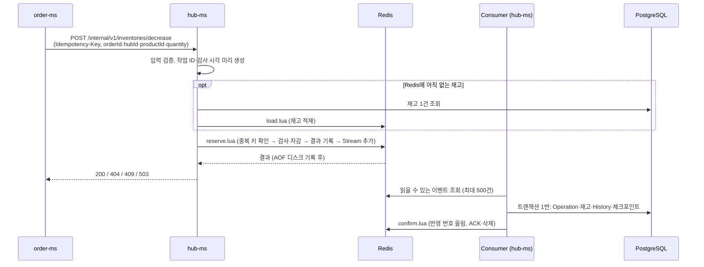
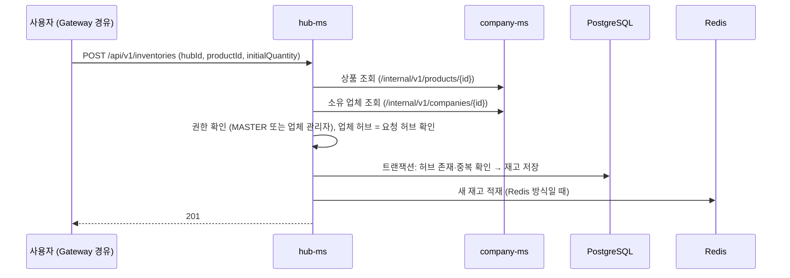

# Hub 도메인 구현 설명

> 작성자: 이찬 · 확인일: 2026-10-21 · 기준: `dev` 186ae33 및 현재 작업 파일(미커밋 변경 포함) · 모듈: `hub-ms` (스키마 `hub`)
> 1부는 **무엇을 왜 이렇게 만들었는지**(설계 결정·트러블슈팅), 2부는 **요청이 어떻게 흐르는지**, 3부는 **코드를 어디서 찾는지**(계층·테이블·API·오류 코드·설정·테스트)입니다.
> API 사용법은 [Hub 사용법](<../사용법/Hub 사용법.md>)·[Hub Route 사용법](<../사용법/Hub Route 사용법.md>)·[Hub-MS Feign 연동 사용법](<../사용법/Hub-MS Feign 연동 사용법.md>), 테이블 컬럼은 [테이블 명세서](<../../design/06 테이블 명세서.md>)를 봅니다.

## 목차

- [한눈에 보기](#한눈에-보기)
- [1부. 설계 결정](#1부-설계-결정)
- [2부. 요청 흐름](#2부-요청-흐름)
- [3부. 코드 구조](#3부-코드-구조)
- [아직 남은 과제](#아직-남은-과제)

---

## 한눈에 보기

| 항목 | 내용 |
|---|---|
| 하는 일 | 허브·허브 경로 조회, 허브별 상품 재고 등록·조회·삭제, 주문의 재고 차감·복원 |
| 도메인 | `hub`(허브 17개) · `hubroute`(허브 간 경로 272개) · `inventory`(재고) |
| 테이블 | 허브 2개 + 재고 4개 = 6개 ([3.2](#32-테이블과-redis-키)) |
| 누가 부르나 | 사용자(Gateway 경유): 조회·재고 등록<br>order-ms: 재고 조회·차감·복원<br>company-ms: 허브 확인, 상품 삭제 시 재고 삭제<br>delivery-ms: 허브 간 경로 조회 |
| 내가 부르는 서비스 | company-ms (재고 등록 때 상품·소유 업체 확인) |
| 재고 차감 방식 | 기본은 **Redis Lua + Streams**(`inventory.stock.mode=redis-streams`). 기존 PostgreSQL 방식도 남아 있음(`postgres`) |
| 구조 | 4계층 `presentation → application → domain ← infrastructure` + DIP |
| 테스트 | 12개 클래스, 126개 실행(매개변수별 실행 포함, 2026-10-21 재실행 통과). DB 통합 테스트는 PostgreSQL 18, Redis 관련 테스트는 Redis 컨테이너 사용 |

---

# 1부. 설계 결정

## 1.1 요구사항 해석

| 대상 | 요구사항 | 구현 |
|---|---|---|
| 허브 | 17개 고정. "초기 데이터를 적재해둔 뒤 조회 API만 제공 (생성/수정/삭제 API 불필요)" | `hubs.sql`로 17개 적재. 목록(이름 검색·정렬 4종)과 단일 조회 |
| 허브 경로 | 모든 허브 사이 직접 배송(P2P). 출발·도착 허브, 소요시간, 이동거리. 조회만 제공 | `hub_routes.sql`로 방향별 272개(17 × 16) 적재. 경유 경로 계산은 없음 |
| 재고 | 상품은 업체가, 허브별 재고는 허브가 관리. 주문 생성 시 차감, 취소 시 복원, 재고가 없으면 주문 실패. 입고는 범위 밖 | 허브 + 상품당 1행. 차감·복원은 order-ms 전용 내부 API(멱등성 키 필수). 재고 등록 API 제공, 입고(증가) API는 없음 |
| 권한 | 관리자·일반 사용자 2단계. 일반 사용자는 자신과 연관된(소유한) 데이터만 수정 | 조회는 로그인 사용자 모두. 재고 등록은 MASTER 또는 상품 소유 업체의 관리자 |
| 공통 | 논리 삭제 데이터 제외, 검색조건·정렬(기본 생성일 역순), 실패 시 롤백 시나리오 1개 이상 | 공개 조회에서는 논리 삭제 제외. History 저장 실패 시 같은 DB 트랜잭션의 재고·Operation도 롤백. Redis 방식은 체크포인트도 롤백하고 이벤트를 재처리 대상으로 유지 |

- **책임 분담**: hub-ms는 재고 차감·복원을 안전하게 처리하는 데까지 맡고, 주문 전체 흐름(실패 시 복원 요청 포함)은 order-ms가 조정합니다.
- 두 초기 데이터 파일은 `ON CONFLICT ... DO NOTHING`입니다. 서버가 뜰 때마다 실행돼도(`spring.sql.init.mode: always`) 중복으로 들어가지 않습니다.
- 페이지네이션은 과제 필수 범위가 아니고 허브·경로 수가 고정이라 넣지 않았습니다. 기존 API 명세와 달라진 점은 [Hub 사용법](<../사용법/Hub 사용법.md>)·[Hub Route 사용법](<../사용법/Hub Route 사용법.md>)의 7장에 있습니다.

## 1.2 재고 차감은 조건부 UPDATE 한 문장으로 (PostgreSQL 방식)

재고를 엔티티로 읽고 바꿔 저장하면, 같은 수량을 동시에 읽은 두 요청이 각자 덮어써서 **차감 하나가 사라질 수 있습니다**(`Inventory`에는 `@Version`이 없습니다). 그래서 검사와 차감을 UPDATE 한 문장으로 합쳤습니다.

```sql
-- InventoryJpaRepository.decreaseIfEnough (JPQL을 SQL로 단순화)
UPDATE hub.p_inventories
SET    quantity = quantity - :quantity,
       updated_at = :changedAt, updated_by = COALESCE(:actorId, updated_by)
WHERE  hub_id = :hubId AND product_id = :productId
  AND  deleted_at IS NULL
  AND  quantity >= :quantity      -- 남은 수량이 충분할 때만 바뀐다
```

- PostgreSQL의 READ COMMITTED에서는 같은 행을 바꾸려는 뒤 요청이 앞 트랜잭션을 기다리고, 앞 요청이 커밋하면 **변경된 값으로 조건을 다시 확인**합니다. 수량 검사와 차감이 분리되지 않아 재고 초과 차감을 막습니다.
- 행 잠금은 별도로 설정한 것이 아니라 **UPDATE를 실행하면서 PostgreSQL이 자동으로 획득**합니다. 같은 트랜잭션의 Operation·History 저장과 커밋·롤백이 끝날 때 해제됩니다.
- 성공 여부는 바뀐 행 수로 판단합니다. 0이면 재고를 다시 조회해서 "부족"과 "대상 없음"을 나누고, 1이면 차감 후 수량을 조회합니다. 2행 이상이면 예외를 던집니다.
- 벌크 UPDATE는 JPA Auditing을 거치지 않아서 `updated_at`·`updated_by`를 쿼리에서 직접 넣습니다. 작업자가 없으면(null) 기존 수정자를 지우지 않도록 `COALESCE`를 씁니다.
- 이 쿼리들은 호출한 쪽의 트랜잭션 안에서만 실행됩니다(`Propagation.MANDATORY`).
- DB에도 `CHECK (quantity >= 0)`를 걸어 두었습니다.

## 1.3 결과 기록(Operation)과 변경 이력(History)을 나눴다

| 테이블 | 언제 쌓이나 | 왜 필요한가 |
|---|---|---|
| `p_inventory_operations` | 새 차감의 성공·업무 거절, 복원 성공마다 1행 | 같은 멱등성 키로 다시 오면 저장된 결과를 그대로 돌려주기 위해 |
| `p_inventory_histories` | 재고 수량이 **실제로 바뀐** 경우만 1행 | 변경량과 변경 후 수량을 추적하기 위해 |

- 차감 거절(재고 부족·대상 없음)도 Operation으로 남깁니다. 그래서 같은 키로 다시 요청하면 같은 거절 결과가 나옵니다. 재요청은 새 기록을 만들지 않으며, 입력 오류·멱등성 충돌·복원 실패는 별도 REJECTED Operation을 만들지 않습니다.
- **PostgreSQL 방식**: 서비스가 거절을 결과로 반환해 Operation을 커밋하고, 컨트롤러가 404·409로 바꿉니다. 서비스 트랜잭션 안에서 예외를 던져 거절 기록까지 롤백되는 것을 피합니다.
- **Redis 방식**: Lua가 거절 결과·이벤트를 기록한 뒤 컨트롤러가 404·409로 바꿉니다. Operation의 DB 저장은 Consumer가 나중에 수행합니다.

## 1.4 멱등성: 같은 키는 같은 결과

| 상황 | PostgreSQL 방식 | Redis 방식 |
|---|---|---|
| 처음 온 키 | 차감 처리와 Operation을 함께 커밋 | Lua가 차감·결과·멱등성 키·이벤트를 기록 |
| 같은 키 + 같은 내용 | DB의 기존 결과 반환, 추가 차감 없음 | Redis의 기존 결과 반환, 추가 차감·이벤트 없음 |
| 같은 키 + 다른 내용 | 409 `IDEMPOTENCY_CONFLICT` | 409 `IDEMPOTENCY_CONFLICT` |
| 같은 키가 동시에 두 번 | UNIQUE 위반으로 롤백 후 새 트랜잭션에서 재조회 | Lua 실행이 겹치지 않아 뒤 요청이 앞 요청의 기록을 확인 |

- DB의 `idempotency_key`에는 UNIQUE 제약이 있습니다. **Redis에는 SQL의 유니크 제약을 거는 대신 Lua에서 키와 요청 내용을 직접 비교**합니다. 차감은 작업 유형·주문·허브·상품·수량을, 복원은 작업 유형·원본 차감 ID를 비교합니다. 키는 최대 120자이며 형식은 호출하는 쪽이 정합니다.
- 재고가 나중에 늘어나도, 같은 키로 다시 보내면 처음의 거절 결과가 그대로 나옵니다.
- 기존 결과의 `remainingQuantity`는 **처리 당시의 수량**이며 재요청 시점의 실시간 수량은 아닙니다.
- **PostgreSQL 방식**은 키를 미리 INSERT하지 않고, 처리 후 `saveAndFlush()`로 Operation을 저장합니다. 멱등성 키 UNIQUE 위반이면 내부 중복 예외로 바꾸고, `execute()` 밖에서 잡아 전체 롤백 후 새 트랜잭션으로 재조회합니다. `save()`만 쓰면 INSERT가 커밋 시점까지 미뤄져 저장 메서드의 try-catch에서 잡지 못할 수 있습니다. flush는 SQL 실행이며 커밋은 아닙니다.
- **Redis 방식의 DB 배치 저장**은 JPA `saveAndFlush()`를 쓰지 않습니다. `PostgresInventoryBatchRepository`가 네이티브 SQL·체크포인트·이벤트 해시로 재전달을 검증합니다.
- **복원**은 DB의 원본 차감 ID(`original_operation_id`)에도 UNIQUE를 걸었습니다. Redis에서는 `restored` 색인을 먼저 확인합니다. 같은 키·같은 원본은 기존 결과를 반환하고, 다른 키로 같은 차감을 다시 복원하면 409 `INVENTORY_ALREADY_RESTORED`입니다.
- 복원할 수 있는 건 **성공한 차감**뿐이고, 수량은 요청이 아니라 원본 차감 기록에서 가져옵니다. 재고를 차감 전 값으로 덮어쓰지 않고 **원본 수량만큼 더합니다.** 예: 지금 50 + 원본 차감 30 = 80 (차감 전 100으로 되돌리지 않음).

## 1.5 외부 호출과 트랜잭션을 분리했다

- **재고 등록**: company-ms에서 상품과 소유 업체를 확인(Feign 2회)한 뒤, 짧은 DB 트랜잭션에서 저장합니다. 등록용 DB 트랜잭션을 열기 전에 외부 조회를 끝냅니다.
  - 상품·업체 모두 company-ms 내부 API(`/internal/v1/products/{id}`, `/internal/v1/companies/{id}`)로 조회해서 사용자 헤더가 필요 없습니다.
  - 권한과 허브는 요청 값이 아니라 **company-ms에서 받은 값**(업체의 관리 허브·관리자 ID)으로 판단합니다. "업체가 속한 허브에만 등록" 규칙은 MASTER에게도 적용됩니다.
  - 404이면서 코드가 `PRODUCT_NOT_FOUND` 또는 `COMPANY_NOT_FOUND`인 경우만 `RESOURCE_NOT_FOUND`로 바꿉니다. 나머지 원격 오류는 전달합니다. 재시도·서킷 브레이커는 없고, 타임아웃은 연결 1초·읽기 2초(common 설정)입니다.
- **PostgreSQL 차감·복원**: `NOT_SUPPORTED`로 호출자의 기존 트랜잭션을 잠시 중단합니다. 첫 `TransactionTemplate.execute()`가 재고·Operation·History를 함께 커밋하거나 롤백하며, 중복 복구 조회는 롤백 후 두 번째 `execute()`에서 실행합니다.
- **Redis 차감·복원**: 요청 처리도 `NOT_SUPPORTED`이지만 Lua 자체는 DB 트랜잭션이 아닙니다. Consumer가 별도로 `TransactionTemplate`을 사용해 읽은 배치의 재고·Operation·History·체크포인트를 함께 커밋합니다.
- OSIV를 끄고, application 계층이 엔티티를 Result DTO로 바꿔서 반환합니다.

## 1.6 같은 재고에 몰리면 느렸다 → Redis Lua + Streams

같은 재고 한 행에 요청이 몰리면 행 잠금 대기 때문에 느려지고, 기다리는 동안 DB 연결도 계속 잡고 있었습니다. PostgreSQL 안에서 세 가지를 먼저 시도했지만, 한 부하가 좋아지면 다른 부하가 나빠졌습니다.

| 시도 | 결과 | 결정 |
|---|---|---|
| RETURNING (차감 후 조회 1회 제거) | 같은 재고 50 VU p95 개선, 재고 소진 부하 악화 | 보류 |
| 재고별 진입 제한 | 다른 재고 요청은 보호, 처리량 감소 | 보류 |
| CTE 한 문장 (차감·Operation·History) | 같은 재고 처리량 증가, 재고 소진 부하 악화 | 보류 |
| **Redis Lua + Streams** | 도입 초기의 같은 재고 100 VU에서 API p95 213~222 → 약 53ms, DB 완료 처리량 530~543 → 2,388~2,402건/초 | 현재 적용. 응답 기준·DB 반영 지연은 별도 평가 |

- **응답 기준이 바뀝니다.** PostgreSQL 방식은 DB 커밋 후 응답합니다. Redis 방식은 Lua 처리 후 응답하며, 서버의 `appendfsync always` 설정으로 응답 전 AOF 동기화를 수행합니다([Redis AOF 정책](https://redis.io/docs/latest/operate/oss_and_stack/management/persistence/#how-durable-is-the-append-only-file)). **PostgreSQL 반영은 비동기이므로 응답 시점에 완료됐다는 보장은 없습니다.**
- 위 Redis 수치는 **20ms 수집을 사용하던 도입 초기 측정**입니다. 분산 재고·소진 부하 등 모든 조건이 좋아진 것은 아니며, 현재의 추가 대기 없는 Consumer 수치와 섞지 않습니다. API p95만으로 동일한 보장의 성능 개선이라고 해석하지 않습니다.
- 측정 조건과 전체 수치는 노션 [성능비교](https://app.notion.com/p/400530b4fe5980a38b7fe5b34ebb84fe)에 정리합니다. 이 문서는 과거 측정 요약이며 이번 검토에서 부하를 새로 측정한 결과는 아닙니다.

## 1.7 Redis 방식은 이렇게 동작한다

```
요청 ─▶ reserve.lua (순서대로 실행, 다른 요청이 중간에 끼어들 수 없음)
          중복 키 확인 → 재고 검사·차감 → 결과 기록 → Stream에 이벤트 추가
       ─▶ Redis가 디스크(AOF)에 기록 ─▶ 응답

Consumer (hub-ms 안 전용 스레드)
       ─▶ Stream에서 읽을 수 있는 이벤트를 최대 500건 읽음
       ─▶ 더 모으려고 기다리지 않고 읽은 묶음을 바로 저장
       ─▶ DB 트랜잭션 1번: Operation → 재고 수량 → History → 체크포인트
       ─▶ 커밋한 뒤 Redis에 "여기까지 반영됨" 표시, Stream에서 삭제
```

**Lua의 원자성은 순서가 없다는 뜻이 아닙니다.** 중복 검사 → 수량 검사 → 차감 → 결과·멱등성 키 기록 → 이벤트 추가 순서로 실행되는 동안 다른 Redis 요청이 끼어들지 못한다는 뜻입니다([Redis 스크립트 실행 규칙](https://redis.io/docs/latest/develop/programmability/eval-intro/)). Redis 안의 이 실행과 Consumer의 PostgreSQL 저장은 서로 다른 단계입니다.

Redis 모드가 동작하는 동안 **차감 판단과 현재 수량의 기준은 Redis**입니다. 이미 커밋된 DB 값의 조회만 돕는 캐시가 아닙니다. DB에는 수량·Operation·History·체크포인트가 비동기로 반영됩니다. DB 값을 Redis에 넣는 경우는 다음과 같습니다.

| 언제 | 무엇을 |
|---|---|
| 파이프라인을 처음 켤 때 | DB의 재고·작업 기록 전체를 복사 |
| 재고를 등록할 때 | 새 재고 1건 |
| Redis에 없는 재고를 처음 쓸 때 | DB에서 그 1건만 읽어 적재 |
| 명시적으로 복구할 때 | DB 값 + 아직 DB에 안 들어간 이벤트로 Redis를 새로 구성 |

`epoch`는 Redis와 DB가 같은 데이터 세대인지 확인하는 ID이고, 체크포인트는 DB에 반영을 마친 마지막 이벤트 위치입니다. 복구에서는 이 기준을 맞춰 재고를 다시 구성합니다.

안전장치는 다음과 같습니다.

| 장치 | 막는 것 |
|---|---|
| Lua 실행 중 다른 요청의 명령이 끼어들지 않음 | 검사와 차감 사이에 다른 요청이 재고를 바꾸는 것 |
| 쓰기 전 검사 + `DIRTY` → `READY` 상태 표시 | 중간 오류로 부분 변경이 남았을 때 정상 상태로 계속 처리하는 것. 자동 롤백은 아님 |
| `appendonly yes`·`appendfsync always`·`noeviction` 검사 | AOF 미기록·응답 후 동기화·메모리 부족 시 자동 키 축출을 허용하는 설정. 저장소 자체 손실은 해결하지 못함 |
| DB 커밋 후 ACK + 체크포인트·이벤트 해시 | 저장 전 ACK하거나, 재전달된 이벤트를 다시 반영하는 것. 같은 이벤트 ID의 내용 변경도 거절 |
| 시작 검사 (epoch·체크포인트 비교) | Redis가 비었거나 다른 데이터일 때 옛 DB 값을 그대로 다시 올리는 것 |
| 밀림 보호 (미확인 1만 건 또는 가장 오래된 미확인 이벤트 10초) | DB 반영·완료 확인이 밀린 상태로 계속 받는 것 → 503 |
| 조회 API는 Redis 수량으로 응답 | DB가 잠깐 늦어서 조회가 이전 값을 보여 주는 것 |

**Lua 실행 중 오류가 나도 앞서 쓴 값이 자동으로 되돌아가지는 않습니다.** 쓰기 도중을 나타내는 `DIRTY` 상태이면 새 처리를 거절하고, DB 체크포인트와 남아 있는 완전한 이벤트로 명시적으로 복구합니다. Redis와 AOF까지 잃으면 아직 DB에 반영되지 않은 차감을 이 복구로 되살릴 수 없습니다.

**Streams는 이벤트 보관·전달 수단이고, 배치는 Consumer의 DB 저장 방법입니다.** Consumer는 처음 이벤트를 읽자마자 더 모으려고 기다리지 않습니다. 다만 Stream이 비어 있으면 첫 이벤트를 최대 250ms 기다리며, 그 사이 이벤트가 도착하면 바로 읽습니다. 이미 읽었지만 ACK하지 못한 자기 Pending 이벤트를 새 이벤트보다 먼저 처리합니다.

DB 배치 저장에서도 체크포인트와 대상 재고를 `SELECT ... FOR UPDATE`로 잠급니다. DB 잠금을 없앤 것이 아니라, **HTTP 요청마다 DB에서 경합하던 변경을 Consumer의 묶음 저장으로 옮긴 구조**입니다. 실패한 묶음은 롤백한 뒤 건별 재시도로 정상인 앞부분을 저장하며, 실패한 이벤트는 ACK하지 않습니다.

**Consumer는 "추가 대기 없는 배치"로 정했습니다.** 1ms·2ms 모으기와 최종 비교한 과거 측정은 아래와 같습니다(같은 재고, 각 10초씩 2회).

| 요청/초 | 1ms·2ms 모으기 DB 반영 p95 | 대기 없는 배치 DB 반영 p95 |
|---|---|---|
| 500 | 31~42ms | **22~23ms** |
| 1,000 | 67~72ms | **46~47ms** |

표의 p95는 **이벤트 발생부터 DB 커밋까지의 시간**이며 HTTP 응답 시간이 아닙니다. 세 방식의 DB 완료 처리량은 목표 요청률에 근접했고, 추가 대기 없는 배치는 이 두 부하에서 p95·p99가 낮았습니다. 대신 2ms 방식보다 SQL 호출이 약 1.7~1.8배 많았습니다. 미확인 건수는 DB 반영·ACK를 기다리는 건수이며 유실 건수가 아닙니다.

**이 선택은 초당 500·1,000건의 같은 재고 부하 기준**입니다. 모든 부하에서 가장 빠르다거나 운영 최대 처리량을 입증한 것은 아닙니다.

## 1.8 트러블슈팅

### ① 삭제된 허브가 단건 조회에 나왔다

- **현상**: 단건 조회를 `findById`로 하면 논리 삭제된 허브도 200으로 반환됐습니다(테스트로 먼저 확인).
- **해결**: `findByIdAndDeletedAtIsNull`로 바꿔 404를 반환합니다. 목록·검색 쿼리도 모두 `deletedAt is null` 조건을 둡니다.

### ② 초기 허브 17개의 생성일이 모두 같았다

- **현상**: `hubs.sql`은 17개를 한 문장으로 넣어서 `created_at`이 모두 같습니다. 기본 정렬(생성일 최신순)만으로는 순서가 보장되지 않았습니다.
- **해결**: 정렬 값이 같으면 `id` 오름차순으로 한 번 더 정렬합니다. 정렬 테스트는 생성일을 고정한 데이터로 검증합니다.

### ③ 같은 키 동시 요청의 중복 예외를 잡지 못할 수 있었다 (PostgreSQL 방식)

- **현상**: 같은 키 요청 두 개가 동시에 "기존 작업 없음"으로 판단하고 둘 다 저장하려 합니다. `save()`는 INSERT를 커밋 시점까지 미룰 수 있어서, 저장 메서드의 try-catch가 UNIQUE 위반을 잡지 못할 수 있었습니다.
- **해결**: `saveAndFlush()`로 그 자리에서 INSERT해 위반을 바로 드러내고, 롤백한 뒤 새 트랜잭션에서 먼저 저장된 결과를 다시 조회합니다. 같은 내용(200/200), 다른 수량(200/409), 재고 부족(409/409) 조합을 동시성 테스트로 검증했습니다.

### ④ 동시에 복원하면 성공한 복원을 실패로 응답할 수 있었다 (PostgreSQL 방식)

- **현상**: 이미 복원됐는지는 Operation을 저장할 때 UNIQUE 위반으로 알아챕니다. 그런데 그보다 앞의 재고 UPDATE가 먼저 실패하면 이 확인까지 가지 못했습니다. 예를 들어 같은 키로 복원 두 개가 동시에 들어와 먼저 끝난 복원이 재고를 int 최대값까지 채우면, 뒤 요청은 UPDATE가 0행이 되어 409 `INVENTORY_QUANTITY_LIMIT_EXCEEDED`로 끝났습니다. 원래는 먼저 끝난 복원과 같은 결과(200)를 돌려줘야 합니다. 다른 키로 다시 복원하거나 복원 뒤 재고가 삭제된 경우도 `INVENTORY_ALREADY_RESTORED` 대신 수량 한도·404가 나왔습니다.
- **해결**: 재고 변경이 이 두 오류(`INVENTORY_NOT_FOUND`·`INVENTORY_QUANTITY_LIMIT_EXCEEDED`)로 거절돼도 롤백한 뒤 새 트랜잭션에서 **같은 키의 기존 결과를 먼저 확인**합니다. 같은 키의 기록이 없으면 다른 키로 이미 복원됐는지 보고, 그것도 없을 때만 원래 오류를 돌려줍니다(`PostgresInventoryStockService.restore()`).

### ⑤ 진입 제한을 넣었더니 처리량이 줄었다

- **현상**: 같은 재고 요청이 DB 연결을 잡기 전에 한 줄로 기다리게 했더니, 다른 재고 요청은 보호됐지만(인기 재고 100 VU 혼합에서 다른 재고 p95 196~198 → 4.1~4.2ms) 같은 재고 20 VU 처리량이 534~540 → 445~448건/초로 줄었습니다.
- **해결**: 자원 보호와 처리량의 손익이 갈려서 채택하지 않고 실험만 보존했습니다.

### ⑥ Redis Consumer가 이벤트를 모으느라 DB 반영이 늦었다

- **현상**: 첫 구조는 이벤트를 20ms 동안 모아서 저장했습니다. 이벤트를 한 건씩 바로 저장하는 방식도 시험했지만, 초당 500건에서 DB가 초당 약 156건밖에 저장하지 못해 이벤트가 약 4,000건 쌓였습니다.
- **해결**: 읽는 순간 쌓여 있는 이벤트를 기다리지 않고 바로 한 번에 저장하는 "대기 없는 배치"로 바꿨습니다([1.7](#17-redis-방식은-이렇게-동작한다)).

### ⑦ Redis 모드를 기본값으로 켜자 테스트까지 Redis 모드가 될 뻔했다

- **현상**: Redis를 사용하지 않는 PostgreSQL 테스트도 `test` 프로필에서 main의 `application.yaml`을 읽습니다. 기본값을 `redis-streams`로 바꾸면 모드를 지정하지 않은 테스트도 Redis 모드로 바뀝니다.
- **해결**: `application.yaml` 맨 아래에 `test` 프로필일 때만 `postgres`로 고정하는 블록을 두었습니다. Redis 모드 테스트는 각자 테스트용 Redis·PostgreSQL 컨테이너를 띄우고 모드를 직접 지정합니다.

## 1.9 그 밖의 설계 포인트

- **DIP**: Repository는 domain에 인터페이스(포트)를, infrastructure에 구현을 둡니다. 저장 기술이나 테스트 대역을 바꾸기 쉽게 하려는 팀 선택입니다. `@Entity`는 domain/entity에 두고 별도 Mapper는 만들지 않았습니다(실용적 절충).
- **정렬 값 제한**: 허브 정렬은 `HubSort` enum의 네 가지만 받고, Spring Data `Sort`는 도메인 계약에 드러내지 않습니다. 그 밖의 값은 400입니다.
- **허브 이름 정렬**: PostgreSQL ICU 한국어 정렬(`ko-x-icu`)로 가나다순입니다. 정렬식은 사용자 입력이 아니라 서버에 고정한 식만 씁니다(`HubRepositoryImpl`).
- **검색어 특수문자**: 이름 검색에서 `%`·`_`를 와일드카드가 아닌 일반 글자로 찾습니다(`escape`).
- **상품 삭제 시 재고 정리는 멱등**: 대상이 없거나 이미 삭제됐어도 204입니다. company-ms가 다시 호출해도 안전합니다.
- **내부 API**: `/internal/**`는 Gateway가 외부에서 막습니다. hub-ms 자체의 호출자 인증은 없습니다.

---

# 2부. 요청 흐름

## 2.1 재고 차감 — Redis 방식 (기본)



| 응답 | 언제 |
|---|---|
| 200 `SUCCEEDED` | 차감 성공. 남은 수량을 함께 반환 |
| 404 `INVENTORY_NOT_FOUND` | 허브·상품의 재고가 없거나 삭제됨 |
| 409 `INSUFFICIENT_STOCK` | 재고 부족 (거절 결과도 저장됨) |
| 409 `IDEMPOTENCY_CONFLICT` | 같은 키로 다른 내용을 보냄 |
| 503 `SERVICE_UNAVAILABLE` | Redis를 쓸 수 없거나 DB 반영이 많이 밀림 |

이 그림은 요청 하나의 대표 흐름입니다. **API 응답과 Consumer 저장은 독립적으로 진행되므로, Consumer가 반드시 응답 뒤에 시작하는 것은 아닙니다.** API는 DB 저장 완료를 기다리지 않습니다. 차감 거절도 Redis에 결과·이벤트를 기록하지만, 같은 키의 재요청·키 충돌에는 새 이벤트를 만들지 않습니다.

작업 ID와 감사 정보는 `RedisInventoryStockService`·`InventoryRequestAudit`에서 요청 시점에 만듭니다. Consumer의 저장 시각·실행 사용자로 바뀌지 않도록 이벤트에 담아 DB INSERT에 사용합니다. `actorId`는 전달받은 작업자 ID이며, 사용자 헤더가 없는 내부 차감·복원에서는 null일 수 있습니다. 주문 구매자와 항상 같은 ID라는 뜻은 아닙니다.

## 2.2 재고 차감 — PostgreSQL 방식

`inventory.stock.mode=postgres`일 때의 흐름입니다(`PostgresInventoryStockService`). 아래 1~4가 트랜잭션 하나입니다.

1. 같은 키의 Operation이 있으면 내용을 비교해 저장된 결과를 반환하거나 409 `IDEMPOTENCY_CONFLICT`
2. 조건부 UPDATE로 차감 → 바뀐 행이 0이면 재고를 조회해 "부족"·"대상 없음"을 구분
3. 결과에 맞는 Operation을 `saveAndFlush`로 저장 (같은 키 동시 요청은 여기서 UNIQUE 위반)
4. 성공한 경우에만 History 저장
5. 커밋 후 응답. 거절은 컨트롤러가 404·409로 변환

UNIQUE 위반이 나면 트랜잭션은 롤백되고, 새 트랜잭션에서 먼저 저장된 결과를 조회해 같은 내용이면 그 결과를 반환합니다.

## 2.3 재고 복원 (주문 취소·실패 보상)

order-ms가 원본 차감 ID(`originalOperationId`)와 새 멱등성 키로 `POST /internal/v1/inventories/restore`를 부릅니다.

1. 같은 키의 기록이 있으면 같은 원본인지 비교해 저장된 결과를 반환하거나 409 `IDEMPOTENCY_CONFLICT`
2. 원본 차감을 찾음 → 없으면 404 `RESOURCE_NOT_FOUND`, 성공한 차감이 아니면 400 `INVALID_INPUT`
3. 원본 수량만큼 재고를 되돌림 → 재고가 삭제됐으면 404 `INVENTORY_NOT_FOUND`, int 최대값을 넘으면 409 `INVENTORY_QUANTITY_LIMIT_EXCEEDED`
4. 복원 Operation·History 저장 → 같은 원본이 이미 복원됐으면 `original_operation_id` UNIQUE 위반으로 롤백되고 409 `INVENTORY_ALREADY_RESTORED`

Redis 방식은 `reserve.lua`에서 같은 키의 기존 결과 → 원본 차감 유효성 → 기존 복원 여부 → 삭제·수량 한도를 **재고 변경 전에** 확인합니다. 성공한 원본이 Redis에 있으면 아직 DB에 저장되지 않았어도 복원할 수 있습니다. 복원 실패에는 새 Operation·이벤트를 만들지 않습니다.

## 2.4 재고 등록



| 실패 | 응답 |
|---|---|
| 상품 또는 소유 업체가 없음 | 404 `RESOURCE_NOT_FOUND` |
| MASTER도 업체 관리자도 아님 | 403 `ACCESS_DENIED` |
| 업체가 속한 허브가 아님, 이미 등록된 허브·상품, 초기 수량 음수 | 400 `INVALID_INPUT` |

재고 등록의 DB 커밋과 Redis 적재는 하나의 트랜잭션이 아닙니다. DB 저장 후 Redis 적재가 실패하면 503이어도 DB의 등록은 남습니다. 이후 조회·차감 경로의 미적재 재고 로딩으로 보완하므로, 실패 응답이 DB 등록 취소를 뜻하지는 않습니다.

## 2.5 재고 조회

`GET /api/v1/inventories?hubId=&productId=`는 두 조건 모두 선택이며, 논리 삭제를 제외하고 생성일 최신순으로 반환합니다. 서비스 간 조회용 `GET /internal/v1/inventories?productId=`(productId 필수, 사용자 헤더 불필요)는 같은 `InventoryService.getInventories`를 써서 같은 결과를 돌려줍니다. Redis 방식에서는 DB에서 목록을 읽은 뒤 **수량만 Redis 값으로 덮어씁니다.** 삭제 표시된 상품은 빼고, Redis에 아직 없는 재고는 이때 적재합니다.

## 2.6 상품 삭제 → 재고 삭제

company-ms가 상품을 지울 때 먼저 `DELETE /internal/v1/inventories/products/{productId}`를 부릅니다.

1. Redis 방식이면 Redis에 상품 삭제 표시를 먼저 남겨 **새 차감·복원을 막습니다.**
2. 그 상품의 재고를 DB에서 논리 삭제합니다(`deleted_at`·`deleted_by`).
3. 대상이 없거나 이미 삭제됐어도 204입니다.

삭제 표시 전에 이미 수락한 이벤트는 Consumer가 DB에 반영하되 삭제·수정 감사 정보를 덮어쓰지 않습니다. 삭제 이후의 **새** 요청은 차단하지만, 같은 키의 기존 처리 결과를 다시 반환하는 것은 허용합니다. Redis 삭제 표시와 DB 논리 삭제도 서로 다른 단계입니다.

## 2.7 허브·허브 경로 조회

모두 읽기 전용 트랜잭션입니다. 내부 조회 API는 사용자 헤더 없이 부를 수 있습니다.

| 호출 | 용도 |
|---|---|
| `GET /internal/v1/hubs/{hubId}` | company-ms가 업체의 소속 허브가 있는지 확인 |
| `GET /internal/v1/hub-routes?departureHubId=&arrivalHubId=` | delivery-ms가 배송 구간의 예상 거리·시간 조회 |

---

# 3부. 코드 구조

## 3.1 계층

```
com.hub
├── hub                        허브
│   ├── presentation           HubController, HubInternalController + dto
│   ├── application            HubService (읽기 전용) + dto
│   ├── domain                 Hub, HubRepository(포트), HubSort
│   └── infrastructure         HubRepositoryImpl, HubJpaRepository
├── hubroute                   허브 간 경로
│   ├── presentation           HubRouteController, HubRouteInternalController + dto
│   ├── application            HubRouteService (읽기 전용) + dto
│   ├── domain                 HubRoute, HubRouteRepository(포트)
│   └── infrastructure         HubRouteRepositoryImpl, HubRouteJpaRepository
└── inventory                  재고
    ├── presentation           InventoryController, InventoryInternalController,
    │                          DecreaseInventoryController, RestoreInventoryController + dto
    ├── application
    │   ├── InventoryService                 등록·조회·삭제
    │   ├── InventoryStockService            차감·복원 계약
    │   │   ├── PostgresInventoryStockService   postgres 모드
    │   │   └── RedisInventoryStockService      redis-streams 모드
    │   ├── InventoryPipelineService         시작 검사·Redis 적재·복구
    │   ├── InventoryLiveState               모드별 수량 보정·등록·삭제 연결 계약
    │   ├── InventoryRequestAudit            요청 시점의 감사 정보 생성
    │   ├── InventoryPipelineErrors          Redis 처리 오류 → 공통 API 오류 변환
    │   └── InventoryStreamConsumer          Stream → DB 저장 (전용 스레드)
    ├── domain
    │   ├── entity             Inventory, InventoryOperation, InventoryHistory
    │   ├── repository         InventoryRepository, InventoryStockRepository, ...(포트)
    │   ├── stream             InventoryReservationRepository(Redis 포트),
    │   │                      InventoryBatchRepository(DB 묶음 저장 포트), 이벤트·체크포인트 값
    │   └── client             ProductClient (company-ms 포트)
    └── infrastructure
        ├── persistence        JPA 구현, PostgresInventoryBatchRepository(네이티브 SQL),
        │                      InventoryStreamCheckpoint(테이블 정의용 엔티티)
        ├── redis              RedisInventoryReservationRepository (Lua 실행)
        ├── client             CompanyFeignClient, ProductClientImpl
        └── config             InventoryStreamsConfiguration
```

| 찾고 싶은 것 | 위치 (`hub-ms/src/main/` 기준) |
|---|---|
| PostgreSQL 차감·복원과 중복 복구 | [PostgresInventoryStockService.java](../../../hub-ms/src/main/java/com/hub/inventory/application/service/PostgresInventoryStockService.java) |
| 조건부 UPDATE 쿼리 | [InventoryJpaRepository.java](../../../hub-ms/src/main/java/com/hub/inventory/infrastructure/persistence/InventoryJpaRepository.java)의 `decreaseIfEnough()`·`restoreStock()` |
| DB 기록의 멱등성 비교 | [InventoryOperation.java](../../../hub-ms/src/main/java/com/hub/inventory/domain/entity/InventoryOperation.java)의 `matchesDecreaseRequest()`·`matchesRestoreRequest()` |
| 거절 → 404·409 변환 | [DecreaseInventoryController.java](../../../hub-ms/src/main/java/com/hub/inventory/presentation/controller/DecreaseInventoryController.java) |
| JPA 중복 키 → 예외 변환 | [InventoryOperationRepositoryImpl.java](../../../hub-ms/src/main/java/com/hub/inventory/infrastructure/persistence/InventoryOperationRepositoryImpl.java) |
| Redis 차감·복원 규칙 | [reserve.lua](../../../hub-ms/src/main/resources/inventory/reserve.lua) |
| 시작 검사·복구 | [InventoryPipelineService.java](../../../hub-ms/src/main/java/com/hub/inventory/application/service/InventoryPipelineService.java)의 `run()`·`recover()` |
| 이벤트 읽기·추가 수집 대기 없는 저장·커밋 후 ACK | [InventoryStreamConsumer.java](../../../hub-ms/src/main/java/com/hub/inventory/application/service/InventoryStreamConsumer.java)의 `consumeReady()`·`commit()` |
| DB 묶음 저장·체크포인트 | [PostgresInventoryBatchRepository.java](../../../hub-ms/src/main/java/com/hub/inventory/infrastructure/persistence/PostgresInventoryBatchRepository.java)의 `persist()` |
| 모드 선택 | `@ConditionalOnProperty(name = "inventory.stock.mode")` |

PostgreSQL 방식은 엔티티 팩토리·JPA 저장을 사용하고, Redis 방식은 Lua에서 만든 `InventoryStreamEvent`를 배치 저장소가 검증해 네이티브 SQL로 반영합니다. Redis 경로가 `InventoryOperation.succeededDecrease()`나 `InventoryHistory.decrease()`를 호출하는 것은 아닙니다.

## 3.2 테이블과 Redis 키

**테이블 (스키마 `hub`)**

| 테이블 | 내용 | 주요 제약 |
|---|---|---|
| `p_hubs` | 허브 17개 | `name` UNIQUE |
| `p_hub_routes` | 방향별 경로 272개 | (`from_hub_id`, `to_hub_id`) UNIQUE |
| `p_inventories` | 허브·상품별 재고 | (`hub_id`, `product_id`) UNIQUE, `quantity >= 0` |
| `p_inventory_operations` | 차감·복원 결과(성공·거절) | `idempotency_key` UNIQUE, `original_operation_id` UNIQUE |
| `p_inventory_histories` | 실제 수량 변경 이력 | `operation_id` UNIQUE |
| `p_inventory_stream_checkpoints` | Consumer가 DB에 반영한 마지막 이벤트 번호 (행 1개, Redis 방식) | `pipeline` PK |

**Redis 키 (Redis 방식, 접두사 `inventory:streams`)**

| 키 | 내용 |
|---|---|
| `:engine` | 지금 epoch, 상태, 마지막 이벤트 번호, DB 반영 확인 번호 |
| `:{epoch}:stocks` | 재고 ID → 수량 |
| `:{epoch}:routes` | `허브ID:상품ID` → 재고 ID |
| `:{epoch}:operations` | 작업 ID → 결과(JSON) |
| `:{epoch}:idempotency` | 멱등성 키 → 작업 ID |
| `:{epoch}:restored` | 원본 차감 ID → 복원 작업 ID |
| `:{epoch}:deleted` | 삭제된 상품 |
| `:{epoch}:stream` | DB에 반영할 이벤트 (반영 후 삭제) |

Lua 스크립트(`resources/inventory/`): `reserve.lua`(차감·복원), `load.lua`(재고 1건 적재), `inspect.lua`(상태·재고 존재 확인), `quantities.lua`(수량 일괄 조회), `confirm.lua`(DB 반영 확인·ACK).

활성 epoch 하나를 기준으로 **Hash 7개(engine 포함) + Stream 1개**입니다. PostgreSQL의 세 테이블을 그대로 Redis에 복제한 것이 아니라, 수량·조회 색인·작업 결과·미반영 이벤트를 역할별로 나눠 보관합니다. History 테이블의 행은 Consumer가 DB에 만들며 Redis에 별도 History 키는 없습니다. 복구 후 이전 epoch의 키는 남을 수 있습니다.

## 3.3 API

| 메서드 | 경로 | 호출자 | 조건 |
|---|---|---|---|
| GET | `/api/v1/hubs?name=&sort=` | 사용자 | 로그인 |
| GET | `/api/v1/hubs/{hubId}` | 사용자 | 로그인 |
| GET | `/internal/v1/hubs/{hubId}` | company-ms | 내부 |
| GET | `/api/v1/hub-routes` | 사용자 | 로그인 |
| GET | `/api/v1/hub-routes/{routeId}` | 사용자 | 로그인 |
| GET | `/api/v1/hub-routes/fromtosearch?fromHubId=&toHubId=` | 사용자 | 로그인 |
| GET | `/internal/v1/hub-routes?departureHubId=&arrivalHubId=` | delivery-ms | 내부 |
| GET | `/api/v1/inventories?hubId=&productId=` | 사용자 | 로그인 |
| GET | `/internal/v1/inventories?productId=` | order-ms | 내부, `productId` 필수 |
| POST | `/api/v1/inventories` | 사용자 | MASTER 또는 상품 소유 업체 관리자 |
| POST | `/internal/v1/inventories/decrease` | order-ms | `Idempotency-Key` 필수 |
| POST | `/internal/v1/inventories/restore` | order-ms | `Idempotency-Key` 필수 |
| DELETE | `/internal/v1/inventories/products/{productId}` | company-ms | 내부 |

허브 목록 `sort`: `createdAt,desc`(기본) · `createdAt,asc` · `name,asc` · `name,desc`

## 3.4 오류 코드

| 상태 | 코드 | 언제 |
|---|---|---|
| 400 | `INVALID_INPUT` | 입력 오류, 지원하지 않는 정렬, 업체 허브가 아닌 곳에 재고 등록, 이미 등록된 허브·상품, 성공하지 않은 차감을 복원 |
| 403 | `ACCESS_DENIED` | MASTER도 상품 소유 업체 관리자도 아닌 사용자의 재고 등록 |
| 404 | `RESOURCE_NOT_FOUND` | 허브·경로·상품·업체 없음, 복원할 원본 차감 없음 |
| 404 | `INVENTORY_NOT_FOUND` | 차감·복원할 재고가 없거나 삭제됨 |
| 409 | `INSUFFICIENT_STOCK` | 재고 부족 |
| 409 | `IDEMPOTENCY_CONFLICT` | 같은 키로 다른 내용 |
| 409 | `INVENTORY_ALREADY_RESTORED` | 이미 복원된 차감 |
| 409 | `INVENTORY_QUANTITY_LIMIT_EXCEEDED` | 복원하면 수량이 int 최대값을 넘음 |
| 503 | `SERVICE_UNAVAILABLE` | Redis 방식: Redis 사용 불가, DB 반영 밀림, 시작 준비 전 |

재고 오류 코드는 common의 `InventoryErrorCode`, 나머지는 `CommonErrorCode`입니다.

## 3.5 설정

**`hub-ms` application.yaml**

| 설정 | 값 |
|---|---|
| `inventory.stock.mode` | `redis-streams` (기본), `test` 프로필은 `postgres` |
| `spring.sql.init` | `hubs.sql`·`hub_routes.sql` 매번 실행 (중복은 무시) |

**Redis 방식 기본값** (`inventory.streams.*`, 필요할 때만 바꿈)

현재 YAML의 기본 모드는 `redis-streams`이며 `test` 프로필에서는 `postgres`입니다. 파일·환경에서 모드 설정이 아예 없으면 `matchIfMissing=true`인 PostgreSQL 구현이 선택됩니다. `redis-streams`가 실패했다고 PostgreSQL로 자동 전환하지는 않습니다.

| 설정 | 기본값 | 뜻 |
|---|---|---|
| `batch-size` | 500 | Consumer가 한 번에 저장하는 최대 이벤트 수 |
| `soft-limit` | 10000 | 미확인 이벤트가 이만큼이면 새 차감을 503으로 거절 |
| `hard-limit` | 20000 | 미확인 이벤트가 이만큼이면 복원도 거절 |
| `max-age-millis` | 10000 | 가장 오래된 미확인 이벤트가 이만큼 지나면 새 차감 거절 |
| `consumer-enabled` | true | Consumer 실행 여부 |
| `recover` | false | 시작할 때 명시적 복구 실행 |

미확인 건수는 Redis의 `revision - confirmed`입니다. DB 커밋 후 ACK 전인 이벤트도 포함할 수 있으므로, 전부 미저장·유실 건수라는 뜻은 아닙니다. 같은 키의 기존 결과 반환은 새 차감·복원보다 먼저 검사합니다.

**Redis 서버** (`docker-compose.yml`): `--appendonly yes --appendfsync always`, `maxmemory-policy noeviction`(Redis 기본값). Redis 방식의 hub-ms는 시작할 때 이 세 설정을 검사하고, 다르면 시작하지 않습니다.

추가 수집 시간을 정하는 `batch-millis`·`poll-millis` 설정이나 `@Scheduled`는 현재 Consumer에 없습니다. `ApplicationReadyEvent` 이후 전용 스레드가 시작하고, 이벤트를 읽은 묶음이 처리되면 다음 읽기를 바로 이어갑니다.

## 3.6 테스트

실행 명령은 `bash gradlew :hub-ms:test --console=plain`입니다(Docker 필요). 스프링 통합 테스트는 `TestPostgresConnectConfig`로 PostgreSQL 18 컨테이너를 사용합니다. Redis 통합 테스트는 Redis 컨테이너와 `redis-streams` 모드를 별도로 지정하며, Consumer 단위 테스트는 테스트 대역을 사용합니다.

아래 개수는 2026-10-21 현재 테스트 코드로 `bash gradlew :hub-ms:test`를 다시 실행한 결과(126개 모두 통과)이며 매개변수별 실행을 포함합니다.

| 테스트 클래스 | 개수 | 확인하는 것 |
|---|---|---|
| `HubSearchIntegrationTest` | 17 | 허브 목록·이름 검색·정렬·단일 조회 |
| `HubRouteSearchIntegrationTest` | 13 | 경로 목록·ID·출발/도착 조합 조회 |
| `HubInternalApiIntegrationTest` | 14 | 내부 허브·경로 조회 API, 상품별 재고 정리 |
| `InventorySearchIntegrationTest` | 16 | 재고 조회·등록 |
| `InventoryStockIntegrationTest` | 11 | 차감·복원, 롤백 (PostgreSQL 방식) |
| `InventoryConcurrencyIntegrationTest` | 6 | 같은 키 동시 요청 (PostgreSQL 방식) |
| `InventoryBatchIntegrationTest` | 7 | Consumer 묶음 저장 SQL·체크포인트 |
| `RedisInventoryReservationTest` | 26 | Lua 스크립트 (Redis 컨테이너) |
| `InventoryRedisStreamsIntegrationTest` | 13 | Redis 방식 전체 흐름 (Redis·PostgreSQL 컨테이너) |
| `InventoryStreamConsumerIntegrationTest` | 1 | 대기 없는 Consumer 연동 |
| `InventoryStreamConsumerTest` | 1 | Consumer 단위 동작 |
| `HubMsApplicationTests` | 1 | 컨텍스트 로딩 |

---

## 아직 남은 과제

- **hub-ms 여러 대 운영**: 현재 검증은 단일 Hub·파이프라인당 Consumer 하나 기준입니다. 로컬 잠금만 있으므로 Consumer 소유권·Pending 회수뿐 아니라 여러 인스턴스의 초기화·등록·삭제·복구 조정도 설계해야 합니다. Consumer만 한 대 켜면 충분하다고 검증한 상태는 아닙니다.
- **Redis 기록 보관**: 멱등성 기록에 만료가 없어 메모리가 계속 늘어납니다(누적 약 22.3만 이벤트에서 약 211MiB).
- **Redis 디스크 장애**: Redis 디스크(AOF)까지 잃으면 아직 DB에 안 들어간 차감은 되살릴 수 없습니다. 복제·백업은 적용하지 않았습니다.
- **모드 전환 절차**: 같은 DB에서 Redis 방식과 PostgreSQL 방식을 번갈아 쓰면 재고 값이 어긋납니다. 안전한 전환 절차는 아직 없습니다.
- **측정 범위**: Consumer 방식 결론은 같은 재고에 초당 500·1,000건을 보낸 측정 기준입니다.
- **내부 API 호출자 인증**: Gateway 차단에 의존하며, hub-ms에서 호출 서비스를 확인하지 않습니다.
- **허브 경로**: 정렬 기준 선택과 페이지네이션이 없습니다. 경로 데이터의 지도 서비스 저장·재사용 라이선스 확인이 필요합니다(`hub_routes.sql` 상단 주석).
- **상품 삭제와 재고 등록이 동시에 일어나는 경우**: 서비스 간 정합성은 검토가 남아 있습니다.
- **주문 기준 중복**: 멱등성은 키 기준입니다. 같은 주문을 다른 키로 보내면 두 번 차감됩니다.
- **입고(재고 증가) API**: 없습니다(요구사항상 선택 범위).
- **내부 재고 조회 API 테스트**: `GET /internal/v1/inventories`에는 자동 테스트가 없습니다. 2026-10-21 로컬에서 order-ms 주문 흐름으로 실제 호출만 확인했습니다.
