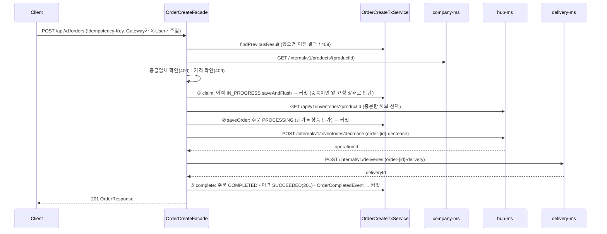
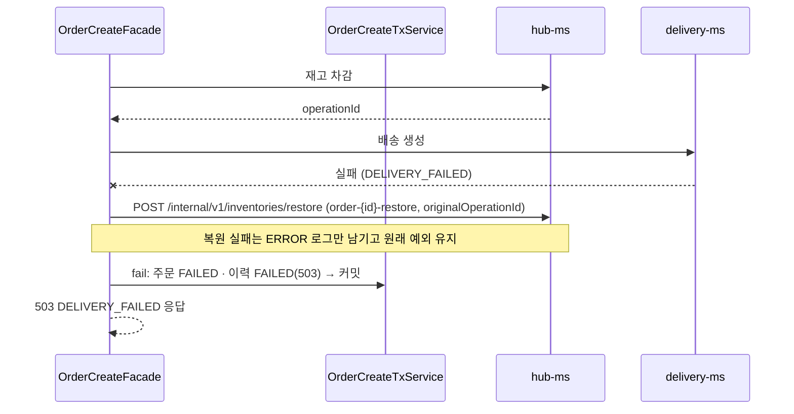
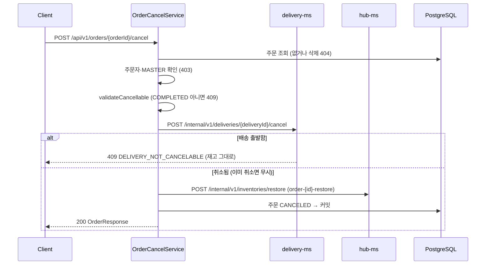
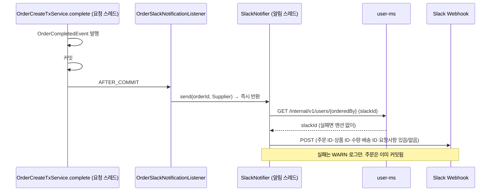
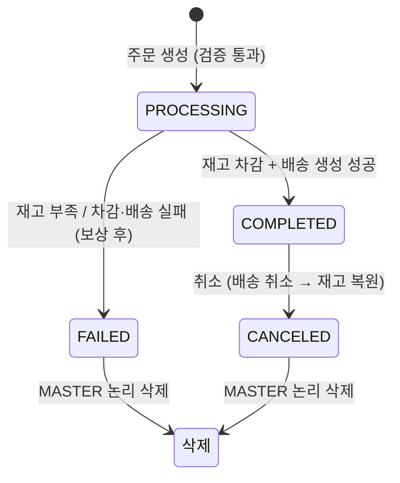

# Order 도메인 구현 설명

> 작성자: 다울 · 기준: `dev` 186ae33 · 모듈: `order-ms` (스키마 `orders`, 테이블 `p_orders`·`p_order_histories`)
> 1부는 **무엇을 왜 이렇게 만들었는지**(설계 결정·대안·트러블슈팅), 2부는 **요청이 어떻게 흐르는지**, 3부는 **코드를 어디서 찾는지**(계층·API·오류 코드·설정·테스트)입니다.
> 알림 발송 라이브러리는 [[NTF 주문 알림 설계]], 원격 호출 실패 분류는 [[SYS-13 장애 대응 설계]], 재고 API 계약은 [[Hub-MS Feign 연동 사용법]]을 봅니다.

## 목차

- [1부. 설계 결정](#1부-설계-결정)
- [2부. 요청 흐름](#2부-요청-흐름)
- [3부. 코드 구조](#3부-코드-구조)

---

## 한눈에 보기

| 항목 | 내용 |
|---|---|
| 역할 | 주문 생성(Saga 오케스트레이터), 조회·목록, 취소, 논리 삭제, 주문 완료 Slack 알림 |
| 권한 | 생성: 로그인 사용자 · 조회·취소: 주문자 본인·MASTER · 삭제: MASTER |
| 부르는 서비스 | company-ms(상품 단가·공급업체 확인), hub-ms(재고 조회·차감·복원), delivery-ms(배송 생성·취소), user-ms(주문자 slackId, 알림 시) |
| 부르는 쪽 | 없음 (Gateway를 거친 클라이언트만) |

| 항목 | 내용 |
|---|---|
| Saga | Order가 조정하는 **동기 Orchestration Saga**. 상품 조회(공급업체·가격 확인) → 재고 조회 → 주문 저장 → 재고 차감 → 배송 생성 → 완료. 실패하면 보상(배송 취소·재고 복원) 후 `FAILED`. 원격 호출은 **DB 트랜잭션 밖**, DB 작업만 짧은 트랜잭션 |
| 멱등성 | 클라이언트 `Idempotency-Key` + 요청 해시(SHA-256)로 중복 주문 차단. 키는 원격 호출 전에 **선점(즉시 커밋)**해 동시 요청도 막음. 하위 호출도 `order-{orderId}-decrease·-restore·-delivery` 키를 보냄 |
| 구조 | 4계층 + DIP. 원격 호출은 domain 인터페이스(`HubClient`·`DeliveryClient`·`ProductClient`·`UserClient`), Feign 구현은 infrastructure. `stub` 프로필로 다른 서비스 없이 단독 실행 |
| 알림 | 주문 `COMPLETED` **커밋 후** 비동기 발송. Slack·user-ms 장애가 주문에 영향 없음 |
| 테스트 | 테스트 클래스 11개, 테스트 메서드 60개(파라미터 테스트 포함). Mockito 단위 테스트 + 트랜잭션 경계·유니크 제약 확인용 `@SpringBootTest`(H2) |

---

# 1부. 설계 결정

## 1.1 요구사항 해석

발제·설계 문서의 빈칸이나 충돌을 구현 규칙으로 정한 결정입니다. 정책 원문은 [[07 서비스 정책]] 5장에 있습니다.

| 결정 | 내용 | 이유 |
|---|---|---|
| 주문 생성 응답은 `201` (정책 #11) | 설계의 `202 Accepted` 대신 Saga를 끝까지 처리하고 **최종 상태(COMPLETED)를 담아 201** | 서비스 간 통신이 Feign 동기 호출이라 비동기 응답을 줄 근거가 없음. 202면 처리 결과 조회 흐름을 따로 만들어야 함 |
| 1주문 = 1상품 | 요청 본문에 상품 1개·수량 | 설계 그대로 |
| 단가는 **상품 테이블 값**으로 저장 | 요청의 `unitPrice`는 "사용자가 본 가격" 확인용. 저장하는 `unitPriceSnapshot`은 company-ms에서 조회한 값 | 클라이언트가 보낸 가격을 믿으면 0원 주문이 가능. 가격이 바뀌었으면 409로 알려 사용자가 새 가격을 보고 다시 주문 |
| 상품이 공급업체 소유인지 확인 | 상품의 `companyId` ≠ 요청 `supplierCompanyId`면 400 `SUPPLIER_PRODUCT_MISMATCH` | 정책 5.1 "상품이 공급업체 소유인지". 다른 업체 상품으로 주문하는 것을 막음 |
| 차감 허브 = **재고가 충분한 첫 허브** | hub-ms 재고 목록 중 `quantity >= 주문 수량`인 첫 허브에서 차감, 그 허브가 배송 출발 허브 | 공급업체 관리 허브만 쓰면 그 허브 재고가 없을 때 다른 허브 재고가 있어도 주문 실패. 허브 선택 규칙(가까운 허브 등)은 다음 개선 |
| 조회·취소 = 주문자 본인·MASTER | `p_orders.ordered_by == 로그인 사용자`. 다른 USER는 403 | 정책 5.4. "주문 관계자"(업체 관리자 등)까지 넓히려면 company·user 조회가 필요해 제외 |
| 취소 가능 조건 (정책 #8) | `COMPLETED` 주문만. 배송 **출발 전**만(배송 상태는 delivery-ms가 판단, 출발 후 409) | 출발한 물건의 재고를 되돌리면 실물과 재고가 어긋남 |
| 취소 순서 = 배송 취소 → 재고 복원 → `CANCELED` | 배송이 취소된 것을 확인한 뒤 재고를 돌려놓음 | 재고를 먼저 복원하면 배송 취소가 거절될 때(이미 출발) 실물 없이 재고만 늘어남 |
| 삭제 = MASTER, `CANCELED`·`FAILED`만 | 진행 중·완료 주문은 409 `ORDER_NOT_DELETABLE`. Gateway + 컨트롤러 `requireMaster()` | 살아 있는 배송이 연결된 주문을 지우면 배송만 남음. 끝난 주문만 정리 대상 |
| 존재·삭제 확인이 권한보다 먼저 | 없거나 삭제된 주문은 권한과 관계없이 404 | 다른 서비스와 같은 순서(존재 → 권한) |
| 주문 수정 없음 | 도전과제로 분류, 구현하지 않음 | 수정하려면 재고·배송까지 다시 맞춰야 해 Saga가 하나 더 필요 |

## 1.2 왜 동기 Saga이고, 트랜잭션은 어떻게 잡았나

다섯 서비스는 DB가 따로라 한 트랜잭션으로 롤백할 수 없습니다. Order가 각 단계를 순서대로 부르고, 실패하면 **이미 바뀐 것을 되돌리는 보상**을 직접 호출합니다.

| 결정 | 내용 | 이유 |
|---|---|---|
| Orchestration (Order가 조정) | 각 서비스는 자기 로컬 트랜잭션만. 흐름과 보상은 `OrderCreateFacade.createOrder` 한 곳 | 메시지 브로커가 없고, 흐름이 한 메서드에 보여 디버깅·발표가 쉬움 |
| **Facade + TxService로 분리** (#78) | `OrderCreateFacade`: 원격 호출·보상만, `@Transactional` 없음. `OrderCreateTxService`: 저장소만 쓰는 짧은 트랜잭션 ① 이력 선점 → ② 주문 `PROCESSING` 저장 → ③ 확정(`COMPLETED`) 또는 실패(`FAILED`) 기록 | 원격 응답(최대 수 초)을 기다리는 동안 DB 커넥션을 잡지 않음. 동시 주문이 몰려도 Hikari 풀(기본 10)이 원격 대기로 고갈되지 않음 |
| 실패도 커밋 | 실패 기록(③)은 별도 트랜잭션이라 업무 실패여도 **`FAILED` 주문과 이력이 남음** | 실패 원인 추적과 멱등 재요청 판단(`PREVIOUS_REQUEST_NOT_SUCCEEDED`)에 필요 |
| 원래 예외를 그대로 던짐 | 보상·실패 기록 후 `throw e` | 클라이언트는 실제 원인(409 재고 부족, 503 배송 실패)을 받음 |
| 보상·기록 실패는 원래 예외를 덮지 않음 | 배송 취소·재고 복원·실패 기록이 실패해도 ERROR 로그만 (`*Safely`) | 사용자에게 의미 있는 건 주문 실패 원인. 보상 실패는 운영자가 로그로 처리 |

| 대안 | 채택하지 않은 이유 |
|---|---|
| 비동기 Saga(202 + 상태 조회) | 메시지 브로커가 없음. 완료·실패 내부 API(`/orders/{id}/complete`·`/fail`)도 필요해짐 |
| 메서드 전체를 `@Transactional(noRollbackFor = BusinessException.class)` 하나로 (초기 구현) | FAILED는 남지만 원격 호출 내내 커넥션을 점유하고, 이력 INSERT가 커밋 시점으로 미뤄져 같은 키의 동시 요청을 원격 호출 전에 막지 못함 (트러블슈팅 ①·⑤) |
| 같은 빈 안에서 `@Transactional` 메서드 호출 | 자기 호출(self-invocation)은 프록시를 거치지 않아 트랜잭션이 적용되지 않음. 그래서 TxService를 별도 빈으로 둠 |

## 1.3 멱등성: 같은 주문이 두 번 만들어지지 않게

네트워크가 끊겨 클라이언트가 다시 보내도 주문·재고 차감·배송이 한 번만 일어나야 합니다.

**클라이언트 → Order**

| 결정 | 내용 | 이유 |
|---|---|---|
| `Idempotency-Key` 헤더 필수 | 120자 이하. `p_order_histories`에 `UNIQUE(operation_type, idempotency_key)` | 같은 키의 두 번째 요청을 DB 수준에서 구분 |
| **원격 호출 전에 키 선점** | `claim()`이 `IN_PROGRESS` 이력을 `saveAndFlush`로 바로 INSERT·커밋. 유니크 위반은 `DuplicateOrderRequestException`으로 바꾸고, 새 트랜잭션에서 앞 요청 상태를 다시 봐서 성공이면 그 결과, 아니면 409 `PREVIOUS_REQUEST_NOT_SUCCEEDED` | 같은 키로 동시에 두 번 눌러도 먼저 선점한 요청만 재고·배송을 건드림. 실서비스 검증: 같은 키 동시 20건 → 201 1건, 409 19건, 재고 1회만 차감 |
| 요청 해시 비교 | 본문 + 주문자를 이어 붙여 SHA-256. 키는 해시에서 제외. 단가는 `stripTrailingZeros()`로 `1000`과 `1000.00`을 같게 | 같은 키로 **다른 내용**이 오면 실수이므로 409 `IDEMPOTENCY_KEY_CONFLICT`. 주문자를 넣어 다른 사용자가 같은 키를 써도 남의 주문 결과를 받아 가지 않음 |
| 이전 요청이 성공했을 때만 결과 재응답 | 같은 키 + 같은 내용 + `SUCCEEDED` → 원격 호출 없이 이전 주문 반환 (201) | 응답만 유실된 재요청에 같은 결과를 줌 |
| 진행 중·실패한 키는 409 | `PREVIOUS_REQUEST_NOT_SUCCEEDED`. 다시 주문하려면 새 키 | 실패한 키를 재사용해 자동 재시도하면 실패 원인이 남은 상태에서 또 재고를 건드림 |
| **검증은 이력 선점 전** | 상품 조회·공급업체·가격 확인에서 거절되면 이력·주문을 남기지 않음 | `@Valid` 400처럼 "처리 전 거절"로 취급. 가격만 고쳐 **같은 키로 다시 주문**할 수 있음 |

**Order → 하위 서비스**

| 호출 | 키 | 하위 서비스 동작 |
|---|---|---|
| 재고 차감 | `order-{orderId}-decrease` | 같은 키면 처음 결과(작업 ID 포함)를 그대로 반환 |
| 재고 복원 | `order-{orderId}-restore` + 본문 `originalOperationId` | 원본 차감 수량만큼 한 번만 복원. 이미 복원됐으면 409 `INVENTORY_ALREADY_RESTORED` → Order는 **성공으로 해석** |
| 배송 생성 | `order-{orderId}-delivery` | 같은 주문으로 배송 중복 생성 방지 |

키를 주문 ID로 만든 이유는 **Order가 다시 보낼 때 같은 키를 다시 만들 수 있어야** 하기 때문입니다. 무작위 키면 재전송 때 새 작업으로 처리됩니다.

## 1.4 실패 보상: "결과를 모를 때"가 가장 어렵다

재고 차감은 세 가지로 끝납니다. 차감됨, 거절됨(확실히 안 빠짐), **모름**(타임아웃·5xx). 보상은 이 셋을 구분해야 합니다.

| 상황 | 판단 | 보상 |
|---|---|---|
| 차감 성공 후 배송 실패 | 작업 ID를 알고 있음 | 그 ID로 복원 |
| 배송까지 만든 뒤 확정(`COMPLETED`) 커밋 실패 | 배송·재고 모두 바뀜 | **배송 취소 → 재고 복원** 후 `FAILED` |
| 차감 거절 (`INSUFFICIENT_STOCK`, `INVENTORY_NOT_FOUND`) | 확실히 안 빠짐 | 복원 안 함, 409 |
| 차감 결과 모름 (5xx·타임아웃 → 503 `INVENTORY_UNAVAILABLE`) | 빠졌을 수도 있음 | **같은 키로 차감을 다시 보내** hub에 기록된 결과를 확인 → 성공 기록이 있으면 그 작업 ID로 복원, 없으면 복원 호출 안 함 |

- `stockMayBeDecreased` 플래그: 차감 요청을 보내기 직전에 `true`, 거절이 확실하면 `false`. `catch`에서 이 값으로 복원 여부를 정합니다.
- 결과 확인 재전송이 안전한 이유: hub-ms가 같은 키에 처음 결과를 돌려주기 때문입니다(새로 차감하지 않음).
- 주문 상태는 보상 후 `FAILED`, 이력은 `FAILED` + 응답 코드 + 오류 메시지(`last_error`). 실패 기록마저 실패하면 이력은 `IN_PROGRESS`로 남고 ERROR 로그로 추적합니다.
- 배송 생성 호출 자체가 실패(타임아웃 포함)하면 재고만 복원하고 배송 취소는 하지 않습니다. delivery-ms가 실제로는 배송을 만들었을 수 있어, 같은 키 재확인 후 취소하는 것은 다음 개선입니다([[SYS-13 장애 대응 설계]] 8.1).

## 1.5 가격·공급업체 검증과 단가 스냅샷

| 결정 | 내용 | 이유 |
|---|---|---|
| company-ms **내부 API**로 조회 | `GET /internal/v1/products/{productId}` (조회수·캐시 없음) | 공개 상세 API는 조회수를 올리고, 캐시된 옛 단가가 올 수 있음 |
| 404는 그대로 전달 | 없거나 삭제된 상품 404 `PRODUCT_NOT_FOUND`, 소속 업체 삭제 404 `COMPANY_NOT_FOUND` | company-ms의 판단을 바꾸지 않음. 이력 선점 전이라 아무것도 남지 않음 |
| `compareTo`로 비교 | `ProductInfo.isPricedAt` | `BigDecimal.equals`는 `1000`과 `1000.00`을 다르게 봄 |
| 409 메시지에 현재 가격 | `상품 가격이 변경되었습니다. (요청: 900, 현재: 1000.00)` | 사용자가 새 가격을 바로 확인하고 다시 주문 |
| 스냅샷 저장 | `unit_price_snapshot` = 조회한 단가, `total_amount` = 단가 × 수량 | 이후 상품 가격이 바뀌어도 과거 주문 금액 유지 |
| 수량·금액 규칙은 3단계 | 요청 DTO(`@Positive`·`@PositiveOrZero`) → 도메인(`Order.create`) → DB(`CHECK`) | DTO를 거치지 않는 경로(다른 코드, 테스트 데이터)로 만들어도 규칙이 깨지지 않음 |

## 1.6 취소와 삭제

**취소** (`OrderCancelService`)

| 결정 | 내용 | 이유 |
|---|---|---|
| 상태 확인을 원격 호출보다 먼저 | `validateCancellable()`: `COMPLETED`이고 `stockOperationId`가 있어야 함 | 취소할 수 없는 주문이면 배송·재고를 건드리지 않고 409 |
| `stockOperationId` 저장 | 완료 시 `complete(deliveryId, stockOperationId)`로 차감 작업 ID 보관 | hub-ms 복원 API가 원본 차감 ID를 요구함 |
| 출발한 배송은 409 그대로 | delivery-ms의 `DELIVERY_NOT_CANCELABLE`을 바꾸지 않고 전달 | "이미 출발했다"는 이유를 사용자가 알아야 함 |
| 중간 실패 시 같은 요청으로 이어서 | 배송 취소(이미 취소면 무시)·재고 복원(이미 복원이면 성공) 모두 멱등. 실패하면 트랜잭션 롤백으로 주문은 `COMPLETED` 유지 | 사용자가 취소를 다시 누르면 남은 단계만 진행됨 |

**삭제** (`OrderDeleteService`)

- `BaseEntity.softDelete(actorId)`로 `deleted_at`·`deleted_by` 기록. 조회·목록·취소는 `deleted_at IS NULL`만 봅니다(`findActiveById`, `findAllActive*`).
- 이미 삭제된 주문을 다시 지우면 404입니다. 최초 삭제자·시각이 바뀌지 않습니다.
- 삭제 조건은 `@SQLRestriction`으로 숨기지 않고 `findByIdAndDeletedAtIsNull`처럼 쿼리 이름에 드러냈습니다. 어떤 조회가 삭제된 주문을 제외하는지 포트(`findActiveById`, `findAllActive*`)만 보고 알 수 있습니다.
- `p_order_histories`는 지우지 않습니다(멱등성 보장, 정책 2장).

## 1.7 주문 완료 Slack 알림

발송 기능은 common `SlackNotifier`(대진)가, **언제·누구에게·무엇을**은 order-ms가 정합니다.

| 결정 | 내용 | 이유 |
|---|---|---|
| 이벤트로 분리 | 확정 트랜잭션(`OrderCreateTxService.complete`)에서 `OrderCompletedEvent` 발행, 리스너가 발송 | Saga 코드가 Slack을 모름. 알림을 바꿔도 Saga 코드는 그대로 |
| `@TransactionalEventListener(AFTER_COMMIT)` | 주문 `COMPLETED`가 **커밋된 뒤에만** 발송 | 커밋 전에 보내면 롤백·FAILED 주문에도 알림이 감 |
| slackId 조회도 알림 스레드에서 | `send(ref, Supplier)`라 Supplier 안의 user-ms 호출이 발송 스레드에서 실행 | 응답 스레드가 user-ms를 기다리지 않음 |
| 조회 실패 = 멘션 없이 발송 | user-ms 404·5xx·타임아웃은 `Optional.empty()` | 멘션보다 알림 자체가 중요 |
| 요청사항은 "있음/없음"만 | 원문·연락처·주소 제외 | 채널 공개 메시지에 개인정보가 섞이지 않게 |
| 이벤트에는 엔티티가 아니라 값만 | `OrderCompletedEvent`는 ID·수량·요청사항 유무만 담은 record | 커밋 후 다른 스레드에서 쓰이므로 영속성 컨텍스트가 닫힌 엔티티(지연 로딩 위험)를 넘기지 않음 |
| 실패해도 주문 영향 없음 | Webhook URL이 없으면 NoOp, 실패는 WARN 로그만, 재시도 없음 | NTF-02 결정 |

메시지 항목: 주문 ID, 상품 ID, 수량, 배송 ID, 요청사항 있음/없음, 주문자 멘션. 상품명·업체명·허브명은 원격 조회가 늘어 이번 범위에서 제외했습니다(다음 개선).

## 1.8 트러블슈팅

### ① 실패한 주문이 DB에 남지 않았다

- **현상**: 재고 부족으로 주문이 실패하면 `FAILED` 주문과 이력이 남아야 하는데 테이블이 비어 있었습니다.
- **원인**: `@Transactional`은 런타임 예외가 나면 트랜잭션 전체를 롤백합니다. `catch`에서 `order.fail()`·`history.fail()`을 해도 마지막에 예외를 다시 던지므로 함께 롤백됐습니다.
- **1차 해결**: `noRollbackFor = BusinessException.class`로 업무 실패는 상태를 기록한 채 커밋했습니다. `stub` 프로필 없이 실행해 hub-ms 연결 실패(503)를 일부러 내고, DB에 `FAILED` 주문과 `responseCode=503` 이력이 남는 것을 확인했습니다.
- **현재**: 트랜잭션을 나눈 뒤(#78)에는 실패 기록이 **별도 트랜잭션**(`OrderCreateTxService.fail`)이라 롤백 규칙에 기대지 않고 항상 커밋됩니다.
- **검증**: `OrderCreateTransactionBoundaryTest.failureIsCommitted` (H2, 배송 실패 시 `FAILED`가 커밋되는지).

### ② 재고 차감이 타임아웃되면 복원할 방법이 없었다 (#61)

- **현상**: hub-ms 복원 API가 `originalOperationId`(원본 차감 작업 ID)를 요구하도록 계약이 확정됐습니다. 그런데 차감이 타임아웃되면 Order는 작업 ID를 받지 못합니다.
- **위험**: 실제로는 차감됐는데 복원하지 못하면 재고가 영구히 줄어듭니다.
- **해결**: 결과를 모르면 **같은 멱등 키로 차감을 다시 보내** hub-ms에 기록된 결과(작업 ID)를 받아 복원합니다(1.4). hub-ms가 같은 키에 처음 결과를 돌려준다는 계약(P2)에 기대는 방식입니다.
- **검증**: `OrderCreateFacadeTest.createOrderRestoresStockWhenDecreaseResultUnknown`. 첫 차감은 503, 두 번째(같은 키)는 성공 결과를 주도록 연속 스텁(`willThrow().willReturn()`)하고, 복원 명령에 확인된 작업 ID가 담겼는지 검증합니다.

### ③ 가격을 바꿔 보냈는데 `PRICE_CHANGED`가 아니라 `IDEMPOTENCY_KEY_CONFLICT`가 나왔다

- **현상**: Postman에서 가격 검증을 테스트하는데 409 `IDEMPOTENCY_KEY_CONFLICT`만 나왔습니다.
- **원인**: 앞 테스트에서 성공한 키를 재사용했습니다. 처리 순서가 **멱등성 확인 → 상품·가격 확인**이라, 같은 키 + 다른 본문은 가격을 보기 전에 충돌로 끝납니다.
- **정리**: 의도한 순서입니다. 이미 처리된 키인지가 먼저이고, 새 요청일 때만 검증합니다. 테스트마다 키를 바꾸도록 테스트 시나리오를 고쳤습니다.

### ④ 다른 서비스 없이 order-ms를 실행할 수 없었다

- **현상**: hub·delivery·company가 아직 개발 중이라 order-ms만 띄우면 Feign 호출이 모두 503이었습니다.
- **해결**: domain 포트마다 `@Profile("stub")` 가짜 구현(`StubHubClient` 등)을 두고, 실제 구현은 `@Profile("!stub")`. 코드 수정 없이 `--spring.profiles.active=stub`으로 컨트롤러 → DB까지 확인했습니다. DIP 덕분에 Saga 코드는 바뀌지 않습니다.

### ⑤ 같은 키로 동시에 보내면 재고가 두 번 빠질 수 있었다 (#78)

- **현상**: 같은 `Idempotency-Key`로 요청 두 개가 거의 동시에 오면, 둘 다 "이전 이력 없음"을 보고 진행했습니다.
- **원인**: 이력을 `save()`해도 JPA가 INSERT를 **커밋 시점까지 미뤄**, 유니크 제약 위반이 재고 차감·배송 생성이 끝난 뒤에야 터졌습니다. 진 쪽은 주문이 롤백돼도 이미 빠진 재고와 만든 배송은 남습니다. 커밋 시점 예외라 `catch`의 보상도 타지 않았습니다.
- **해결**: 이력 선점을 별도 트랜잭션에서 `saveAndFlush`로 즉시 반영하고, 유니크 위반을 `DuplicateOrderRequestException`으로 바꿔 **원격 호출 전에** 거절합니다(1.3).
- **검증**: `OrderCreateTransactionBoundaryTest.claimRejectsDuplicateKey`(실제 유니크 제약), `OrderCreateFacadeTest.createOrderStopsBeforeRemoteCallsWhenKeyTakenConcurrently`, 실서비스에서 같은 키 동시 20건 → 재고 1회만 차감.

## 1.9 그 밖의 설계 포인트

- **`COMPLETED`는 "배송 완료"가 아님**: 재고 확보와 배송 생성까지 끝났다는 뜻입니다. 실제 배송 진행·완료는 delivery-ms의 배송 상태가 관리하고, 주문은 배송 상태를 따라 바뀌지 않습니다. 그래서 취소 가능 여부(출발 전인지)도 주문이 아니라 delivery-ms가 판단합니다.
- **보상과 취소가 같은 복원 키를 씀**: 생성 실패 보상과 주문 취소 모두 `order-{orderId}-restore`입니다. 보상한 주문은 `FAILED`라 취소할 수 없으므로 한 주문에서 두 복원이 겹치지 않고, 어느 쪽이든 재시도하면 hub-ms가 같은 결과를 돌려줍니다.
- **재고 부족은 공통 코드, 메시지만 주문용**: hub-ms와 같은 `InventoryErrorCode.INSUFFICIENT_STOCK`을 쓰고 메시지만 "재고가 부족하여 주문할 수 없습니다."로 줍니다. 허브 선택 단계에서 부족하든 차감 단계에서 거절되든 클라이언트는 같은 코드를 받습니다.


---

# 2부. 요청 흐름

## 2.1 주문 생성 (성공)



원격 호출(company·hub·delivery) 사이에는 열린 DB 트랜잭션이 없습니다.

## 2.2 주문 생성 (실패와 보상)

| 실패 지점 | 응답 | 주문 | 이력 | 재고 복원 |
|---|---|---|---|---|
| 같은 키 + 다른 내용 | 409 `IDEMPOTENCY_KEY_CONFLICT` | - | 기존 그대로 | - |
| 같은 키, 이전 요청 진행 중·실패 | 409 `PREVIOUS_REQUEST_NOT_SUCCEEDED` | - | 기존 그대로 | - |
| 같은 키 동시 요청 (선점 실패) | 앞 요청이 성공했으면 그 결과, 아니면 409 `PREVIOUS_REQUEST_NOT_SUCCEEDED` | - | 앞 요청 것만 | - |
| 상품 없음·업체 삭제 | 404 `PRODUCT_NOT_FOUND` / `COMPANY_NOT_FOUND` | 없음 | 없음 | - |
| 공급업체 불일치 | 400 `SUPPLIER_PRODUCT_MISMATCH` | 없음 | 없음 | - |
| 가격 변경 | 409 `PRICE_CHANGED` | 없음 | 없음 | - |
| 충분한 재고의 허브 없음 | 409 `INSUFFICIENT_STOCK` | 없음 | `FAILED` | - |
| 차감 거절 (부족·재고 없음) | 409 `INSUFFICIENT_STOCK` | `FAILED` | `FAILED` | 안 함 |
| 차감 결과 모름 (5xx·타임아웃) | 503 `INVENTORY_UNAVAILABLE` | `FAILED` | `FAILED` | 같은 키 재전송으로 확인 후 복원 |
| 배송 생성 실패 | 503 `DELIVERY_FAILED` | `FAILED` | `FAILED` | 작업 ID로 복원 |
| 배송 생성 후 확정 커밋 실패 | 원래 예외 (예: 500) | `FAILED` | `FAILED` | 배송 취소 → 복원 |



## 2.3 주문 취소



## 2.4 조회와 삭제

- **단건 조회** `GET /api/v1/orders/{orderId}`: 없거나 삭제 404 → 주문자·MASTER가 아니면 403 → 200.
- **목록 조회** `GET /api/v1/orders`: MASTER는 삭제되지 않은 전체, 그 외는 `ordered_by = 본인`만. 공통 `PagePolicy`(기본 `size=10`, 최대 100, `createdAt DESC` + 보조 `id ASC`), 정렬은 `createdAt`·`totalAmount`만 허용(그 밖은 400 `INVALID_SORT_PROPERTY`). 응답은 공통 `PageResponse`.
- **삭제** `DELETE /api/v1/orders/{orderId}`: `requireMaster()`(403) → 없거나 삭제 404 → `CANCELED`·`FAILED`가 아니면 409 → 논리 삭제 → 204.

## 2.5 주문 완료 알림



## 2.6 order-ms가 부르는 서비스

```
order-ms ──Feign──▶ company-ms  GET  /internal/v1/products/{productId}        (단가·공급업체 확인)
order-ms ──Feign──▶ hub-ms      GET  /api/v1/inventories?productId={id}      (차감할 허브 선택)
order-ms ──Feign──▶ hub-ms      POST /internal/v1/inventories/decrease       (재고 차감)
order-ms ──Feign──▶ hub-ms      POST /internal/v1/inventories/restore        (보상·취소 시 복원)
order-ms ──Feign──▶ delivery-ms POST /internal/v1/deliveries                 (배송 생성)
order-ms ──Feign──▶ delivery-ms POST /internal/v1/deliveries/{id}/cancel     (주문 취소)
order-ms ┄┄Feign┄┄▶ user-ms     GET  /internal/v1/users/{userId}             (slackId, 커밋 후 비동기)
order-ms ┄┄HTTP┄┄┄▶ Slack       Incoming Webhook                             (주문 완료 알림, 커밋 후 비동기)
```

실선은 주문 처리 중 동기 호출, 점선은 커밋 후 알림 스레드의 호출입니다. 재고 목록은 hub-ms에 내부 조회 API가 없어 공개 API(`/api/v1/inventories`)를 사용자 헤더와 함께 부릅니다(내부 API 전환 예정). 원격 호출은 모두 common `RemoteCallTemplate`을 거쳐 4xx는 `RemoteBusinessException`(하위 코드 유지), 5xx·연결 실패는 503, 타임아웃은 504로 분류됩니다.

---

# 3부. 코드 구조

## 3.1 계층

```
presentation → application → domain ← infrastructure
```

| 계층 | 패키지 (`com.order.`) | 주요 클래스 |
|---|---|---|
| presentation | `presentation.controller` | `OrderController` |
| | `presentation.dto` | `CreateOrderRequest`, `OrderResponse` |
| application | `application.service` | `OrderCreateFacade`(생성 Saga·보상, 트랜잭션 없음), `OrderCreateTxService`(생성의 짧은 트랜잭션), `OrderQueryService`(`readOnly`), `OrderCancelService`, `OrderDeleteService` |
| | `application.dto` | `CreateOrderCommand`(요청 해시 계산), `OrderResult` |
| | `application.event` | `OrderCompletedEvent`, `OrderSlackNotificationListener` |
| domain | `domain.entity` | `Order`, `OrderHistory` |
| | `domain.vo` | `OrderStatus`, `OrderOperationType`, `OrderOperationStatus` |
| | `domain.repository` | 포트 `OrderRepository`, `OrderHistoryRepository`(`saveAndFlush`로 선점) |
| | `domain.exception` | `DuplicateOrderRequestException` (같은 키 선점 실패) |
| | `domain.client` | 포트 `HubClient`, `DeliveryClient`, `ProductClient`, `UserClient` + 명령·결과 record (`StockDecreaseCommand`, `StockRestoreCommand`, `StockOperationResult`, `InventoryInfo`, `CreateDeliveryCommand`, `DeliveryResult`, `ProductInfo`) |
| infrastructure | `infrastructure.persistence` | `OrderRepositoryImpl`·`OrderJpaRepository`, `OrderHistoryRepositoryImpl`(유니크 제약 `uk_order_histories_operation_key` 위반 → `DuplicateOrderRequestException`)·`OrderHistoryJpaRepository` |
| | `infrastructure.client.{hub,delivery,product,user}` | `*ClientImpl`, `*FeignClient`, Feign 요청·응답 DTO |
| | `infrastructure.client.stub` | `StubHubClient`, `StubDeliveryClient`, `StubProductClient`, `StubUserClient` |

**포트와 구현 (DIP)**

| 도메인 포트 | 구현 | 실패 변환 |
|---|---|---|
| `HubClient.findInventories` | `HubClientImpl` | 5xx·타임아웃 → 503 `INVENTORY_UNAVAILABLE` |
| `HubClient.decreaseStock` | `HubClientImpl` | `INSUFFICIENT_STOCK`·`INVENTORY_NOT_FOUND` → 거절 결과(예외 아님), 그 밖의 4xx 그대로, 5xx·타임아웃 → 503 `INVENTORY_UNAVAILABLE` |
| `HubClient.restoreStock` | `HubClientImpl` | `INVENTORY_ALREADY_RESTORED` → 성공 |
| `DeliveryClient.createDelivery` | `DeliveryClientImpl` | 모든 실패 → 503 `DELIVERY_FAILED` (원인은 `cause`로 보존) |
| `DeliveryClient.cancelDelivery` | `DeliveryClientImpl` | 409 `DELIVERY_NOT_CANCELABLE` 그대로, 5xx·타임아웃 → 503 `DELIVERY_UNAVAILABLE` |
| `ProductClient.getProduct` | `ProductClientImpl` | 변환 없음 (404 그대로, 503·504) |
| `UserClient.findSlackId` | `UserClientImpl` | 모든 실패 → `Optional.empty()` |

> 각 `*ClientImpl`은 `@Profile("!stub")`, Stub은 `@Profile("stub")`입니다. 같은 포트에 빈이 하나만 뜹니다.

## 3.2 도메인 모델

**`Order`** (`p_orders`)

| 필드 | 컬럼 | 설명 |
|---|---|---|
| `id` | `id` UUID | PK (`GenerationType.UUID`) |
| `requesterCompanyId` | `requester_company_id` UUID | 받는 업체 (FK 없음) |
| `supplierCompanyId` | `supplier_company_id` UUID | 보내는 업체 (FK 없음) |
| `productId` | `product_id` UUID | 상품 (FK 없음) |
| `quantity` | `quantity` INTEGER | `CHECK > 0` |
| `unitPriceSnapshot` | `unit_price_snapshot` NUMERIC(15,2) | 주문 시점 상품 단가, `CHECK >= 0` |
| `totalAmount` | `total_amount` NUMERIC(15,2) | 단가 × 수량, `CHECK >= 0` |
| `deliveryId` | `delivery_id` UUID | 배송 (UNIQUE, 완료 시 저장) |
| `requestNote` | `request_note` TEXT | 요청사항 (NULL 가능) |
| `orderStatus` | `order_status` VARCHAR(24) | `PROCESSING`·`COMPLETED`·`FAILED`·`CANCELED` |
| `orderedBy` | `ordered_by` UUID | 주문자 (`X-User-Id`) |
| `stockOperationId` | `stock_operation_id` UUID | hub-ms 차감 작업 ID (취소 시 복원) |
| `BaseEntity` | `created_*`, `updated_*`, `deleted_*` | 감사 컬럼·논리 삭제 |

| 메서드 | 규칙 |
|---|---|
| `create` | 수량 1 이상(`INVALID_QUANTITY`), 단가 0 이상(`INVALID_UNIT_PRICE`), 총액 계산, `PROCESSING` |
| `complete(deliveryId, stockOperationId)` | `PROCESSING`만 (`ORDER_NOT_PROCESSING`) → `COMPLETED` |
| `fail()` | `PROCESSING`만 → `FAILED` |
| `validateCancellable()` / `cancel()` | `COMPLETED` + 작업 ID 있음만 (`ORDER_NOT_CANCELLABLE`) → `CANCELED` |
| `delete(actorId)` | `CANCELED`·`FAILED`만 (`ORDER_NOT_DELETABLE`) → `softDelete` |
| `isOrderedBy(userId)` | 조회·취소 권한 판단 |



**`OrderHistory`** (`p_order_histories`): 주문 상태 이력이 아니라 **멱등성 요청 처리 기록**입니다.

| 필드 | 컬럼 | 설명 |
|---|---|---|
| `id` | `id` UUID | PK |
| `order` | `order_id` UUID | `@ManyToOne(LAZY)`, 주문 저장 전 실패면 NULL |
| `operationType` | `operation_type` VARCHAR(32) | `CREATE` (현재 생성만 기록) |
| `idempotencyKey` | `idempotency_key` VARCHAR(120) | `UNIQUE(operation_type, idempotency_key)` |
| `requestHash` | `request_hash` CHAR(64) | SHA-256 |
| `operationStatus` | `operation_status` VARCHAR(20) | `IN_PROGRESS`·`SUCCEEDED`·`FAILED` |
| `responseCode` | `response_code` INTEGER | 201, 409, 503 등 |
| `retryCount` / `lastError` | `retry_count` DEFAULT 0 / `last_error` TEXT | 재시도 횟수(현재 미사용), 실패 메시지 |

| 메서드 | 규칙 |
|---|---|
| `create` | `IN_PROGRESS`, 주문 미연결 |
| `linkOrder(order)` | 주문 저장 직후 연결 |
| `succeed(code)` / `fail(code, error)` | 이미 끝난 이력이면 `HISTORY_ALREADY_COMPLETED` |
| `isSameReqeust(hash)` / `isSucceeded()` | 재요청 판단 |

## 3.3 API

| Method · Path | 권한 | 처리 | 규칙 |
|---|---|---|---|
| POST `/api/v1/orders` | 로그인 | `OrderCreateFacade.createOrder` | 201. `Idempotency-Key` 필수(120자 이하) |
| GET `/api/v1/orders/{orderId}` | 주문자·MASTER | `OrderQueryService.getOrder` | 200, 404·403 |
| GET `/api/v1/orders` | 로그인 (MASTER 전체, 그 외 본인) | `OrderQueryService.getOrders` | 정렬 `createdAt`(기본 DESC)·`totalAmount` |
| POST `/api/v1/orders/{orderId}/cancel` | 주문자·MASTER | `OrderCancelService.cancelOrder` | 200, 본문 없음 |
| DELETE `/api/v1/orders/{orderId}` | MASTER | `OrderDeleteService.deleteOrder` | 204 |

모든 API는 Gateway가 넣은 `X-User-Id`·`X-User-Role`을 `@CurrentUser AuthUser`로 받습니다. 헤더가 없으면 common이 401로 막습니다.

**주문 생성 요청**

```http
POST /api/v1/orders
Authorization: Bearer {accessToken}
Idempotency-Key: 7f3c2a10-order-001
Content-Type: application/json
```

```json
{
  "requesterCompanyId": "aaaaaaaa-0000-0000-0000-000000000001",
  "supplierCompanyId": "bbbbbbbb-0000-0000-0000-000000000002",
  "productId": "cccccccc-0000-0000-0000-000000000003",
  "quantity": 10,
  "unitPrice": 1000,
  "requestNote": "오전 중 도착 부탁드립니다."
}
```

| 필드 | 검증 |
|---|---|
| `requesterCompanyId`, `supplierCompanyId`, `productId` | `@NotNull` |
| `quantity` | `@NotNull @Positive` |
| `unitPrice` | `@NotNull @PositiveOrZero`. 화면에 보인 가격. 현재 상품 단가와 다르면 409 |
| `requestNote` | 선택 |

**응답** (생성 201, 조회·취소 200 공통)

```json
{
  "orderId": "3fa85f64-5717-4562-b3fc-2c963f66afa6",
  "requesterCompanyId": "aaaaaaaa-0000-0000-0000-000000000001",
  "supplierCompanyId": "bbbbbbbb-0000-0000-0000-000000000002",
  "productId": "cccccccc-0000-0000-0000-000000000003",
  "quantity": 10,
  "unitPriceSnapshot": 1000.00,
  "totalAmount": 10000.00,
  "orderStatus": "COMPLETED",
  "deliveryId": "dddddddd-0000-0000-0000-000000000004"
}
```

## 3.4 오류 코드

| 상태 | 코드 | 언제 |
|---|---|---|
| 400 | `INVALID_INPUT` | 필수값 누락, 수량 0 이하, 음수 단가, `Idempotency-Key` 누락·120자 초과 |
| 400 | `INVALID_SORT_PROPERTY` | `createdAt`·`totalAmount` 외 정렬 |
| 400 | `INVALID_QUANTITY` / `INVALID_UNIT_PRICE` | 도메인 검증 (DTO를 거치지 않은 경로) |
| 400 | `SUPPLIER_PRODUCT_MISMATCH` | 상품의 업체 ≠ 요청 공급업체 |
| 401 | `UNAUTHENTICATED` | `X-User-*` 헤더 없음 (common) |
| 403 | `ACCESS_DENIED` | 주문자·MASTER 아님(조회·취소), MASTER 아님(삭제) |
| 404 | `ORDER_NOT_FOUND` | 없거나 삭제된 주문 |
| 404 | `PRODUCT_NOT_FOUND` / `COMPANY_NOT_FOUND` | company-ms 응답 그대로 |
| 409 | `PRICE_CHANGED` | 요청 단가 ≠ 현재 상품 단가 (메시지에 두 값) |
| 409 | `IDEMPOTENCY_KEY_CONFLICT` | 같은 키 + 다른 요청 내용 |
| 409 | `PREVIOUS_REQUEST_NOT_SUCCEEDED` | 같은 키의 이전 요청이 진행 중이거나 실패 |
| 409 | `INSUFFICIENT_STOCK` | 충분한 재고의 허브 없음, 차감 거절 (common `InventoryErrorCode`) |
| 409 | `ORDER_NOT_CANCELLABLE` | `COMPLETED`가 아닌 주문 취소 |
| 409 | `DELIVERY_NOT_CANCELABLE` | 출발한 배송 (delivery-ms 그대로) |
| 409 | `ORDER_NOT_DELETABLE` | `CANCELED`·`FAILED`가 아닌 주문 삭제 |
| 409 | `ORDER_NOT_PROCESSING` / `HISTORY_ALREADY_COMPLETED` | 도메인 상태 위반 (정상 흐름에서는 나오지 않음) |
| 503 | `INVENTORY_UNAVAILABLE` | hub-ms 장애·타임아웃 (재고 조회·차감) |
| 503 | `DELIVERY_FAILED` | 배송 생성 실패 (재고 복원 후) |
| 503 | `DELIVERY_UNAVAILABLE` | 취소 중 delivery-ms 장애 |
| 503 / 504 | `SERVICE_UNAVAILABLE` / `SERVICE_TIMEOUT` | company-ms 상품 조회 실패, 취소 중 재고 복원 실패 (common) |

코드 정의는 common의 `OrderErrorCode`(재고 부족은 `InventoryErrorCode`, 권한·입력은 `CommonErrorCode`)에 있습니다.

## 3.5 설정 (`order-ms` application.yaml)

| 키 | 값 | 설명 |
|---|---|---|
| `server.port` | 19094 | |
| `db.schema` | `orders` | 서비스별 스키마 |
| `db.username` / `db.password` | `ORDER_DB_USER` / `ORDER_DB_PASSWORD` | `.env` |
| `spring.profiles.include` | `common` | Feign 타임아웃(연결 1초·응답 2초), Slack 설정 공통 사용 |
| Gateway `/api/v1/orders/**` | 응답 15초 | Saga 전체 시간을 고려 ([[SYS-13 장애 대응 설계]]) |
| `SLACK_WEBHOOK_URL` | `.env`에만 | 비어 있으면 알림 NoOp. **커밋 금지** |

```bash
./gradlew :order-ms:bootRun                                        # 실제 서비스 연동 (Eureka)
./gradlew :order-ms:bootRun --args='--spring.profiles.active=stub' # 다른 서비스 없이 단독 실행
```

## 3.6 테스트

| 계층 | 방식 | 테스트 |
|---|---|---|
| domain | 순수 단위 테스트 | `OrderTest`(13), `OrderHistoryTest`(5) |
| application | Mockito (`@ExtendWith(MockitoExtension.class)`), 포트를 mock | `OrderCreateFacadeTest`(13), `OrderCreateTxServiceTest`(9), `OrderQueryServiceTest`(6), `OrderCancelServiceTest`(4), `OrderDeleteServiceTest`(2), `OrderSlackNotificationListenerTest`(2) |
| 트랜잭션 경계 | `@SpringBootTest`(H2) + 원격 포트 `@MockitoBean` | `OrderCreateTransactionBoundaryTest`(3) |
| infrastructure | Mockito | `OrderHistoryRepositoryImplTest`(2): 멱등키 유니크 위반만 `DuplicateOrderRequestException`으로 변환 |
| 기동 | `@SpringBootTest` | `OrderMsApplicationTests`(1) |
| 수동 | Postman (`stub` 프로필 + 실제 연동) | 생성·가격 변경·공급업체 불일치·같은 키 재요청·취소·삭제·403·404 |

눈여겨볼 테스트:

- `OrderCreateTransactionBoundaryTest.remoteCallsRunOutsideTransaction`: 원격 포트가 호출될 때 `TransactionSynchronizationManager.isActualTransactionActive()`가 false이고, 그 전에 이력 선점이 커밋돼 있음.
- `OrderCreateTransactionBoundaryTest.claimRejectsDuplicateKey`: 실제 유니크 제약으로 같은 키 선점이 `DuplicateOrderRequestException` (트러블슈팅 ⑤).
- `OrderCreateFacadeTest.createOrderStopsBeforeRemoteCallsWhenKeyTakenConcurrently`·`...ReturnsResultOfConcurrentWinner`: 선점 실패 시 재고·배송 호출 0번, 앞 요청 결과 또는 409.
- `OrderCreateFacadeTest.createOrderRestoresStockWhenDecreaseResultUnknown`·`...SkipsRestoreWhenDecreaseConfirmedNotApplied`: 차감 결과 모름 → 같은 키 재전송 → 차감됐으면 복원, 안 됐으면 복원 안 함 (트러블슈팅 ②).
- `OrderCreateFacadeTest.createOrderCompensatesWhenCompleteFails`: 확정 커밋 실패 시 배송 취소 → 재고 복원 → `FAILED`.
- `OrderCreateFacadeTest.createOrderKeepsOriginalExceptionWhenCompensationFails`: 보상·실패 기록이 실패해도 원래 예외.
- `OrderCreateFacadeTest.createOrderFailsWhenPriceChanged`·`...SupplierMismatch`: 이력을 선점하지 않음 (`never()`).
- `OrderCancelServiceTest.cancelOrder`: `InOrder`로 배송 취소 → 재고 복원 순서 확인. 출발한 배송이면 복원 호출 0번.
- `OrderSlackNotificationListenerTest`: `Supplier`를 실행해 메시지 항목과 멘션 확인, slackId가 없으면 멘션 없이.

```bash
./gradlew :order-ms:test
```
