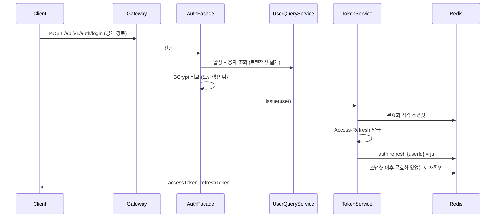
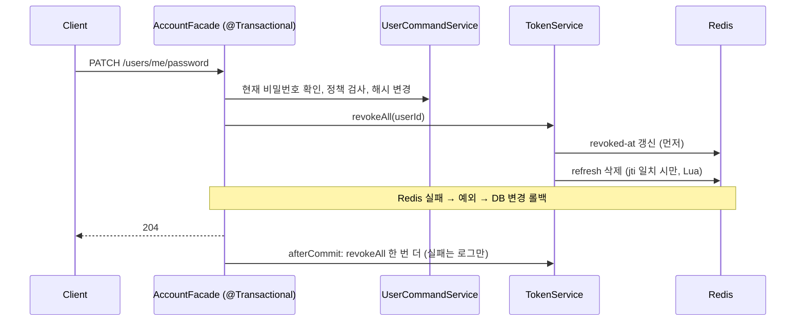

# User 도메인 구현 설명

> 작성자: 대진 · 기준: `dev` 7ded690 · 모듈: `user-ms` (스키마 `auth`)
> 1부는 **무엇을 왜 이렇게 만들었는지**(설계 결정·대안·트러블슈팅), 2부는 **요청이 어떻게 흐르는지**, 3부는 **코드를 어디서 찾는지**(계층·API·오류 코드·테스트)입니다.
> API 사용법만 필요하면 [[03 User·Auth API 가이드]]를 봅니다.

## 목차

- [1부. 설계 결정](#1부-설계-결정)
- [2부. 요청 흐름](#2부-요청-흐름)
- [3부. 코드 구조](#3부-코드-구조)

---

## 한눈에 보기

| 항목 | 내용 |
|---|---|
| 역할 | 회원가입·로그인·토큰 발급/재발급/로그아웃, 내 계정 관리, MASTER 사용자 관리, 다른 서비스용 사용자 조회·배송담당자 배정 |
| 권한 | `MASTER`(관리자) · `USER`(일반) 2단계. 배송담당자는 역할이 아니라 `isDeliveryManager` 속성 |
| 토큰 | JWT(HS256) Access 30분 · Refresh 7일, 상태는 Redis(사용자당 세션 1개) |
| 구조 | 4계층 + DIP. 도메인은 Spring·jjwt·Redis를 모름 (ArchUnit 13개 규칙으로 강제) |
| 테스트 | 테스트 클래스 79개, 테스트 메서드 약 440개 (H2 기본, PostgreSQL·Redis 컨테이너 테스트 7개) |

---

# 1부. 설계 결정

## 1.1 요구사항 해석

발제의 짧은 문장을 구현 가능한 규칙으로 바꾼 결정입니다. 전체 목록은 [[요구사항정리]] A1~A18에 있습니다.

| 결정 | 내용 | 이유 |
|---|---|---|
| 계정 생성 경로 2개 (A1) | 비회원 **회원가입**(항상 USER), MASTER의 **사용자 생성**(역할·배송담당 지정) | 발제 "관리자는 사용자를 생성·수정·삭제"를 회원가입과 분리 |
| 본인 계정 관리는 확장 (A2) | 내 정보 수정·비밀번호 변경·탈퇴 추가 | "수정·삭제는 관리자만"은 **다른 사람 계정**에 대한 규칙으로 해석 |
| 배송담당자는 속성 (A3) | `is_delivery_manager` 플래그, 별도 서비스·엔티티 없음 | 발제가 권한을 2단계로 제한. 역할이 늘면 Gateway 인가 규칙이 복잡해짐 |
| 소속 유형 (A4) | 가입 시 `COMPANY`·`HUB` + 이름만, 관리자가 나중에 실제 ID 연결. 본사 관리자는 `HQ`(MASTER 전용) | 가입 시점엔 업체·허브 UUID를 알 수 없음 |
| 첫 MASTER (A7) | 서비스 시작 시 활성 MASTER가 없으면 `.env` 값으로 1회 생성 | 관리자 없이 시작하면 아무도 사용자를 관리할 수 없음 |
| 마지막 MASTER 보호 (A8) | 탈퇴·비활성화·강등으로 MASTER가 0명이 되는 요청 거부 | 시스템이 관리 불능 상태가 되는 것을 막음 |
| ID 재사용 금지 (A9) | 탈퇴한 username도 다시 쓸 수 없음 | 감사 기록의 작성자가 다른 사람으로 바뀌는 것을 막음 |
| 본인 수정은 Slack ID만 (A10) | 이름·역할·소속은 본인이 못 바꿈 | 소속·역할은 권한과 연결되어 관리자 확인이 필요 |
| 온라인 비밀번호 찾기 없음 (A11) | 관리자에게 문의 → MASTER가 초기화 | 이메일·휴대폰이 없고 Slack Webhook은 개인 DM 불가 |
| 임시 비밀번호 (A12) | 서버가 생성해 응답에 1회만 노출, 다음 로그인 후 **비밀번호 변경 강제** | 관리자가 비밀번호를 계속 알고 있는 상태를 없앰 |

## 1.2 토큰 설계: 왜 Redis에 상태를 두었나

JWT는 서명만 맞으면 만료 전까지 유효합니다. 그래서 **로그아웃·비밀번호 변경·탈퇴 후에도 옛 토큰이 살아 있는 문제**가 생깁니다. 이를 Redis 키 3개로 막았습니다.

| 키 | 값 | TTL | 용도 |
|---|---|---|---|
| `auth:refresh:{userId}` | Refresh jti | 7일 | 사용자당 세션 1개. 새 로그인이 덮어씀 |
| `auth:blacklist:{jti}` | `logout` | Access 남은 시간 | 로그아웃한 Access Token 차단 |
| `auth:revoked-at:{userId}` | 무효화 시각(초) | 남은 시간 + 30분 | 이 시각 이전에 발급된(`iat ≤ revoked-at`) 토큰 전부 차단 |

- **검증 위치**: 토큰 검증과 Redis 확인은 Gateway가 합니다. user-ms는 발급·무효화만 합니다.
- **언제 전부 무효화하나**: 비밀번호 변경, 탈퇴, 비활성화, 역할이 실제로 바뀐 경우, 비밀번호 초기화. 배송담당자 지정은 토큰 claim이 아니라서 무효화하지 않습니다.
- **Refresh 재사용 탐지**: 서명은 맞는데 저장된 jti와 다르면 탈취로 보고 저장된 세션까지 지운 뒤 401을 줍니다.
- **Redis 장애**: 모든 `DataAccessException`을 503 `AUTH_UNAVAILABLE`로 바꿉니다. 타임아웃은 기본 60초 대신 2초입니다.

| 대안 | 채택하지 않은 이유 |
|---|---|
| 순수 Stateless JWT | 로그아웃·강제 무효화 불가 |
| 토큰에 `credentials_version` claim | 버전 저장소가 결국 필요하고, 변경 범위가 넓음 |
| 재발급을 CAS(비교 후 교체)로 | 클라이언트가 재시도하면 정상 요청도 "재사용"으로 판단해 세션이 죽음 → GET 후 SET 사용 |

## 1.3 트러블슈팅

### ① 비밀번호를 바꿨는데 옛 토큰이 살아 있었다 (PR #34)

- **현상**: 로그인과 비밀번호 변경을 동시에 반복하자, 5회 중 옛 비밀번호로 받은 토큰 **48개가 변경 후에도 유효**했습니다.
- **원인**: 로그인이 "비밀번호 확인 → 토큰 발급 → Redis 저장"을 하는 사이에 무효화가 끼어들면, 무효화 시각보다 늦게 발급된 옛 토큰이 남았습니다.
- **해결**
  1. 발급 직전에 무효화 시각을 읽어 두고(`revocationSnapshot`), 발급 전·저장 후에 다시 확인해 그 사이 무효화가 있었으면 발급을 취소합니다(`issue()`가 `Optional` 반환).
  2. Refresh 삭제는 Lua 스크립트로 **저장된 jti가 같을 때만** 지웁니다.
  3. 무효화 시각을 Refresh 삭제보다 **먼저** 씁니다.
  4. 트랜잭션 커밋 후(`afterCommit`) 한 번 더 무효화합니다.
  5. BCrypt 비교(느림)를 트랜잭션 밖으로 옮겨 DB 커넥션을 오래 잡지 않게 했습니다.
- **결과**: 20회 반복에서 살아남은 토큰 0개. `AuthIssueRaceTest`가 각 단계에 무효화를 끼워 넣어 회귀를 막습니다.

### ② 같은 초에 다시 로그인하면 바로 차단됐다

- **현상**: 비밀번호를 바꾸고 1초 안에 다시 로그인하면, 새 토큰의 `iat`가 무효화 시각과 같아져 Gateway에서 `TOKEN_REVOKED`가 났습니다(JWT 시각은 초 단위).
- **해결**: Access 발급 시각을 `max(현재, 무효화 시각 + 1초)`로 정했습니다.
- **버린 대안**: 다음 초까지 대기(응답 지연), Gateway 비교를 `<`로 변경(같은 초의 옛 토큰이 통과), 밀리초 claim 추가(Gateway·계약 변경).

### ③ 동시에 같은 ID로 가입하면 500이 났다

- **현상**: 중복 확인을 통과한 두 요청이 동시에 저장되면 DB UNIQUE 위반이 커밋 시점에 터져 500이 됐습니다.
- **해결**: `saveAndFlush`로 저장 시점에 위반을 드러내고, 제약 이름(또는 PostgreSQL의 `Key (username)` 메시지)으로 `DUPLICATE_USERNAME`·`DUPLICATE_SLACK_ID` 409로 바꿉니다.

### ④ 마지막 MASTER 두 명이 동시에 탈퇴하면 둘 다 성공할 수 있었다

- **해결**: 활성 MASTER를 `PESSIMISTIC_WRITE`로 잠근 뒤 셉니다. PostgreSQL은 `count(*) FOR UPDATE`를 허용하지 않아, 행을 잠가 가져온 뒤 개수를 셉니다.
- **검증**: `LastMasterWithdrawPostgresTest`(실제 PostgreSQL)에서 동시 탈퇴 중 1명만 성공합니다.

### ⑤ 유일한 HQ MASTER를 USER로 바꾸면 엉뚱한 오류가 났다

- **현상**: HQ 소속은 USER가 될 수 없는데, `LAST_MASTER` 검사가 먼저 돌아 원인과 다른 오류가 나왔습니다.
- **해결**: 검사 순서를 "HQ 규칙 → 잠금 → 마지막 MASTER"로 바꿨습니다.

## 1.4 그 밖의 설계 포인트

- **로그인 실패 메시지 통일**: 없는 ID·틀린 비밀번호·탈퇴 계정 모두 401 `INVALID_CREDENTIALS`. 어떤 ID가 있는지 알려주지 않습니다.
- **DB 제약은 코드가 만든다**: 일반 UNIQUE(username), 활성 사용자만의 부분 UNIQUE(Slack ID), HQ는 소속 ID 없음 CHECK를 `UserSchemaInitializer`가 기동 시 만듭니다(여러 번 실행해도 결과 같음). Docker init SQL은 테이블이 아직 없는 시점이라, Flyway는 팀 전체 변경이 커서 제외했습니다.
- **Soft Delete인데 `@SQLRestriction`을 쓰지 않음**: MASTER가 삭제된 사용자를 조회·복구해야 하므로, 저장소에 `findById`(삭제 포함)와 `findActive*`(삭제 제외)를 나눴습니다.
- **임시 비밀번호**: 12자, 헷갈리는 문자(0 O 1 l I o) 제외, `SecureRandom`, 해시만 저장, 응답에 `Cache-Control: no-store`.
- **배송담당자 무작위 배정(USR-23)**: 출발·도착 허브별로 활성 배송담당자 중 1명씩 뽑습니다. 보안 값이 아니라서 `ThreadLocalRandom`을 씁니다. 후보가 없으면 404이고, delivery-ms는 이때 담당자 없이 배송을 만듭니다.

---

# 2부. 요청 흐름

## 2.1 로그인



## 2.2 비밀번호 변경 (전체 무효화)



이후 옛 Access Token으로 요청하면 Gateway가 `iat ≤ revoked-at`을 보고 401 `TOKEN_REVOKED`를 반환합니다.

## 2.3 다른 서비스가 사용자를 조회할 때

```
delivery-ms ──Feign──▶ GET /internal/v1/users/{userId}                      (활성 사용자 8개 필드, 삭제면 404)
delivery-ms ──Feign──▶ GET /internal/v1/users/delivery-managers/random      (출발·도착 허브 담당자 ID)
```

`/internal/**`는 Gateway가 외부 요청을 404로 막으므로 서비스끼리만 호출할 수 있습니다.

---

# 3부. 코드 구조

## 3.1 계층

```
presentation → application → domain ← infrastructure
```

| 계층 | 패키지 | 주요 클래스 |
|---|---|---|
| presentation | `presentation.controller` | `AuthController`, `MyAccountController`, `UserAdminController`(MASTER), `InternalUserController`, `InternalDeliveryManagerController` |
| | `presentation.bootstrap` | `InitialMasterInitializer`(기동 시 첫 MASTER 생성, 입력 어댑터로 취급) |
| application | `application.service` | `UserCommandService`(쓰기), `UserQueryService`(읽기), `TokenService`(발급·무효화, 트랜잭션 없음), `DeliveryManagerAssignService` |
| | `application.facade` | `AuthFacade`(로그인·재발급, 트랜잭션 없음), `AccountFacade`·`UserAdminFacade`(사용자 변경 + 토큰 무효화를 한 트랜잭션으로) |
| domain | `domain.entity` | `User` |
| | `domain.vo` | `Username`, `UserRole`, `OrganizationType` |
| | `domain.service` | `PasswordPolicy`, `LastMasterGuard` (순수 규칙) |
| | `domain.repository` / `domain.token` | 포트: `UserRepository`, `TokenIssuer`, `RefreshTokenParser`, `TokenStore`, `PasswordHasher`, `TemporaryPasswordGenerator`, `RandomPicker` |
| infrastructure | `persistence`, `jwt`, `redis`, `security`, `random` | 포트 구현 (아래 표) |

**포트와 구현 (DIP)**

| 도메인 포트 | 구현 |
|---|---|
| `UserRepository` | `UserRepositoryImpl` (+ `UserJpaRepository`, `UserSpecifications`, `UserSchemaInitializer`) |
| `TokenIssuer` / `RefreshTokenParser` | `JjwtTokenIssuer` / `JjwtRefreshTokenParser` |
| `TokenStore` | `RedisTokenStore` |
| `PasswordHasher` | `BCryptPasswordHasher` (spring-security-crypto만 사용, 필터 체인 없음) |
| `TemporaryPasswordGenerator` | `SecureRandomTemporaryPasswordGenerator` |
| `RandomPicker` | `ThreadLocalRandomPicker` |

> **Facade를 둔 이유**: 서비스끼리 서로 부르지 않게 하고, "사용자 변경 + 토큰 무효화"처럼 여러 서비스를 묶는 일만 Facade가 맡습니다. ArchUnit이 "서비스 조합은 facade 패키지만"을 강제합니다.

## 3.2 도메인 모델 `User`

| 필드 | 설명 |
|---|---|
| `id`, `username`(4~10자 소문자·숫자), `name`, `passwordHash`, `slackId` | 기본 정보 |
| `role` | `MASTER` · `USER` |
| `deliveryManager` | 배송담당자 여부 (HUB 소속만) |
| `organizationType`, `organizationName`, `organizationId` | 소속 (`COMPANY`·`HUB`·`HQ`, HQ는 ID 없음) |
| `passwordChangeRequired` | 비밀번호 변경 강제 (`pcr` claim) |

| 생성·변경 메서드 | 규칙 |
|---|---|
| `signup` | 항상 USER, HQ 불가 |
| `createByMaster` | HQ는 MASTER만, 배송담당자는 HUB만, 변경 강제 켬 |
| `initialMaster` | MASTER · HQ · "본사" |
| `changePassword` / `requirePasswordChange` | 변경 강제 끔 / 켬 |
| `updateProfile` | 소속 유형이 바뀌면 소속 ID 초기화 |
| `changeRole` | HQ 소속은 USER 불가 |
| `assignDeliveryManager` | HUB 소속만 |
| `linkOrganization` | HQ·null ID 불가 |
| `withdraw` / `restore` | Soft Delete / 복구 (이미 삭제·미삭제면 409) |

비밀번호 정책(`PasswordPolicy`): 8~15자, 대문자·소문자·숫자·특수문자 모두 포함.

## 3.3 API

| Method · Path | 권한 | 처리 | 규칙 |
|---|---|---|---|
| POST `/api/v1/auth/signup` | 공개 | `UserCommandService.signup` | 201. 소속은 COMPANY·HUB |
| GET `/api/v1/auth/check-username` | 공개 | `isUsernameAvailable` | 탈퇴 사용자 포함 검사 |
| POST `/api/v1/auth/login` | 공개 | `AuthFacade.login` | 실패는 모두 401 `INVALID_CREDENTIALS` |
| POST `/api/v1/auth/reissue` | 공개 | `AuthFacade.reissue` | 두 토큰 교체, 역할·pcr은 DB에서 다시 읽음 |
| POST `/api/v1/auth/logout` | 로그인 | `TokenService.logout` | Gateway가 넣은 `X-Token-Jti`·`X-Token-Exp` 사용 |
| GET · PATCH `/api/v1/users/me` | 로그인 | 조회 / `updateSlackId` | 수정은 Slack ID만 |
| PATCH `/api/v1/users/me/password` | 로그인 | `AccountFacade.changePassword` | 같은 비밀번호면 400 `SAME_PASSWORD`, 이후 전체 무효화 |
| DELETE `/api/v1/users/me` | 로그인 | `AccountFacade.withdraw` | 비밀번호 재확인, 마지막 MASTER면 409 |
| POST · GET `/api/v1/users` | MASTER | 생성 / 검색 | 검색: ID·이름 부분 일치, 역할·배송담당·소속 필터, `includeDeleted`, 정렬 username·name |
| GET · PATCH `/api/v1/users/{id}` | MASTER | 상세 / 수정 | 상세는 삭제 사용자 포함 |
| PATCH `/api/v1/users/{id}/role` | MASTER | `UserAdminFacade.changeRole` | 실제로 바뀐 경우만 토큰 무효화 |
| PATCH `/api/v1/users/{id}/delivery-manager` | MASTER | `assignDeliveryManager` | HUB만, 토큰 유지 |
| PATCH `/api/v1/users/{id}/organization` | MASTER | `linkOrganization` | COMPANY·HUB만 |
| POST `/api/v1/users/{id}/password-reset` | MASTER | `UserAdminFacade.resetPassword` | 본인 불가, 임시 비밀번호 1회 노출 |
| POST `/api/v1/users/{id}/restore` | MASTER | `restore` | Slack ID가 이미 쓰이면 409 |
| DELETE `/api/v1/users/{id}` | MASTER | `UserAdminFacade.deactivate` | 본인 불가, 마지막 MASTER 보호 |
| GET `/internal/v1/users/{userId}` | 서비스 간 | `getActiveUser` | 소속 유형·ID 포함 |
| GET `/internal/v1/users/delivery-managers/random` | 서비스 간 | `DeliveryManagerAssignService` | `{departureManagerId, arrivalManagerId}` |

MASTER API는 Gateway가 먼저 막고, 컨트롤러 첫 줄의 `authUser.requireMaster()`가 한 번 더 확인합니다.

## 3.4 오류 코드

| 상태 | 코드 |
|---|---|
| 400 | `INVALID_USERNAME`, `INVALID_PASSWORD`, `INVALID_ORGANIZATION`, `SAME_PASSWORD`, `INVALID_INPUT` |
| 401 | `INVALID_CREDENTIALS`, `REFRESH_TOKEN_INVALID` (그 밖의 `TOKEN_*`는 Gateway) |
| 403 | `ACCESS_DENIED`, `PASSWORD_CHANGE_REQUIRED` |
| 404 | `USER_NOT_FOUND`, `DELIVERY_MANAGER_NOT_FOUND` |
| 409 | `DUPLICATE_USERNAME`, `DUPLICATE_SLACK_ID`, `LAST_MASTER`, `USER_ALREADY_DELETED`, `USER_NOT_DELETED`, `DELIVERY_MANAGER_REQUIRES_HUB`, `CANNOT_DEACTIVATE_SELF`, `CANNOT_RESET_OWN_PASSWORD` |
| 503 | `AUTH_UNAVAILABLE` (Redis 장애) |

코드 정의는 common의 `UserErrorCode`, `AuthErrorCode`, `CommonErrorCode`에 있습니다.

## 3.5 기동 시 초기 데이터

| 데이터 | 방법 | 끄는 법 |
|---|---|---|
| 첫 MASTER | `InitialMasterInitializer`가 `.env`의 `MASTER_*`로 생성. 활성 MASTER가 있으면 건너뜀 | `MASTER_*`를 비우면 경고만 남김 |
| 시연용 사용자 38명 | `db/seed/users.sql` (배송담당자 34명 = 허브 17 × 2, 업체 사용자 4명, 비밀번호 `Seed1234!`) | `USER_SEED_MODE=never` (테스트 프로필은 기본 꺼짐) |

## 3.6 테스트

| 계층 | 방식 | 예 |
|---|---|---|
| domain | 순수 단위 테스트 | `UserTest`, `UsernameTest`, `PasswordPolicyTest`, `LastMasterGuardTest` |
| application | Spring 없이 가짜 구현(`test/fake` 7개)으로 | 서비스 약 25개, Facade 9개 |
| infrastructure | `@DataJpaTest`(H2), JWT·Redis·보안 | `RedisTokenStoreFailureTest`(포트 1로 연결해 Docker 없이 503 확인) |
| presentation | `@WebMvcTest` + `@SpringBootTest` | 컨트롤러별 |
| 컨테이너 | `@Tag("container")`, `postgres:18`·`redis:7.4-alpine` | `LastMasterWithdrawPostgresTest`, `UserSeedPostgresTest` |
| 아키텍처 | ArchUnit 13개 규칙 | 계층 의존, 도메인의 Spring·jjwt·lettuce 금지, 포트 구현 위치 |

눈여겨볼 테스트:

- `AccessTokenContractTest`: claim 문자열을 하드코딩해 Gateway와의 계약이 바뀌면 깨집니다.
- `AuthIssueRaceTest`: 발급 단계마다 무효화를 끼워 넣어 트러블슈팅 ①의 회귀를 막습니다.
- `AuthTransactionBoundaryTest`: BCrypt가 트랜잭션 밖에서 도는지 확인합니다.
- `AccountRollbackTest`: Redis 실패 시 DB 변경이 롤백되는지 확인합니다.

```bash
./gradlew :user-ms:test                       # H2, Docker 불필요
./gradlew :user-ms:test -PincludeContainer    # PostgreSQL·Redis 컨테이너 테스트 포함
```

테스트는 Gradle이 `test` 프로필을 켜므로 Gradle로 실행합니다. IntelliJ 기본 실행기로 돌리면 VM 옵션 `-Dspring.profiles.active=test`를 넣어야 합니다.
