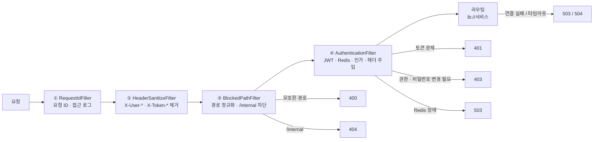
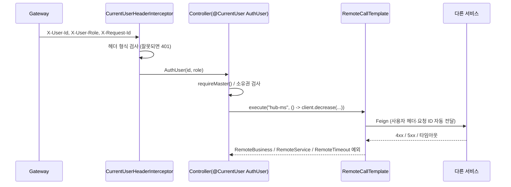

# 공통&게이트웨이 구현 설명

> 작성자: 대진 · 기준: `dev` 7ded690 · 모듈: `gateway-edge`, `common`(인증 헤더·서비스 간 호출·Slack 알림·오류 응답)
> 1부는 **무엇을 왜 이렇게 만들었는지**(설계 결정·대안·트러블슈팅), 2부는 **요청이 어떻게 흐르는지**, 3부는 **코드를 어디서 찾는지**(계층·설정·테스트)입니다.
> 내 서비스에서 쓰는 법만 필요하면 [[01 Gateway·인증 가이드]], [[02 장애 대응(Feign) 가이드]], [[04 Slack 알림 가이드]]를 봅니다.

> ⚠️ `docs/Common/SYS-13 장애 대응 설계.md`와 `02 장애 대응(Feign) 가이드`에는 Circuit Breaker·재시도(`executeWithRetryOnce`) 설명이 남아 있습니다. 둘 다 PR #47에서 제거됐으니 장애 대응은 **이 문서와 코드가 기준**입니다.

## 목차

- [1부. 설계 결정](#1부-설계-결정)
- [2부. 요청 흐름](#2부-요청-흐름)
- [3부. 코드 구조](#3부-코드-구조)

---

## 한눈에 보기

| 영역 | 하는 일 | 핵심 결정 |
|---|---|---|
| Gateway | 외부 요청 단일 진입점: 경로 정규화, JWT 인증, MASTER 경로 인가, 사용자 헤더 주입, 라우팅·타임아웃, 접근 로그 | 인증은 Gateway에서만. Redis 장애 시 **거부**(fail-closed) |
| 인증 헤더 (common) | `X-User-Id`·`X-User-Role`을 읽어 `@CurrentUser AuthUser`로 전달, Feign 호출에 헤더 전달, 감사 작성자 기록 | 서비스는 JWT·Spring Security 없이 헤더만 신뢰 |
| 서비스 간 호출 (common) | `RemoteCallTemplate`과 오류 디코더로 실패를 예외 3종으로 분류 | "처리됐는지 모름"을 따로 구분해 보상 판단에 사용 |
| Slack 알림 (common) | 비동기 Webhook 발송, URL이 없으면 아무것도 안 함 | 알림 실패가 주문 처리를 막지 않음 |
| 오류 응답 (common) | `{code, message, errors}` 공통 형식, 오류 코드 레지스트리 | Gateway·서비스·Feign이 같은 형식 사용 |

| 모듈 | 테스트 파일 | 테스트 메서드 |
|---|---|---|
| gateway-edge | 49 | 220 |
| common | 36 | 211 |

---

# 1부. 설계 결정

## 1.1 인증은 Gateway 한 곳에서

| 결정 | 내용 | 이유 |
|---|---|---|
| 인증 위치 | JWT 검증·Redis 상태 확인은 Gateway만 | 서비스 5개가 각자 JWT·Spring Security를 두면 설정이 갈라지고 실수가 늘어남 |
| 인가 분담 | **역할 단위(MASTER 전용)는 Gateway**, 소유권·데이터를 봐야 아는 권한은 서비스 | 업체 관리자 본인 여부 같은 판단은 데이터가 있는 서비스만 할 수 있음 |
| 401 / 403 | 401은 Gateway, 403(소유권)은 서비스 | 오류 원인 위치가 명확해짐 |
| 헤더 위조 방지 | 외부에서 온 `X-User-*`·`X-Token-*`를 **모든 요청에서** 지우고 토큰 값으로 다시 넣음 | 서비스가 헤더를 그대로 믿기 때문에, 위조 헤더가 들어오면 바로 권한 상승 |
| Redis 장애 | 503 `AUTH_UNAVAILABLE`로 거부 (fail-closed) | 통과시키면 로그아웃한 토큰이 다시 살아남 |
| 내부 API 차단 | `/internal/**`는 403이 아니라 **404** | 내부 경로가 있다는 사실 자체를 숨김 |
| 계약 한 곳 | claim 이름·헤더·Redis 키를 common `AuthContract` 상수로, 인증 오류 코드도 common `AuthErrorCode`로 | Gateway와 user-ms가 같은 문자열을 따로 쓰면 어긋남 |

## 1.2 서비스 간 호출 실패를 3종으로 나눈 이유

주문처럼 여러 서비스를 차례로 부르는 흐름에서는 **"상대가 처리했는지"**에 따라 보상(롤백)이 달라집니다.

| 예외 | 상태 | 뜻 | 호출한 쪽의 처리 |
|---|---|---|---|
| `RemoteServiceException` | 503 | 연결 실패·상대 5xx. **처리되지 않음** | 바로 실패 처리 |
| `RemoteBusinessException` | 4xx | 상대가 **규칙상 거절** (재고 부족 등). 원래 오류 코드를 복원 | 거절 사유별로 처리 |
| `RemoteTimeoutException` | 504 | 읽기 타임아웃 등. **처리됐는지 모름** | 처리됐다고 가정하고 보상 (예: 재고 복원) |

- **연결 실패는 "처리 안 됨"**: 요청이 상대에 도착하지 못했으므로 안전하게 실패로 끝냅니다. 읽기 타임아웃만 "모름"입니다.
- **서비스 간 401은 503으로**: 서비스끼리 401이 나면 호출 쪽이 헤더를 빠뜨린 내부 버그라서, 사용자에게 401을 그대로 주지 않습니다.
- **오류 코드 복원**: 상대가 보낸 `code`를 `ErrorCodeRegistry`로 원래 enum으로 되돌려, 호출 쪽이 `==`로 비교할 수 있습니다.
- **Feign은 내부 전용**: `@FeignClient(url=...)`이 있으면 기동을 실패시킵니다(`FeignClientUrlGuard`). 외부 호스트로 사용자 헤더가 새는 것을 막습니다.

## 1.3 타임아웃 설계

| 구간 | 연결 | 응답 | 근거 |
|---|---|---|---|
| Gateway → 서비스 | 2초 | 5초 | 일반 API |
| Gateway → order-ms | 2초 | **15초** | 주문은 안에서 재고·배송·보상을 차례로 호출. 바깥 타임아웃은 안쪽 호출 합보다 길어야 함 |
| 서비스 → 서비스 (Feign) | 1초 | 2초 | 내부 호출은 짧게 끊어 스레드·커넥션을 오래 잡지 않음 |
| Gateway → Redis | 0.5초 | 0.5초 | 모든 보호 요청이 거치므로 짧게. 실패 시 503 |
| Slack Webhook | 1초 | 2초 | 별도 스레드에서 실행, 실패해도 무시 |

## 1.4 트러블슈팅

### ① 경로를 바꿔 쓰면 MASTER 인가를 우회할 수 있었다 (PR #26)

- **배경**: 서비스에는 MASTER 검사가 없어 Gateway가 유일한 방어선이었습니다.
- **원인**: 정책은 **원본 경로**로 비교하는데, 라우팅과 Tomcat은 **디코딩한 경로**를 씁니다. 그래서 정책과 실제 도착 경로가 달라졌습니다.

| 우회 요청 | 정책이 본 경로 | 서비스가 받은 경로 |
|---|---|---|
| `/api/v1/%75sers/u-1` | `%75sers` (규칙에 안 걸림) | `/users/u-1` |
| `/api/v1/users;x/u-1` | `users;x` | Tomcat이 `;` 뒤를 버림 → `/users/u-1` |
| `.../%2e%2e/...` | 인코딩된 점 | `..`로 해석되어 상위 경로 |
| `HEAD /users/u-1` | HEAD 규칙 없음 | Spring MVC가 GET 핸들러로 처리 |

- **해결** (`domain/policy/RequestPath`)
  1. 원본 경로에 `;` `\` `%2e` `%2f` `%5c` `%00` `%25`가 있으면 400.
  2. UTF-8로 엄격하게 디코딩한 뒤 `.`·`..` 세그먼트가 있으면 400.
  3. 정책은 디코딩한 경로로 비교하고, 서비스에는 원본 경로를 그대로 넘김.
  4. HEAD는 GET 규칙에도 걸리게 함.
  5. 같은 검사를 인증 단계에서 한 번 더 (필터 순서가 바뀌어도 안전).
- **검증**: 우회를 재현하는 실패 테스트 44개를 먼저 작성. 뮤테이션 테스트 18/18 검출. `PathBypassIntegrationTest`가 WireMock으로 **서비스에 도착한 요청이 0건**인지 확인.
- **대안**: Spring `PathPattern` 사용은 도메인이 Spring에 의존하게 돼서 직접 디코딩했습니다. 거부 범위는 Spring Security `StrictHttpFirewall`과 맞췄습니다.

### ② 200 응답인데 본문이 깨지면 분류가 제각각이었다 (PR #35)

- **현상**: WireMock으로 재현하니, 200 + 깨진 JSON은 Timeout, 200 + HTML은 Service, 상대가 504를 주면 Service로 분류됐습니다.
- **문제**: "처리는 됐는데 응답을 못 읽은" 경우와 "상대의 하위 호출이 타임아웃"인 경우는 **처리됐을 수 있습니다**. Service로 분류하면 호출 쪽이 보상을 건너뛰어 재고가 샙니다.
- **해결**: 2xx 본문 변환 실패와 원격 504를 모두 `RemoteTimeoutException`(모름)으로 통일했습니다.

### ③ Gateway 관리 포트가 company-ms와 겹쳤다

- **현상**: 관리 포트를 19091로 뒀더니 company-ms 서버 포트와 같아 로컬에서 함께 띄울 수 없었습니다.
- **해결**: 19190으로 옮기고, `ActuatorPropertiesTest`가 다른 모듈의 `server.port`와 겹치는지 검사합니다.

### ④ 접근 로그에 실제 상태 코드가 안 찍혔다

- **원인**: 라우트가 없는 404나 하위 서비스 503·504는 일반 GlobalFilter보다 앞이나 밖에서 끝나 로그가 빠지거나 상태가 달랐습니다.
- **해결**: 요청 ID·접근 로그를 GlobalFilter가 아닌 **WebFilter**(가장 앞)로 만들고, 체인 오류를 그 안에서 처리해 실제 상태를 기록합니다.

## 1.5 common의 그 밖의 설계 포인트

- **헤더 파싱은 한 곳**: `CurrentUserHeaderParser`가 없음 / 정상 / 잘못됨을 구분합니다. UUID는 다시 문자열로 바꿔 원본과 같은지까지 봅니다(`fromString`은 `1-1-1-1-1`도 받아들임). 헤더가 중복되거나 하나만 있으면 401입니다.
- **필터가 아닌 인터셉터**: 잘못된 헤더 응답도 `GlobalExceptionHandler`의 공통 형식으로 나가게 하려고 인터셉터로 만들었습니다.
- **감사 작성자**: 요청 밖(스케줄러·기동·시드)은 시스템 UUID(`00000000-…`), 요청 안이면 로그인 사용자입니다. 컬럼이 UUID라서 `"SYSTEM"` 같은 문자열은 쓸 수 없고, NULL은 이전 `updated_by`가 남는 문제가 있었습니다.
- **Slack 전용 스레드 풀**: Executor를 Bean으로 등록하면 Spring Boot 기본 `applicationTaskExecutor`를 대체해 버려서, 내부 전용 풀(2개, 큐 100)로 만들었습니다. 큐가 차면 버립니다.
- **Slack 메시지 주입 방지**: `& < >`를 이스케이프해 `<!channel>` 같은 전체 멘션 주입을 막습니다. 로그에는 상태 코드와 예외 클래스 이름만 남기고 Webhook URL은 절대 찍지 않습니다.

---

# 2부. 요청 흐름

## 2.1 Gateway 필터 순서



## 2.2 인증 단계 상세 (`AuthenticationService`)

| 순서 | 검사 | 실패 |
|---|---|---|
| 1 | 경로 다시 파싱 (2차 방어) | 400 |
| 2 | 공개 경로면 통과 | - |
| 3 | `Bearer` 토큰 있음 | 401 `TOKEN_MISSING` |
| 4 | 서명·만료 | 401 `TOKEN_EXPIRED` / `TOKEN_INVALID` |
| 5 | `typ=access`, `role`, `pcr`, `sub`·`jti`·`iat`·`exp` 형식 | 401 `TOKEN_INVALID` |
| 6 | Redis 한 번(MGET)으로 블랙리스트·무효화 시각 확인 (`iat ≤ revoked-at`이면 차단) | 401 `TOKEN_REVOKED`, 503 `AUTH_UNAVAILABLE` |
| 7 | 비밀번호 변경 강제(`pcr`) 계정은 허용된 3개 요청만 | 403 `PASSWORD_CHANGE_REQUIRED` |
| 8 | MASTER 전용 경로 | 403 `ACCESS_DENIED` |
| 9 | `X-User-Id`·`X-User-Role`·`X-Token-Jti`·`X-Token-Exp` 주입 | - |

7번이 8번보다 먼저라서, 비밀번호가 초기화된 MASTER도 먼저 비밀번호를 바꿔야 관리 API를 쓸 수 있습니다.

## 2.3 서비스 안에서



---

# 3부. 코드 구조

## 3.1 gateway-edge (`com.gateway`)

| 계층 | 패키지 | 주요 클래스 |
|---|---|---|
| domain | `policy` | `RoutePolicy`, `PathRule`, `EndpointRule`, `RequestPath`(경로 정규화), `TrustedHeaders` |
| | `token` | `AccessTokenClaims`, `BearerToken`, `Role`, `TokenState`, `UserHeaders`, 포트 `TokenVerifier`·`TokenStateReader` |
| | `request` | `RequestId`, `AccessLogLine` |
| application | `auth` | `AuthenticationService`, `AuthRequest`, `AuthResult` |
| | `request` | `RequestGuard`, `RequestTracer` |
| infrastructure | `jwt` / `redis` / `config` | `JjwtTokenVerifier`, `RedisTokenStateReader`, `RoutePolicyProperties` |
| presentation | `filter` / `error` | 필터 4개, `FilterOrder`, `GatewayErrorWebExceptionHandler`, `ExceptionErrorMapper`, `ErrorResponseWriter` |

ArchUnit 규칙: 도메인은 Spring·jjwt·lettuce 금지(Reactor는 `Mono`만), presentation은 domain·infrastructure 직접 의존 금지, 포트 구현은 infrastructure에만.

**경로 정책** (`application.yaml`의 `gateway.policy`, 형식 `"메서드[,메서드] 경로"`)

| 키 | 내용 |
|---|---|
| `blocked` | `/internal/**`, `/api/v1/internal/**` → 404 |
| `public` | 회원가입, 로그인, 재발급, ID 중복 확인 |
| `master-exclude` | `/users/me`, `/users/me/**` (MASTER 규칙보다 먼저 제외) |
| `master` | 사용자 관리, 허브·경로 변경, 업체 등록·삭제, 배송담당자 변경 등 13개 |
| `password-change-allowed` | `GET /users/me`, `PATCH /users/me/password`, `POST /auth/logout` |

경로가 바뀌면 이 목록만 고칩니다. `master-cases.csv`(46줄)가 정책표 역할을 하고 `RoutePolicyPropertiesTest`가 YAML과 대조합니다.

**운영 확인**

| 포트 | 노출 | 용도 |
|---|---|---|
| 19090 (서비스) | `/livez`, `/readyz`만. `/actuator/**`는 404 | 헬스체크 (Redis 상태와 무관) |
| 19190 (관리) | `health`, `info`, `gateway`(읽기 전용) | 상세 헬스, 라우트 확인. 외부 비공개 |

Redis가 죽어도 liveness·readiness는 정상이라 Gateway가 재시작되지 않고, 보호 경로만 503이 됩니다.

## 3.2 common (`com.common`)

| 패키지 | 주요 클래스 | 역할 |
|---|---|---|
| `auth` | `AuthContract`, `AuthUser`, `AuthRole` | 인증 계약 상수, 로그인 사용자(`isMaster`, `requireMaster`, `requireSelfOrMaster`) |
| `auth.web` | `CurrentUserHeaderParser`, `CurrentUserHeaderInterceptor`, `CurrentUserArgumentResolver`, `RequestHeaderCurrentUserProvider` | 헤더 검사, `@CurrentUser` 주입 |
| `auth.feign` | `UserHeaderRelayInterceptor` | Feign 호출에 `X-User-Id`·`X-User-Role`·`X-Request-Id` 전달 (`Authorization`·`X-Token-*`는 안 보냄) |
| `audit` | `UserIdAuditorAware` | 감사 작성자 (요청 밖은 시스템 UUID) |
| `remote` | `RemoteCallTemplate`, 예외 3종 | 원격 호출 실패 분류 |
| `remote.feign` | `CommonFeignErrorDecoder`, `FeignClientUrlGuard` | 상태 코드별 예외 변환, 외부 URL 금지 |
| `notification` | `SlackNotifier`, `SlackMessage` | 알림 인터페이스 (즉시 반환, 예외 없음, 재시도 없음) |
| `notification.slack` | `SlackWebhookNotifier`, `NoOpSlackNotifier` | Webhook 발송 / URL 없을 때 아무것도 안 함 |
| `exception` | `ErrorResponse`, `ErrorCode`, `ErrorCodeRegistry`, `GlobalExceptionHandler` | 공통 오류 형식과 처리 |
| `entity`, `page` | `BaseEntity`, `PageQuery`·`PageData` | 감사 컬럼·Soft Delete, 페이지네이션 (권우) |
| `config` | 자동 설정 7개 | 서비스가 common을 의존성에 넣기만 하면 동작 |

**Feign 오류 분류 규칙**

| 원인 | 예외 |
|---|---|
| 연결 실패 (`ConnectException`, `UnknownHost`, 연결 타임아웃) | `RemoteServiceException` (503) |
| 상대 5xx, 서비스 간 401 | `RemoteServiceException` (503) |
| 상대 4xx (401 제외) | `RemoteBusinessException` (원래 상태·코드 복원) |
| 상대 504, 읽기 타임아웃, 응답 도중 끊김, 2xx 본문 변환 실패 | `RemoteTimeoutException` (504) |

```java
// 사용 예: 원격 호출은 RemoteCallTemplate으로 감싼다
StockResult result = remoteCallTemplate.execute("hub-ms", () -> hubClient.decrease(command));
```

## 3.3 테스트

| 종류 | 예 | 확인하는 것 |
|---|---|---|
| 보안 통합 | `PathBypassIntegrationTest`, `HeaderSpoofingIntegrationTest`, `InternalBlockIntegrationTest` | 우회·위조·내부 경로 요청이 서비스에 도착하지 않음 (WireMock 수신 0건) |
| 계약 | `AccessTokenContractTest`, `ErrorFormatContractTest` | 토큰 claim 6개, 오류 본문이 정확히 `code`·`message`이고 코드가 레지스트리에 있음 |
| 정책 | `RoutePolicyPropertiesTest` + `master-cases.csv` | MASTER 경로 표와 YAML 일치 |
| 타임아웃·라우팅 | `TimeoutIntegrationTest`, `NoInstanceTest`, `ActuatorIntegrationTest` | 504·503, 관리 포트 노출 범위 |
| Feign | `FeignRemoteCallIntegrationTest` | 읽기 타임아웃, 깨진 2xx, 4xx·5xx·504, 연결 거부, 헤더 전달 |
| Slack | `SlackWebhookNotifierTest` | 비동기 발송, 실패 격리, URL 마스킹 |
| Redis (컨테이너) | `TokenStateRedisIntegrationTest`, `RedisTokenStateReaderTest` | 실제 Redis로 토큰 상태 확인 |
| 아키텍처 | `ArchitectureTest` | 계층 의존 규칙 |
| 재발 방지 | `TimeoutPropertiesTest`, `CommonFeignSettingsTest` | Circuit Breaker 설정이 다시 들어오지 않음 |

```bash
./gradlew :gateway-edge:test
./gradlew :common:test
./gradlew :gateway-edge:test -PincludeContainer   # Redis 컨테이너 테스트 포함
```
