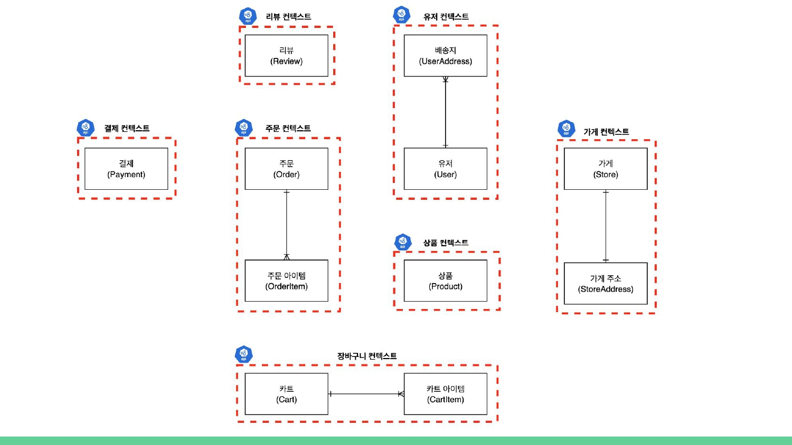
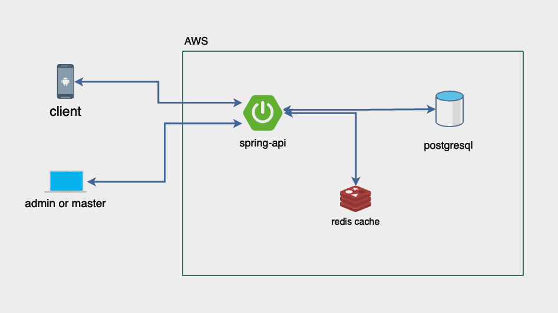

# [261012] 숙련 프로젝트 발제

> 원본: Notion (3f72dc3e-f514-8032-990b-c0604fdc544d)

> 🎦 **영상 자료**

- **프로젝트 발제 녹화본**
> 🗓️ **숙련 주차 일정**

> 🗓️
> 일정 및 내용
>
>
> ---
>
> **`강의 학습`**
>
> - **10/13 (화) 까지는 필수 수강**
>     - **인메모리 저장소 및 캐싱 전략**
>     - **대규모 스트림 처리**
> **`프로젝트 주차`** **대규모 AI 시스템 프로젝트**
>
> - **SA 작성 마감 : 10/13(화) 12:00 까지**
> - **프로젝트 제출 마감 :** **10/21(수) 20:00 전 까지**
> - **프로젝트 개발 마감 : 10/22(목) 08:00 까지**
>     - **프로젝트 제출(10/21)을 하고 나서 코드 수정 가능한 기간**
> - **프로젝트 발표회 : 10/22(목) 10:00**

> 📎
> 시간표 및 커리큘럼 정리
>
>
> ---
>
> 

---

>
> **Chater 1. 프로젝트 가이드**
>

##  **물류 관리 및 배송 시스템을 위한 MSA 기반 플랫폼 개발**

- 이전 프로젝트에서는 실생활에서 쉽게 접할 수 있는 주문 관리 플랫폼을 개발해 보았습니다. <br>
  이번에는 **물류 관리 및 배송 시스템**을 개발하는 것이 목표입니다. <br>
  이 과정에서 우리는 MSA(Microservices Architecture) 기반의 시스템을 설계하고 구현하면서, 다양한 기술과 방법론을 적용해 볼 예정입니다.
- 실무에서는 개발자 간의 협업이 필수적이며, 서로 다른 애플리케이션 간의 데이터 연동과 기능 요청이 빈번하게 발생합니다. 강의를 통해 MSA의 핵심 기능과 데이터를 효율적으로 관리하는 방법을 학습했으니, <br>
  이번 프로젝트에서는 팀원들과 함께 MSA 애플리케이션을 구성하고 서로 호출하면서 협력할 것입니다. 이를 통해 실무에서 발생할 수 있는 다양한 상황을 경험해 볼 수 있을 것입니다.
- MSA를 개발할 때는 많은 고민이 필요합니다. 예를 들어, 하나의 서비스에서 변경이 발생할 때 전체 시스템에 미칠 영향을 신중하게 고려해야 합니다. API의 스펙을 변경할 경우, 이로 인해 발생할 수 있는 문제들을 어떻게 최소화할지 생각해야 합니다. <br>
  이 프로젝트에서는 API 연동, 데이터 무결성 유지, 그리고 서비스 간 통신의 신뢰성을 확보하는 방법에 대해 집중적으로 고민하고, Spring Cloud와 Spring Boot를 활용하여 이러한 과제들을 해결할 방안을 모색할 것입니다.
- 이번 프로젝트를 통해 **MSA의 복잡성을 이해**하고, **팀원들과 함께 MSA를 구축하며 실무에서 발생할 수 있는 문제를 간접적으로 경험하고 해결하는 것**이 목표입니다. <br>
  이러한 경험이 향후 더 나은 시스템을 설계하고 개발하는 데 큰 도움이 될 것입니다.

## 개발 프로세스 가이드

- 1단계 프로젝트 킥오프
    - 주제
        - MSA 기반 국내 물류 관리 및 배송 시스템 개발 ( 스파르타 물류 )
    - 개요 
        - 이번 프로젝트는 B2B 물류 관리 및 배송 시스템 입니다. B2B는 Business to Business의 약자로, 기업 간 거래를 의미합니다.
        - 스파르타 물류는 각 지역에 허브센터를 가지고 있으며 각 허브 센터는 여러 업체의 물건을 보관합니다.
        - 허브의 재고가 부족할 경우, 공급업체로부터 상품이 입고됩니다.<br>
          (이 과정은 본 시스템의 개발 범위에 포함되지 않으므로 별도로 구현하거나 고려하지 않아도 됩니다. API를 통해 ‘재고 추가’와 같은 기능으로 구현하셔도 무방합니다.)
        - 해당 상품의 배송 요청이 들어오면 목적지 허브로 물품을 이동시켜 목적지에 배송합니다.
        - 예를 들어 아래와 같은 프로세스가 진행됩니다.
            - **시스템의 구조**
                - **도별 공급 허브**: 시스템은 허브를 가지고 있으며, 이 허브는 해당 도 내의 모든 주문, 재고 관리, 물류 운영을 담당합니다.
            - **주문 발생:**
                - **부산시의 수산물 도매 업체(예시 업체)**: 부산에 위치한 수산물 도매 업체는 스파르타로 연락하여 경기도 일산에 위치한 건조 식품 가공 업체의 마른오징어 가공품  50개를 주문합니다.
                - 이에 따라 스파르타 물류는 해당 업체의 담당 허브인 경기도 허브의 재고를 확인한 뒤 배송합니다.
            - **물류 처리 및 재고 이동:**
                - **경기도 허브에서 부산시 허브로 물품 이동**: 시스템은 주문을 처리하기 위해, 경기도 허브에 저장된 마른 오징어 가공품을 부산시 허브로 이동 시키도록 계획합니다. 이 과정에서 허브 배송 담당자를 통해 이동 경로에 따라, 부산시 허브로 물품이 안전하게 전달됩니다.
            - **최종 수령:**
                - **부산시 허브에서 수산물 도매 업체로 물품 전달**: 부산시 허브에 물품이 도착하면, 부산 허브 소속 업체 배송담당자가 물품을 주문한 수산물 도매 업체로 배송 합니다.
                ```mermaid
                flowchart TB
                    supplier["공급 업체<br/>(건조 식품 가공)"]
                    hubA["Hub<br/>경기 북부 센터"]
                    hubB["Hub<br/>부산광역시 센터"]
                    courier["업체 배송 담당자<br/>(고길동)"]
                    receiver["수령 업체 (부산)"]

                    subgraph others["그 외 허브 — 모든 허브가 서로 직접 연결됨 (P2P)"]
                        direction LR
                        hubC["경기 남부 센터"]
                        hubD["대전광역시 센터"]
                        hubE["대구광역시 센터"]
                    end

                    supplier -- 입고 --> hubA
                    hubA == "직접 배송 (중간 허브 경유 없음)<br/>허브 배송 담당자 A씨" ==> hubB
                    hubB --> courier
                    courier -- 배송 --> receiver

                    hubA -.- hubC & hubD & hubE
                    hubB -.- hubC & hubD & hubE
                    hubC -.- hubD -.- hubE
                ```
                [P2P 배송 흐름 원본 이미지](assets/d6c2dc3e-p2p_delivery_flow.svg)

- 2단계 요구사항 확인
    - 허브 관리 (필수 과제)
        - 허브 위치 : 
            - 스파르타 물류는 아래와 같은 위치에 허브를 보유하고 있습니다:
                - 서울특별시 센터 : 서울특별시 송파구 송파대로 55
                - 경기 북부 센터 : 경기도 고양시 덕양구 권율대로 570
                - 경기 남부 센터 : 경기도 이천시 덕평로 257-21
                - 부산광역시 센터 : 부산 동구 중앙대로 206
                - 대구광역시 센터 : 대구 북구 태평로 161
                - 인천광역시 센터 : 인천 남동구 정각로 29
                - 광주광역시 센터 : 광주 서구 내방로 111
                - 대전광역시 센터 : 대전 서구 둔산로 100
                - 울산광역시 센터 : 울산 남구 중앙로 201
                - 세종특별자치시 센터 : 세종특별자치시 한누리대로 2130
                - 강원특별자치도 센터 : 강원특별자치도 춘천시 중앙로 1 
                - 충청북도 센터 : 충북 청주시 상당구 상당로 82
                - 충청남도 센터 : 충남 홍성군 홍북읍 충남대로 21
                - 전북특별자치도 센터 : 전북특별자치도 전주시 완산구 효자로 225
                - 전라남도 센터 : 전남 무안군 삼향읍 오룡길 1
                - 경상북도 센터 : 경북 안동시 풍천면 도청대로 455
                - 경상남도 센터 : 경남 창원시 의창구 중앙대로 300
    - 허브간 이동정보 관리
        - **데이터 조회** :
            - 허브 간 이동 정보는 `허브간 이동정보 관리(필수기능가이드)` 에 따라 허브 간 경로가 매핑 되어 있습니다.
    - 배송 담당자 관리
        - **배송 담당자 구성** :
            - 배송 담당자는 가입한 유저에게 권한으로 부여되며 시간적,공간적 제약은 이번 프로젝트에서는 제외합니다.
    - **업체 관리**
        - **업체 소속** 
            - 모든 업체는 특정 허브에 소속되어 있습니다.
        - **업체 타입** :
            - 모든 업체는 따로 구분없이 **생산업체**와 **수령업체**가 될 수 있습니다.
    - **상품 관리** 
        - **상품 소속** :
            - 모든 상품은 특정 업체와 허브에 소속되어 있습니다.
                - 업체
                    - 상품의 이름,정보,가격 등
                - 허브
                    - 해당 상품의 재고
    - **주문 관리**
        - **주문 생성 및 취소** :
            - 주문이 생성되면 관련된 재고가 감소하며, 주문이 취소되면 해당 수량이 복원됩니다.
            - 허브에 물품 재고가 없는 경우는 주문이 실패해야 합니다.
            - 주문이 삭제 되면 연관된 데이터는 deleted_by, deleted_at 필드를 통해 관리됩니다.
    - **배송 관리**
        - **배송 데이터** :
            - 배송 및 배송 경로 기록 엔티티는 주문 생성 시 함께 생성되며, 연관된 데이터는 deleted_by, deleted_at 필드를 통해 관리됩니다.
    - **슬랙 메시지 관리**
        - **슬랙 메시지 발송** :
            - 로그인한 모든 사용자 및 내부 시스템에서 메시지 발송이 가능합니다.
            참고) [Sending messages using incoming webhooks | Slack Developer Docs](https://docs.slack.dev/messaging/sending-messages-using-incoming-webhooks/)
    - **사용자 관리**
        - **사용자 정보 관리**:
            - 사용자 엔티티는 모든 사용자 정보를 관리하며, 사용자 비활성화 시 deleted_by, deleted_at 필드를 통해 관리됩니다.
        - **권한**:

            | 분류 | 설명 |
            |---|---|
            | 관리자 | 모든 기능에 대한 권한이 있습니다. |
            | 일반사용자 | 로그인한 모든 사용자입니다. 업체/배송 등 자신이 연관된(소유한) 데이터만 수정할 수 있습니다. |

    - **기타 공통 사항**
        - **논리적 삭제 관리**:
            - 모든 엔티티에서 deleted_by, deleted_at 필드를 추가하여 논리적 삭제를 관리하며, deleted_at 필드가 null인 데이터만 조회 및 검색에서 사용되도록 로직을 구현합니다.
        - **API 호출 기반 연동**:
            - MSA 환경에서 API 호출을 통해 서비스 간 데이터 연관성을 유지하며, 데이터 변경 시 이를 반영하는 통신 구조를 설계합니다.
        - **트랜잭션 관리**:
            - 여러 엔티티가 동시에 업데이트될 경우 트랜잭션을 사용하여 일관성을 유지하며, 실패 시 전체를 롤백 처리합니다.
    - 개발 요구사항
        - **MSA 기반 아키텍처:** 
            - 주요 기능은 독립적인 마이크로서비스로 개발되어, 각각의 서비스가 독립적으로 배포, 확장, 유지보수될 수 있도록 설계합니다. 다만, 모든 서비스를 MSA로 구성할 필요는 없습니다.
        - **서비스 간 통신:** 
            - 서비스 간의 통신은 주로 REST API를 통해 이루어집니다. 
            - 시간관계상 FeignClient를 이용하는 걸 기본 구성으로 권장합니다.
        - **인프라 확장:** 
            - 시스템 설계는 간결하게 하며 각 MSA 애플리케이션은 수평 확장 될 수 있습니다.
        - 기술 스택
            - **백엔드:** Spring Boot 3.x
            - **데이터베이스:** PostgreSQL 를 권고 드리나, MySQL/MariaDB 등 다른 데이터베이스를 이용하셔도 무방합니다.
            - **빌드 툴:**  Gradle
            - **API 문서화:** 프론트 엔드 개발자가 API 문서만 보고도 개발 할 수 있게 작성하고*,* Swagger 등의 API 문서 자동화 라이브러리를 이용하여 문서 관리를 진행합니다.
            - **API 게이트웨이:** Spring Cloud Gateway를 사용하여 모든 외부 요청을 각 마이크로서비스로 라우팅 합니다.
            - **서비스 디스커버리:** Spring Cloud Eureka를 사용하여 각 마이크로서비스의 위치를 자동으로 발견하고 관리하도록 합니다.
            - **버전 관리:** Git을 이용한 버전 관리 (GitHub, GitLab, Bitbucket 등) 
        - **프로젝트 구조**
            - **Layered Architecture:** 표현 → 응용 → 도메인 → 인프라스트럭처의 계층 구조로 구성된 클린 아키텍쳐 권장
                ```mermaid
                flowchart TB
                    presentation["표현 (Presentation)"]
                    application["응용 (Application)"]
                    domain["도메인 (Domain)"]
                    infra["인프라스트럭처 (Infrastructure)"]

                    presentation --> application --> domain --> infra
                ```
                [레이어드 아키텍처 원본 이미지](assets/91d2dc3e-스크린샷_2025-10-24_오후_10.44.16.png)
                > 계층 구조는 상위→하위 방향의 의존만 허용합니다. 원칙상 상위 계층은 바로 아래 계층에만 의존해야 하나, 현실적으로는 외부 연동 등 이유로 하위 계층에 직접 의존하는 등 유연하게 적용되기도 합니다.
                참고자료(‣)
            - **Entity 및 DTO:** 각 기능별로 Entity와 DTO(Data Transfer Object)를 분리하여 관리
            - **API 설계:** RESTful API 원칙에 따라 설계
            - **도메인 주도 설계(DDD)**: 마이크로서비스는 보통 비즈니스 도메인에 맞춰 분리됩니다. 따라서 요구사항을 바탕으로 각 도메인과 마이크로서비스의 경계를 정의하는 것이 중요합니다.
            - **서비스 경계 결정**: 각 마이크로서비스가 어떤 기능을 담당할지, 어떤 서비스 단위로 분리할지 고민해야 합니다.
        - 데이터베이스
            - **테이블 명명 규칙:** 모든 테이블에 p_ 접두사 사용
            - **UUID 사용:**  모든 주요 엔티티의 식별자는 UUID를 사용,  데이터베이스는 자율로 구성
                (근접 거리 계산을 위해서 벡터 기반 DB를 사용하는 경우 PGVector를 도입해도 됨)
            - **분산 데이터베이스:** 마이크로서비스별로 논리적으로 독립된 데이터베이스를 사용하며, 필요한 경우 분산 데이터베이스 및 데이터 복제를 적용하여 가용성과 성능을 보장합니다.
            - **Audit 필드:** 모든 테이블에 created_at, created_by, updated_at, updated_by, deleted_at, deleted_by 필드를 추가하여 데이터 감사 로그 기록 (update가 없는 기록형 데이터는 일부 생략 가능합니다.)
        - 보안
            - **JWT 인증:**  Spring Security와 자체 JWT(Json Web Token) 발급 방식을 이용한 인증 및 권한 관리
            - **권한 확인:** 권한은 요청마다 저장되어 있는 권한 값과 동일한지 체크필요
            - **비밀번호 암호화:** BCrypt 등 해시 알고리즘을 사용한 비밀번호 암호화
            - **데이터 유효성 검사:** 서버 측 데이터 유효성 검사를 위해 Spring Validator 사용
    - 3단계 테이블 명세서 및 ERD 작성
        - **ERD 설계:** 각 마이크로서비스별로 ERD(Entity-Relationship Diagram)를 작성하여, 데이터베이스의 구조와 관계를 명확히 정의합니다.
        - 기능명세와 요구사항에 따라 AI를 활용하여 초안을 구성하는 것도 권장 드립니다.
        - 각 MSA에 연결된 데이터 베이스 별로 테이블 명세서를 작성해주세요. 아래는 유저 테이블 예시 입니다.
            - **1. 사용자 테이블 (`p_users`)**
            이번 프로젝트에서는 별도 인증서버 없이 자체 사용자 테이블을 사용합니다.

            | 필드 이름 | 데이터 타입 | 설명 |
            |---|---|---|
            | `username` | `VARCHAR(100)` | 사용자 ID, Primary Key |
            | `nickname` | `VARCHAR(100)` | 사용자 닉네임 |
            | `email` | `VARCHAR(255)` | 사용자 이메일, Unique |
            | `password` | `VARCHAR(255)` | 사용자 비밀번호 |
            | `role` | `role_type` | 사용자 역할 (`MASTER`, `USER`) |
            | `is_public` | `BOOLEAN` | 사용자 정보가 공개된 상태인지 여부, 기본값 `TRUE` |
            | `created_at` | `TIMESTAMP` | 레코드 생성 시간 |
            | `created_by` | `VARCHAR(100)` | 레코드 생성자 (username) |
            | `updated_at` | `TIMESTAMP` | 레코드 수정 시간 |
            | `updated_by` | `VARCHAR(100)` | 레코드 수정자 (username) |
            | `deleted_at` | `TIMESTAMP` | 레코드 삭제 시간 |
            | `deleted_by` | `VARCHAR(100)` | 레코드 삭제자 (username) |

        - 각 서비스가 독립적으로 동작하므로, 서비스마다 별도의 데이터베이스 혹은 데이터베이스 스키마를 설계하는 것이 일반적입니다.(이번에는 스키마를 분리하도록 합니다)
            
            

    - 4단계 인프라 설계도 작성
        - 각 마이크로서비스의 특성과 요구사항에 따라 필요한 인프라 요소를 결정합니다. 예를 들어, 서비스 간의 통신 방식, 데이터 저장소, 메시지 브로커, API 게이트웨이등을 포함합니다.
        - [https://app.diagrams.net/](https://app.diagrams.net/) 를 사용하여 인프라의 설계도를 작성해봅니다. 아래는 예시 설계도 입니다.
            
        - 인프라 설계도는 타 개발자들에게 서비스 개발을 효과적으로 설명 할 수 있는 요소입니다.
        - Image Generator AI 를 사용하여 인프라 설계도를 구성하셔도 무방합니다.
    - 5단계 API 명세서 작성
        - 모든 명세서를 작성해주세요 아래는 명세서 작성 예시입니다.
        - API를 먼저 정의한 뒤 상세 스펙은 AI를 활용하여 초안을 작성하시는 것을 권장 드립니다.
            - **게시물 생성 API (`/posts`)**

            | **메서드** | **요청 URL** |
            |---|---|
            | POST | http://{SERVER_URL}/api/posts |

            - **Request Header**

            | **파라미터** | **타입** | **필수여부** | **설명** |
            |---|---|---|---|
            | Authorization | String | 필수 | (JWT 토큰, `role`이 `MASTER`여야 함) |
            | Content-Type | String | 필수 | application/json |

            - **Role Requirement**
            - **권한:** 이 작업은 `role`이 `MASTER`인 사용자만 수행할 수 있습니다.
            - **Request Elements**

            | **파라미터** | **타입** | **필수여부** | **설명** |
            |---|---|---|---|
            | title | String | 필수 | 제목 |
            | content | String | 필수 | 내용 |
            |  |  |  |  |

            - **요청 예시**
            ```json
            POST /api/posts
            Authorization: Bearer jwt_token_string
            Content-Type: application/json
            
            {
              "title": "새로운 포스트",
              "content": "이것은 새로운 포스트의 내용입니다."
            }
            ```

            - **Response Elements**

            | **필드** | **타입** | **필수여부** | **설명** |
            |---|---|---|---|
            | id | Integer | 필수 | 포스트 고유 번호 |

            - **응답 예시**
            ```json
            {
              "id": 1
            }
            ```
    - 6단계 백엔드 개발하기
        - 협업을 위한 룰을 정의합니다.
            - 코드 컨벤션, 브랜치 정책, PR 정책, 협업 방식 등의 우리 팀만의 규칙을 세우고 협업을 진행해 보세요. 
            - 코드 리뷰를 통해 우리가 정한 규칙에 어긋나지 않는지, 더 좋은 방법이 있는지 확인하는 시간을 가져보세요.
            - 서로 개발 경험이 다를 수 있어요, 부족하면 도와주고 모르는 부분은 서로 채워줄 수 있는 시간이 되기를 바래요.
            - 문제가 발생하면 문제 상황과 원인, 해결 방법과 개선 효과를 문서로 작성하고 공유해보세요. 간접적인 경험을 통해 서로의 성장에 도움이 되는 동료가 되기를 바래요
        - Spring Boot를 이용하여 본격적인 개발을 진행합니다.
        - CRUD + Search 가 기본임을 항상 생각합니다.
        - 인증 및 인가에 대해 항상 주의 깊게 생각해야 합니다.

    - 7단계 테스트 및 버그 수정하기(권장)
        - **테스트:** 각 마이크로서비스별로 단위 테스트와 통합 테스트를 작성하여, 서비스의 개별 기능을 확인합니다.
        - 작성한 API를 실행해볼 수 있는 테스트 스크립트 혹은 툴을 이용하여 endpoint에서 전체 API를 커버하는 테스트를 자동화합니다. 

## 필수 기능 가이드

- MSA 애플리케이션 구성
    - [ ] 유레카 서버를 생성해서 모든 애플리케이션을 관리해주세요.
    - [ ] 게이트웨이를 생성해서 게이트웨이가 모든 인입을 관리하게 해주세요.
    - [ ] API Gateway에 인증 및 권한 확인 로직을 추가하여 각 서비스로의 요청이 올바르게 인증된 사용자로부터만 이루어지도록 합니다.
    - [ ] 이번 과제는 MSA에 집중하기 위해, 서버 배포 없이 로컬 환경에서 구성하도록 합니다. 모든 애플리케이션을 Docker 컨테이너로 실행해주세요.
        - [ ] Dockerfile *(혹은 docker-compose)* 파일을 작성하고 컨테이너로 실행후 동작을 확인해주세요.
- 허브 관리
    - [ ] 허브 정보(17개 센터와 해당 주소)는 변경되지 않고 고정됩니다. 이번 프로젝트에서는 초기 데이터를 적재해둔 뒤 조회 API만 제공하면 됩니다 (생성/수정/삭제 API 불필요).
    - [ ] 권한 관리: **조회 및 검색**은 모든 로그인 사용자가 가능합니다.
- 허브간 이동정보 관리
    - [ ] 허브 간 이동경로(P2P)를 모델링할 수 있는 엔티티를 생성해주세요. 필수 정보는 다음과 같으며 필요에 따라 추가하거나 변경할 수 있습니다.
        - 출발 허브 ID, 도착 허브 ID, 소요시간, 이동거리
    - [ ] 허브 정보(17개 센터와 해당 주소)는 변경되지 않고 고정됩니다. 모든 허브간 직접 배송이 가능한 P2P 모델을 기준으로 합니다.
    - [ ] 이번 프로젝트에서는 초기 데이터를 적재해둔 뒤 조회 API만 제공하면 됩니다 (생성/수정 API 불필요).
    - [ ] 권한 관리: **조회 및 검색**은 모든 로그인 사용자가 가능합니다.
- 배송담당자 관리
    이번 프로젝트에서는 배송담당자를 별도 서비스/엔티티로 둘지 않고, 가입한 유저에게 권한(배송담당자)으로만 부여합니다. 허브 간 이동과 허브→업체 배송을 모두 담당하며, 시간적/공간적 제약은 고려하지 않습니다. 순차 배정 로직은 구현하지 않습니다.
- 업체 관리
    - [ ] 업체 엔티티를 생성해주세요. 필수 정보는 다음과 같습니다.
        - 업체명, 업체 관리 허브 ID, 업체 주소, **사용자(업체 관리자) ID**
        - 모든 업체는 구분 없이 생산업체/수령업체가 될 수 있습니다.
    - [ ] 엔티티의 CRUD + Search를 구현해 주세요.
    - [ ] 업체가 추가, 수정될때 관리 허브ID가 존재하는 허브인지 확인합니다.
    - [ ] 업체 엔티티에 deleted_at, deleted_by 필드를 이용하여 논리적 삭제를 관리합니다.
    - [ ] 상품 관리는 별도 서비스로 분리하지 않고, 업체 서비스 안의 하위 리소스로 통합해 관리합니다. 상품명/정보/가격은 업체가, 해당 상품의 허브별 재고는 허브가 가집니다.
    - [ ] 권한 관리: **생성, 수정**은 해당 업체의 사용자(업체 엔티티의 사용자 ID와 일치하는 본인) 또는 관리자만 가능하며, **조회 및 검색**은 모든 로그인 사용자가 가능합니다.
- 주문 관리
    - [ ] 주문 엔티티를 생성해주세요. 필수 정보는 다음과 같습니다.
        - 요청업체 ID(수령/주문업체), 공급업체 ID(상품 보유 업체), 상품 ID, 수량, 배송 ID, 요청사항
    - [ ] 주문이 생성되면 배송도 같이 생성되어야 합니다.
    - [ ] 주문 엔티티의 deleted_at, deleted_by 필드를 이용하여 논리적 삭제를 관리합니다.
    - [ ] 권한 관리: **생성**은 모든 로그인 사용자가, **조회 및 검색**은 모든 로그인 사용자가 가능하나 주문자 본인은 자신의 주문만 조회 가능합니다.
- 배송 관리
    - [ ] 배송과 배송 경로 기록 엔티티를 생성해주세요. 필수 정보는 다음과 같습니다.
        - 배송: 주문 ID, 현재상태, 출발 허브 ID, 목적지 허브 ID, 배송지 주소, 수령인, 담당자 ID
        - 배송 경로 기록: 배송 ID, 출발/도착 허브 ID, 예상/실제 거리 및 소요시간, 현재상태, 담당자 ID
    - [ ] 주문이 생성될때 배송과 배송 경로 기록 데이터가 같이 생성되어야 합니다.
    - [ ] 배송 및 배송 경로 기록 엔티티의 deleted_at, deleted_by 필드를 추가하여 논리적 삭제를 관리합니다.
    - [ ] 권한 관리: **수정**은 해당 배송의 담당자 ID와 일치하는 본인 또는 관리자만 가능하며, 조회 및 검색은 모든 로그인 사용자가 가능합니다(담당자는 본인 배송만).
- 슬랙 메시지 관리
    이번 프로젝트에서는 슬랙 메시지를 저장하는 별도 엔티티/CRUD 없이, 주문 생성 시점에 Slack Incoming Webhook을 호출하는 함수만 구현합니다.
- 사용자 관리
    - [ ] 사용자 엔티티는 모든 사용자 정보를 관리합니다.
    - [ ] 회원가입 기능: 가입 즉시 계정이 활성화되며, 별도 승인 절차는 없습니다.
        - [ ] 요청 시 필수 입력 정보: 이름, 패스워드, SlackID, 소속 업체명(또는 허브명)<br>
          **소속 허브는 출발지를 기준으로 합니다.** <br>
          예를 들어, 서울특별시 허브에 소속된 배송 담당자는 해당 허브가 관리하는 지역 내 배송뿐만 아니라, 서울특별시 허브를 출발지로 하는 다른 허브로의 배송도 담당할 수 있습니다.
        - [ ] username은  `최소 4자 이상, 10자 이하이며 알파벳 소문자(a~z), 숫자(0~9)`로 구성
        - [ ] password는  `최소 8자 이상, 15자 이하이며 알파벳 대소문자(a~z, A~Z), 숫자(0~9), 특수문자`
    - [ ] 로그인 기능: 유저 아이디와 패스워드를 입력받아 로그인하고, 성공 시 JWT 토큰을 발급합니다.
    - [ ] 사용자 엔티티의 deleted_at, deleted_by 필드를 이용하여 논리적 삭제를 관리합니다.
    - [ ] 권한 관리: **생성, 수정, 삭제**는 관리자만 가능하며, **조회 및 검색**은 본인만 가능합니다(관리자는 전체 조회 가능).
- **기타 공통 사항**
    - [ ] 서치에는 검색조건 및 정렬기능이 추가되어 있어야 합니다. (기본: 생성일 역순 정렬)
    - [ ] DELETE 호출이 발생하면 각 서비스에서 물리적인 삭제 대신 deleted_at, deleted_by 필드를 이용하여 데이터의 논리적 삭제(Soft delete)를 수행합니다.
    - [ ] 트랜잭션 처리 시, 논리적 삭제에 대한 예외 상황도 고려하여 롤백 등의 처리를 구현합니다.
    - [ ] [https://app.diagrams.net/](https://app.diagrams.net/) 또는 [https://dbdiagram.io/](https://dbdiagram.io/)을 통해 ERD를 만들어주세요.
    - [ ] (선택) Swagger등의 API 문서 자동화 라이브러리를 적용하면 좋습니다.
    - [ ] (선택) Zipkin을 사용하면 MSA간 분산 추적이 가능해집니다.

## 도전 기능 가이드

- [ ] 서비스 간 호출을 메시징 시스템으로 전환하기<br>
  (모든 부분을 전환할 필요는 없습니다. 일부분만 선택하여 전환해봅니다.)
    - [ ] 메시징 시스템 종류는 다양하며 대표적으로 Kafka와 RabbitMQ가 있습니다. 이외에도 다양한 메시징 시스템 중, 원하는 시스템을 선택해보세요.
    - [ ] 기존의 API 호출 기반 서비스 간 통신을 메시징 시스템으로 전환합니다.
    - [ ] 메시징 시스템을 사용하여 각 서비스 간 비 동기적으로 메시지를 전송하고, 이벤트 기반 통신을 구현합니다.
    - [ ] 각 서비스에서 필요한 큐를 설정하고, 메시지 송수신 로직을 구현하여 데이터의 일관성과 신뢰성을 확보합니다.
    - [ ] 메시징 시스템을 사용하여 서비스 간의 느슨한 결합을 유지하면서도 확장성과 유연성을 강화할 수 있습니다.
    - [ ] 기존 API 호출에 대한 로직은 필요 시 백업으로 유지하거나, 메시징 시스템 기반으로 대체합니다.
    - [ ] **MSA에서 적용 해볼만한 곳을 파악해보시고 메시징 시스템으로 전환해보세요. <br>
      (MSA 서비스 간 연계, 슬랙 메시지 발송 등등)**

- [ ] 배송 담당자 배정 로직을 자유롭게 구현해주세요. 
    - [ ] 배송 담당자가 효율적으로 배송을 완수하기 위한 구현을 해주세요. 
    - [ ] 제한사항은 없습니다. 필요한 로직과 정책을 총동원 해주세요! 
    - [ ] 예시) 거리를 기반으로 한 효율적인 담당자 배정

##  프로젝트 이후 개발자 기대 역량

### 필수 기능을 모두 구현한 경우

- 이번 프로젝트를 통해 백엔드 개발자로서 Spring Cloud와 MSA(Microservices Architecture)를 활용한 기본적인 서비스 플랫폼을 구축할 수 있는 역량을 쌓게 되었습니다. Spring Cloud를 활용하여 마이크로서비스 간의 통신, Eureka를 통한 서비스 디스커버리, API Gateway를 통한 API 관리 등을 실무에 적용할 수 있을 정도로 이해했습니다.
- 프로젝트 과정에서 JPA와 Spring Data를 사용하여 MSA 환경에서 각 마이크로서비스가 독립적인 데이터베이스를 관리할 수 있도록 설계하였으며, Spring Security를 통해 사용자 인증 및 권한 관리 기능을 구현했습니다. RESTful API 설계 및 기본적인 문서화를 통해 서비스 간의 인터페이스를 명확히 정의하고, 데이터의 일관성을 유지하기 위한 기본적인 트랜잭션 관리 기능을 구현했습니다.
- 그러나 일부 고도화된 기능 구현에 있어서 깊이 있는 최적화나 복잡한 시나리오를 처리하는 데는 다소 부족한 부분이 있었습니다.
→ 이러한 경험은 실무에서 Spring Cloud와 MSA를 활용한 시스템을 개발하는 데 기초적인 자산이 될 것입니다.

### 필수 기능의 일부를 구현한 경우

- 이번 프로젝트를 통해 백엔드 개발자로서 Spring Cloud와 MSA(Microservices Architecture)의 기본 개념을 이해하고, 이를 기반으로 간단한 서비스 플랫폼을 구현할 수 있는 기초적인 역량을 쌓았습니다. Spring Cloud를 사용하여 마이크로서비스 간의 기본적인 통신을 구현하였고, Eureka를 통해 서비스 디스커버리와 API Gateway를 사용한 기초적인 API 관리를 경험했습니다.
- 프로젝트 과정에서 JPA와 Spring Data를 사용하여 각 마이크로서비스의 데이터베이스를 독립적으로 관리하는 방법을 익혔으나, 데이터 무결성을 유지하거나 복잡한 비즈니스 로직을 처리하는 데 있어서는 다소 미흡한 부분이 있었습니다. Spring Security를 사용하여 기본적인 사용자 인증 및 권한 관리를 구현했으나, 보안의 심화된 부분까지는 다루지 못했습니다.
- RESTful API 설계와 문서화 작업을 수행하였으나, 서비스 간의 인터페이스를 명확하고 일관되게 유지하는 데 어려움을 겪었으며, 일부 기능 구현이 부족했습니다. 서비스 간 데이터 일관성을 유지하기 위한 트랜잭션 처리나, API 실패 시 대체 로직을 실행하는 기능에서는 추가적인 개선이 필요합니다.
→ 이 경험을 통해 실무에서 더 깊이 있는 학습과 경험이 필요함을 느꼈으며, 이를 바탕으로 향후 프로젝트에서 더욱 발전된 역량을 쌓을 계획입니다.

## 진행 안내

> 📌
> 이번 프로젝트의 핵심 목표와 진행 시 참고사항을 안내드립니다.
>

### 프로젝트 목표

이번 숙련 프로젝트의 핵심 목표는 **MSA(Microservices Architecture) 경험**입니다. 서비스를 어떻게 분리하고, 서비스 간에 어떻게 통신하며, 독립적인 배포·확장이 가능한 구조를 어떻게 설계하는지에 집중해주세요.

### 필수 구현 범위

- MSA 구현
- Eureka 서비스 디스커버리
- API Gateway + 인가 로직
- FeignClient 기반 서비스 간 통신
- 서비스별 독립 DB(스키마 분리)
- 실패 시 롤백 처리 시나리오 1개 이상
- Docker Compose 기반 전체 오케스트레이션
- ERD / API 명세 / 인프라 설계도 문서화

### 진행 시 참고사항

- 허브간 이동경로는 **P2P** 모델을 기준으로 진행합니다.
- 회원가입은 승인 절차 없이 가입 즉시 활성화되는 방식으로 구현합니다.
- 인증은 별도 인증서버(Keycloak) 없이 자체 JWT 발급 방식으로 구현합니다.
- 권한은 세부 항목별이 아닌 **관리자 / 일반사용자** 2단계로 구분합니다.
- 배송담당자는 허브 간 이동과 허브→업체 배송을 모두 담당하는 단일 유형으로 통합합니다.
- Redis 캐싱, 전체 테스트 커버리지, Zipkin 분산추적은 필수가 아니며 시간 여유가 있는 팀만 진행합니다.
- AI 연동, 메시징 시스템(Kafka/RabbitMQ) 전환, 배차 최적화 등은 이번 과제 범위에 포함되지 않습니다.

### AI 에이전트 활용

반복적인 코드(CRUD 보일러플레이트, FeignClient 인터페이스, 테스트 코드)는 AI 에이전트를 활용해 작성 속도를 높이는 것을 권장합니다. 

다만 **서비스 경계 설계, 트랜잭션 처리 방식, 인가 로직 등 핵심 설계는 팀원이 직접 고민**해주세요. 

발표 시 어떤 부분을 직접 설계했는지 설명하는 시간이 있습니다.

---

>
> **Chater 2. 제출 가이드**
>

**S.A 작성 안내**

숙련 프로젝트에서는 **여러분의 힘으로 S.A를 작성해 보셔야 합니다!**

- **SA 작성 기한 :** **10/13 (화) 12:00 전 까지**
- SA 작성 내용 : 아래 항목을 **팀 노션**에 정리 후 **담당 튜터님께 피드백을 받아주세요.**<br>
  **작성 마감 기한 보다 빠르게 작성 후 피드백 받았다면, 바로 개발 시작하셔도 좋습니다!**
    - API 명세서 (예시)
        아래와 같이 API를 정리해는 방식이 가장 좋습니다.
        *(데이터베이스: collection — 내용 미포함)*
    - 테이블 명세서
    - ERD 명세서
    - 인프라 설계서
**최종 산출물 및 발표 안내**

- **결과물 제출 기한 :** **10/21(수) 20:00 전 까지**
    - **정각에는 제출이 되지 않을 수 있습니다!**
    - **제출 기한 내에 제출 해주셔야 담당 튜터님께서 발표회 전까지 각 팀의 코드를 확인하신 후 <br>
      발표회에서 원활하게 피드백 해주실 수 있습니다.**
- **제출 링크 :** [**bootcamp-lms.spartaclub.kr**](https://bootcamp-lms.spartaclub.kr/nbcamp/graduated/assignment-project)
- **제출해야 할 것**
    1. **Git Repo URL**
        - README.md 파일 필수
        - README에 포함해야 할 것
            - 팀원 역할분담
            - 서비스 구성 및 실행 방법
            - 프로젝트 목적/상세
            - ERD
            - 기술 스택 
            - (선택)API docs
    1. **프로젝트 소스코드 압축파일(.env 파일 만들었을 경우 같이 압축)**
    1. **배포 주소 URL(필수x)**
        1. 배포를 진행한 팀만 선택적으로 배포 주소 URL을 제출하시면 됩니다.
    1. **프로젝트 결과물**(발표 자료)
        - 프로젝트 결과물을 정리한 발표 자료로 이해해주시면 됩니다.
        - PPT, 노션 등 편하신 방식으로 자유롭게 프로젝트 결과를 설명할 수 있도록 발표자료를 구성해주시고, pdf 형태로 제출해주세요.
        - 프로젝트 결과물(발표 자료)에 포함해야 할 것
            1. 프로젝트에 대한 소개 요약
            1. 구현 기능 정리/기술 도입 이유 (강의에 나와서❌)
                1. ERD 및 API 설계에 대해 간략하게 구조 설명
                1. 여러 기능/기술을 비교했다면 왜 이 기능/기술을 사용 하였는지 작성
            1. AI 활용 부분 (최소 2개의 사례를 작성)
                1. AI를 통해 해결 하려던 문제
                1. AI 활용 방식 (Claude Code 등)
                1. AI 제안에 대한 채택·수정·기각에 대한 판단
                1. AI 제안 적용 후의 빌드·테스트·API 검증 결과 등
            1. 어려웠던 점, 그에 대한 해결 방안
                1. “왜” 썼는지 반드시 고민해볼 것
                1. 코드를 작성하며 발견한 오류의 해결 방안 / 더 효율적으로 하려면 어떻게 해야할지
            1. 잘 된 점과 그 이유
                1. 기술구현 / 협업방식 면에서 작성
            1. 협업 간 발생한 문제와 해결 방안
            1. 팀 프로젝트를 진행하며 느낀 점
**발표 안내**

- **발표 장소 : 발표장 ZOOM 링크**
    - 발표장 링크로 접속하셔서 발표회를 진행하게 됩니다.
    - 발표 순서는 발표 전날 공개됩니다.
- **발표 진행 상세**
    - **09:30 ~ 10:00 :** **마이크 및 자료 공유 기능 점검**
    - **발표 시간 8분** + **튜터님 피드백 4분 = 팀 당 최대 12분 내외**
    - 발표는 팀 내의 어떤 분이 하셔도 좋습니다.
    - 본인 팀 발표 시간에는 팀원 전원이 카메라 ON 상태이셔야 합니다. 
        - 물론 다른 분들도 카메라 ON은 필수입니다!
        - 발표는 1명이 진행하지만 긴장은 팀원들이 함께 덜어주세요😀
>  **안내 사항**

- **다면 평가 제출**
    - **링크 :** [bootcamp-lms.spartaclub.kr](http://bootcamp-lms.spartaclub.kr/nbcamp/multi-evaluation)
    - **기한 :** **10/12(월) 12:00까지**
- **온보딩 주차 적응 설문 제출**
    - **링크 :** [[단기심화 10기] 개강 1-2주차 적응 설문](https://forms.gle/cvXBQk62CnoPpFxz7)
    - **기한 :** **10/13(화) 16:00까지**
- **👬 공통 특강**
    - **Git 협업 관리 특강**
        - **진행 : 남동현 튜터님**
        - **일시** **:** **10/12(월) 14:00**
- **🤖 AI Agent 특강**
    - **진행 : 남동현 튜터님**
        - **Prompt / Context Engineering**
            - **일시** **:** **10/14(수) 11:00**
        - **Harness Engineering**
            - **일시** **:** **10/21(수) 11:00**
>
> - **수준별 특강**
>     - **선호도 조사 :** [[단기심화 10기] 수준별 학습반](https://forms.gle/2UvtJPLzY46MTSCk9)
>         - **기한 : 10/12 (월) 12:00 까지**
>     - **실시간 참여는 소속 수준별 분반 특강에서 진행해주세요.**
>         - 특강의 **녹화본, 학습 자료는 특강 종료 후 모든 수강생 분들께 공유**될 예정입니다.

>
> - **토요 특강**
>     - **신청 :** [**[토요 특강 신청] 백엔드 개발자, 회사에서는 무슨 일을 할까?**](https://docs.google.com/forms/d/e/1FAIpQLSfUXr-cyNssA_kmuB4oOWSJEKk3kqXBlh-5HH6eb17dJKjr3w/viewform?usp=header)
>         - **기한 :** **10/14 (수) 16:00**
>     - **오프라인 참여 : 팀스파르타 본사(서울 강남구, 선릉역 도보5분)**
>     - **온라인 참여 : Youtube 링크 공유 예정**

- **백엔드 개발자, 회사에서는 무슨 일을 할까? - 여기어때 출신 개발자가 들려주는 실제 현업 이야기**
    - **연사 경력**
        - **(전) 여기어때 백엔드 개발자**
        - **싱가포르 현지 개발자 근무 경험**
    - **일시** **:** **10/17(토) 13:00 ~ 16:00**
        - **13:00~14:00｜예비 백엔드 개발자들과의 네트워킹!**
        - **14:00~15:20｜강연**
        - **15:20~16:00｜질의응답**
>
> - **취업 자료집 배포**
>     [file](attachment:b017f34c-390a-4435-9e05-f3cf4db15db0:수료생을_위한_엔지니어_취업_자료집_10월.pdf)

>  **팀편성 공개! 🌞 → 발제 끝난 시점에 공개 하겠습니다!**

- **팀 편성 :** [[단기심화 10기] 팀 편성표 (공유용)](https://docs.google.com/spreadsheets/d/1kgjhqb-s5Dg7BxW9-6BfVHmC99n__AOq0W1yR1vbPLA/edit?gid=1563523531#gid=1563523531)
    - 본인 이름이 누락되어 있다면 나영웅 학습관리 매니저님께 DM 부탁드립니다.
- **팀 노션 :** **‣** 
>  **오늘 세션 종료 후 할 일 !**

1. 팀 편성 확인 및 자리 이동
1. 팀원과 인사 및 팀 노션 작성
1. **발제문 내용 확인**하기
1. **발제 관련 질문이 있는 경우 튜터님께 질문** 하기
1.  **SA 문서 작성 시작**
1. **Git 특강 참여**
